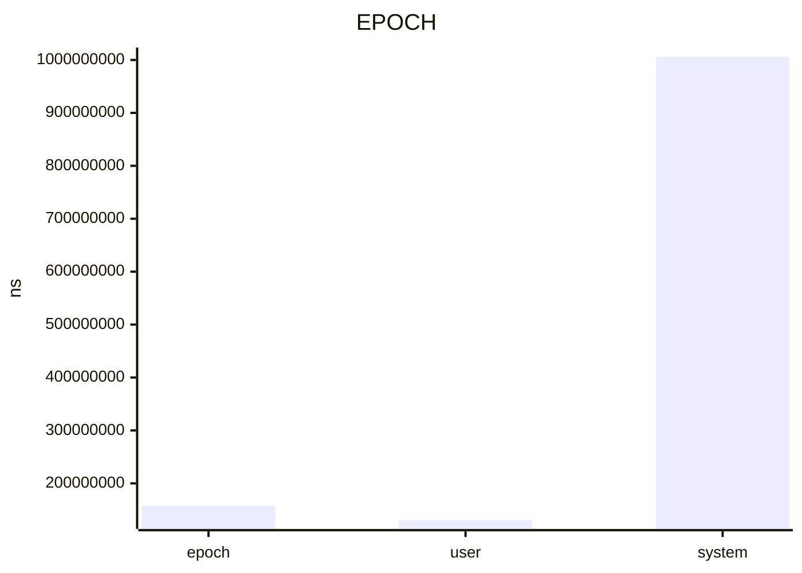

## epoch

+--------+-------+---------------------+--------------------+---------------------+---------------------+-------+------+--------------------------------------------------------------------------------------------------------------------------------+---------------------+---------------------+-----------------------+
| key    | type  | value               | errorPercent       | min                 | max                 | calls | unit | samples                                                                                                                        | baseline            | change              | probability           |
+========+=======+=====================+====================+=====================+=====================+=======+======+================================================================================================================================+=====================+=====================+=======================+
| epoch  | float | 1.579631666666667e8 | 0.4826019567852906 | 1.564958333333333e8 | 1.732227916666667e8 | 1     | ns   | 1.732227916666667e8, 1.594819166666667e8                                                                                       | 1.578792916666667e8 | 0.05312603009206359 | 0.2003806939066095    |
|        |       |                     |                    |                     |                     |       |      | , 1.58050625e8, 1.579631666666667e8, 1.5                                                                                       |                     |                     |                       |
|        |       |                     |                    |                     |                     |       |      | 71550416666667e8, 1.57250375e8, 1.564958                                                                                       |                     |                     |                       |
|        |       |                     |                    |                     |                     |       |      | 333333333e8, 1.574537916666667e8, 1.5793                                                                                       |                     |                     |                       |
|        |       |                     |                    |                     |                     |       |      | 92916666667e8, 1.608010833333333e8, 1.58                                                                                       |                     |                     |                       |
|        |       |                     |                    |                     |                     |       |      | 7255e8                                                                                                                         |                     |                     |                       |
+--------+-------+---------------------+--------------------+---------------------+---------------------+-------+------+--------------------------------------------------------------------------------------------------------------------------------+---------------------+---------------------+-----------------------+
| user   | float | 1.30769e8           | 0.3372358892398045 | 1.28905e8           | 1.37283e8           | 1     | ns   | 1.37283e8, 1.30328e8, 1.30907e8, 1.28905                                                                                       | 2.04815e8           | -36.15262554012158  | 0.01146807302223756   |
|        |       |                     |                    |                     |                     |       |      | e8, 1.29982e8, 1.30984e8, 1.30759e8, 1.3                                                                                       |                     |                     |                       |
|        |       |                     |                    |                     |                     |       |      | 0769e8, 1.32977e8, 1.33041e8, 1.30762e8                                                                                        |                     |                     |                       |
+--------+-------+---------------------+--------------------+---------------------+---------------------+-------+------+--------------------------------------------------------------------------------------------------------------------------------+---------------------+---------------------+-----------------------+
| system | float | 1.006295e9          | 0.4539424323881168 | 9.43697e8           | 1.031611e9          | 1     | ns   | 1.031611e9, 1.00822e9, 1.009933e9, 9.43697e8, 1.010863e9, 1.006295e9, 9.94059e8, 1.010973e9, 1.004211e9, 9.93441e8, 1.003042e9 | 8.55986e8           | 17.5597498089922    | 0.0009128869759883767 |
+--------+-------+---------------------+--------------------+---------------------+---------------------+-------+------+--------------------------------------------------------------------------------------------------------------------------------+---------------------+---------------------+-----------------------+

