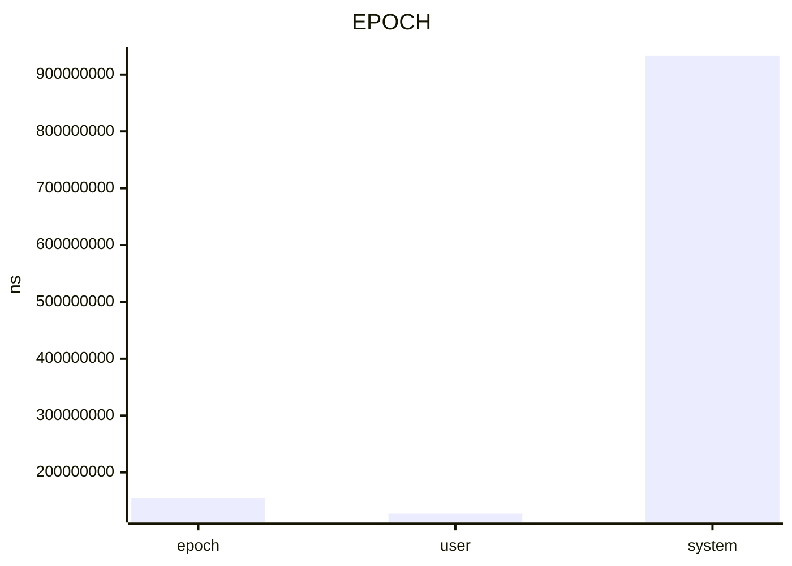

## epoch

+--------+-------+---------------------+--------------------+--------------+------------+-------+------+----------------------------------------------------------------------------------------------------------------------------------------------------------------------------------------------------------------------+---------------------+--------------------+-----------------------+
| key    | type  | value               | errorPercent       | min          | max        | calls | unit | samples                                                                                                                                                                                                              | baseline            | change             | probability           |
+========+=======+=====================+====================+==============+============+=======+======+======================================================================================================================================================================================================================+=====================+====================+=======================+
| epoch  | float | 1.558617083333333e8 | 0.276527188498584  | 1.53182875e8 | 3.67984e8  | 1     | ns   | 3.67984e8, 1.557178333333333e8, 1.561337083333333e8, 1.562609583333333e8, 1.534370416666667e8, 1.575229583333333e8, 1.562927083333333e8, 1.549557083333333e8, 1.556467916666667e8, 1.558617083333333e8, 1.53182875e8 | 1.578792916666667e8 | -1.27792778396367  | 0.8696032000169421    |
+--------+-------+---------------------+--------------------+--------------+------------+-------+------+----------------------------------------------------------------------------------------------------------------------------------------------------------------------------------------------------------------------+---------------------+--------------------+-----------------------+
| user   | float | 1.27458e8           | 0.3985626637794411 | 1.2695e8     | 1.44523e8  | 1     | ns   | 1.44523e8, 1.28747e8, 1.27458e8, 1.2695e                                                                                                                                                                             | 2.04815e8           | -37.76920635695627 | 0.01146807302223756   |
|        |       |                     |                    |              |            |       |      | 8, 1.2695e8, 1.29784e8, 1.27107e8, 1.285                                                                                                                                                                             |                     |                    |                       |
|        |       |                     |                    |              |            |       |      | 05e8, 1.27235e8, 1.27326e8, 1.27991e8                                                                                                                                                                                |                     |                    |                       |
+--------+-------+---------------------+--------------------+--------------+------------+-------+------+----------------------------------------------------------------------------------------------------------------------------------------------------------------------------------------------------------------------+---------------------+--------------------+-----------------------+
| system | float | 9.3279e8            | 0.6297237320297173 | 9.13711e8    | 1.052001e9 | 1     | ns   | 1.052001e9, 9.26916e8, 9.3279e8, 9.27865                                                                                                                                                                             | 8.55986e8           | 8.972576654291075  | 0.0009128869759883767 |
|        |       |                     |                    |              |            |       |      | e8, 9.155e8, 9.13711e8, 9.43904e8, 9.385                                                                                                                                                                             |                     |                    |                       |
|        |       |                     |                    |              |            |       |      | 63e8, 9.41368e8, 9.34999e8, 9.29672e8                                                                                                                                                                                |                     |                    |                       |
+--------+-------+---------------------+--------------------+--------------+------------+-------+------+----------------------------------------------------------------------------------------------------------------------------------------------------------------------------------------------------------------------+---------------------+--------------------+-----------------------+

