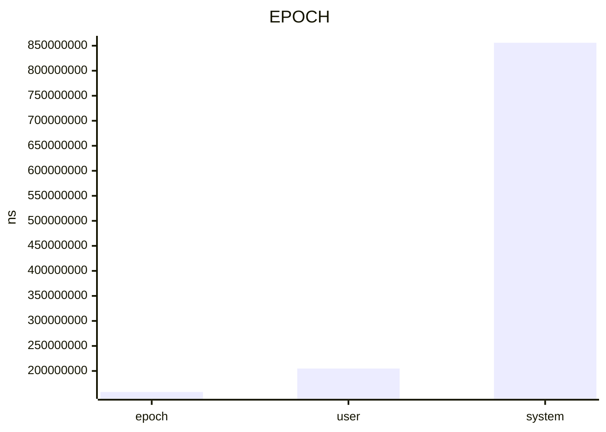

## epoch

+--------+-------+---------------------+--------------------+--------------+---------------------+-------+------+------------------------------------------+
| key    | type  | value               | errorPercent       | min          | max                 | calls | unit | samples                                  |
+========+=======+=====================+====================+==============+=====================+=======+======+==========================================+
| epoch  | float | 1.578792916666667e8 | 0.8853810519270718 | 1.55335625e8 | 5.420947083333333e8 | 1     | ns   | 5.420947083333333e8, 1.58716375e8, 1.586 |
|        |       |                     |                    |              |                     |       |      | 39625e8, 1.684345e8, 1.59277125e8, 1.558 |
|        |       |                     |                    |              |                     |       |      | 804583333333e8, 1.568768333333333e8, 1.5 |
|        |       |                     |                    |              |                     |       |      | 54337083333333e8, 1.55335625e8, 1.567847 |
|        |       |                     |                    |              |                     |       |      | 916666667e8, 1.578792916666667e8         |
+--------+-------+---------------------+--------------------+--------------+---------------------+-------+------+------------------------------------------+
| user   | float | 2.04815e8           | 2.816199985352635  | 1.9523e8     | 2.28373e8           | 1     | ns   | 2.28373e8, 1.96464e8, 2.10583e8, 2.11161 |
|        |       |                     |                    |              |                     |       |      | e8, 2.00553e8, 2.09903e8, 2.04815e8, 2.0 |
|        |       |                     |                    |              |                     |       |      | 0528e8, 1.9523e8, 2.05239e8, 1.98512e8   |
+--------+-------+---------------------+--------------------+--------------+---------------------+-------+------+------------------------------------------+
| system | float | 8.55986e8           | 1.873395125621213  | 8.1512e8     | 1.011981e9          | 1     | ns   | 1.011981e9, 8.1512e8, 8.83441e8, 8.55986 |
|        |       |                     |                    |              |                     |       |      | e8, 8.58526e8, 8.65126e8, 8.30787e8, 8.4 |
|        |       |                     |                    |              |                     |       |      | 4489e8, 8.19299e8, 8.66341e8, 8.3995e8   |
+--------+-------+---------------------+--------------------+--------------+---------------------+-------+------+------------------------------------------+

