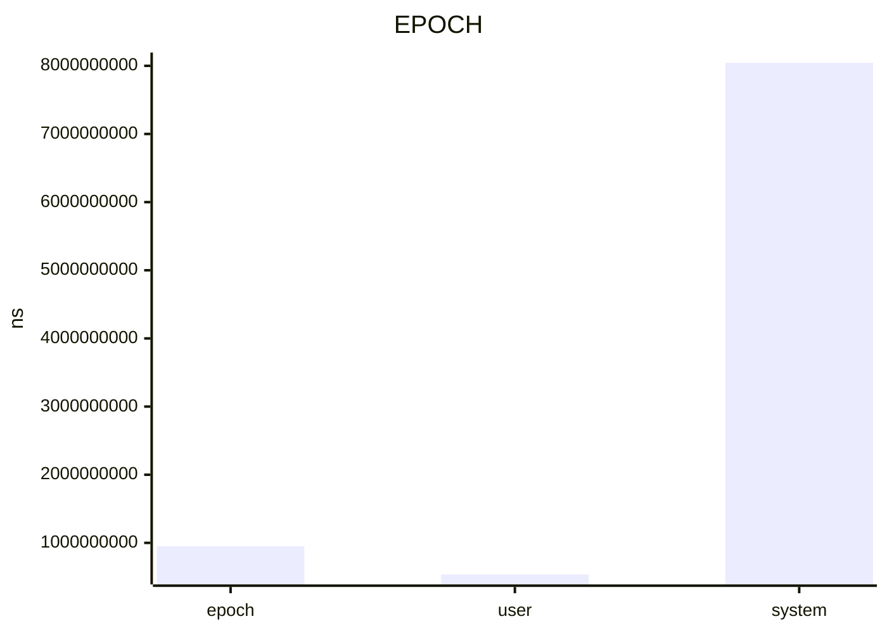

## epoch

+--------+-------+--------------+--------------------+------------+---------------+-------+------+------------------------------------------+---------------------+--------------------+----------------------+
| key    | type  | value        | errorPercent       | min        | max           | calls | unit | samples                                  | baseline            | change             | probability          |
+========+=======+==============+====================+============+===============+=======+======+==========================================+=====================+====================+======================+
| epoch  | float | 9.51528125e8 | 0.3476381741212326 | 9.468755e8 | 3.317558875e9 | 1     | ns   | 3.317558875e9, 1.472751125e9, 1.01835091 | 1.020536458333333e9 | -6.761966490254789 | 0.6223746993013363   |
|        |       |              |                    |            |               |       |      | 6666667e9, 9.797495833333333e8, 9.54836e |                     |                    |                      |
|        |       |              |                    |            |               |       |      | 8, 9.51528125e8, 9.494347083333334e8, 9. |                     |                    |                      |
|        |       |              |                    |            |               |       |      | 508884166666666e8, 9.468755e8, 9.5011225 |                     |                    |                      |
|        |       |              |                    |            |               |       |      | e8, 9.50312375e8                         |                     |                    |                      |
+--------+-------+--------------+--------------------+------------+---------------+-------+------+------------------------------------------+---------------------+--------------------+----------------------+
| user   | float | 5.36746e8    | 1.10201100706852   | 3.80791e8  | 5.47861e8     | 1     | ns   | 3.80791e8, 4.85671e8, 5.35947e8, 5.47128 | 5.15158e8           | 4.190559012963013  | 0.00281031991987513  |
|        |       |              |                    |            |               |       |      | e8, 5.36746e8, 5.33127e8, 5.42661e8, 5.4 |                     |                    |                      |
|        |       |              |                    |            |               |       |      | 7861e8, 5.3349e8, 5.37598e8, 5.43525e8   |                     |                    |                      |
+--------+-------+--------------+--------------------+------------+---------------+-------+------+------------------------------------------+---------------------+--------------------+----------------------+
| system | float | 8.047589e9   | 0.958436122918305  | 4.15587e9  | 8.184144e9    | 1     | ns   | 4.15587e9, 6.723776e9, 7.912536e9, 7.871 | 7.766844e9          | 3.614659957120293  | 0.004284372059255922 |
|        |       |              |                    |            |               |       |      | 344e9, 8.12472e9, 8.092323e9, 8.120885e9 |                     |                    |                      |
|        |       |              |                    |            |               |       |      | , 8.184144e9, 7.98791e9, 8.087969e9, 8.0 |                     |                    |                      |
|        |       |              |                    |            |               |       |      | 47589e9                                  |                     |                    |                      |
+--------+-------+--------------+--------------------+------------+---------------+-------+------+------------------------------------------+---------------------+--------------------+----------------------+

