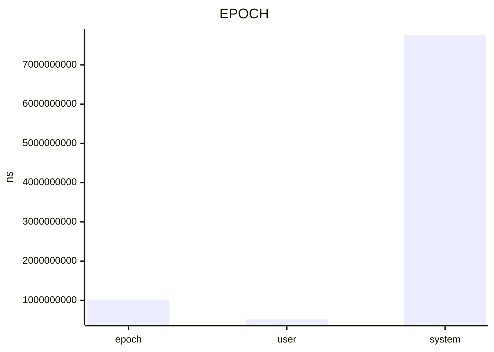

## epoch

+--------+-------+---------------------+-------------------+---------------------+---------------------+-------+------+------------------------------------------+
| key    | type  | value               | errorPercent      | min                 | max                 | calls | unit | samples                                  |
+========+=======+=====================+===================+=====================+=====================+=======+======+==========================================+
| epoch  | float | 1.020536458333333e9 | 5.353793705312267 | 9.539463333333334e8 | 2.711188083333333e9 | 1     | ns   | 2.711188083333333e9, 1.058011291666667e9 |
|        |       |                     |                   |                     |                     |       |      | , 9.58236125e8, 9.539463333333334e8, 9.6 |
|        |       |                     |                   |                     |                     |       |      | 2527125e8, 1.683753e9, 1.068365666666667 |
|        |       |                     |                   |                     |                     |       |      | e9, 9.961865e8, 1.020536458333333e9, 9.6 |
|        |       |                     |                   |                     |                     |       |      | 58990416666666e8, 1.058304666666667e9    |
+--------+-------+---------------------+-------------------+---------------------+---------------------+-------+------+------------------------------------------+
| user   | float | 5.15158e8           | 1.322506881383964 | 3.67335e8           | 5.25906e8           | 1     | ns   | 3.67335e8, 5.14886e8, 5.23921e8, 5.09758 |
|        |       |                     |                   |                     |                     |       |      | e8, 5.20758e8, 4.5238e8, 5.22806e8, 5.12 |
|        |       |                     |                   |                     |                     |       |      | 292e8, 5.21971e8, 5.25906e8, 5.15158e8   |
+--------+-------+---------------------+-------------------+---------------------+---------------------+-------+------+------------------------------------------+
| system | float | 7.766844e9          | 1.326278730459888 | 4.509676e9          | 8.008744e9          | 1     | ns   | 4.509676e9, 7.739827e9, 7.929639e9, 8.00 |
|        |       |                     |                   |                     |                     |       |      | 8744e9, 7.77448e9, 5.943389e9, 7.751369e |
|        |       |                     |                   |                     |                     |       |      | 9, 7.869854e9, 7.766844e9, 7.910668e9, 7 |
|        |       |                     |                   |                     |                     |       |      | .741932e9                                |
+--------+-------+---------------------+-------------------+---------------------+---------------------+-------+------+------------------------------------------+

