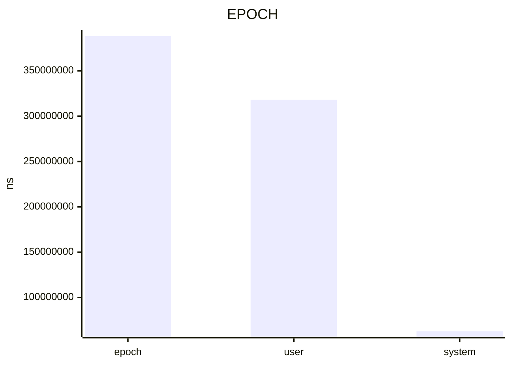

## epoch

+--------+-------+-------------+--------------------+---------------------+---------------------+-------+------+------------------------------------------------------------------------------------------------------------------------------------------------------------------------------------------------------------------------+---------------------+--------------------+---------------------+
| key    | type  | value       | errorPercent       | min                 | max                 | calls | unit | samples                                                                                                                                                                                                                | baseline            | change             | probability         |
+========+=======+=============+====================+=====================+=====================+=======+======+========================================================================================================================================================================================================================+=====================+====================+=====================+
| epoch  | float | 3.8833775e8 | 0.9520921757756781 | 3.809982916666666e8 | 4.476650833333333e8 | 1     | ns   | 4.476650833333333e8, 3.920350833333333e8, 3.888583333333333e8, 3.88523125e8, 3.809982916666666e8, 3.818834166666666e8, 3.811616666666667e8, 3.890835833333333e8, 3.828299166666667e8, 3.8833775e8, 3.858199166666666e8 | 4.173789166666666e8 | -6.957986018699626 | 0.4501604108868032  |
+--------+-------+-------------+--------------------+---------------------+---------------------+-------+------+------------------------------------------------------------------------------------------------------------------------------------------------------------------------------------------------------------------------+---------------------+--------------------+---------------------+
| user   | float | 3.18157e8   | 0.7964621240456755 | 3.14076e8           | 3.34837e8           | 1     | ns   | 3.34837e8, 3.19362e8, 3.18157e8, 3.18351                                                                                                                                                                               | 3.1625e8            | 0.6030039525691699 | 0.2003806939066095  |
|        |       |             |                    |                     |                     |       |      | e8, 3.14076e8, 3.1499e8, 3.14759e8, 3.20                                                                                                                                                                               |                     |                    |                     |
|        |       |             |                    |                     |                     |       |      | 897e8, 3.15623e8, 3.20547e8, 3.18145e8                                                                                                                                                                                 |                     |                    |                     |
+--------+-------+-------------+--------------------+---------------------+---------------------+-------+------+------------------------------------------------------------------------------------------------------------------------------------------------------------------------------------------------------------------------+---------------------+--------------------+---------------------+
| system | float | 6.2809e7    | 2.291072935407346  | 5.9756e7            | 9.8809e7            | 1     | ns   | 9.8809e7, 6.5324e7, 6.1958e7, 6.137e7, 6                                                                                                                                                                               | 9.1565e7            | -31.40501283241413 | 0.04520060374758589 |
|        |       |             |                    |                     |                     |       |      | .3698e7, 6.4134e7, 5.9756e7, 6.4781e7, 6                                                                                                                                                                               |                     |                    |                     |
|        |       |             |                    |                     |                     |       |      | .2809e7, 5.9797e7, 6.1448e7                                                                                                                                                                                            |                     |                    |                     |
+--------+-------+-------------+--------------------+---------------------+---------------------+-------+------+------------------------------------------------------------------------------------------------------------------------------------------------------------------------------------------------------------------------+---------------------+--------------------+---------------------+

