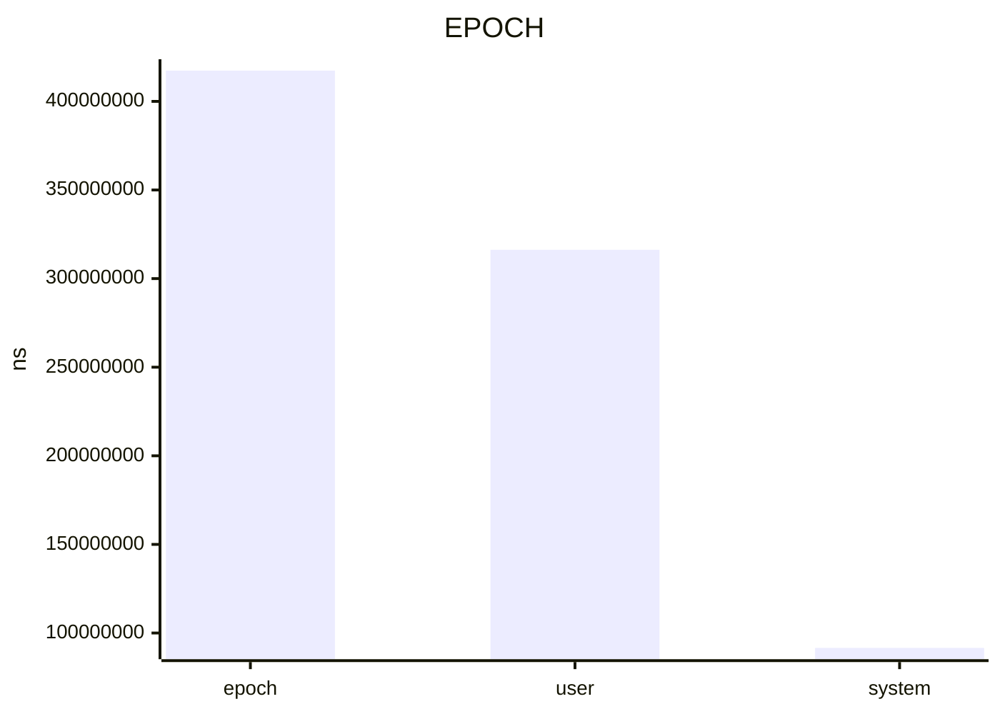

## epoch

+--------+-------+---------------------+--------------------+---------------------+---------------------+-------+------+------------------------------------------+
| key    | type  | value               | errorPercent       | min                 | max                 | calls | unit | samples                                  |
+========+=======+=====================+====================+=====================+=====================+=======+======+==========================================+
| epoch  | float | 4.173789166666666e8 | 1.974355037498904  | 3.959097083333333e8 | 6.888139166666667e8 | 1     | ns   | 6.888139166666667e8, 5.092931666666667e8 |
|        |       |                     |                    |                     |                     |       |      | , 4.280108333333333e8, 4.011725833333333 |
|        |       |                     |                    |                     |                     |       |      | e8, 3.959097083333333e8, 4.2480854166666 |
|        |       |                     |                    |                     |                     |       |      | 66e8, 4.098786666666667e8, 4.12233916666 |
|        |       |                     |                    |                     |                     |       |      | 6666e8, 4.173789166666666e8, 4.165416666 |
|        |       |                     |                    |                     |                     |       |      | 666666e8, 4.256194583333333e8            |
+--------+-------+---------------------+--------------------+---------------------+---------------------+-------+------+------------------------------------------+
| user   | float | 3.1625e8            | 0.6637154150197628 | 3.1212e8            | 3.91953e8           | 1     | ns   | 3.16507e8, 3.91953e8, 3.23918e8, 3.16413 |
|        |       |                     |                    |                     |                     |       |      | e8, 3.1212e8, 3.21902e8, 3.13414e8, 3.15 |
|        |       |                     |                    |                     |                     |       |      | 075e8, 3.1625e8, 3.14341e8, 3.14151e8    |
+--------+-------+---------------------+--------------------+---------------------+---------------------+-------+------+------------------------------------------+
| system | float | 9.1565e7            | 3.342980396439688  | 7.4948e7            | 1.07704e8           | 1     | ns   | 9.027e7, 8.6073e7, 9.5588e7, 7.6653e7, 7 |
|        |       |                     |                    |                     |                     |       |      | .4948e7, 9.2812e7, 9.1565e7, 8.8504e7, 9 |
|        |       |                     |                    |                     |                     |       |      | .2737e7, 9.3341e7, 1.07704e8             |
+--------+-------+---------------------+--------------------+---------------------+---------------------+-------+------+------------------------------------------+

