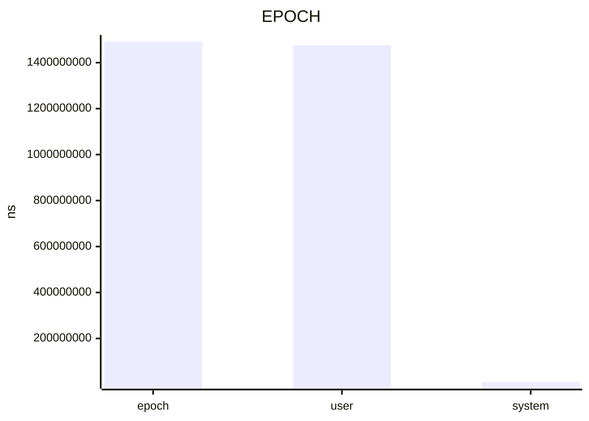

## epoch

+--------+-------+---------------------+--------------------+---------------------+---------------------+-------+------+------------------------------------------+
| key    | type  | value               | errorPercent       | min                 | max                 | calls | unit | samples                                  |
+========+=======+=====================+====================+=====================+=====================+=======+======+==========================================+
| epoch  | float | 1.491511208333333e9 | 0.1230128201349699 | 1.489676458333333e9 | 2.158555166666667e9 | 1     | ns   | 2.158555166666667e9, 1.489676458333333e9 |
|        |       |                     |                    |                     |                     |       |      | , 1.491511208333333e9                    |
+--------+-------+---------------------+--------------------+---------------------+---------------------+-------+------+------------------------------------------+
| user   | float | 1.476201e9          | 0.2043759623520103 | 1.473184e9          | 1.73136e9           | 1     | ns   | 1.73136e9, 1.473184e9, 1.476201e9        |
+--------+-------+---------------------+--------------------+---------------------+---------------------+-------+------+------------------------------------------+
| system | float | 1.035e7             | 2.647342995169082  | 1.0076e7            | 2.4262e7            | 1     | ns   | 2.4262e7, 1.035e7, 1.0076e7              |
+--------+-------+---------------------+--------------------+---------------------+---------------------+-------+------+------------------------------------------+

## sample

+----------------------------------------------------------------------------------------------------------------------------------------------------------------------------------------------------------------------------------------------------------------------------------------------------------------------------------------------------------------------------------------------------------------------------------------------------------------------------------------------------------------------------------------------------------------------------------------------------------------------------------------------------------------------------------------------------------------------------------------------------------------------------------------------------------------------------------------------------------------------------------------------------------------------------------------------------------------------------------------------------------------------------------------------------------------------------------------------------------------------------------------------------------------------------------------------------------------------------------------------------------------------------------------------------------------------------------------------------------------------------------------------------------------------------------------------------------------------------------------------------------------------------------------------------------------------------------------------------------------------------------------------------------------------------------------------------------------------------------------------------------------------------------------------------------------------------------------------------------------------------------------------------------------------------------------------------------------------------------------------------------------------------------------------------------------------------------------------------------------------------------------------------------------------------------------------------------------------------------------------------------------------------------------------------------------------------------------------------------------------------------------------------------------------------------------------------------------------------------------------------------------------------------------------------------------------------------------------------------------------------------------------------------------------------------------------------------------------------------------------------------------------------------------------------------------------------------------------------------------------------------------------------------------------------------------------------------------------------------------------------------------------------------------------------------------------------------------------------+-------+--------+--------------------+--------+--------+-------+-------+------------------+
| key                                                                                                                                                                                                                                                                                                                                                                                                                                                                                                                                                                                                                                                                                                                                                                                                                                                                                                                                                                                                                                                                                                                                                                                                                                                                                                                                                                                                                                                                                                                                                                                                                                                                                                                                                                                                                                                                                                                                                                                                                                                                                                                                                                                                                                                                                                                                                                                                                                                                                                                                                                                                                                                                                                                                                                                                                                                                                                                                                                                                                                                                                                | type  | value  | errorPercent       | min    | max    | calls | unit  | samples          |
+====================================================================================================================================================================================================================================================================================================================================================================================================================================================================================================================================================================================================================================================================================================================================================================================================================================================================================================================================================================================================================================================================================================================================================================================================================================================================================================================================================================================================================================================================================================================================================================================================================================================================================================================================================================================================================================================================================================================================================================================================================================================================================================================================================================================================================================================================================================================================================================================================================================================================================================================================================================================================================================================================================================================================================================================================================================================================================================================================================================================================================================================================================================+=======+========+====================+========+========+=======+=======+==================+
| NS concrete global block                                                                                                                                                                                                                                                                                                                                                                                                                                                                                                                                                                                                                                                                                                                                                                                                                                                                                                                                                                                                                                                                                                                                                                                                                                                                                                                                                                                                                                                                                                                                                                                                                                                                                                                                                                                                                                                                                                                                                                                                                                                                                                                                                                                                                                                                                                                                                                                                                                                                                                                                                                                                                                                                                                                                                                                                                                                                                                                                                                                                                                                                           | float | 10.0   | 20.0               | 8.0    | 18.0   | 1     | count | 18, 8, 10        |
+----------------------------------------------------------------------------------------------------------------------------------------------------------------------------------------------------------------------------------------------------------------------------------------------------------------------------------------------------------------------------------------------------------------------------------------------------------------------------------------------------------------------------------------------------------------------------------------------------------------------------------------------------------------------------------------------------------------------------------------------------------------------------------------------------------------------------------------------------------------------------------------------------------------------------------------------------------------------------------------------------------------------------------------------------------------------------------------------------------------------------------------------------------------------------------------------------------------------------------------------------------------------------------------------------------------------------------------------------------------------------------------------------------------------------------------------------------------------------------------------------------------------------------------------------------------------------------------------------------------------------------------------------------------------------------------------------------------------------------------------------------------------------------------------------------------------------------------------------------------------------------------------------------------------------------------------------------------------------------------------------------------------------------------------------------------------------------------------------------------------------------------------------------------------------------------------------------------------------------------------------------------------------------------------------------------------------------------------------------------------------------------------------------------------------------------------------------------------------------------------------------------------------------------------------------------------------------------------------------------------------------------------------------------------------------------------------------------------------------------------------------------------------------------------------------------------------------------------------------------------------------------------------------------------------------------------------------------------------------------------------------------------------------------------------------------------------------------------------+-------+--------+--------------------+--------+--------+-------+-------+------------------+
| mh execute header                                                                                                                                                                                                                                                                                                                                                                                                                                                                                                                                                                                                                                                                                                                                                                                                                                                                                                                                                                                                                                                                                                                                                                                                                                                                                                                                                                                                                                                                                                                                                                                                                                                                                                                                                                                                                                                                                                                                                                                                                                                                                                                                                                                                                                                                                                                                                                                                                                                                                                                                                                                                                                                                                                                                                                                                                                                                                                                                                                                                                                                                                  | float | 4.0    | 0.0                | 4.0    | 8.0    | 1     | count | 8, 4, 4          |
+----------------------------------------------------------------------------------------------------------------------------------------------------------------------------------------------------------------------------------------------------------------------------------------------------------------------------------------------------------------------------------------------------------------------------------------------------------------------------------------------------------------------------------------------------------------------------------------------------------------------------------------------------------------------------------------------------------------------------------------------------------------------------------------------------------------------------------------------------------------------------------------------------------------------------------------------------------------------------------------------------------------------------------------------------------------------------------------------------------------------------------------------------------------------------------------------------------------------------------------------------------------------------------------------------------------------------------------------------------------------------------------------------------------------------------------------------------------------------------------------------------------------------------------------------------------------------------------------------------------------------------------------------------------------------------------------------------------------------------------------------------------------------------------------------------------------------------------------------------------------------------------------------------------------------------------------------------------------------------------------------------------------------------------------------------------------------------------------------------------------------------------------------------------------------------------------------------------------------------------------------------------------------------------------------------------------------------------------------------------------------------------------------------------------------------------------------------------------------------------------------------------------------------------------------------------------------------------------------------------------------------------------------------------------------------------------------------------------------------------------------------------------------------------------------------------------------------------------------------------------------------------------------------------------------------------------------------------------------------------------------------------------------------------------------------------------------------------------------+-------+--------+--------------------+--------+--------+-------+-------+------------------+
| lsl::s pool bytes                                                                                                                                                                                                                                                                                                                                                                                                                                                                                                                                                                                                                                                                                                                                                                                                                                                                                                                                                                                                                                                                                                                                                                                                                                                                                                                                                                                                                                                                                                                                                                                                                                                                                                                                                                                                                                                                                                                                                                                                                                                                                                                                                                                                                                                                                                                                                                                                                                                                                                                                                                                                                                                                                                                                                                                                                                                                                                                                                                                                                                                                                  | float | 2.0    | 0.0                | 1.0    | 2.0    | 1     | count | 2, 1, 2          |
+----------------------------------------------------------------------------------------------------------------------------------------------------------------------------------------------------------------------------------------------------------------------------------------------------------------------------------------------------------------------------------------------------------------------------------------------------------------------------------------------------------------------------------------------------------------------------------------------------------------------------------------------------------------------------------------------------------------------------------------------------------------------------------------------------------------------------------------------------------------------------------------------------------------------------------------------------------------------------------------------------------------------------------------------------------------------------------------------------------------------------------------------------------------------------------------------------------------------------------------------------------------------------------------------------------------------------------------------------------------------------------------------------------------------------------------------------------------------------------------------------------------------------------------------------------------------------------------------------------------------------------------------------------------------------------------------------------------------------------------------------------------------------------------------------------------------------------------------------------------------------------------------------------------------------------------------------------------------------------------------------------------------------------------------------------------------------------------------------------------------------------------------------------------------------------------------------------------------------------------------------------------------------------------------------------------------------------------------------------------------------------------------------------------------------------------------------------------------------------------------------------------------------------------------------------------------------------------------------------------------------------------------------------------------------------------------------------------------------------------------------------------------------------------------------------------------------------------------------------------------------------------------------------------------------------------------------------------------------------------------------------------------------------------------------------------------------------------------------+-------+--------+--------------------+--------+--------+-------+-------+------------------+
| id::row                                                                                                                                                                                                                                                                                                                                                                                                                                                                                                                                                                                                                                                                                                                                                                                                                                                                                                                                                                                                                                                                                                                                                                                                                                                                                                                                                                                                                                                                                                                                                                                                                                                                                                                                                                                                                                                                                                                                                                                                                                                                                                                                                                                                                                                                                                                                                                                                                                                                                                                                                                                                                                                                                                                                                                                                                                                                                                                                                                                                                                                                                            | float | 1482.0 | 0.6072874493927125 | 1473.0 | 1741.0 | 1     | count | 1741, 1473, 1482 |
+----------------------------------------------------------------------------------------------------------------------------------------------------------------------------------------------------------------------------------------------------------------------------------------------------------------------------------------------------------------------------------------------------------------------------------------------------------------------------------------------------------------------------------------------------------------------------------------------------------------------------------------------------------------------------------------------------------------------------------------------------------------------------------------------------------------------------------------------------------------------------------------------------------------------------------------------------------------------------------------------------------------------------------------------------------------------------------------------------------------------------------------------------------------------------------------------------------------------------------------------------------------------------------------------------------------------------------------------------------------------------------------------------------------------------------------------------------------------------------------------------------------------------------------------------------------------------------------------------------------------------------------------------------------------------------------------------------------------------------------------------------------------------------------------------------------------------------------------------------------------------------------------------------------------------------------------------------------------------------------------------------------------------------------------------------------------------------------------------------------------------------------------------------------------------------------------------------------------------------------------------------------------------------------------------------------------------------------------------------------------------------------------------------------------------------------------------------------------------------------------------------------------------------------------------------------------------------------------------------------------------------------------------------------------------------------------------------------------------------------------------------------------------------------------------------------------------------------------------------------------------------------------------------------------------------------------------------------------------------------------------------------------------------------------------------------------------------------------------+-------+--------+--------------------+--------+--------+-------+-------+------------------+
| GLOBAL sub I jam model context protocol cpp                                                                                                                                                                                                                                                                                                                                                                                                                                                                                                                                                                                                                                                                                                                                                                                                                                                                                                                                                                                                                                                                                                                                                                                                                                                                                                                                                                                                                                                                                                                                                                                                                                                                                                                                                                                                                                                                                                                                                                                                                                                                                                                                                                                                                                                                                                                                                                                                                                                                                                                                                                                                                                                                                                                                                                                                                                                                                                                                                                                                                                                        | float | 1.0    | 0.0                | 0.0    | 1.0    | 1     | count | 1, 0, 1          |
+----------------------------------------------------------------------------------------------------------------------------------------------------------------------------------------------------------------------------------------------------------------------------------------------------------------------------------------------------------------------------------------------------------------------------------------------------------------------------------------------------------------------------------------------------------------------------------------------------------------------------------------------------------------------------------------------------------------------------------------------------------------------------------------------------------------------------------------------------------------------------------------------------------------------------------------------------------------------------------------------------------------------------------------------------------------------------------------------------------------------------------------------------------------------------------------------------------------------------------------------------------------------------------------------------------------------------------------------------------------------------------------------------------------------------------------------------------------------------------------------------------------------------------------------------------------------------------------------------------------------------------------------------------------------------------------------------------------------------------------------------------------------------------------------------------------------------------------------------------------------------------------------------------------------------------------------------------------------------------------------------------------------------------------------------------------------------------------------------------------------------------------------------------------------------------------------------------------------------------------------------------------------------------------------------------------------------------------------------------------------------------------------------------------------------------------------------------------------------------------------------------------------------------------------------------------------------------------------------------------------------------------------------------------------------------------------------------------------------------------------------------------------------------------------------------------------------------------------------------------------------------------------------------------------------------------------------------------------------------------------------------------------------------------------------------------------------------------------------+-------+--------+--------------------+--------+--------+-------+-------+------------------+
| jam:: array jam:: document:: token juce:: dummy critical section jam:: document:: element::add jam:: array jam:: document:: token juce:: dummy critical section                                                                                                                                                                                                                                                                                                                                                                                                                                                                                                                                                                                                                                                                                                                                                                                                                                                                                                                                                                                                                                                                                                                                                                                                                                                                                                                                                                                                                                                                                                                                                                                                                                                                                                                                                                                                                                                                                                                                                                                                                                                                                                                                                                                                                                                                                                                                                                                                                                                                                                                                                                                                                                                                                                                                                                                                                                                                                                                                    | float | 3.0    | 0.0                | 0.0    | 3.0    | 1     | count | 3, 3, 0          |
+----------------------------------------------------------------------------------------------------------------------------------------------------------------------------------------------------------------------------------------------------------------------------------------------------------------------------------------------------------------------------------------------------------------------------------------------------------------------------------------------------------------------------------------------------------------------------------------------------------------------------------------------------------------------------------------------------------------------------------------------------------------------------------------------------------------------------------------------------------------------------------------------------------------------------------------------------------------------------------------------------------------------------------------------------------------------------------------------------------------------------------------------------------------------------------------------------------------------------------------------------------------------------------------------------------------------------------------------------------------------------------------------------------------------------------------------------------------------------------------------------------------------------------------------------------------------------------------------------------------------------------------------------------------------------------------------------------------------------------------------------------------------------------------------------------------------------------------------------------------------------------------------------------------------------------------------------------------------------------------------------------------------------------------------------------------------------------------------------------------------------------------------------------------------------------------------------------------------------------------------------------------------------------------------------------------------------------------------------------------------------------------------------------------------------------------------------------------------------------------------------------------------------------------------------------------------------------------------------------------------------------------------------------------------------------------------------------------------------------------------------------------------------------------------------------------------------------------------------------------------------------------------------------------------------------------------------------------------------------------------------------------------------------------------------------------------------------------------------+-------+--------+--------------------+--------+--------+-------+-------+------------------+
| jam:: json document::parse call                                                                                                                                                                                                                                                                                                                                                                                                                                                                                                                                                                                                                                                                                                                                                                                                                                                                                                                                                                                                                                                                                                                                                                                                                                                                                                                                                                                                                                                                                                                                                                                                                                                                                                                                                                                                                                                                                                                                                                                                                                                                                                                                                                                                                                                                                                                                                                                                                                                                                                                                                                                                                                                                                                                                                                                                                                                                                                                                                                                                                                                                    | float | 1.0    | 0.0                | 1.0    | 1.0    | 1     | count | 1, 1, 1          |
+----------------------------------------------------------------------------------------------------------------------------------------------------------------------------------------------------------------------------------------------------------------------------------------------------------------------------------------------------------------------------------------------------------------------------------------------------------------------------------------------------------------------------------------------------------------------------------------------------------------------------------------------------------------------------------------------------------------------------------------------------------------------------------------------------------------------------------------------------------------------------------------------------------------------------------------------------------------------------------------------------------------------------------------------------------------------------------------------------------------------------------------------------------------------------------------------------------------------------------------------------------------------------------------------------------------------------------------------------------------------------------------------------------------------------------------------------------------------------------------------------------------------------------------------------------------------------------------------------------------------------------------------------------------------------------------------------------------------------------------------------------------------------------------------------------------------------------------------------------------------------------------------------------------------------------------------------------------------------------------------------------------------------------------------------------------------------------------------------------------------------------------------------------------------------------------------------------------------------------------------------------------------------------------------------------------------------------------------------------------------------------------------------------------------------------------------------------------------------------------------------------------------------------------------------------------------------------------------------------------------------------------------------------------------------------------------------------------------------------------------------------------------------------------------------------------------------------------------------------------------------------------------------------------------------------------------------------------------------------------------------------------------------------------------------------------------------------------------------+-------+--------+--------------------+--------+--------+-------+-------+------------------+
| jam:: json document::parse unary                                                                                                                                                                                                                                                                                                                                                                                                                                                                                                                                                                                                                                                                                                                                                                                                                                                                                                                                                                                                                                                                                                                                                                                                                                                                                                                                                                                                                                                                                                                                                                                                                                                                                                                                                                                                                                                                                                                                                                                                                                                                                                                                                                                                                                                                                                                                                                                                                                                                                                                                                                                                                                                                                                                                                                                                                                                                                                                                                                                                                                                                   | float | 1.0    | 0.0                | 1.0    | 1.0    | 1     | count | 1, 1, 1          |
+----------------------------------------------------------------------------------------------------------------------------------------------------------------------------------------------------------------------------------------------------------------------------------------------------------------------------------------------------------------------------------------------------------------------------------------------------------------------------------------------------------------------------------------------------------------------------------------------------------------------------------------------------------------------------------------------------------------------------------------------------------------------------------------------------------------------------------------------------------------------------------------------------------------------------------------------------------------------------------------------------------------------------------------------------------------------------------------------------------------------------------------------------------------------------------------------------------------------------------------------------------------------------------------------------------------------------------------------------------------------------------------------------------------------------------------------------------------------------------------------------------------------------------------------------------------------------------------------------------------------------------------------------------------------------------------------------------------------------------------------------------------------------------------------------------------------------------------------------------------------------------------------------------------------------------------------------------------------------------------------------------------------------------------------------------------------------------------------------------------------------------------------------------------------------------------------------------------------------------------------------------------------------------------------------------------------------------------------------------------------------------------------------------------------------------------------------------------------------------------------------------------------------------------------------------------------------------------------------------------------------------------------------------------------------------------------------------------------------------------------------------------------------------------------------------------------------------------------------------------------------------------------------------------------------------------------------------------------------------------------------------------------------------------------------------------------------------------------------+-------+--------+--------------------+--------+--------+-------+-------+------------------+
| jam:: json document::parse expression                                                                                                                                                                                                                                                                                                                                                                                                                                                                                                                                                                                                                                                                                                                                                                                                                                                                                                                                                                                                                                                                                                                                                                                                                                                                                                                                                                                                                                                                                                                                                                                                                                                                                                                                                                                                                                                                                                                                                                                                                                                                                                                                                                                                                                                                                                                                                                                                                                                                                                                                                                                                                                                                                                                                                                                                                                                                                                                                                                                                                                                              | float | 1.0    | 0.0                | 1.0    | 1.0    | 1     | count | 1, 1, 1          |
+----------------------------------------------------------------------------------------------------------------------------------------------------------------------------------------------------------------------------------------------------------------------------------------------------------------------------------------------------------------------------------------------------------------------------------------------------------------------------------------------------------------------------------------------------------------------------------------------------------------------------------------------------------------------------------------------------------------------------------------------------------------------------------------------------------------------------------------------------------------------------------------------------------------------------------------------------------------------------------------------------------------------------------------------------------------------------------------------------------------------------------------------------------------------------------------------------------------------------------------------------------------------------------------------------------------------------------------------------------------------------------------------------------------------------------------------------------------------------------------------------------------------------------------------------------------------------------------------------------------------------------------------------------------------------------------------------------------------------------------------------------------------------------------------------------------------------------------------------------------------------------------------------------------------------------------------------------------------------------------------------------------------------------------------------------------------------------------------------------------------------------------------------------------------------------------------------------------------------------------------------------------------------------------------------------------------------------------------------------------------------------------------------------------------------------------------------------------------------------------------------------------------------------------------------------------------------------------------------------------------------------------------------------------------------------------------------------------------------------------------------------------------------------------------------------------------------------------------------------------------------------------------------------------------------------------------------------------------------------------------------------------------------------------------------------------------------------------------------+-------+--------+--------------------+--------+--------+-------+-------+------------------+
| jam:: json document::parse definition                                                                                                                                                                                                                                                                                                                                                                                                                                                                                                                                                                                                                                                                                                                                                                                                                                                                                                                                                                                                                                                                                                                                                                                                                                                                                                                                                                                                                                                                                                                                                                                                                                                                                                                                                                                                                                                                                                                                                                                                                                                                                                                                                                                                                                                                                                                                                                                                                                                                                                                                                                                                                                                                                                                                                                                                                                                                                                                                                                                                                                                              | float | 1.0    | 0.0                | 1.0    | 1.0    | 1     | count | 1, 1, 1          |
+----------------------------------------------------------------------------------------------------------------------------------------------------------------------------------------------------------------------------------------------------------------------------------------------------------------------------------------------------------------------------------------------------------------------------------------------------------------------------------------------------------------------------------------------------------------------------------------------------------------------------------------------------------------------------------------------------------------------------------------------------------------------------------------------------------------------------------------------------------------------------------------------------------------------------------------------------------------------------------------------------------------------------------------------------------------------------------------------------------------------------------------------------------------------------------------------------------------------------------------------------------------------------------------------------------------------------------------------------------------------------------------------------------------------------------------------------------------------------------------------------------------------------------------------------------------------------------------------------------------------------------------------------------------------------------------------------------------------------------------------------------------------------------------------------------------------------------------------------------------------------------------------------------------------------------------------------------------------------------------------------------------------------------------------------------------------------------------------------------------------------------------------------------------------------------------------------------------------------------------------------------------------------------------------------------------------------------------------------------------------------------------------------------------------------------------------------------------------------------------------------------------------------------------------------------------------------------------------------------------------------------------------------------------------------------------------------------------------------------------------------------------------------------------------------------------------------------------------------------------------------------------------------------------------------------------------------------------------------------------------------------------------------------------------------------------------------------------------------+-------+--------+--------------------+--------+--------+-------+-------+------------------+
| jam:: json document::build                                                                                                                                                                                                                                                                                                                                                                                                                                                                                                                                                                                                                                                                                                                                                                                                                                                                                                                                                                                                                                                                                                                                                                                                                                                                                                                                                                                                                                                                                                                                                                                                                                                                                                                                                                                                                                                                                                                                                                                                                                                                                                                                                                                                                                                                                                                                                                                                                                                                                                                                                                                                                                                                                                                                                                                                                                                                                                                                                                                                                                                                         | float | 1.0    | 0.0                | 1.0    | 1.0    | 1     | count | 1, 1, 1          |
+----------------------------------------------------------------------------------------------------------------------------------------------------------------------------------------------------------------------------------------------------------------------------------------------------------------------------------------------------------------------------------------------------------------------------------------------------------------------------------------------------------------------------------------------------------------------------------------------------------------------------------------------------------------------------------------------------------------------------------------------------------------------------------------------------------------------------------------------------------------------------------------------------------------------------------------------------------------------------------------------------------------------------------------------------------------------------------------------------------------------------------------------------------------------------------------------------------------------------------------------------------------------------------------------------------------------------------------------------------------------------------------------------------------------------------------------------------------------------------------------------------------------------------------------------------------------------------------------------------------------------------------------------------------------------------------------------------------------------------------------------------------------------------------------------------------------------------------------------------------------------------------------------------------------------------------------------------------------------------------------------------------------------------------------------------------------------------------------------------------------------------------------------------------------------------------------------------------------------------------------------------------------------------------------------------------------------------------------------------------------------------------------------------------------------------------------------------------------------------------------------------------------------------------------------------------------------------------------------------------------------------------------------------------------------------------------------------------------------------------------------------------------------------------------------------------------------------------------------------------------------------------------------------------------------------------------------------------------------------------------------------------------------------------------------------------------------------------------------+-------+--------+--------------------+--------+--------+-------+-------+------------------+
| jam:: document::parse                                                                                                                                                                                                                                                                                                                                                                                                                                                                                                                                                                                                                                                                                                                                                                                                                                                                                                                                                                                                                                                                                                                                                                                                                                                                                                                                                                                                                                                                                                                                                                                                                                                                                                                                                                                                                                                                                                                                                                                                                                                                                                                                                                                                                                                                                                                                                                                                                                                                                                                                                                                                                                                                                                                                                                                                                                                                                                                                                                                                                                                                              | float | 1.0    | 0.0                | 1.0    | 1.0    | 1     | count | 1, 1, 1          |
+----------------------------------------------------------------------------------------------------------------------------------------------------------------------------------------------------------------------------------------------------------------------------------------------------------------------------------------------------------------------------------------------------------------------------------------------------------------------------------------------------------------------------------------------------------------------------------------------------------------------------------------------------------------------------------------------------------------------------------------------------------------------------------------------------------------------------------------------------------------------------------------------------------------------------------------------------------------------------------------------------------------------------------------------------------------------------------------------------------------------------------------------------------------------------------------------------------------------------------------------------------------------------------------------------------------------------------------------------------------------------------------------------------------------------------------------------------------------------------------------------------------------------------------------------------------------------------------------------------------------------------------------------------------------------------------------------------------------------------------------------------------------------------------------------------------------------------------------------------------------------------------------------------------------------------------------------------------------------------------------------------------------------------------------------------------------------------------------------------------------------------------------------------------------------------------------------------------------------------------------------------------------------------------------------------------------------------------------------------------------------------------------------------------------------------------------------------------------------------------------------------------------------------------------------------------------------------------------------------------------------------------------------------------------------------------------------------------------------------------------------------------------------------------------------------------------------------------------------------------------------------------------------------------------------------------------------------------------------------------------------------------------------------------------------------------------------------------------------+-------+--------+--------------------+--------+--------+-------+-------+------------------+
| jam:: json document::get definitions :: 0::operator                                                                                                                                                                                                                                                                                                                                                                                                                                                                                                                                                                                                                                                                                                                                                                                                                                                                                                                                                                                                                                                                                                                                                                                                                                                                                                                                                                                                                                                                                                                                                                                                                                                                                                                                                                                                                                                                                                                                                                                                                                                                                                                                                                                                                                                                                                                                                                                                                                                                                                                                                                                                                                                                                                                                                                                                                                                                                                                                                                                                                                                | float | 1.0    | 0.0                | 1.0    | 1.0    | 1     | count | 1, 1, 1          |
+----------------------------------------------------------------------------------------------------------------------------------------------------------------------------------------------------------------------------------------------------------------------------------------------------------------------------------------------------------------------------------------------------------------------------------------------------------------------------------------------------------------------------------------------------------------------------------------------------------------------------------------------------------------------------------------------------------------------------------------------------------------------------------------------------------------------------------------------------------------------------------------------------------------------------------------------------------------------------------------------------------------------------------------------------------------------------------------------------------------------------------------------------------------------------------------------------------------------------------------------------------------------------------------------------------------------------------------------------------------------------------------------------------------------------------------------------------------------------------------------------------------------------------------------------------------------------------------------------------------------------------------------------------------------------------------------------------------------------------------------------------------------------------------------------------------------------------------------------------------------------------------------------------------------------------------------------------------------------------------------------------------------------------------------------------------------------------------------------------------------------------------------------------------------------------------------------------------------------------------------------------------------------------------------------------------------------------------------------------------------------------------------------------------------------------------------------------------------------------------------------------------------------------------------------------------------------------------------------------------------------------------------------------------------------------------------------------------------------------------------------------------------------------------------------------------------------------------------------------------------------------------------------------------------------------------------------------------------------------------------------------------------------------------------------------------------------------------------------+-------+--------+--------------------+--------+--------+-------+-------+------------------+
| jam:: json document::add builtin links                                                                                                                                                                                                                                                                                                                                                                                                                                                                                                                                                                                                                                                                                                                                                                                                                                                                                                                                                                                                                                                                                                                                                                                                                                                                                                                                                                                                                                                                                                                                                                                                                                                                                                                                                                                                                                                                                                                                                                                                                                                                                                                                                                                                                                                                                                                                                                                                                                                                                                                                                                                                                                                                                                                                                                                                                                                                                                                                                                                                                                                             | float | 1.0    | 0.0                | 1.0    | 1.0    | 1     | count | 1, 1, 1          |
+----------------------------------------------------------------------------------------------------------------------------------------------------------------------------------------------------------------------------------------------------------------------------------------------------------------------------------------------------------------------------------------------------------------------------------------------------------------------------------------------------------------------------------------------------------------------------------------------------------------------------------------------------------------------------------------------------------------------------------------------------------------------------------------------------------------------------------------------------------------------------------------------------------------------------------------------------------------------------------------------------------------------------------------------------------------------------------------------------------------------------------------------------------------------------------------------------------------------------------------------------------------------------------------------------------------------------------------------------------------------------------------------------------------------------------------------------------------------------------------------------------------------------------------------------------------------------------------------------------------------------------------------------------------------------------------------------------------------------------------------------------------------------------------------------------------------------------------------------------------------------------------------------------------------------------------------------------------------------------------------------------------------------------------------------------------------------------------------------------------------------------------------------------------------------------------------------------------------------------------------------------------------------------------------------------------------------------------------------------------------------------------------------------------------------------------------------------------------------------------------------------------------------------------------------------------------------------------------------------------------------------------------------------------------------------------------------------------------------------------------------------------------------------------------------------------------------------------------------------------------------------------------------------------------------------------------------------------------------------------------------------------------------------------------------------------------------------------------------+-------+--------+--------------------+--------+--------+-------+-------+------------------+
| jam:: json document::read filter std:: 1::basic string view char std:: 1::char traits char jam:: strings const std:: 1::function std:: 1::optional juce:: file                                                                                                                                                                                                                                                                                                                                                                                                                                                                                                                                                                                                                                                                                                                                                                                                                                                                                                                                                                                                                                                                                                                                                                                                                                                                                                                                                                                                                                                                                                                                                                                                                                                                                                                                                                                                                                                                                                                                                                                                                                                                                                                                                                                                                                                                                                                                                                                                                                                                                                                                                                                                                                                                                                                                                                                                                                                                                                                                     | float | 1.0    | 0.0                | 1.0    | 1.0    | 1     | count | 1, 1, 1          |
+----------------------------------------------------------------------------------------------------------------------------------------------------------------------------------------------------------------------------------------------------------------------------------------------------------------------------------------------------------------------------------------------------------------------------------------------------------------------------------------------------------------------------------------------------------------------------------------------------------------------------------------------------------------------------------------------------------------------------------------------------------------------------------------------------------------------------------------------------------------------------------------------------------------------------------------------------------------------------------------------------------------------------------------------------------------------------------------------------------------------------------------------------------------------------------------------------------------------------------------------------------------------------------------------------------------------------------------------------------------------------------------------------------------------------------------------------------------------------------------------------------------------------------------------------------------------------------------------------------------------------------------------------------------------------------------------------------------------------------------------------------------------------------------------------------------------------------------------------------------------------------------------------------------------------------------------------------------------------------------------------------------------------------------------------------------------------------------------------------------------------------------------------------------------------------------------------------------------------------------------------------------------------------------------------------------------------------------------------------------------------------------------------------------------------------------------------------------------------------------------------------------------------------------------------------------------------------------------------------------------------------------------------------------------------------------------------------------------------------------------------------------------------------------------------------------------------------------------------------------------------------------------------------------------------------------------------------------------------------------------------------------------------------------------------------------------------------------------------+-------+--------+--------------------+--------+--------+-------+-------+------------------+
| run filter                                                                                                                                                                                                                                                                                                                                                                                                                                                                                                                                                                                                                                                                                                                                                                                                                                                                                                                                                                                                                                                                                                                                                                                                                                                                                                                                                                                                                                                                                                                                                                                                                                                                                                                                                                                                                                                                                                                                                                                                                                                                                                                                                                                                                                                                                                                                                                                                                                                                                                                                                                                                                                                                                                                                                                                                                                                                                                                                                                                                                                                                                         | float | 1477.0 | 0.5416384563303994 | 1469.0 | 1732.0 | 1     | count | 1732, 1469, 1477 |
+----------------------------------------------------------------------------------------------------------------------------------------------------------------------------------------------------------------------------------------------------------------------------------------------------------------------------------------------------------------------------------------------------------------------------------------------------------------------------------------------------------------------------------------------------------------------------------------------------------------------------------------------------------------------------------------------------------------------------------------------------------------------------------------------------------------------------------------------------------------------------------------------------------------------------------------------------------------------------------------------------------------------------------------------------------------------------------------------------------------------------------------------------------------------------------------------------------------------------------------------------------------------------------------------------------------------------------------------------------------------------------------------------------------------------------------------------------------------------------------------------------------------------------------------------------------------------------------------------------------------------------------------------------------------------------------------------------------------------------------------------------------------------------------------------------------------------------------------------------------------------------------------------------------------------------------------------------------------------------------------------------------------------------------------------------------------------------------------------------------------------------------------------------------------------------------------------------------------------------------------------------------------------------------------------------------------------------------------------------------------------------------------------------------------------------------------------------------------------------------------------------------------------------------------------------------------------------------------------------------------------------------------------------------------------------------------------------------------------------------------------------------------------------------------------------------------------------------------------------------------------------------------------------------------------------------------------------------------------------------------------------------------------------------------------------------------------------------------------+-------+--------+--------------------+--------+--------+-------+-------+------------------+
| json::run                                                                                                                                                                                                                                                                                                                                                                                                                                                                                                                                                                                                                                                                                                                                                                                                                                                                                                                                                                                                                                                                                                                                                                                                                                                                                                                                                                                                                                                                                                                                                                                                                                                                                                                                                                                                                                                                                                                                                                                                                                                                                                                                                                                                                                                                                                                                                                                                                                                                                                                                                                                                                                                                                                                                                                                                                                                                                                                                                                                                                                                                                          | float | 1479.0 | 0.5409060175794456 | 1471.0 | 1736.0 | 1     | count | 1736, 1471, 1479 |
+----------------------------------------------------------------------------------------------------------------------------------------------------------------------------------------------------------------------------------------------------------------------------------------------------------------------------------------------------------------------------------------------------------------------------------------------------------------------------------------------------------------------------------------------------------------------------------------------------------------------------------------------------------------------------------------------------------------------------------------------------------------------------------------------------------------------------------------------------------------------------------------------------------------------------------------------------------------------------------------------------------------------------------------------------------------------------------------------------------------------------------------------------------------------------------------------------------------------------------------------------------------------------------------------------------------------------------------------------------------------------------------------------------------------------------------------------------------------------------------------------------------------------------------------------------------------------------------------------------------------------------------------------------------------------------------------------------------------------------------------------------------------------------------------------------------------------------------------------------------------------------------------------------------------------------------------------------------------------------------------------------------------------------------------------------------------------------------------------------------------------------------------------------------------------------------------------------------------------------------------------------------------------------------------------------------------------------------------------------------------------------------------------------------------------------------------------------------------------------------------------------------------------------------------------------------------------------------------------------------------------------------------------------------------------------------------------------------------------------------------------------------------------------------------------------------------------------------------------------------------------------------------------------------------------------------------------------------------------------------------------------------------------------------------------------------------------------------------------+-------+--------+--------------------+--------+--------+-------+-------+------------------+
| command line::run                                                                                                                                                                                                                                                                                                                                                                                                                                                                                                                                                                                                                                                                                                                                                                                                                                                                                                                                                                                                                                                                                                                                                                                                                                                                                                                                                                                                                                                                                                                                                                                                                                                                                                                                                                                                                                                                                                                                                                                                                                                                                                                                                                                                                                                                                                                                                                                                                                                                                                                                                                                                                                                                                                                                                                                                                                                                                                                                                                                                                                                                                  | float | 1479.0 | 0.5409060175794456 | 1471.0 | 1736.0 | 1     | count | 1736, 1471, 1479 |
+----------------------------------------------------------------------------------------------------------------------------------------------------------------------------------------------------------------------------------------------------------------------------------------------------------------------------------------------------------------------------------------------------------------------------------------------------------------------------------------------------------------------------------------------------------------------------------------------------------------------------------------------------------------------------------------------------------------------------------------------------------------------------------------------------------------------------------------------------------------------------------------------------------------------------------------------------------------------------------------------------------------------------------------------------------------------------------------------------------------------------------------------------------------------------------------------------------------------------------------------------------------------------------------------------------------------------------------------------------------------------------------------------------------------------------------------------------------------------------------------------------------------------------------------------------------------------------------------------------------------------------------------------------------------------------------------------------------------------------------------------------------------------------------------------------------------------------------------------------------------------------------------------------------------------------------------------------------------------------------------------------------------------------------------------------------------------------------------------------------------------------------------------------------------------------------------------------------------------------------------------------------------------------------------------------------------------------------------------------------------------------------------------------------------------------------------------------------------------------------------------------------------------------------------------------------------------------------------------------------------------------------------------------------------------------------------------------------------------------------------------------------------------------------------------------------------------------------------------------------------------------------------------------------------------------------------------------------------------------------------------------------------------------------------------------------------------------------------------+-------+--------+--------------------+--------+--------+-------+-------+------------------+
| main                                                                                                                                                                                                                                                                                                                                                                                                                                                                                                                                                                                                                                                                                                                                                                                                                                                                                                                                                                                                                                                                                                                                                                                                                                                                                                                                                                                                                                                                                                                                                                                                                                                                                                                                                                                                                                                                                                                                                                                                                                                                                                                                                                                                                                                                                                                                                                                                                                                                                                                                                                                                                                                                                                                                                                                                                                                                                                                                                                                                                                                                                               | float | 1479.0 | 0.5409060175794456 | 1471.0 | 1736.0 | 1     | count | 1736, 1471, 1479 |
+----------------------------------------------------------------------------------------------------------------------------------------------------------------------------------------------------------------------------------------------------------------------------------------------------------------------------------------------------------------------------------------------------------------------------------------------------------------------------------------------------------------------------------------------------------------------------------------------------------------------------------------------------------------------------------------------------------------------------------------------------------------------------------------------------------------------------------------------------------------------------------------------------------------------------------------------------------------------------------------------------------------------------------------------------------------------------------------------------------------------------------------------------------------------------------------------------------------------------------------------------------------------------------------------------------------------------------------------------------------------------------------------------------------------------------------------------------------------------------------------------------------------------------------------------------------------------------------------------------------------------------------------------------------------------------------------------------------------------------------------------------------------------------------------------------------------------------------------------------------------------------------------------------------------------------------------------------------------------------------------------------------------------------------------------------------------------------------------------------------------------------------------------------------------------------------------------------------------------------------------------------------------------------------------------------------------------------------------------------------------------------------------------------------------------------------------------------------------------------------------------------------------------------------------------------------------------------------------------------------------------------------------------------------------------------------------------------------------------------------------------------------------------------------------------------------------------------------------------------------------------------------------------------------------------------------------------------------------------------------------------------------------------------------------------------------------------------------------------+-------+--------+--------------------+--------+--------+-------+-------+------------------+
| jam:: json document::add token                                                                                                                                                                                                                                                                                                                                                                                                                                                                                                                                                                                                                                                                                                                                                                                                                                                                                                                                                                                                                                                                                                                                                                                                                                                                                                                                                                                                                                                                                                                                                                                                                                                                                                                                                                                                                                                                                                                                                                                                                                                                                                                                                                                                                                                                                                                                                                                                                                                                                                                                                                                                                                                                                                                                                                                                                                                                                                                                                                                                                                                                     | float | 4.0    | 25.0               | 1.0    | 5.0    | 1     | count | 5, 4, 1          |
+----------------------------------------------------------------------------------------------------------------------------------------------------------------------------------------------------------------------------------------------------------------------------------------------------------------------------------------------------------------------------------------------------------------------------------------------------------------------------------------------------------------------------------------------------------------------------------------------------------------------------------------------------------------------------------------------------------------------------------------------------------------------------------------------------------------------------------------------------------------------------------------------------------------------------------------------------------------------------------------------------------------------------------------------------------------------------------------------------------------------------------------------------------------------------------------------------------------------------------------------------------------------------------------------------------------------------------------------------------------------------------------------------------------------------------------------------------------------------------------------------------------------------------------------------------------------------------------------------------------------------------------------------------------------------------------------------------------------------------------------------------------------------------------------------------------------------------------------------------------------------------------------------------------------------------------------------------------------------------------------------------------------------------------------------------------------------------------------------------------------------------------------------------------------------------------------------------------------------------------------------------------------------------------------------------------------------------------------------------------------------------------------------------------------------------------------------------------------------------------------------------------------------------------------------------------------------------------------------------------------------------------------------------------------------------------------------------------------------------------------------------------------------------------------------------------------------------------------------------------------------------------------------------------------------------------------------------------------------------------------------------------------------------------------------------------------------------------------------+-------+--------+--------------------+--------+--------+-------+-------+------------------+
| jam:: json document::add range values jam:: document:: element jam:: document:: token const jam:: document:: element jam:: document:: token const jam:: document:: element jam:: document:: token const std:: 1::reference wrapper jam:: hash map jam:: document:: element const jam:: json document const jam:: hash jam:: document:: element const void std:: 1::equal to jam:: document:: element const std:: 1::allocator std:: 1::pair jam:: document:: element const jam:: json document const jam:: bucket type:: standard jam:: hash map traits:: default container false const std:: 1::function bool                                                                                                                                                                                                                                                                                                                                                                                                                                                                                                                                                                                                                                                                                                                                                                                                                                                                                                                                                                                                                                                                                                                                                                                                                                                                                                                                                                                                                                                                                                                                                                                                                                                                                                                                                                                                                                                                                                                                                                                                                                                                                                                                                                                                                                                                                                                                                                                                                                                                                     | float | 4.0    | 0.0                | 4.0    | 7.0    | 1     | count | 7, 4, 4          |
+----------------------------------------------------------------------------------------------------------------------------------------------------------------------------------------------------------------------------------------------------------------------------------------------------------------------------------------------------------------------------------------------------------------------------------------------------------------------------------------------------------------------------------------------------------------------------------------------------------------------------------------------------------------------------------------------------------------------------------------------------------------------------------------------------------------------------------------------------------------------------------------------------------------------------------------------------------------------------------------------------------------------------------------------------------------------------------------------------------------------------------------------------------------------------------------------------------------------------------------------------------------------------------------------------------------------------------------------------------------------------------------------------------------------------------------------------------------------------------------------------------------------------------------------------------------------------------------------------------------------------------------------------------------------------------------------------------------------------------------------------------------------------------------------------------------------------------------------------------------------------------------------------------------------------------------------------------------------------------------------------------------------------------------------------------------------------------------------------------------------------------------------------------------------------------------------------------------------------------------------------------------------------------------------------------------------------------------------------------------------------------------------------------------------------------------------------------------------------------------------------------------------------------------------------------------------------------------------------------------------------------------------------------------------------------------------------------------------------------------------------------------------------------------------------------------------------------------------------------------------------------------------------------------------------------------------------------------------------------------------------------------------------------------------------------------------------------------------------+-------+--------+--------------------+--------+--------+-------+-------+------------------+
| std:: 1:: function:: func jam:: json document::add range2 results jam:: document:: element const jam:: document:: element jam:: document:: token const jam:: array std:: 1::tuple jam:: document:: element const jam:: document:: element jam:: document:: token const jam:: document:: element const int int juce:: dummy critical section int std:: 1::reference wrapper jam:: hash map jam:: document:: element const jam:: json document const jam:: hash jam:: document:: element const void std:: 1::equal to jam:: document:: element const std:: 1::allocator std:: 1::pair jam:: document:: element const jam:: json document const jam:: bucket type:: standard jam:: hash map traits:: default container false const std:: 1::function std:: 1::tuple jam:: json document jam:: document:: element jam:: document:: token const const std:: 1::function void std:: 1::basic string view char std:: 1::char traits char const std:: 1::function std:: 1::optional std:: 1::basic string view char std:: 1::char traits char const std:: 1::function std:: 1::optional juce:: file std:: 1::basic string view char std:: 1::char traits char std:: 1::basic string view char std:: 1::char traits char juce:: array juce:: file juce:: dummy critical section 0 const const std:: 1::function bool jam:: document:: element jam:: document:: token const const :: 0::operator jam:: document:: element jam:: document:: token const const:: lambda jam:: document:: element jam:: document:: token const std:: 1::allocator jam:: json document::add range2 results jam:: document:: element const jam:: document:: element jam:: document:: token const jam:: array std:: 1::tuple jam:: document:: element const jam:: document:: element jam:: document:: token const jam:: document:: element const int int juce:: dummy critical section int std:: 1::reference wrapper jam:: hash map jam:: document:: element const jam:: json document const jam:: hash jam:: document:: element const void std:: 1::equal to jam:: document:: element const std:: 1::allocator std:: 1::pair jam:: document:: element const jam:: json document const jam:: bucket type:: standard jam:: hash map traits:: default container false const std:: 1::function std:: 1::tuple jam:: json document jam:: document:: element jam:: document:: token const const std:: 1::function void std:: 1::basic string view char std:: 1::char traits char const std:: 1::function std:: 1::optional std:: 1::basic string view char std:: 1::char traits char const std:: 1::function std:: 1::optional juce:: file std:: 1::basic string view char std:: 1::char traits char std:: 1::basic string view char std:: 1::char traits char juce:: array juce:: file juce:: dummy critical section 0 const const std:: 1::function bool jam:: document:: element jam:: document:: token const const :: 0::operator jam:: document:: element jam:: document:: token const const:: lambda jam:: document:: element jam:: document:: token const bool jam:: document:: element jam:: document:: token const ::operator | float | 4.0    | 0.0                | 4.0    | 7.0    | 1     | count | 7, 4, 4          |
+----------------------------------------------------------------------------------------------------------------------------------------------------------------------------------------------------------------------------------------------------------------------------------------------------------------------------------------------------------------------------------------------------------------------------------------------------------------------------------------------------------------------------------------------------------------------------------------------------------------------------------------------------------------------------------------------------------------------------------------------------------------------------------------------------------------------------------------------------------------------------------------------------------------------------------------------------------------------------------------------------------------------------------------------------------------------------------------------------------------------------------------------------------------------------------------------------------------------------------------------------------------------------------------------------------------------------------------------------------------------------------------------------------------------------------------------------------------------------------------------------------------------------------------------------------------------------------------------------------------------------------------------------------------------------------------------------------------------------------------------------------------------------------------------------------------------------------------------------------------------------------------------------------------------------------------------------------------------------------------------------------------------------------------------------------------------------------------------------------------------------------------------------------------------------------------------------------------------------------------------------------------------------------------------------------------------------------------------------------------------------------------------------------------------------------------------------------------------------------------------------------------------------------------------------------------------------------------------------------------------------------------------------------------------------------------------------------------------------------------------------------------------------------------------------------------------------------------------------------------------------------------------------------------------------------------------------------------------------------------------------------------------------------------------------------------------------------------------------+-------+--------+--------------------+--------+--------+-------+-------+------------------+
| std:: 1:: function:: func jam:: json document::add range2 results jam:: document:: element const jam:: document:: element jam:: document:: token const jam:: array std:: 1::tuple jam:: document:: element const jam:: document:: element jam:: document:: token const jam:: document:: element const int int juce:: dummy critical section int std:: 1::reference wrapper jam:: hash map jam:: document:: element const jam:: json document const jam:: hash jam:: document:: element const void std:: 1::equal to jam:: document:: element const std:: 1::allocator std:: 1::pair jam:: document:: element const jam:: json document const jam:: bucket type:: standard jam:: hash map traits:: default container false const std:: 1::function std:: 1::tuple jam:: json document jam:: document:: element jam:: document:: token const const std:: 1::function void std:: 1::basic string view char std:: 1::char traits char const std:: 1::function std:: 1::optional std:: 1::basic string view char std:: 1::char traits char const std:: 1::function std:: 1::optional juce:: file std:: 1::basic string view char std:: 1::char traits char std:: 1::basic string view char std:: 1::char traits char juce:: array juce:: file juce:: dummy critical section 0 const const std:: 1::function bool jam:: document:: element jam:: document:: token const const :: 0 std:: 1::allocator jam:: json document::add range2 results jam:: document:: element const jam:: document:: element jam:: document:: token const jam:: array std:: 1::tuple jam:: document:: element const jam:: document:: element jam:: document:: token const jam:: document:: element const int int juce:: dummy critical section int std:: 1::reference wrapper jam:: hash map jam:: document:: element const jam:: json document const jam:: hash jam:: document:: element const void std:: 1::equal to jam:: document:: element const std:: 1::allocator std:: 1::pair jam:: document:: element const jam:: json document const jam:: bucket type:: standard jam:: hash map traits:: default container false const std:: 1::function std:: 1::tuple jam:: json document jam:: document:: element jam:: document:: token const const std:: 1::function void std:: 1::basic string view char std:: 1::char traits char const std:: 1::function std:: 1::optional std:: 1::basic string view char std:: 1::char traits char const std:: 1::function std:: 1::optional juce:: file std:: 1::basic string view char std:: 1::char traits char std:: 1::basic string view char std:: 1::char traits char juce:: array juce:: file juce:: dummy critical section 0 const const std:: 1::function bool jam:: document:: element jam:: document:: token const const :: 0 bool jam:: document:: element jam:: document:: token const ::operator                                                                                                                                                                                                                                                                           | float | 4.0    | 0.0                | 4.0    | 7.0    | 1     | count | 7, 4, 4          |
+----------------------------------------------------------------------------------------------------------------------------------------------------------------------------------------------------------------------------------------------------------------------------------------------------------------------------------------------------------------------------------------------------------------------------------------------------------------------------------------------------------------------------------------------------------------------------------------------------------------------------------------------------------------------------------------------------------------------------------------------------------------------------------------------------------------------------------------------------------------------------------------------------------------------------------------------------------------------------------------------------------------------------------------------------------------------------------------------------------------------------------------------------------------------------------------------------------------------------------------------------------------------------------------------------------------------------------------------------------------------------------------------------------------------------------------------------------------------------------------------------------------------------------------------------------------------------------------------------------------------------------------------------------------------------------------------------------------------------------------------------------------------------------------------------------------------------------------------------------------------------------------------------------------------------------------------------------------------------------------------------------------------------------------------------------------------------------------------------------------------------------------------------------------------------------------------------------------------------------------------------------------------------------------------------------------------------------------------------------------------------------------------------------------------------------------------------------------------------------------------------------------------------------------------------------------------------------------------------------------------------------------------------------------------------------------------------------------------------------------------------------------------------------------------------------------------------------------------------------------------------------------------------------------------------------------------------------------------------------------------------------------------------------------------------------------------------------------------------+-------+--------+--------------------+--------+--------+-------+-------+------------------+
| jam:: json document::add range2 results jam:: document:: element const jam:: document:: element jam:: document:: token const jam:: array std:: 1::tuple jam:: document:: element const jam:: document:: element jam:: document:: token const jam:: document:: element const int int juce:: dummy critical section int std:: 1::reference wrapper jam:: hash map jam:: document:: element const jam:: json document const jam:: hash jam:: document:: element const void std:: 1::equal to jam:: document:: element const std:: 1::allocator std:: 1::pair jam:: document:: element const jam:: json document const jam:: bucket type:: standard jam:: hash map traits:: default container false const std:: 1::function std:: 1::tuple jam:: json document jam:: document:: element jam:: document:: token const const std:: 1::function void std:: 1::basic string view char std:: 1::char traits char const std:: 1::function std:: 1::optional std:: 1::basic string view char std:: 1::char traits char const std:: 1::function std:: 1::optional juce:: file std:: 1::basic string view char std:: 1::char traits char std:: 1::basic string view char std:: 1::char traits char juce:: array juce:: file juce:: dummy critical section 0 const const std:: 1::function bool                                                                                                                                                                                                                                                                                                                                                                                                                                                                                                                                                                                                                                                                                                                                                                                                                                                                                                                                                                                                                                                                                                                                                                                                                                                                                                                                                                                                                                                                                                                                                                                                                                                                                                                                                                                                                  | float | 4.0    | 0.0                | 4.0    | 7.0    | 1     | count | 7, 4, 4          |
+----------------------------------------------------------------------------------------------------------------------------------------------------------------------------------------------------------------------------------------------------------------------------------------------------------------------------------------------------------------------------------------------------------------------------------------------------------------------------------------------------------------------------------------------------------------------------------------------------------------------------------------------------------------------------------------------------------------------------------------------------------------------------------------------------------------------------------------------------------------------------------------------------------------------------------------------------------------------------------------------------------------------------------------------------------------------------------------------------------------------------------------------------------------------------------------------------------------------------------------------------------------------------------------------------------------------------------------------------------------------------------------------------------------------------------------------------------------------------------------------------------------------------------------------------------------------------------------------------------------------------------------------------------------------------------------------------------------------------------------------------------------------------------------------------------------------------------------------------------------------------------------------------------------------------------------------------------------------------------------------------------------------------------------------------------------------------------------------------------------------------------------------------------------------------------------------------------------------------------------------------------------------------------------------------------------------------------------------------------------------------------------------------------------------------------------------------------------------------------------------------------------------------------------------------------------------------------------------------------------------------------------------------------------------------------------------------------------------------------------------------------------------------------------------------------------------------------------------------------------------------------------------------------------------------------------------------------------------------------------------------------------------------------------------------------------------------------------------------+-------+--------+--------------------+--------+--------+-------+-------+------------------+
| jam:: json document::add array results jam:: document:: element const jam:: document:: element jam:: document:: token const jam:: array std:: 1::tuple jam:: document:: element const jam:: document:: element jam:: document:: token const jam:: document:: element const int int juce:: dummy critical section int std:: 1::reference wrapper jam:: hash map jam:: document:: element const jam:: json document const jam:: hash jam:: document:: element const void std:: 1::equal to jam:: document:: element const std:: 1::allocator std:: 1::pair jam:: document:: element const jam:: json document const jam:: bucket type:: standard jam:: hash map traits:: default container false const std:: 1::function std:: 1::tuple jam:: json document jam:: document:: element jam:: document:: token const const std:: 1::function void std:: 1::basic string view char std:: 1::char traits char const std:: 1::function std:: 1::optional std:: 1::basic string view char std:: 1::char traits char const std:: 1::function std:: 1::optional juce:: file std:: 1::basic string view char std:: 1::char traits char std:: 1::basic string view char std:: 1::char traits char juce:: array juce:: file juce:: dummy critical section 0 const const std:: 1::function bool                                                                                                                                                                                                                                                                                                                                                                                                                                                                                                                                                                                                                                                                                                                                                                                                                                                                                                                                                                                                                                                                                                                                                                                                                                                                                                                                                                                                                                                                                                                                                                                                                                                                                                                                                                                                                   | float | 1476.0 | 0.5420054200542005 | 1468.0 | 1731.0 | 1     | count | 1731, 1468, 1476 |
+----------------------------------------------------------------------------------------------------------------------------------------------------------------------------------------------------------------------------------------------------------------------------------------------------------------------------------------------------------------------------------------------------------------------------------------------------------------------------------------------------------------------------------------------------------------------------------------------------------------------------------------------------------------------------------------------------------------------------------------------------------------------------------------------------------------------------------------------------------------------------------------------------------------------------------------------------------------------------------------------------------------------------------------------------------------------------------------------------------------------------------------------------------------------------------------------------------------------------------------------------------------------------------------------------------------------------------------------------------------------------------------------------------------------------------------------------------------------------------------------------------------------------------------------------------------------------------------------------------------------------------------------------------------------------------------------------------------------------------------------------------------------------------------------------------------------------------------------------------------------------------------------------------------------------------------------------------------------------------------------------------------------------------------------------------------------------------------------------------------------------------------------------------------------------------------------------------------------------------------------------------------------------------------------------------------------------------------------------------------------------------------------------------------------------------------------------------------------------------------------------------------------------------------------------------------------------------------------------------------------------------------------------------------------------------------------------------------------------------------------------------------------------------------------------------------------------------------------------------------------------------------------------------------------------------------------------------------------------------------------------------------------------------------------------------------------------------------------------+-------+--------+--------------------+--------+--------+-------+-------+------------------+
| jam:: json document::add scope results jam:: document:: element const jam:: document:: element jam:: document:: token const jam:: array std:: 1::tuple jam:: document:: element const jam:: document:: element jam:: document:: token const jam:: document:: element const int int juce:: dummy critical section int std:: 1::reference wrapper jam:: hash map jam:: document:: element const jam:: json document const jam:: hash jam:: document:: element const void std:: 1::equal to jam:: document:: element const std:: 1::allocator std:: 1::pair jam:: document:: element const jam:: json document const jam:: bucket type:: standard jam:: hash map traits:: default container false const std:: 1::function std:: 1::tuple jam:: json document jam:: document:: element jam:: document:: token const const std:: 1::function void std:: 1::basic string view char std:: 1::char traits char const std:: 1::function std:: 1::optional std:: 1::basic string view char std:: 1::char traits char const std:: 1::function std:: 1::optional juce:: file std:: 1::basic string view char std:: 1::char traits char std:: 1::basic string view char std:: 1::char traits char juce:: array juce:: file juce:: dummy critical section 0 const const std:: 1::function bool                                                                                                                                                                                                                                                                                                                                                                                                                                                                                                                                                                                                                                                                                                                                                                                                                                                                                                                                                                                                                                                                                                                                                                                                                                                                                                                                                                                                                                                                                                                                                                                                                                                                                                                                                                                                                   | float | 1476.0 | 0.5420054200542005 | 1468.0 | 1731.0 | 1     | count | 1731, 1468, 1476 |
+----------------------------------------------------------------------------------------------------------------------------------------------------------------------------------------------------------------------------------------------------------------------------------------------------------------------------------------------------------------------------------------------------------------------------------------------------------------------------------------------------------------------------------------------------------------------------------------------------------------------------------------------------------------------------------------------------------------------------------------------------------------------------------------------------------------------------------------------------------------------------------------------------------------------------------------------------------------------------------------------------------------------------------------------------------------------------------------------------------------------------------------------------------------------------------------------------------------------------------------------------------------------------------------------------------------------------------------------------------------------------------------------------------------------------------------------------------------------------------------------------------------------------------------------------------------------------------------------------------------------------------------------------------------------------------------------------------------------------------------------------------------------------------------------------------------------------------------------------------------------------------------------------------------------------------------------------------------------------------------------------------------------------------------------------------------------------------------------------------------------------------------------------------------------------------------------------------------------------------------------------------------------------------------------------------------------------------------------------------------------------------------------------------------------------------------------------------------------------------------------------------------------------------------------------------------------------------------------------------------------------------------------------------------------------------------------------------------------------------------------------------------------------------------------------------------------------------------------------------------------------------------------------------------------------------------------------------------------------------------------------------------------------------------------------------------------------------------------------+-------+--------+--------------------+--------+--------+-------+-------+------------------+
| jam:: json document::apply to results jam:: json document jam:: document:: element jam:: document:: token const std:: 1::reference wrapper jam:: hash map jam:: document:: element const jam:: json document const jam:: hash jam:: document:: element const void std:: 1::equal to jam:: document:: element const std:: 1::allocator std:: 1::pair jam:: document:: element const jam:: json document const jam:: bucket type:: standard jam:: hash map traits:: default container false const jam:: json document std:: 1::function std:: 1::tuple jam:: json document jam:: document:: element jam:: document:: token const const std:: 1::function void std:: 1::basic string view char std:: 1::char traits char const std:: 1::function std:: 1::optional std:: 1::basic string view char std:: 1::char traits char const std:: 1::function std:: 1::optional juce:: file std:: 1::basic string view char std:: 1::char traits char std:: 1::basic string view char std:: 1::char traits char juce:: array juce:: file juce:: dummy critical section 0 const const std:: 1::function bool                                                                                                                                                                                                                                                                                                                                                                                                                                                                                                                                                                                                                                                                                                                                                                                                                                                                                                                                                                                                                                                                                                                                                                                                                                                                                                                                                                                                                                                                                                                                                                                                                                                                                                                                                                                                                                                                                                                                                                                                    | float | 1476.0 | 0.5420054200542005 | 1468.0 | 1731.0 | 1     | count | 1731, 1468, 1476 |
+----------------------------------------------------------------------------------------------------------------------------------------------------------------------------------------------------------------------------------------------------------------------------------------------------------------------------------------------------------------------------------------------------------------------------------------------------------------------------------------------------------------------------------------------------------------------------------------------------------------------------------------------------------------------------------------------------------------------------------------------------------------------------------------------------------------------------------------------------------------------------------------------------------------------------------------------------------------------------------------------------------------------------------------------------------------------------------------------------------------------------------------------------------------------------------------------------------------------------------------------------------------------------------------------------------------------------------------------------------------------------------------------------------------------------------------------------------------------------------------------------------------------------------------------------------------------------------------------------------------------------------------------------------------------------------------------------------------------------------------------------------------------------------------------------------------------------------------------------------------------------------------------------------------------------------------------------------------------------------------------------------------------------------------------------------------------------------------------------------------------------------------------------------------------------------------------------------------------------------------------------------------------------------------------------------------------------------------------------------------------------------------------------------------------------------------------------------------------------------------------------------------------------------------------------------------------------------------------------------------------------------------------------------------------------------------------------------------------------------------------------------------------------------------------------------------------------------------------------------------------------------------------------------------------------------------------------------------------------------------------------------------------------------------------------------------------------------------------------+-------+--------+--------------------+--------+--------+-------+-------+------------------+
| apply program jam:: json document jam:: json document jam:: document:: element jam:: document:: token const std:: 1::basic string view char std:: 1::char traits char std:: 1::function bool jam:: document:: element jam:: document:: token const const std:: 1::function std:: 1::tuple jam:: json document jam:: document:: element jam:: document:: token const const std:: 1::function void std:: 1::basic string view char std:: 1::char traits char const std:: 1::function std:: 1::optional std:: 1::basic string view char std:: 1::char traits char const std:: 1::function std:: 1::optional juce:: file                                                                                                                                                                                                                                                                                                                                                                                                                                                                                                                                                                                                                                                                                                                                                                                                                                                                                                                                                                                                                                                                                                                                                                                                                                                                                                                                                                                                                                                                                                                                                                                                                                                                                                                                                                                                                                                                                                                                                                                                                                                                                                                                                                                                                                                                                                                                                                                                                                                                               | float | 1476.0 | 0.5420054200542005 | 1468.0 | 1731.0 | 1     | count | 1731, 1468, 1476 |
+----------------------------------------------------------------------------------------------------------------------------------------------------------------------------------------------------------------------------------------------------------------------------------------------------------------------------------------------------------------------------------------------------------------------------------------------------------------------------------------------------------------------------------------------------------------------------------------------------------------------------------------------------------------------------------------------------------------------------------------------------------------------------------------------------------------------------------------------------------------------------------------------------------------------------------------------------------------------------------------------------------------------------------------------------------------------------------------------------------------------------------------------------------------------------------------------------------------------------------------------------------------------------------------------------------------------------------------------------------------------------------------------------------------------------------------------------------------------------------------------------------------------------------------------------------------------------------------------------------------------------------------------------------------------------------------------------------------------------------------------------------------------------------------------------------------------------------------------------------------------------------------------------------------------------------------------------------------------------------------------------------------------------------------------------------------------------------------------------------------------------------------------------------------------------------------------------------------------------------------------------------------------------------------------------------------------------------------------------------------------------------------------------------------------------------------------------------------------------------------------------------------------------------------------------------------------------------------------------------------------------------------------------------------------------------------------------------------------------------------------------------------------------------------------------------------------------------------------------------------------------------------------------------------------------------------------------------------------------------------------------------------------------------------------------------------------------------------------------+-------+--------+--------------------+--------+--------+-------+-------+------------------+
| run input value jam:: json document std:: 1::unique ptr jam:: json document std:: 1::default delete jam:: json document jam:: hash map jam:: document:: element const jam:: json document const jam:: hash jam:: document:: element const void std:: 1::equal to jam:: document:: element const std:: 1::allocator std:: 1::pair jam:: document:: element const jam:: json document const jam:: bucket type:: standard jam:: hash map traits:: default container false std:: 1::tuple jam:: json document jam:: document:: element jam:: document:: token const std:: 1::function std:: 1::tuple jam:: json document jam:: document:: element jam:: document:: token const const std:: 1::function bool jam:: document:: element jam:: document:: token const const std:: 1::function void std:: 1::basic string view char std:: 1::char traits char const std:: 1::function std:: 1::optional std:: 1::basic string view char std:: 1::char traits char const std:: 1::function std:: 1::optional juce:: file                                                                                                                                                                                                                                                                                                                                                                                                                                                                                                                                                                                                                                                                                                                                                                                                                                                                                                                                                                                                                                                                                                                                                                                                                                                                                                                                                                                                                                                                                                                                                                                                                                                                                                                                                                                                                                                                                                                                                                                                                                                                                     | float | 1476.0 | 0.5420054200542005 | 1468.0 | 1731.0 | 1     | count | 1731, 1468, 1476 |
+----------------------------------------------------------------------------------------------------------------------------------------------------------------------------------------------------------------------------------------------------------------------------------------------------------------------------------------------------------------------------------------------------------------------------------------------------------------------------------------------------------------------------------------------------------------------------------------------------------------------------------------------------------------------------------------------------------------------------------------------------------------------------------------------------------------------------------------------------------------------------------------------------------------------------------------------------------------------------------------------------------------------------------------------------------------------------------------------------------------------------------------------------------------------------------------------------------------------------------------------------------------------------------------------------------------------------------------------------------------------------------------------------------------------------------------------------------------------------------------------------------------------------------------------------------------------------------------------------------------------------------------------------------------------------------------------------------------------------------------------------------------------------------------------------------------------------------------------------------------------------------------------------------------------------------------------------------------------------------------------------------------------------------------------------------------------------------------------------------------------------------------------------------------------------------------------------------------------------------------------------------------------------------------------------------------------------------------------------------------------------------------------------------------------------------------------------------------------------------------------------------------------------------------------------------------------------------------------------------------------------------------------------------------------------------------------------------------------------------------------------------------------------------------------------------------------------------------------------------------------------------------------------------------------------------------------------------------------------------------------------------------------------------------------------------------------------------------------------+-------+--------+--------------------+--------+--------+-------+-------+------------------+
| jam:: document::add child                                                                                                                                                                                                                                                                                                                                                                                                                                                                                                                                                                                                                                                                                                                                                                                                                                                                                                                                                                                                                                                                                                                                                                                                                                                                                                                                                                                                                                                                                                                                                                                                                                                                                                                                                                                                                                                                                                                                                                                                                                                                                                                                                                                                                                                                                                                                                                                                                                                                                                                                                                                                                                                                                                                                                                                                                                                                                                                                                                                                                                                                          | float | 2.0    | 0.0                | 1.0    | 2.0    | 1     | count | 2, 2, 1          |
+----------------------------------------------------------------------------------------------------------------------------------------------------------------------------------------------------------------------------------------------------------------------------------------------------------------------------------------------------------------------------------------------------------------------------------------------------------------------------------------------------------------------------------------------------------------------------------------------------------------------------------------------------------------------------------------------------------------------------------------------------------------------------------------------------------------------------------------------------------------------------------------------------------------------------------------------------------------------------------------------------------------------------------------------------------------------------------------------------------------------------------------------------------------------------------------------------------------------------------------------------------------------------------------------------------------------------------------------------------------------------------------------------------------------------------------------------------------------------------------------------------------------------------------------------------------------------------------------------------------------------------------------------------------------------------------------------------------------------------------------------------------------------------------------------------------------------------------------------------------------------------------------------------------------------------------------------------------------------------------------------------------------------------------------------------------------------------------------------------------------------------------------------------------------------------------------------------------------------------------------------------------------------------------------------------------------------------------------------------------------------------------------------------------------------------------------------------------------------------------------------------------------------------------------------------------------------------------------------------------------------------------------------------------------------------------------------------------------------------------------------------------------------------------------------------------------------------------------------------------------------------------------------------------------------------------------------------------------------------------------------------------------------------------------------------------------------------------------------+-------+--------+--------------------+--------+--------+-------+-------+------------------+
| jam:: owner jam:: document:: element ::add                                                                                                                                                                                                                                                                                                                                                                                                                                                                                                                                                                                                                                                                                                                                                                                                                                                                                                                                                                                                                                                                                                                                                                                                                                                                                                                                                                                                                                                                                                                                                                                                                                                                                                                                                                                                                                                                                                                                                                                                                                                                                                                                                                                                                                                                                                                                                                                                                                                                                                                                                                                                                                                                                                                                                                                                                                                                                                                                                                                                                                                         | float | 1.0    | 0.0                | 0.0    | 1.0    | 1     | count | 1, 1, 0          |
+----------------------------------------------------------------------------------------------------------------------------------------------------------------------------------------------------------------------------------------------------------------------------------------------------------------------------------------------------------------------------------------------------------------------------------------------------------------------------------------------------------------------------------------------------------------------------------------------------------------------------------------------------------------------------------------------------------------------------------------------------------------------------------------------------------------------------------------------------------------------------------------------------------------------------------------------------------------------------------------------------------------------------------------------------------------------------------------------------------------------------------------------------------------------------------------------------------------------------------------------------------------------------------------------------------------------------------------------------------------------------------------------------------------------------------------------------------------------------------------------------------------------------------------------------------------------------------------------------------------------------------------------------------------------------------------------------------------------------------------------------------------------------------------------------------------------------------------------------------------------------------------------------------------------------------------------------------------------------------------------------------------------------------------------------------------------------------------------------------------------------------------------------------------------------------------------------------------------------------------------------------------------------------------------------------------------------------------------------------------------------------------------------------------------------------------------------------------------------------------------------------------------------------------------------------------------------------------------------------------------------------------------------------------------------------------------------------------------------------------------------------------------------------------------------------------------------------------------------------------------------------------------------------------------------------------------------------------------------------------------------------------------------------------------------------------------------------------------------+-------+--------+--------------------+--------+--------+-------+-------+------------------+
| std:: 1:: function:: func jam:: json document::add array results jam:: document:: element const jam:: document:: element jam:: document:: token const jam:: array std:: 1::tuple jam:: document:: element const jam:: document:: element jam:: document:: token const jam:: document:: element const int int juce:: dummy critical section int std:: 1::reference wrapper jam:: hash map jam:: document:: element const jam:: json document const jam:: hash jam:: document:: element const void std:: 1::equal to jam:: document:: element const std:: 1::allocator std:: 1::pair jam:: document:: element const jam:: json document const jam:: bucket type:: standard jam:: hash map traits:: default container false const std:: 1::function std:: 1::tuple jam:: json document jam:: document:: element jam:: document:: token const const std:: 1::function void std:: 1::basic string view char std:: 1::char traits char const std:: 1::function std:: 1::optional std:: 1::basic string view char std:: 1::char traits char const std:: 1::function std:: 1::optional juce:: file std:: 1::basic string view char std:: 1::char traits char std:: 1::basic string view char std:: 1::char traits char juce:: array juce:: file juce:: dummy critical section 0 const const std:: 1::function bool jam:: document:: element jam:: document:: token const const :: 0 std:: 1::allocator jam:: json document::add array results jam:: document:: element const jam:: document:: element jam:: document:: token const jam:: array std:: 1::tuple jam:: document:: element const jam:: document:: element jam:: document:: token const jam:: document:: element const int int juce:: dummy critical section int std:: 1::reference wrapper jam:: hash map jam:: document:: element const jam:: json document const jam:: hash jam:: document:: element const void std:: 1::equal to jam:: document:: element const std:: 1::allocator std:: 1::pair jam:: document:: element const jam:: json document const jam:: bucket type:: standard jam:: hash map traits:: default container false const std:: 1::function std:: 1::tuple jam:: json document jam:: document:: element jam:: document:: token const const std:: 1::function void std:: 1::basic string view char std:: 1::char traits char const std:: 1::function std:: 1::optional std:: 1::basic string view char std:: 1::char traits char const std:: 1::function std:: 1::optional juce:: file std:: 1::basic string view char std:: 1::char traits char std:: 1::basic string view char std:: 1::char traits char juce:: array juce:: file juce:: dummy critical section 0 const const std:: 1::function bool jam:: document:: element jam:: document:: token const const :: 0 bool jam:: document:: element jam:: document:: token const ::operator                                                                                                                                                                                                                                                                             | float | 1.0    | 100.0              | 0.0    | 3.0    | 1     | count | 1, 0, 3          |
+----------------------------------------------------------------------------------------------------------------------------------------------------------------------------------------------------------------------------------------------------------------------------------------------------------------------------------------------------------------------------------------------------------------------------------------------------------------------------------------------------------------------------------------------------------------------------------------------------------------------------------------------------------------------------------------------------------------------------------------------------------------------------------------------------------------------------------------------------------------------------------------------------------------------------------------------------------------------------------------------------------------------------------------------------------------------------------------------------------------------------------------------------------------------------------------------------------------------------------------------------------------------------------------------------------------------------------------------------------------------------------------------------------------------------------------------------------------------------------------------------------------------------------------------------------------------------------------------------------------------------------------------------------------------------------------------------------------------------------------------------------------------------------------------------------------------------------------------------------------------------------------------------------------------------------------------------------------------------------------------------------------------------------------------------------------------------------------------------------------------------------------------------------------------------------------------------------------------------------------------------------------------------------------------------------------------------------------------------------------------------------------------------------------------------------------------------------------------------------------------------------------------------------------------------------------------------------------------------------------------------------------------------------------------------------------------------------------------------------------------------------------------------------------------------------------------------------------------------------------------------------------------------------------------------------------------------------------------------------------------------------------------------------------------------------------------------------------------------+-------+--------+--------------------+--------+--------+-------+-------+------------------+
| jam:: array jam:: document:: property std:: 1::variant bool double juce:: string jam:: document:: token jam:: array jam:: document:: property jam:: document:: token juce:: dummy critical section int jam:: union unsigned short unsigned short std:: 1::basic string char std:: 1::char traits char std:: 1::allocator char juce:: dummy critical section ::reallocate storage                                                                                                                                                                                                                                                                                                                                                                                                                                                                                                                                                                                                                                                                                                                                                                                                                                                                                                                                                                                                                                                                                                                                                                                                                                                                                                                                                                                                                                                                                                                                                                                                                                                                                                                                                                                                                                                                                                                                                                                                                                                                                                                                                                                                                                                                                                                                                                                                                                                                                                                                                                                                                                                                                                                   | float | 0.0    | 0.0                | 0.0    | 1.0    | 1     | count | 1, 0, 0          |
+----------------------------------------------------------------------------------------------------------------------------------------------------------------------------------------------------------------------------------------------------------------------------------------------------------------------------------------------------------------------------------------------------------------------------------------------------------------------------------------------------------------------------------------------------------------------------------------------------------------------------------------------------------------------------------------------------------------------------------------------------------------------------------------------------------------------------------------------------------------------------------------------------------------------------------------------------------------------------------------------------------------------------------------------------------------------------------------------------------------------------------------------------------------------------------------------------------------------------------------------------------------------------------------------------------------------------------------------------------------------------------------------------------------------------------------------------------------------------------------------------------------------------------------------------------------------------------------------------------------------------------------------------------------------------------------------------------------------------------------------------------------------------------------------------------------------------------------------------------------------------------------------------------------------------------------------------------------------------------------------------------------------------------------------------------------------------------------------------------------------------------------------------------------------------------------------------------------------------------------------------------------------------------------------------------------------------------------------------------------------------------------------------------------------------------------------------------------------------------------------------------------------------------------------------------------------------------------------------------------------------------------------------------------------------------------------------------------------------------------------------------------------------------------------------------------------------------------------------------------------------------------------------------------------------------------------------------------------------------------------------------------------------------------------------------------------------------------------------+-------+--------+--------------------+--------+--------+-------+-------+------------------+
| double jam:: document:: token::add double double                                                                                                                                                                                                                                                                                                                                                                                                                                                                                                                                                                                                                                                                                                                                                                                                                                                                                                                                                                                                                                                                                                                                                                                                                                                                                                                                                                                                                                                                                                                                                                                                                                                                                                                                                                                                                                                                                                                                                                                                                                                                                                                                                                                                                                                                                                                                                                                                                                                                                                                                                                                                                                                                                                                                                                                                                                                                                                                                                                                                                                                   | float | 0.0    | 0.0                | 0.0    | 1.0    | 1     | count | 1, 0, 0          |
+----------------------------------------------------------------------------------------------------------------------------------------------------------------------------------------------------------------------------------------------------------------------------------------------------------------------------------------------------------------------------------------------------------------------------------------------------------------------------------------------------------------------------------------------------------------------------------------------------------------------------------------------------------------------------------------------------------------------------------------------------------------------------------------------------------------------------------------------------------------------------------------------------------------------------------------------------------------------------------------------------------------------------------------------------------------------------------------------------------------------------------------------------------------------------------------------------------------------------------------------------------------------------------------------------------------------------------------------------------------------------------------------------------------------------------------------------------------------------------------------------------------------------------------------------------------------------------------------------------------------------------------------------------------------------------------------------------------------------------------------------------------------------------------------------------------------------------------------------------------------------------------------------------------------------------------------------------------------------------------------------------------------------------------------------------------------------------------------------------------------------------------------------------------------------------------------------------------------------------------------------------------------------------------------------------------------------------------------------------------------------------------------------------------------------------------------------------------------------------------------------------------------------------------------------------------------------------------------------------------------------------------------------------------------------------------------------------------------------------------------------------------------------------------------------------------------------------------------------------------------------------------------------------------------------------------------------------------------------------------------------------------------------------------------------------------------------------------------------+-------+--------+--------------------+--------+--------+-------+-------+------------------+
| auto jam:: document:: element::get jam:: array jam:: document:: token juce:: dummy critical section jam:: document:: element const void                                                                                                                                                                                                                                                                                                                                                                                                                                                                                                                                                                                                                                                                                                                                                                                                                                                                                                                                                                                                                                                                                                                                                                                                                                                                                                                                                                                                                                                                                                                                                                                                                                                                                                                                                                                                                                                                                                                                                                                                                                                                                                                                                                                                                                                                                                                                                                                                                                                                                                                                                                                                                                                                                                                                                                                                                                                                                                                                                            | float | 2.0    | 100.0              | 0.0    | 4.0    | 1     | count | 4, 0, 2          |
+----------------------------------------------------------------------------------------------------------------------------------------------------------------------------------------------------------------------------------------------------------------------------------------------------------------------------------------------------------------------------------------------------------------------------------------------------------------------------------------------------------------------------------------------------------------------------------------------------------------------------------------------------------------------------------------------------------------------------------------------------------------------------------------------------------------------------------------------------------------------------------------------------------------------------------------------------------------------------------------------------------------------------------------------------------------------------------------------------------------------------------------------------------------------------------------------------------------------------------------------------------------------------------------------------------------------------------------------------------------------------------------------------------------------------------------------------------------------------------------------------------------------------------------------------------------------------------------------------------------------------------------------------------------------------------------------------------------------------------------------------------------------------------------------------------------------------------------------------------------------------------------------------------------------------------------------------------------------------------------------------------------------------------------------------------------------------------------------------------------------------------------------------------------------------------------------------------------------------------------------------------------------------------------------------------------------------------------------------------------------------------------------------------------------------------------------------------------------------------------------------------------------------------------------------------------------------------------------------------------------------------------------------------------------------------------------------------------------------------------------------------------------------------------------------------------------------------------------------------------------------------------------------------------------------------------------------------------------------------------------------------------------------------------------------------------------------------------------------+-------+--------+--------------------+--------+--------+-------+-------+------------------+
| jam:: json writer::append value juce:: output stream std:: 1::function jam:: json document const                                                                                                                                                                                                                                                                                                                                                                                                                                                                                                                                                                                                                                                                                                                                                                                                                                                                                                                                                                                                                                                                                                                                                                                                                                                                                                                                                                                                                                                                                                                                                                                                                                                                                                                                                                                                                                                                                                                                                                                                                                                                                                                                                                                                                                                                                                                                                                                                                                                                                                                                                                                                                                                                                                                                                                                                                                                                                                                                                                                                   | float | 1471.0 | 0.4758667573079538 | 1464.0 | 1724.0 | 1     | count | 1724, 1464, 1471 |
+----------------------------------------------------------------------------------------------------------------------------------------------------------------------------------------------------------------------------------------------------------------------------------------------------------------------------------------------------------------------------------------------------------------------------------------------------------------------------------------------------------------------------------------------------------------------------------------------------------------------------------------------------------------------------------------------------------------------------------------------------------------------------------------------------------------------------------------------------------------------------------------------------------------------------------------------------------------------------------------------------------------------------------------------------------------------------------------------------------------------------------------------------------------------------------------------------------------------------------------------------------------------------------------------------------------------------------------------------------------------------------------------------------------------------------------------------------------------------------------------------------------------------------------------------------------------------------------------------------------------------------------------------------------------------------------------------------------------------------------------------------------------------------------------------------------------------------------------------------------------------------------------------------------------------------------------------------------------------------------------------------------------------------------------------------------------------------------------------------------------------------------------------------------------------------------------------------------------------------------------------------------------------------------------------------------------------------------------------------------------------------------------------------------------------------------------------------------------------------------------------------------------------------------------------------------------------------------------------------------------------------------------------------------------------------------------------------------------------------------------------------------------------------------------------------------------------------------------------------------------------------------------------------------------------------------------------------------------------------------------------------------------------------------------------------------------------------------------------+-------+--------+--------------------+--------+--------+-------+-------+------------------+
| jam:: json writer::append value                                                                                                                                                                                                                                                                                                                                                                                                                                                                                                                                                                                                                                                                                                                                                                                                                                                                                                                                                                                                                                                                                                                                                                                                                                                                                                                                                                                                                                                                                                                                                                                                                                                                                                                                                                                                                                                                                                                                                                                                                                                                                                                                                                                                                                                                                                                                                                                                                                                                                                                                                                                                                                                                                                                                                                                                                                                                                                                                                                                                                                                                    | float | 1472.0 | 0.5434782608695652 | 1464.0 | 1724.0 | 1     | count | 1724, 1464, 1472 |
+----------------------------------------------------------------------------------------------------------------------------------------------------------------------------------------------------------------------------------------------------------------------------------------------------------------------------------------------------------------------------------------------------------------------------------------------------------------------------------------------------------------------------------------------------------------------------------------------------------------------------------------------------------------------------------------------------------------------------------------------------------------------------------------------------------------------------------------------------------------------------------------------------------------------------------------------------------------------------------------------------------------------------------------------------------------------------------------------------------------------------------------------------------------------------------------------------------------------------------------------------------------------------------------------------------------------------------------------------------------------------------------------------------------------------------------------------------------------------------------------------------------------------------------------------------------------------------------------------------------------------------------------------------------------------------------------------------------------------------------------------------------------------------------------------------------------------------------------------------------------------------------------------------------------------------------------------------------------------------------------------------------------------------------------------------------------------------------------------------------------------------------------------------------------------------------------------------------------------------------------------------------------------------------------------------------------------------------------------------------------------------------------------------------------------------------------------------------------------------------------------------------------------------------------------------------------------------------------------------------------------------------------------------------------------------------------------------------------------------------------------------------------------------------------------------------------------------------------------------------------------------------------------------------------------------------------------------------------------------------------------------------------------------------------------------------------------------------------------+-------+--------+--------------------+--------+--------+-------+-------+------------------+
| std:: 1:: function:: func get emit function json options const jam:: hash map jam:: document:: element const jam:: json document const jam:: hash jam:: document:: element const void std:: 1::equal to jam:: document:: element const std:: 1::allocator std:: 1::pair jam:: document:: element const jam:: json document const jam:: bucket type:: standard jam:: hash map traits:: default container false const jam:: json writer const juce:: memory output stream std:: 1::optional bool :: 0 std:: 1::allocator get emit function json options const jam:: hash map jam:: document:: element const jam:: json document const jam:: hash jam:: document:: element const void std:: 1::equal to jam:: document:: element const std:: 1::allocator std:: 1::pair jam:: document:: element const jam:: json document const jam:: bucket type:: standard jam:: hash map traits:: default container false const jam:: json writer const juce:: memory output stream std:: 1::optional bool :: 0 bool jam:: document:: element jam:: document:: token const ::operator                                                                                                                                                                                                                                                                                                                                                                                                                                                                                                                                                                                                                                                                                                                                                                                                                                                                                                                                                                                                                                                                                                                                                                                                                                                                                                                                                                                                                                                                                                                                                                                                                                                                                                                                                                                                                                                                                                                                                                                                                             | float | 1472.0 | 0.5434782608695652 | 1464.0 | 1724.0 | 1     | count | 1724, 1464, 1472 |
+----------------------------------------------------------------------------------------------------------------------------------------------------------------------------------------------------------------------------------------------------------------------------------------------------------------------------------------------------------------------------------------------------------------------------------------------------------------------------------------------------------------------------------------------------------------------------------------------------------------------------------------------------------------------------------------------------------------------------------------------------------------------------------------------------------------------------------------------------------------------------------------------------------------------------------------------------------------------------------------------------------------------------------------------------------------------------------------------------------------------------------------------------------------------------------------------------------------------------------------------------------------------------------------------------------------------------------------------------------------------------------------------------------------------------------------------------------------------------------------------------------------------------------------------------------------------------------------------------------------------------------------------------------------------------------------------------------------------------------------------------------------------------------------------------------------------------------------------------------------------------------------------------------------------------------------------------------------------------------------------------------------------------------------------------------------------------------------------------------------------------------------------------------------------------------------------------------------------------------------------------------------------------------------------------------------------------------------------------------------------------------------------------------------------------------------------------------------------------------------------------------------------------------------------------------------------------------------------------------------------------------------------------------------------------------------------------------------------------------------------------------------------------------------------------------------------------------------------------------------------------------------------------------------------------------------------------------------------------------------------------------------------------------------------------------------------------------------------------+-------+--------+--------------------+--------+--------+-------+-------+------------------+
| jam:: json writer::append number                                                                                                                                                                                                                                                                                                                                                                                                                                                                                                                                                                                                                                                                                                                                                                                                                                                                                                                                                                                                                                                                                                                                                                                                                                                                                                                                                                                                                                                                                                                                                                                                                                                                                                                                                                                                                                                                                                                                                                                                                                                                                                                                                                                                                                                                                                                                                                                                                                                                                                                                                                                                                                                                                                                                                                                                                                                                                                                                                                                                                                                                   | float | 168.0  | 4.166666666666666  | 160.0  | 175.0  | 1     | count | 160, 175, 168    |
+----------------------------------------------------------------------------------------------------------------------------------------------------------------------------------------------------------------------------------------------------------------------------------------------------------------------------------------------------------------------------------------------------------------------------------------------------------------------------------------------------------------------------------------------------------------------------------------------------------------------------------------------------------------------------------------------------------------------------------------------------------------------------------------------------------------------------------------------------------------------------------------------------------------------------------------------------------------------------------------------------------------------------------------------------------------------------------------------------------------------------------------------------------------------------------------------------------------------------------------------------------------------------------------------------------------------------------------------------------------------------------------------------------------------------------------------------------------------------------------------------------------------------------------------------------------------------------------------------------------------------------------------------------------------------------------------------------------------------------------------------------------------------------------------------------------------------------------------------------------------------------------------------------------------------------------------------------------------------------------------------------------------------------------------------------------------------------------------------------------------------------------------------------------------------------------------------------------------------------------------------------------------------------------------------------------------------------------------------------------------------------------------------------------------------------------------------------------------------------------------------------------------------------------------------------------------------------------------------------------------------------------------------------------------------------------------------------------------------------------------------------------------------------------------------------------------------------------------------------------------------------------------------------------------------------------------------------------------------------------------------------------------------------------------------------------------------------------------------+-------+--------+--------------------+--------+--------+-------+-------+------------------+
| jam:: json document::get value                                                                                                                                                                                                                                                                                                                                                                                                                                                                                                                                                                                                                                                                                                                                                                                                                                                                                                                                                                                                                                                                                                                                                                                                                                                                                                                                                                                                                                                                                                                                                                                                                                                                                                                                                                                                                                                                                                                                                                                                                                                                                                                                                                                                                                                                                                                                                                                                                                                                                                                                                                                                                                                                                                                                                                                                                                                                                                                                                                                                                                                                     | float | 1297.0 | 1.079414032382421  | 1283.0 | 1554.0 | 1     | count | 1554, 1283, 1297 |
+----------------------------------------------------------------------------------------------------------------------------------------------------------------------------------------------------------------------------------------------------------------------------------------------------------------------------------------------------------------------------------------------------------------------------------------------------------------------------------------------------------------------------------------------------------------------------------------------------------------------------------------------------------------------------------------------------------------------------------------------------------------------------------------------------------------------------------------------------------------------------------------------------------------------------------------------------------------------------------------------------------------------------------------------------------------------------------------------------------------------------------------------------------------------------------------------------------------------------------------------------------------------------------------------------------------------------------------------------------------------------------------------------------------------------------------------------------------------------------------------------------------------------------------------------------------------------------------------------------------------------------------------------------------------------------------------------------------------------------------------------------------------------------------------------------------------------------------------------------------------------------------------------------------------------------------------------------------------------------------------------------------------------------------------------------------------------------------------------------------------------------------------------------------------------------------------------------------------------------------------------------------------------------------------------------------------------------------------------------------------------------------------------------------------------------------------------------------------------------------------------------------------------------------------------------------------------------------------------------------------------------------------------------------------------------------------------------------------------------------------------------------------------------------------------------------------------------------------------------------------------------------------------------------------------------------------------------------------------------------------------------------------------------------------------------------------------------------------------+-------+--------+--------------------+--------+--------+-------+-------+------------------+
| auto jam:: document:: token::get double jam:: document:: token const                                                                                                                                                                                                                                                                                                                                                                                                                                                                                                                                                                                                                                                                                                                                                                                                                                                                                                                                                                                                                                                                                                                                                                                                                                                                                                                                                                                                                                                                                                                                                                                                                                                                                                                                                                                                                                                                                                                                                                                                                                                                                                                                                                                                                                                                                                                                                                                                                                                                                                                                                                                                                                                                                                                                                                                                                                                                                                                                                                                                                               | float | 0.0    | 0.0                | 0.0    | 1.0    | 1     | count | 1, 0, 0          |
+----------------------------------------------------------------------------------------------------------------------------------------------------------------------------------------------------------------------------------------------------------------------------------------------------------------------------------------------------------------------------------------------------------------------------------------------------------------------------------------------------------------------------------------------------------------------------------------------------------------------------------------------------------------------------------------------------------------------------------------------------------------------------------------------------------------------------------------------------------------------------------------------------------------------------------------------------------------------------------------------------------------------------------------------------------------------------------------------------------------------------------------------------------------------------------------------------------------------------------------------------------------------------------------------------------------------------------------------------------------------------------------------------------------------------------------------------------------------------------------------------------------------------------------------------------------------------------------------------------------------------------------------------------------------------------------------------------------------------------------------------------------------------------------------------------------------------------------------------------------------------------------------------------------------------------------------------------------------------------------------------------------------------------------------------------------------------------------------------------------------------------------------------------------------------------------------------------------------------------------------------------------------------------------------------------------------------------------------------------------------------------------------------------------------------------------------------------------------------------------------------------------------------------------------------------------------------------------------------------------------------------------------------------------------------------------------------------------------------------------------------------------------------------------------------------------------------------------------------------------------------------------------------------------------------------------------------------------------------------------------------------------------------------------------------------------------------------------------------+-------+--------+--------------------+--------+--------+-------+-------+------------------+
| auto jam:: document:: element::get jam:: array jam:: document:: element juce:: dummy critical section jam:: document:: element const void                                                                                                                                                                                                                                                                                                                                                                                                                                                                                                                                                                                                                                                                                                                                                                                                                                                                                                                                                                                                                                                                                                                                                                                                                                                                                                                                                                                                                                                                                                                                                                                                                                                                                                                                                                                                                                                                                                                                                                                                                                                                                                                                                                                                                                                                                                                                                                                                                                                                                                                                                                                                                                                                                                                                                                                                                                                                                                                                                          | float | 1.0    | 0.0                | 0.0    | 1.0    | 1     | count | 1, 0, 1          |
+----------------------------------------------------------------------------------------------------------------------------------------------------------------------------------------------------------------------------------------------------------------------------------------------------------------------------------------------------------------------------------------------------------------------------------------------------------------------------------------------------------------------------------------------------------------------------------------------------------------------------------------------------------------------------------------------------------------------------------------------------------------------------------------------------------------------------------------------------------------------------------------------------------------------------------------------------------------------------------------------------------------------------------------------------------------------------------------------------------------------------------------------------------------------------------------------------------------------------------------------------------------------------------------------------------------------------------------------------------------------------------------------------------------------------------------------------------------------------------------------------------------------------------------------------------------------------------------------------------------------------------------------------------------------------------------------------------------------------------------------------------------------------------------------------------------------------------------------------------------------------------------------------------------------------------------------------------------------------------------------------------------------------------------------------------------------------------------------------------------------------------------------------------------------------------------------------------------------------------------------------------------------------------------------------------------------------------------------------------------------------------------------------------------------------------------------------------------------------------------------------------------------------------------------------------------------------------------------------------------------------------------------------------------------------------------------------------------------------------------------------------------------------------------------------------------------------------------------------------------------------------------------------------------------------------------------------------------------------------------------------------------------------------------------------------------------------------------------------+-------+--------+--------------------+--------+--------+-------+-------+------------------+
| jam:: array jam:: document:: property std:: 1::variant std:: 1::monostate bool int double unsigned int juce:: identifier juce:: string jam:: array jam:: document:: token juce:: dummy critical section long long juce::var jam:: document:: element jam:: array jam:: document:: element juce:: dummy critical section jam:: array juce:: identifier juce:: dummy critical section jam:: array double juce:: dummy critical section jam:: attributed string jam:: array long long juce:: dummy critical section juce:: dummy critical section ::reallocate storage                                                                                                                                                                                                                                                                                                                                                                                                                                                                                                                                                                                                                                                                                                                                                                                                                                                                                                                                                                                                                                                                                                                                                                                                                                                                                                                                                                                                                                                                                                                                                                                                                                                                                                                                                                                                                                                                                                                                                                                                                                                                                                                                                                                                                                                                                                                                                                                                                                                                                                                                | float | 1.0    | 0.0                | 0.0    | 1.0    | 1     | count | 0, 1, 1          |
+----------------------------------------------------------------------------------------------------------------------------------------------------------------------------------------------------------------------------------------------------------------------------------------------------------------------------------------------------------------------------------------------------------------------------------------------------------------------------------------------------------------------------------------------------------------------------------------------------------------------------------------------------------------------------------------------------------------------------------------------------------------------------------------------------------------------------------------------------------------------------------------------------------------------------------------------------------------------------------------------------------------------------------------------------------------------------------------------------------------------------------------------------------------------------------------------------------------------------------------------------------------------------------------------------------------------------------------------------------------------------------------------------------------------------------------------------------------------------------------------------------------------------------------------------------------------------------------------------------------------------------------------------------------------------------------------------------------------------------------------------------------------------------------------------------------------------------------------------------------------------------------------------------------------------------------------------------------------------------------------------------------------------------------------------------------------------------------------------------------------------------------------------------------------------------------------------------------------------------------------------------------------------------------------------------------------------------------------------------------------------------------------------------------------------------------------------------------------------------------------------------------------------------------------------------------------------------------------------------------------------------------------------------------------------------------------------------------------------------------------------------------------------------------------------------------------------------------------------------------------------------------------------------------------------------------------------------------------------------------------------------------------------------------------------------------------------------------------------+-------+--------+--------------------+--------+--------+-------+-------+------------------+
| juce:: memory block::set size                                                                                                                                                                                                                                                                                                                                                                                                                                                                                                                                                                                                                                                                                                                                                                                                                                                                                                                                                                                                                                                                                                                                                                                                                                                                                                                                                                                                                                                                                                                                                                                                                                                                                                                                                                                                                                                                                                                                                                                                                                                                                                                                                                                                                                                                                                                                                                                                                                                                                                                                                                                                                                                                                                                                                                                                                                                                                                                                                                                                                                                                      | float | 0.0    | 0.0                | 0.0    | 1.0    | 1     | count | 0, 1, 0          |
+----------------------------------------------------------------------------------------------------------------------------------------------------------------------------------------------------------------------------------------------------------------------------------------------------------------------------------------------------------------------------------------------------------------------------------------------------------------------------------------------------------------------------------------------------------------------------------------------------------------------------------------------------------------------------------------------------------------------------------------------------------------------------------------------------------------------------------------------------------------------------------------------------------------------------------------------------------------------------------------------------------------------------------------------------------------------------------------------------------------------------------------------------------------------------------------------------------------------------------------------------------------------------------------------------------------------------------------------------------------------------------------------------------------------------------------------------------------------------------------------------------------------------------------------------------------------------------------------------------------------------------------------------------------------------------------------------------------------------------------------------------------------------------------------------------------------------------------------------------------------------------------------------------------------------------------------------------------------------------------------------------------------------------------------------------------------------------------------------------------------------------------------------------------------------------------------------------------------------------------------------------------------------------------------------------------------------------------------------------------------------------------------------------------------------------------------------------------------------------------------------------------------------------------------------------------------------------------------------------------------------------------------------------------------------------------------------------------------------------------------------------------------------------------------------------------------------------------------------------------------------------------------------------------------------------------------------------------------------------------------------------------------------------------------------------------------------------------------------+-------+--------+--------------------+--------+--------+-------+-------+------------------+
| juce:: memory output stream::write                                                                                                                                                                                                                                                                                                                                                                                                                                                                                                                                                                                                                                                                                                                                                                                                                                                                                                                                                                                                                                                                                                                                                                                                                                                                                                                                                                                                                                                                                                                                                                                                                                                                                                                                                                                                                                                                                                                                                                                                                                                                                                                                                                                                                                                                                                                                                                                                                                                                                                                                                                                                                                                                                                                                                                                                                                                                                                                                                                                                                                                                 | float | 0.0    | 0.0                | 0.0    | 2.0    | 1     | count | 0, 2, 0          |
+----------------------------------------------------------------------------------------------------------------------------------------------------------------------------------------------------------------------------------------------------------------------------------------------------------------------------------------------------------------------------------------------------------------------------------------------------------------------------------------------------------------------------------------------------------------------------------------------------------------------------------------------------------------------------------------------------------------------------------------------------------------------------------------------------------------------------------------------------------------------------------------------------------------------------------------------------------------------------------------------------------------------------------------------------------------------------------------------------------------------------------------------------------------------------------------------------------------------------------------------------------------------------------------------------------------------------------------------------------------------------------------------------------------------------------------------------------------------------------------------------------------------------------------------------------------------------------------------------------------------------------------------------------------------------------------------------------------------------------------------------------------------------------------------------------------------------------------------------------------------------------------------------------------------------------------------------------------------------------------------------------------------------------------------------------------------------------------------------------------------------------------------------------------------------------------------------------------------------------------------------------------------------------------------------------------------------------------------------------------------------------------------------------------------------------------------------------------------------------------------------------------------------------------------------------------------------------------------------------------------------------------------------------------------------------------------------------------------------------------------------------------------------------------------------------------------------------------------------------------------------------------------------------------------------------------------------------------------------------------------------------------------------------------------------------------------------------------------------+-------+--------+--------------------+--------+--------+-------+-------+------------------+
| juce:: output stream::write byte                                                                                                                                                                                                                                                                                                                                                                                                                                                                                                                                                                                                                                                                                                                                                                                                                                                                                                                                                                                                                                                                                                                                                                                                                                                                                                                                                                                                                                                                                                                                                                                                                                                                                                                                                                                                                                                                                                                                                                                                                                                                                                                                                                                                                                                                                                                                                                                                                                                                                                                                                                                                                                                                                                                                                                                                                                                                                                                                                                                                                                                                   | float | 0.0    | 0.0                | 0.0    | 1.0    | 1     | count | 0, 1, 0          |
+----------------------------------------------------------------------------------------------------------------------------------------------------------------------------------------------------------------------------------------------------------------------------------------------------------------------------------------------------------------------------------------------------------------------------------------------------------------------------------------------------------------------------------------------------------------------------------------------------------------------------------------------------------------------------------------------------------------------------------------------------------------------------------------------------------------------------------------------------------------------------------------------------------------------------------------------------------------------------------------------------------------------------------------------------------------------------------------------------------------------------------------------------------------------------------------------------------------------------------------------------------------------------------------------------------------------------------------------------------------------------------------------------------------------------------------------------------------------------------------------------------------------------------------------------------------------------------------------------------------------------------------------------------------------------------------------------------------------------------------------------------------------------------------------------------------------------------------------------------------------------------------------------------------------------------------------------------------------------------------------------------------------------------------------------------------------------------------------------------------------------------------------------------------------------------------------------------------------------------------------------------------------------------------------------------------------------------------------------------------------------------------------------------------------------------------------------------------------------------------------------------------------------------------------------------------------------------------------------------------------------------------------------------------------------------------------------------------------------------------------------------------------------------------------------------------------------------------------------------------------------------------------------------------------------------------------------------------------------------------------------------------------------------------------------------------------------------------------------+-------+--------+--------------------+--------+--------+-------+-------+------------------+
| jam:: array jam:: document:: element juce:: dummy critical section jam:: document:: element::add jam:: array jam:: document:: element juce:: dummy critical section jam:: array jam:: document:: element juce:: dummy critical section                                                                                                                                                                                                                                                                                                                                                                                                                                                                                                                                                                                                                                                                                                                                                                                                                                                                                                                                                                                                                                                                                                                                                                                                                                                                                                                                                                                                                                                                                                                                                                                                                                                                                                                                                                                                                                                                                                                                                                                                                                                                                                                                                                                                                                                                                                                                                                                                                                                                                                                                                                                                                                                                                                                                                                                                                                                             | float | 0.0    | 0.0                | 0.0    | 2.0    | 1     | count | 0, 0, 2          |
+----------------------------------------------------------------------------------------------------------------------------------------------------------------------------------------------------------------------------------------------------------------------------------------------------------------------------------------------------------------------------------------------------------------------------------------------------------------------------------------------------------------------------------------------------------------------------------------------------------------------------------------------------------------------------------------------------------------------------------------------------------------------------------------------------------------------------------------------------------------------------------------------------------------------------------------------------------------------------------------------------------------------------------------------------------------------------------------------------------------------------------------------------------------------------------------------------------------------------------------------------------------------------------------------------------------------------------------------------------------------------------------------------------------------------------------------------------------------------------------------------------------------------------------------------------------------------------------------------------------------------------------------------------------------------------------------------------------------------------------------------------------------------------------------------------------------------------------------------------------------------------------------------------------------------------------------------------------------------------------------------------------------------------------------------------------------------------------------------------------------------------------------------------------------------------------------------------------------------------------------------------------------------------------------------------------------------------------------------------------------------------------------------------------------------------------------------------------------------------------------------------------------------------------------------------------------------------------------------------------------------------------------------------------------------------------------------------------------------------------------------------------------------------------------------------------------------------------------------------------------------------------------------------------------------------------------------------------------------------------------------------------------------------------------------------------------------------------------------+-------+--------+--------------------+--------+--------+-------+-------+------------------+
| jam:: document::add link endpoint                                                                                                                                                                                                                                                                                                                                                                                                                                                                                                                                                                                                                                                                                                                                                                                                                                                                                                                                                                                                                                                                                                                                                                                                                                                                                                                                                                                                                                                                                                                                                                                                                                                                                                                                                                                                                                                                                                                                                                                                                                                                                                                                                                                                                                                                                                                                                                                                                                                                                                                                                                                                                                                                                                                                                                                                                                                                                                                                                                                                                                                                  | float | 0.0    | 0.0                | 0.0    | 2.0    | 1     | count | 0, 0, 2          |
+----------------------------------------------------------------------------------------------------------------------------------------------------------------------------------------------------------------------------------------------------------------------------------------------------------------------------------------------------------------------------------------------------------------------------------------------------------------------------------------------------------------------------------------------------------------------------------------------------------------------------------------------------------------------------------------------------------------------------------------------------------------------------------------------------------------------------------------------------------------------------------------------------------------------------------------------------------------------------------------------------------------------------------------------------------------------------------------------------------------------------------------------------------------------------------------------------------------------------------------------------------------------------------------------------------------------------------------------------------------------------------------------------------------------------------------------------------------------------------------------------------------------------------------------------------------------------------------------------------------------------------------------------------------------------------------------------------------------------------------------------------------------------------------------------------------------------------------------------------------------------------------------------------------------------------------------------------------------------------------------------------------------------------------------------------------------------------------------------------------------------------------------------------------------------------------------------------------------------------------------------------------------------------------------------------------------------------------------------------------------------------------------------------------------------------------------------------------------------------------------------------------------------------------------------------------------------------------------------------------------------------------------------------------------------------------------------------------------------------------------------------------------------------------------------------------------------------------------------------------------------------------------------------------------------------------------------------------------------------------------------------------------------------------------------------------------------------------------------+-------+--------+--------------------+--------+--------+-------+-------+------------------+

## cswitch

+----------------------------------------------------------------------------------------------------------------------------------------------------------------------------------------------------------------------------------------------------------------------------------------------------------------------------------------------------------------------------------------------------------------------------------------------------------------------------------------------------------------------------------------------------------------------------------------------------------------------------------------------------------------------------------------------------------------------------------------------------------------------------------------------------------------------------------------------------------------------------------------------------------------------------------------------------------------------------------------------------------------------------------------------------------------------------------------------------------------------------------------------------------------------------------------------------------------------------------------------------------------------------------+-------+-------+-------------------+------+--------+-------+-------+--------------+
| key                                                                                                                                                                                                                                                                                                                                                                                                                                                                                                                                                                                                                                                                                                                                                                                                                                                                                                                                                                                                                                                                                                                                                                                                                                                                              | type  | value | errorPercent      | min  | max    | calls | unit  | samples      |
+==================================================================================================================================================================================================================================================================================================================================================================================================================================================================================================================================================================================================================================================================================================================================================================================================================================================================================================================================================================================================================================================================================================================================================================================================================================================================================+=======+=======+===================+======+========+=======+=======+==============+
| NS concrete global block                                                                                                                                                                                                                                                                                                                                                                                                                                                                                                                                                                                                                                                                                                                                                                                                                                                                                                                                                                                                                                                                                                                                                                                                                                                         | float | 36.0  | 5.555555555555555 | 34.0 | 1562.0 | 1     | count | 1562, 34, 36 |
+----------------------------------------------------------------------------------------------------------------------------------------------------------------------------------------------------------------------------------------------------------------------------------------------------------------------------------------------------------------------------------------------------------------------------------------------------------------------------------------------------------------------------------------------------------------------------------------------------------------------------------------------------------------------------------------------------------------------------------------------------------------------------------------------------------------------------------------------------------------------------------------------------------------------------------------------------------------------------------------------------------------------------------------------------------------------------------------------------------------------------------------------------------------------------------------------------------------------------------------------------------------------------------+-------+-------+-------------------+------+--------+-------+-------+--------------+
| mh execute header                                                                                                                                                                                                                                                                                                                                                                                                                                                                                                                                                                                                                                                                                                                                                                                                                                                                                                                                                                                                                                                                                                                                                                                                                                                                | float | 16.0  | 18.75             | 13.0 | 23.0   | 1     | count | 23, 13, 16   |
+----------------------------------------------------------------------------------------------------------------------------------------------------------------------------------------------------------------------------------------------------------------------------------------------------------------------------------------------------------------------------------------------------------------------------------------------------------------------------------------------------------------------------------------------------------------------------------------------------------------------------------------------------------------------------------------------------------------------------------------------------------------------------------------------------------------------------------------------------------------------------------------------------------------------------------------------------------------------------------------------------------------------------------------------------------------------------------------------------------------------------------------------------------------------------------------------------------------------------------------------------------------------------------+-------+-------+-------------------+------+--------+-------+-------+--------------+
| lsl::s pool bytes                                                                                                                                                                                                                                                                                                                                                                                                                                                                                                                                                                                                                                                                                                                                                                                                                                                                                                                                                                                                                                                                                                                                                                                                                                                                | float | 2.0   | 50.0              | 1.0  | 3.0    | 1     | count | 3, 2, 1      |
+----------------------------------------------------------------------------------------------------------------------------------------------------------------------------------------------------------------------------------------------------------------------------------------------------------------------------------------------------------------------------------------------------------------------------------------------------------------------------------------------------------------------------------------------------------------------------------------------------------------------------------------------------------------------------------------------------------------------------------------------------------------------------------------------------------------------------------------------------------------------------------------------------------------------------------------------------------------------------------------------------------------------------------------------------------------------------------------------------------------------------------------------------------------------------------------------------------------------------------------------------------------------------------+-------+-------+-------------------+------+--------+-------+-------+--------------+
| id::row                                                                                                                                                                                                                                                                                                                                                                                                                                                                                                                                                                                                                                                                                                                                                                                                                                                                                                                                                                                                                                                                                                                                                                                                                                                                          | float | 18.0  | 5.555555555555555 | 17.0 | 1535.0 | 1     | count | 1535, 18, 17 |
+----------------------------------------------------------------------------------------------------------------------------------------------------------------------------------------------------------------------------------------------------------------------------------------------------------------------------------------------------------------------------------------------------------------------------------------------------------------------------------------------------------------------------------------------------------------------------------------------------------------------------------------------------------------------------------------------------------------------------------------------------------------------------------------------------------------------------------------------------------------------------------------------------------------------------------------------------------------------------------------------------------------------------------------------------------------------------------------------------------------------------------------------------------------------------------------------------------------------------------------------------------------------------------+-------+-------+-------------------+------+--------+-------+-------+--------------+
| jam:: json document::get value                                                                                                                                                                                                                                                                                                                                                                                                                                                                                                                                                                                                                                                                                                                                                                                                                                                                                                                                                                                                                                                                                                                                                                                                                                                   | float | 11.0  | 0.0               | 11.0 | 1463.0 | 1     | count | 1463, 11, 11 |
+----------------------------------------------------------------------------------------------------------------------------------------------------------------------------------------------------------------------------------------------------------------------------------------------------------------------------------------------------------------------------------------------------------------------------------------------------------------------------------------------------------------------------------------------------------------------------------------------------------------------------------------------------------------------------------------------------------------------------------------------------------------------------------------------------------------------------------------------------------------------------------------------------------------------------------------------------------------------------------------------------------------------------------------------------------------------------------------------------------------------------------------------------------------------------------------------------------------------------------------------------------------------------------+-------+-------+-------------------+------+--------+-------+-------+--------------+
| jam:: json writer::append value juce:: output stream std:: 1::function jam:: json document const                                                                                                                                                                                                                                                                                                                                                                                                                                                                                                                                                                                                                                                                                                                                                                                                                                                                                                                                                                                                                                                                                                                                                                                 | float | 14.0  | 0.0               | 14.0 | 1529.0 | 1     | count | 1529, 14, 14 |
+----------------------------------------------------------------------------------------------------------------------------------------------------------------------------------------------------------------------------------------------------------------------------------------------------------------------------------------------------------------------------------------------------------------------------------------------------------------------------------------------------------------------------------------------------------------------------------------------------------------------------------------------------------------------------------------------------------------------------------------------------------------------------------------------------------------------------------------------------------------------------------------------------------------------------------------------------------------------------------------------------------------------------------------------------------------------------------------------------------------------------------------------------------------------------------------------------------------------------------------------------------------------------------+-------+-------+-------------------+------+--------+-------+-------+--------------+
| jam:: json writer::append value                                                                                                                                                                                                                                                                                                                                                                                                                                                                                                                                                                                                                                                                                                                                                                                                                                                                                                                                                                                                                                                                                                                                                                                                                                                  | float | 14.0  | 0.0               | 14.0 | 1530.0 | 1     | count | 1530, 14, 14 |
+----------------------------------------------------------------------------------------------------------------------------------------------------------------------------------------------------------------------------------------------------------------------------------------------------------------------------------------------------------------------------------------------------------------------------------------------------------------------------------------------------------------------------------------------------------------------------------------------------------------------------------------------------------------------------------------------------------------------------------------------------------------------------------------------------------------------------------------------------------------------------------------------------------------------------------------------------------------------------------------------------------------------------------------------------------------------------------------------------------------------------------------------------------------------------------------------------------------------------------------------------------------------------------+-------+-------+-------------------+------+--------+-------+-------+--------------+
| std:: 1:: function:: func get emit function json options const jam:: hash map jam:: document:: element const jam:: json document const jam:: hash jam:: document:: element const void std:: 1::equal to jam:: document:: element const std:: 1::allocator std:: 1::pair jam:: document:: element const jam:: json document const jam:: bucket type:: standard jam:: hash map traits:: default container false const jam:: json writer const juce:: memory output stream std:: 1::optional bool :: 0 std:: 1::allocator get emit function json options const jam:: hash map jam:: document:: element const jam:: json document const jam:: hash jam:: document:: element const void std:: 1::equal to jam:: document:: element const std:: 1::allocator std:: 1::pair jam:: document:: element const jam:: json document const jam:: bucket type:: standard jam:: hash map traits:: default container false const jam:: json writer const juce:: memory output stream std:: 1::optional bool :: 0 bool jam:: document:: element jam:: document:: token const ::operator                                                                                                                                                                                                           | float | 14.0  | 0.0               | 14.0 | 1530.0 | 1     | count | 1530, 14, 14 |
+----------------------------------------------------------------------------------------------------------------------------------------------------------------------------------------------------------------------------------------------------------------------------------------------------------------------------------------------------------------------------------------------------------------------------------------------------------------------------------------------------------------------------------------------------------------------------------------------------------------------------------------------------------------------------------------------------------------------------------------------------------------------------------------------------------------------------------------------------------------------------------------------------------------------------------------------------------------------------------------------------------------------------------------------------------------------------------------------------------------------------------------------------------------------------------------------------------------------------------------------------------------------------------+-------+-------+-------------------+------+--------+-------+-------+--------------+
| jam:: json document::add array results jam:: document:: element const jam:: document:: element jam:: document:: token const jam:: array std:: 1::tuple jam:: document:: element const jam:: document:: element jam:: document:: token const jam:: document:: element const int int juce:: dummy critical section int std:: 1::reference wrapper jam:: hash map jam:: document:: element const jam:: json document const jam:: hash jam:: document:: element const void std:: 1::equal to jam:: document:: element const std:: 1::allocator std:: 1::pair jam:: document:: element const jam:: json document const jam:: bucket type:: standard jam:: hash map traits:: default container false const std:: 1::function std:: 1::tuple jam:: json document jam:: document:: element jam:: document:: token const const std:: 1::function void std:: 1::basic string view char std:: 1::char traits char const std:: 1::function std:: 1::optional std:: 1::basic string view char std:: 1::char traits char const std:: 1::function std:: 1::optional juce:: file std:: 1::basic string view char std:: 1::char traits char std:: 1::basic string view char std:: 1::char traits char juce:: array juce:: file juce:: dummy critical section 0 const const std:: 1::function bool | float | 14.0  | 0.0               | 14.0 | 1530.0 | 1     | count | 1530, 14, 14 |
+----------------------------------------------------------------------------------------------------------------------------------------------------------------------------------------------------------------------------------------------------------------------------------------------------------------------------------------------------------------------------------------------------------------------------------------------------------------------------------------------------------------------------------------------------------------------------------------------------------------------------------------------------------------------------------------------------------------------------------------------------------------------------------------------------------------------------------------------------------------------------------------------------------------------------------------------------------------------------------------------------------------------------------------------------------------------------------------------------------------------------------------------------------------------------------------------------------------------------------------------------------------------------------+-------+-------+-------------------+------+--------+-------+-------+--------------+
| jam:: json document::add scope results jam:: document:: element const jam:: document:: element jam:: document:: token const jam:: array std:: 1::tuple jam:: document:: element const jam:: document:: element jam:: document:: token const jam:: document:: element const int int juce:: dummy critical section int std:: 1::reference wrapper jam:: hash map jam:: document:: element const jam:: json document const jam:: hash jam:: document:: element const void std:: 1::equal to jam:: document:: element const std:: 1::allocator std:: 1::pair jam:: document:: element const jam:: json document const jam:: bucket type:: standard jam:: hash map traits:: default container false const std:: 1::function std:: 1::tuple jam:: json document jam:: document:: element jam:: document:: token const const std:: 1::function void std:: 1::basic string view char std:: 1::char traits char const std:: 1::function std:: 1::optional std:: 1::basic string view char std:: 1::char traits char const std:: 1::function std:: 1::optional juce:: file std:: 1::basic string view char std:: 1::char traits char std:: 1::basic string view char std:: 1::char traits char juce:: array juce:: file juce:: dummy critical section 0 const const std:: 1::function bool | float | 14.0  | 0.0               | 14.0 | 1530.0 | 1     | count | 1530, 14, 14 |
+----------------------------------------------------------------------------------------------------------------------------------------------------------------------------------------------------------------------------------------------------------------------------------------------------------------------------------------------------------------------------------------------------------------------------------------------------------------------------------------------------------------------------------------------------------------------------------------------------------------------------------------------------------------------------------------------------------------------------------------------------------------------------------------------------------------------------------------------------------------------------------------------------------------------------------------------------------------------------------------------------------------------------------------------------------------------------------------------------------------------------------------------------------------------------------------------------------------------------------------------------------------------------------+-------+-------+-------------------+------+--------+-------+-------+--------------+
| jam:: json document::apply to results jam:: json document jam:: document:: element jam:: document:: token const std:: 1::reference wrapper jam:: hash map jam:: document:: element const jam:: json document const jam:: hash jam:: document:: element const void std:: 1::equal to jam:: document:: element const std:: 1::allocator std:: 1::pair jam:: document:: element const jam:: json document const jam:: bucket type:: standard jam:: hash map traits:: default container false const jam:: json document std:: 1::function std:: 1::tuple jam:: json document jam:: document:: element jam:: document:: token const const std:: 1::function void std:: 1::basic string view char std:: 1::char traits char const std:: 1::function std:: 1::optional std:: 1::basic string view char std:: 1::char traits char const std:: 1::function std:: 1::optional juce:: file std:: 1::basic string view char std:: 1::char traits char std:: 1::basic string view char std:: 1::char traits char juce:: array juce:: file juce:: dummy critical section 0 const const std:: 1::function bool                                                                                                                                                                                  | float | 14.0  | 0.0               | 14.0 | 1530.0 | 1     | count | 1530, 14, 14 |
+----------------------------------------------------------------------------------------------------------------------------------------------------------------------------------------------------------------------------------------------------------------------------------------------------------------------------------------------------------------------------------------------------------------------------------------------------------------------------------------------------------------------------------------------------------------------------------------------------------------------------------------------------------------------------------------------------------------------------------------------------------------------------------------------------------------------------------------------------------------------------------------------------------------------------------------------------------------------------------------------------------------------------------------------------------------------------------------------------------------------------------------------------------------------------------------------------------------------------------------------------------------------------------+-------+-------+-------------------+------+--------+-------+-------+--------------+
| apply program jam:: json document jam:: json document jam:: document:: element jam:: document:: token const std:: 1::basic string view char std:: 1::char traits char std:: 1::function bool jam:: document:: element jam:: document:: token const const std:: 1::function std:: 1::tuple jam:: json document jam:: document:: element jam:: document:: token const const std:: 1::function void std:: 1::basic string view char std:: 1::char traits char const std:: 1::function std:: 1::optional std:: 1::basic string view char std:: 1::char traits char const std:: 1::function std:: 1::optional juce:: file                                                                                                                                                                                                                                                                                                                                                                                                                                                                                                                                                                                                                                                             | float | 14.0  | 0.0               | 14.0 | 1530.0 | 1     | count | 1530, 14, 14 |
+----------------------------------------------------------------------------------------------------------------------------------------------------------------------------------------------------------------------------------------------------------------------------------------------------------------------------------------------------------------------------------------------------------------------------------------------------------------------------------------------------------------------------------------------------------------------------------------------------------------------------------------------------------------------------------------------------------------------------------------------------------------------------------------------------------------------------------------------------------------------------------------------------------------------------------------------------------------------------------------------------------------------------------------------------------------------------------------------------------------------------------------------------------------------------------------------------------------------------------------------------------------------------------+-------+-------+-------------------+------+--------+-------+-------+--------------+
| run input value jam:: json document std:: 1::unique ptr jam:: json document std:: 1::default delete jam:: json document jam:: hash map jam:: document:: element const jam:: json document const jam:: hash jam:: document:: element const void std:: 1::equal to jam:: document:: element const std:: 1::allocator std:: 1::pair jam:: document:: element const jam:: json document const jam:: bucket type:: standard jam:: hash map traits:: default container false std:: 1::tuple jam:: json document jam:: document:: element jam:: document:: token const std:: 1::function std:: 1::tuple jam:: json document jam:: document:: element jam:: document:: token const const std:: 1::function bool jam:: document:: element jam:: document:: token const const std:: 1::function void std:: 1::basic string view char std:: 1::char traits char const std:: 1::function std:: 1::optional std:: 1::basic string view char std:: 1::char traits char const std:: 1::function std:: 1::optional juce:: file                                                                                                                                                                                                                                                                   | float | 14.0  | 0.0               | 14.0 | 1530.0 | 1     | count | 1530, 14, 14 |
+----------------------------------------------------------------------------------------------------------------------------------------------------------------------------------------------------------------------------------------------------------------------------------------------------------------------------------------------------------------------------------------------------------------------------------------------------------------------------------------------------------------------------------------------------------------------------------------------------------------------------------------------------------------------------------------------------------------------------------------------------------------------------------------------------------------------------------------------------------------------------------------------------------------------------------------------------------------------------------------------------------------------------------------------------------------------------------------------------------------------------------------------------------------------------------------------------------------------------------------------------------------------------------+-------+-------+-------------------+------+--------+-------+-------+--------------+
| run filter                                                                                                                                                                                                                                                                                                                                                                                                                                                                                                                                                                                                                                                                                                                                                                                                                                                                                                                                                                                                                                                                                                                                                                                                                                                                       | float | 14.0  | 0.0               | 14.0 | 1530.0 | 1     | count | 1530, 14, 14 |
+----------------------------------------------------------------------------------------------------------------------------------------------------------------------------------------------------------------------------------------------------------------------------------------------------------------------------------------------------------------------------------------------------------------------------------------------------------------------------------------------------------------------------------------------------------------------------------------------------------------------------------------------------------------------------------------------------------------------------------------------------------------------------------------------------------------------------------------------------------------------------------------------------------------------------------------------------------------------------------------------------------------------------------------------------------------------------------------------------------------------------------------------------------------------------------------------------------------------------------------------------------------------------------+-------+-------+-------------------+------+--------+-------+-------+--------------+
| json::run                                                                                                                                                                                                                                                                                                                                                                                                                                                                                                                                                                                                                                                                                                                                                                                                                                                                                                                                                                                                                                                                                                                                                                                                                                                                        | float | 14.0  | 0.0               | 14.0 | 1530.0 | 1     | count | 1530, 14, 14 |
+----------------------------------------------------------------------------------------------------------------------------------------------------------------------------------------------------------------------------------------------------------------------------------------------------------------------------------------------------------------------------------------------------------------------------------------------------------------------------------------------------------------------------------------------------------------------------------------------------------------------------------------------------------------------------------------------------------------------------------------------------------------------------------------------------------------------------------------------------------------------------------------------------------------------------------------------------------------------------------------------------------------------------------------------------------------------------------------------------------------------------------------------------------------------------------------------------------------------------------------------------------------------------------+-------+-------+-------------------+------+--------+-------+-------+--------------+
| command line::run                                                                                                                                                                                                                                                                                                                                                                                                                                                                                                                                                                                                                                                                                                                                                                                                                                                                                                                                                                                                                                                                                                                                                                                                                                                                | float | 14.0  | 0.0               | 14.0 | 1530.0 | 1     | count | 1530, 14, 14 |
+----------------------------------------------------------------------------------------------------------------------------------------------------------------------------------------------------------------------------------------------------------------------------------------------------------------------------------------------------------------------------------------------------------------------------------------------------------------------------------------------------------------------------------------------------------------------------------------------------------------------------------------------------------------------------------------------------------------------------------------------------------------------------------------------------------------------------------------------------------------------------------------------------------------------------------------------------------------------------------------------------------------------------------------------------------------------------------------------------------------------------------------------------------------------------------------------------------------------------------------------------------------------------------+-------+-------+-------------------+------+--------+-------+-------+--------------+
| main                                                                                                                                                                                                                                                                                                                                                                                                                                                                                                                                                                                                                                                                                                                                                                                                                                                                                                                                                                                                                                                                                                                                                                                                                                                                             | float | 14.0  | 0.0               | 14.0 | 1530.0 | 1     | count | 1530, 14, 14 |
+----------------------------------------------------------------------------------------------------------------------------------------------------------------------------------------------------------------------------------------------------------------------------------------------------------------------------------------------------------------------------------------------------------------------------------------------------------------------------------------------------------------------------------------------------------------------------------------------------------------------------------------------------------------------------------------------------------------------------------------------------------------------------------------------------------------------------------------------------------------------------------------------------------------------------------------------------------------------------------------------------------------------------------------------------------------------------------------------------------------------------------------------------------------------------------------------------------------------------------------------------------------------------------+-------+-------+-------------------+------+--------+-------+-------+--------------+
| jam:: json writer::append number                                                                                                                                                                                                                                                                                                                                                                                                                                                                                                                                                                                                                                                                                                                                                                                                                                                                                                                                                                                                                                                                                                                                                                                                                                                 | float | 3.0   | 0.0               | 3.0  | 65.0   | 1     | count | 65, 3, 3     |
+----------------------------------------------------------------------------------------------------------------------------------------------------------------------------------------------------------------------------------------------------------------------------------------------------------------------------------------------------------------------------------------------------------------------------------------------------------------------------------------------------------------------------------------------------------------------------------------------------------------------------------------------------------------------------------------------------------------------------------------------------------------------------------------------------------------------------------------------------------------------------------------------------------------------------------------------------------------------------------------------------------------------------------------------------------------------------------------------------------------------------------------------------------------------------------------------------------------------------------------------------------------------------------+-------+-------+-------------------+------+--------+-------+-------+--------------+
| auto jam:: document:: element::get jam:: array jam:: document:: element juce:: dummy critical section jam:: document:: element const void                                                                                                                                                                                                                                                                                                                                                                                                                                                                                                                                                                                                                                                                                                                                                                                                                                                                                                                                                                                                                                                                                                                                        | float | 0.0   | 0.0               | 0.0  | 1.0    | 1     | count | 1, 0, 0      |
+----------------------------------------------------------------------------------------------------------------------------------------------------------------------------------------------------------------------------------------------------------------------------------------------------------------------------------------------------------------------------------------------------------------------------------------------------------------------------------------------------------------------------------------------------------------------------------------------------------------------------------------------------------------------------------------------------------------------------------------------------------------------------------------------------------------------------------------------------------------------------------------------------------------------------------------------------------------------------------------------------------------------------------------------------------------------------------------------------------------------------------------------------------------------------------------------------------------------------------------------------------------------------------+-------+-------+-------------------+------+--------+-------+-------+--------------+
| std:: 1::enable if std::is same v void void void ::type juce::detail::call jam:: json writer::get scalars :: 0::operator const:: lambda0 int jam:: json writer const juce:: output stream jam:: json document const jam:: document:: token const void int const jam:: json writer const juce:: output stream jam:: json document const jam:: document:: token const                                                                                                                                                                                                                                                                                                                                                                                                                                                                                                                                                                                                                                                                                                                                                                                                                                                                                                              | float | 0.0   | 0.0               | 0.0  | 1.0    | 1     | count | 1, 0, 0      |
+----------------------------------------------------------------------------------------------------------------------------------------------------------------------------------------------------------------------------------------------------------------------------------------------------------------------------------------------------------------------------------------------------------------------------------------------------------------------------------------------------------------------------------------------------------------------------------------------------------------------------------------------------------------------------------------------------------------------------------------------------------------------------------------------------------------------------------------------------------------------------------------------------------------------------------------------------------------------------------------------------------------------------------------------------------------------------------------------------------------------------------------------------------------------------------------------------------------------------------------------------------------------------------+-------+-------+-------------------+------+--------+-------+-------+--------------+
| append block                                                                                                                                                                                                                                                                                                                                                                                                                                                                                                                                                                                                                                                                                                                                                                                                                                                                                                                                                                                                                                                                                                                                                                                                                                                                     | float | 0.0   | 0.0               | 0.0  | 3.0    | 1     | count | 0, 3, 0      |
+----------------------------------------------------------------------------------------------------------------------------------------------------------------------------------------------------------------------------------------------------------------------------------------------------------------------------------------------------------------------------------------------------------------------------------------------------------------------------------------------------------------------------------------------------------------------------------------------------------------------------------------------------------------------------------------------------------------------------------------------------------------------------------------------------------------------------------------------------------------------------------------------------------------------------------------------------------------------------------------------------------------------------------------------------------------------------------------------------------------------------------------------------------------------------------------------------------------------------------------------------------------------------------+-------+-------+-------------------+------+--------+-------+-------+--------------+



```mermaid
xychart-beta
title "SAMPLE"
x-axis ["-NSConcreteGlobalBlock", "-mh-execute-header", "lsl::sPoolBytes", "Id::row", "-GLOBAL--sub-I-jam-model-context-protocol-cpp", "jam::Array-jam::Document::Token--juce::DummyCriticalSection---jam::Document::Element::add-jam::Array-jam::Document::Token--juce::DummyCriticalSection--", "jam::JsonDocument::parseCall", "jam::JsonDocument::parseUnary", "jam::JsonDocument::parseExpression", "jam::JsonDocument::parseDefinition", "jam::JsonDocument::build", "jam::Document::parse", "jam::JsonDocument::getDefinitions--::--0::operator--", "jam::JsonDocument::addBuiltinLinks", "jam::JsonDocument::readFilter-std::--1::basic-string-view-char--std::--1::char-traits-char----jam::Strings-const---std::--1::function-std::--1::optional-juce::File--", "runFilter", "Json::run", "CommandLine::run", "main", "jam::JsonDocument::addToken", "jam::JsonDocument::addRangeValues-jam::Document::Element---jam::Document::Token-const---jam::Document::Element---jam::Document::Token-const---jam::Document::Element---jam::Document::Token-const---std::--1::reference-wrapper-jam::HashMap-jam::Document::Element-const---jam::JsonDocument-const---jam::Hash-jam::Document::Element-const---void---std::--1::equal-to-jam::Document::Element-const----std::--1::allocator-std::--1::pair-jam::Document::Element-const---jam::JsonDocument-const-----jam::BucketType::Standard--jam::HashMapTraits::DefaultContainer--false--const---std::--1::function-bool-", "std::--1::--function::--func-jam::JsonDocument::addRange2Results-jam::Document::Element-const---jam::Document::Element---jam::Document::Token-const---jam::Array-std::--1::tuple-jam::Document::Element-const---jam::Document::Element---jam::Document::Token-const---jam::Document::Element-const---int--int---juce::DummyCriticalSection----int--std::--1::reference-wrapper-jam::HashMap-jam::Document::Element-const---jam::JsonDocument-const---jam::Hash-jam::Document::Element-const---void---std::--1::equal-to-jam::Document::Element-const----std::--1::allocator-std::--1::pair-jam::Document::Element-const---jam::JsonDocument-const-----jam::BucketType::Standard--jam::HashMapTraits::DefaultContainer--false--const---std::--1::function-std::--1::tuple-jam::JsonDocument---jam::Document::Element---jam::Document::Token-const-------const---std::--1::function-void--std::--1::basic-string-view-char--std::--1::char-traits-char-----const---std::--1::function-std::--1::optional-std::--1::basic-string-view-char--std::--1::char-traits-char--------const---std::--1::function-std::--1::optional-juce::File---std::--1::basic-string-view-char--std::--1::char-traits-char----std::--1::basic-string-view-char--std::--1::char-traits-char----juce::Array-juce::File--juce::DummyCriticalSection--0--const----const---std::--1::function-bool--jam::Document::Element---jam::Document::Token-const----const--::--0::operator---jam::Document::Element---jam::Document::Token-const---const::-lambda--jam::Document::Element---jam::Document::Token-const----std::--1::allocator-jam::JsonDocument::addRange2Results-jam::Document::Element-const---jam::Document::Element---jam::Document::Token-const---jam::Array-std::--1::tuple-jam::Document::Element-const---jam::Document::Element---jam::Document::Token-const---jam::Document::Element-const---int--int---juce::DummyCriticalSection----int--std::--1::reference-wrapper-jam::HashMap-jam::Document::Element-const---jam::JsonDocument-const---jam::Hash-jam::Document::Element-const---void---std::--1::equal-to-jam::Document::Element-const----std::--1::allocator-std::--1::pair-jam::Document::Element-const---jam::JsonDocument-const-----jam::BucketType::Standard--jam::HashMapTraits::DefaultContainer--false--const---std::--1::function-std::--1::tuple-jam::JsonDocument---jam::Document::Element---jam::Document::Token-const-------const---std::--1::function-void--std::--1::basic-string-view-char--std::--1::char-traits-char-----const---std::--1::function-std::--1::optional-std::--1::basic-string-view-char--std::--1::char-traits-char--------const---std::--1::function-std::--1::optional-juce::File---std::--1::basic-string-view-char--std::--1::char-traits-char----std::--1::basic-string-view-char--std::--1::char-traits-char----juce::Array-juce::File--juce::DummyCriticalSection--0--const----const---std::--1::function-bool--jam::Document::Element---jam::Document::Token-const----const--::--0::operator---jam::Document::Element---jam::Document::Token-const---const::-lambda--jam::Document::Element---jam::Document::Token-const-----bool--jam::Document::Element---jam::Document::Token-const---::operator--", "std::--1::--function::--func-jam::JsonDocument::addRange2Results-jam::Document::Element-const---jam::Document::Element---jam::Document::Token-const---jam::Array-std::--1::tuple-jam::Document::Element-const---jam::Document::Element---jam::Document::Token-const---jam::Document::Element-const---int--int---juce::DummyCriticalSection----int--std::--1::reference-wrapper-jam::HashMap-jam::Document::Element-const---jam::JsonDocument-const---jam::Hash-jam::Document::Element-const---void---std::--1::equal-to-jam::Document::Element-const----std::--1::allocator-std::--1::pair-jam::Document::Element-const---jam::JsonDocument-const-----jam::BucketType::Standard--jam::HashMapTraits::DefaultContainer--false--const---std::--1::function-std::--1::tuple-jam::JsonDocument---jam::Document::Element---jam::Document::Token-const-------const---std::--1::function-void--std::--1::basic-string-view-char--std::--1::char-traits-char-----const---std::--1::function-std::--1::optional-std::--1::basic-string-view-char--std::--1::char-traits-char--------const---std::--1::function-std::--1::optional-juce::File---std::--1::basic-string-view-char--std::--1::char-traits-char----std::--1::basic-string-view-char--std::--1::char-traits-char----juce::Array-juce::File--juce::DummyCriticalSection--0--const----const---std::--1::function-bool--jam::Document::Element---jam::Document::Token-const----const--::--0--std::--1::allocator-jam::JsonDocument::addRange2Results-jam::Document::Element-const---jam::Document::Element---jam::Document::Token-const---jam::Array-std::--1::tuple-jam::Document::Element-const---jam::Document::Element---jam::Document::Token-const---jam::Document::Element-const---int--int---juce::DummyCriticalSection----int--std::--1::reference-wrapper-jam::HashMap-jam::Document::Element-const---jam::JsonDocument-const---jam::Hash-jam::Document::Element-const---void---std::--1::equal-to-jam::Document::Element-const----std::--1::allocator-std::--1::pair-jam::Document::Element-const---jam::JsonDocument-const-----jam::BucketType::Standard--jam::HashMapTraits::DefaultContainer--false--const---std::--1::function-std::--1::tuple-jam::JsonDocument---jam::Document::Element---jam::Document::Token-const-------const---std::--1::function-void--std::--1::basic-string-view-char--std::--1::char-traits-char-----const---std::--1::function-std::--1::optional-std::--1::basic-string-view-char--std::--1::char-traits-char--------const---std::--1::function-std::--1::optional-juce::File---std::--1::basic-string-view-char--std::--1::char-traits-char----std::--1::basic-string-view-char--std::--1::char-traits-char----juce::Array-juce::File--juce::DummyCriticalSection--0--const----const---std::--1::function-bool--jam::Document::Element---jam::Document::Token-const----const--::--0---bool--jam::Document::Element---jam::Document::Token-const---::operator--", "jam::JsonDocument::addRange2Results-jam::Document::Element-const---jam::Document::Element---jam::Document::Token-const---jam::Array-std::--1::tuple-jam::Document::Element-const---jam::Document::Element---jam::Document::Token-const---jam::Document::Element-const---int--int---juce::DummyCriticalSection----int--std::--1::reference-wrapper-jam::HashMap-jam::Document::Element-const---jam::JsonDocument-const---jam::Hash-jam::Document::Element-const---void---std::--1::equal-to-jam::Document::Element-const----std::--1::allocator-std::--1::pair-jam::Document::Element-const---jam::JsonDocument-const-----jam::BucketType::Standard--jam::HashMapTraits::DefaultContainer--false--const---std::--1::function-std::--1::tuple-jam::JsonDocument---jam::Document::Element---jam::Document::Token-const-------const---std::--1::function-void--std::--1::basic-string-view-char--std::--1::char-traits-char-----const---std::--1::function-std::--1::optional-std::--1::basic-string-view-char--std::--1::char-traits-char--------const---std::--1::function-std::--1::optional-juce::File---std::--1::basic-string-view-char--std::--1::char-traits-char----std::--1::basic-string-view-char--std::--1::char-traits-char----juce::Array-juce::File--juce::DummyCriticalSection--0--const----const---std::--1::function-bool-", "jam::JsonDocument::addArrayResults-jam::Document::Element-const---jam::Document::Element---jam::Document::Token-const---jam::Array-std::--1::tuple-jam::Document::Element-const---jam::Document::Element---jam::Document::Token-const---jam::Document::Element-const---int--int---juce::DummyCriticalSection----int--std::--1::reference-wrapper-jam::HashMap-jam::Document::Element-const---jam::JsonDocument-const---jam::Hash-jam::Document::Element-const---void---std::--1::equal-to-jam::Document::Element-const----std::--1::allocator-std::--1::pair-jam::Document::Element-const---jam::JsonDocument-const-----jam::BucketType::Standard--jam::HashMapTraits::DefaultContainer--false--const---std::--1::function-std::--1::tuple-jam::JsonDocument---jam::Document::Element---jam::Document::Token-const-------const---std::--1::function-void--std::--1::basic-string-view-char--std::--1::char-traits-char-----const---std::--1::function-std::--1::optional-std::--1::basic-string-view-char--std::--1::char-traits-char--------const---std::--1::function-std::--1::optional-juce::File---std::--1::basic-string-view-char--std::--1::char-traits-char----std::--1::basic-string-view-char--std::--1::char-traits-char----juce::Array-juce::File--juce::DummyCriticalSection--0--const----const---std::--1::function-bool-", "jam::JsonDocument::addScopeResults-jam::Document::Element-const---jam::Document::Element---jam::Document::Token-const---jam::Array-std::--1::tuple-jam::Document::Element-const---jam::Document::Element---jam::Document::Token-const---jam::Document::Element-const---int--int---juce::DummyCriticalSection----int--std::--1::reference-wrapper-jam::HashMap-jam::Document::Element-const---jam::JsonDocument-const---jam::Hash-jam::Document::Element-const---void---std::--1::equal-to-jam::Document::Element-const----std::--1::allocator-std::--1::pair-jam::Document::Element-const---jam::JsonDocument-const-----jam::BucketType::Standard--jam::HashMapTraits::DefaultContainer--false--const---std::--1::function-std::--1::tuple-jam::JsonDocument---jam::Document::Element---jam::Document::Token-const-------const---std::--1::function-void--std::--1::basic-string-view-char--std::--1::char-traits-char-----const---std::--1::function-std::--1::optional-std::--1::basic-string-view-char--std::--1::char-traits-char--------const---std::--1::function-std::--1::optional-juce::File---std::--1::basic-string-view-char--std::--1::char-traits-char----std::--1::basic-string-view-char--std::--1::char-traits-char----juce::Array-juce::File--juce::DummyCriticalSection--0--const----const---std::--1::function-bool-", "jam::JsonDocument::applyToResults-jam::JsonDocument---jam::Document::Element---jam::Document::Token-const---std::--1::reference-wrapper-jam::HashMap-jam::Document::Element-const---jam::JsonDocument-const---jam::Hash-jam::Document::Element-const---void---std::--1::equal-to-jam::Document::Element-const----std::--1::allocator-std::--1::pair-jam::Document::Element-const---jam::JsonDocument-const-----jam::BucketType::Standard--jam::HashMapTraits::DefaultContainer--false--const---jam::JsonDocument---std::--1::function-std::--1::tuple-jam::JsonDocument---jam::Document::Element---jam::Document::Token-const-------const---std::--1::function-void--std::--1::basic-string-view-char--std::--1::char-traits-char-----const---std::--1::function-std::--1::optional-std::--1::basic-string-view-char--std::--1::char-traits-char--------const---std::--1::function-std::--1::optional-juce::File---std::--1::basic-string-view-char--std::--1::char-traits-char----std::--1::basic-string-view-char--std::--1::char-traits-char----juce::Array-juce::File--juce::DummyCriticalSection--0--const----const---std::--1::function-bool-", "applyProgram-jam::JsonDocument---jam::JsonDocument---jam::Document::Element---jam::Document::Token-const---std::--1::basic-string-view-char--std::--1::char-traits-char----std::--1::function-bool--jam::Document::Element---jam::Document::Token-const----const---std::--1::function-std::--1::tuple-jam::JsonDocument---jam::Document::Element---jam::Document::Token-const-------const---std::--1::function-void--std::--1::basic-string-view-char--std::--1::char-traits-char-----const---std::--1::function-std::--1::optional-std::--1::basic-string-view-char--std::--1::char-traits-char--------const---std::--1::function-std::--1::optional-juce::File--", "runInputValue-jam::JsonDocument---std::--1::unique-ptr-jam::JsonDocument--std::--1::default-delete-jam::JsonDocument-----jam::HashMap-jam::Document::Element-const---jam::JsonDocument-const---jam::Hash-jam::Document::Element-const---void---std::--1::equal-to-jam::Document::Element-const----std::--1::allocator-std::--1::pair-jam::Document::Element-const---jam::JsonDocument-const-----jam::BucketType::Standard--jam::HashMapTraits::DefaultContainer--false----std::--1::tuple-jam::JsonDocument---jam::Document::Element---jam::Document::Token-const----std::--1::function-std::--1::tuple-jam::JsonDocument---jam::Document::Element---jam::Document::Token-const-------const---std::--1::function-bool--jam::Document::Element---jam::Document::Token-const----const---std::--1::function-void--std::--1::basic-string-view-char--std::--1::char-traits-char-----const---std::--1::function-std::--1::optional-std::--1::basic-string-view-char--std::--1::char-traits-char--------const---std::--1::function-std::--1::optional-juce::File--", "jam::Document::addChild", "jam::Owner-jam::Document::Element-::add", "std::--1::--function::--func-jam::JsonDocument::addArrayResults-jam::Document::Element-const---jam::Document::Element---jam::Document::Token-const---jam::Array-std::--1::tuple-jam::Document::Element-const---jam::Document::Element---jam::Document::Token-const---jam::Document::Element-const---int--int---juce::DummyCriticalSection----int--std::--1::reference-wrapper-jam::HashMap-jam::Document::Element-const---jam::JsonDocument-const---jam::Hash-jam::Document::Element-const---void---std::--1::equal-to-jam::Document::Element-const----std::--1::allocator-std::--1::pair-jam::Document::Element-const---jam::JsonDocument-const-----jam::BucketType::Standard--jam::HashMapTraits::DefaultContainer--false--const---std::--1::function-std::--1::tuple-jam::JsonDocument---jam::Document::Element---jam::Document::Token-const-------const---std::--1::function-void--std::--1::basic-string-view-char--std::--1::char-traits-char-----const---std::--1::function-std::--1::optional-std::--1::basic-string-view-char--std::--1::char-traits-char--------const---std::--1::function-std::--1::optional-juce::File---std::--1::basic-string-view-char--std::--1::char-traits-char----std::--1::basic-string-view-char--std::--1::char-traits-char----juce::Array-juce::File--juce::DummyCriticalSection--0--const----const---std::--1::function-bool--jam::Document::Element---jam::Document::Token-const----const--::--0--std::--1::allocator-jam::JsonDocument::addArrayResults-jam::Document::Element-const---jam::Document::Element---jam::Document::Token-const---jam::Array-std::--1::tuple-jam::Document::Element-const---jam::Document::Element---jam::Document::Token-const---jam::Document::Element-const---int--int---juce::DummyCriticalSection----int--std::--1::reference-wrapper-jam::HashMap-jam::Document::Element-const---jam::JsonDocument-const---jam::Hash-jam::Document::Element-const---void---std::--1::equal-to-jam::Document::Element-const----std::--1::allocator-std::--1::pair-jam::Document::Element-const---jam::JsonDocument-const-----jam::BucketType::Standard--jam::HashMapTraits::DefaultContainer--false--const---std::--1::function-std::--1::tuple-jam::JsonDocument---jam::Document::Element---jam::Document::Token-const-------const---std::--1::function-void--std::--1::basic-string-view-char--std::--1::char-traits-char-----const---std::--1::function-std::--1::optional-std::--1::basic-string-view-char--std::--1::char-traits-char--------const---std::--1::function-std::--1::optional-juce::File---std::--1::basic-string-view-char--std::--1::char-traits-char----std::--1::basic-string-view-char--std::--1::char-traits-char----juce::Array-juce::File--juce::DummyCriticalSection--0--const----const---std::--1::function-bool--jam::Document::Element---jam::Document::Token-const----const--::--0---bool--jam::Document::Element---jam::Document::Token-const---::operator--", "jam::Array-jam::Document::Property-std::--1::variant-bool--double--juce::String--jam::Document::Token--jam::Array-jam::Document::Property-jam::Document::Token---juce::DummyCriticalSection---int--jam::Union-unsigned-short--unsigned-short---std::--1::basic-string-char--std::--1::char-traits-char---std::--1::allocator-char------juce::DummyCriticalSection-::reallocateStorage", "double--jam::Document::Token::add-double--double--", "auto-jam::Document::Element::get-jam::Array-jam::Document::Token--juce::DummyCriticalSection---jam::Document::Element-const--void-", "jam::JsonWriter::appendValue-juce::OutputStream---std::--1::function-jam::JsonDocument-const--", "jam::JsonWriter::appendValue", "std::--1::--function::--func-getEmitFunction-JsonOptions-const---jam::HashMap-jam::Document::Element-const---jam::JsonDocument-const---jam::Hash-jam::Document::Element-const---void---std::--1::equal-to-jam::Document::Element-const----std::--1::allocator-std::--1::pair-jam::Document::Element-const---jam::JsonDocument-const-----jam::BucketType::Standard--jam::HashMapTraits::DefaultContainer--false--const---jam::JsonWriter-const---juce::MemoryOutputStream---std::--1::optional-bool---::--0--std::--1::allocator-getEmitFunction-JsonOptions-const---jam::HashMap-jam::Document::Element-const---jam::JsonDocument-const---jam::Hash-jam::Document::Element-const---void---std::--1::equal-to-jam::Document::Element-const----std::--1::allocator-std::--1::pair-jam::Document::Element-const---jam::JsonDocument-const-----jam::BucketType::Standard--jam::HashMapTraits::DefaultContainer--false--const---jam::JsonWriter-const---juce::MemoryOutputStream---std::--1::optional-bool---::--0---bool--jam::Document::Element---jam::Document::Token-const---::operator--", "jam::JsonWriter::appendNumber", "jam::JsonDocument::getValue", "auto-jam::Document::Token::get-double--jam::Document::Token-const-", "auto-jam::Document::Element::get-jam::Array-jam::Document::Element---juce::DummyCriticalSection---jam::Document::Element-const--void-", "jam::Array-jam::Document::Property-std::--1::variant-std::--1::monostate--bool--int--double--unsigned-int--juce::Identifier--juce::String--jam::Array-jam::Document::Token--juce::DummyCriticalSection---long-long--juce::var--jam::Document::Element---jam::Array-jam::Document::Element---juce::DummyCriticalSection---jam::Array-juce::Identifier--juce::DummyCriticalSection---jam::Array-double--juce::DummyCriticalSection---jam::AttributedString--jam::Array-long-long--juce::DummyCriticalSection-----juce::DummyCriticalSection-::reallocateStorage", "juce::MemoryBlock::setSize", "juce::MemoryOutputStream::write", "juce::OutputStream::writeByte", "jam::Array-jam::Document::Element---juce::DummyCriticalSection---jam::Document::Element::add-jam::Array-jam::Document::Element---juce::DummyCriticalSection---jam::Array-jam::Document::Element---juce::DummyCriticalSection--", "jam::Document::addLinkEndpoint"]
y-axis "count"
bar [10.00000000000000000, 4.00000000000000000, 2.00000000000000000, 1482.00000000000000000, 1.00000000000000000, 3.00000000000000000, 1.00000000000000000, 1.00000000000000000, 1.00000000000000000, 1.00000000000000000, 1.00000000000000000, 1.00000000000000000, 1.00000000000000000, 1.00000000000000000, 1.00000000000000000, 1477.00000000000000000, 1479.00000000000000000, 1479.00000000000000000, 1479.00000000000000000, 4.00000000000000000, 4.00000000000000000, 4.00000000000000000, 4.00000000000000000, 4.00000000000000000, 1476.00000000000000000, 1476.00000000000000000, 1476.00000000000000000, 1476.00000000000000000, 1476.00000000000000000, 2.00000000000000000, 1.00000000000000000, 1.00000000000000000, 0.00000000000000000, 0.00000000000000000, 2.00000000000000000, 1471.00000000000000000, 1472.00000000000000000, 1472.00000000000000000, 168.00000000000000000, 1297.00000000000000000, 0.00000000000000000, 1.00000000000000000, 1.00000000000000000, 0.00000000000000000, 0.00000000000000000, 0.00000000000000000, 0.00000000000000000, 0.00000000000000000]
```

```mermaid
xychart-beta
title "CSWITCH"
x-axis ["-NSConcreteGlobalBlock", "-mh-execute-header", "lsl::sPoolBytes", "Id::row", "jam::JsonDocument::getValue", "jam::JsonWriter::appendValue-juce::OutputStream---std::--1::function-jam::JsonDocument-const--", "jam::JsonWriter::appendValue", "std::--1::--function::--func-getEmitFunction-JsonOptions-const---jam::HashMap-jam::Document::Element-const---jam::JsonDocument-const---jam::Hash-jam::Document::Element-const---void---std::--1::equal-to-jam::Document::Element-const----std::--1::allocator-std::--1::pair-jam::Document::Element-const---jam::JsonDocument-const-----jam::BucketType::Standard--jam::HashMapTraits::DefaultContainer--false--const---jam::JsonWriter-const---juce::MemoryOutputStream---std::--1::optional-bool---::--0--std::--1::allocator-getEmitFunction-JsonOptions-const---jam::HashMap-jam::Document::Element-const---jam::JsonDocument-const---jam::Hash-jam::Document::Element-const---void---std::--1::equal-to-jam::Document::Element-const----std::--1::allocator-std::--1::pair-jam::Document::Element-const---jam::JsonDocument-const-----jam::BucketType::Standard--jam::HashMapTraits::DefaultContainer--false--const---jam::JsonWriter-const---juce::MemoryOutputStream---std::--1::optional-bool---::--0---bool--jam::Document::Element---jam::Document::Token-const---::operator--", "jam::JsonDocument::addArrayResults-jam::Document::Element-const---jam::Document::Element---jam::Document::Token-const---jam::Array-std::--1::tuple-jam::Document::Element-const---jam::Document::Element---jam::Document::Token-const---jam::Document::Element-const---int--int---juce::DummyCriticalSection----int--std::--1::reference-wrapper-jam::HashMap-jam::Document::Element-const---jam::JsonDocument-const---jam::Hash-jam::Document::Element-const---void---std::--1::equal-to-jam::Document::Element-const----std::--1::allocator-std::--1::pair-jam::Document::Element-const---jam::JsonDocument-const-----jam::BucketType::Standard--jam::HashMapTraits::DefaultContainer--false--const---std::--1::function-std::--1::tuple-jam::JsonDocument---jam::Document::Element---jam::Document::Token-const-------const---std::--1::function-void--std::--1::basic-string-view-char--std::--1::char-traits-char-----const---std::--1::function-std::--1::optional-std::--1::basic-string-view-char--std::--1::char-traits-char--------const---std::--1::function-std::--1::optional-juce::File---std::--1::basic-string-view-char--std::--1::char-traits-char----std::--1::basic-string-view-char--std::--1::char-traits-char----juce::Array-juce::File--juce::DummyCriticalSection--0--const----const---std::--1::function-bool-", "jam::JsonDocument::addScopeResults-jam::Document::Element-const---jam::Document::Element---jam::Document::Token-const---jam::Array-std::--1::tuple-jam::Document::Element-const---jam::Document::Element---jam::Document::Token-const---jam::Document::Element-const---int--int---juce::DummyCriticalSection----int--std::--1::reference-wrapper-jam::HashMap-jam::Document::Element-const---jam::JsonDocument-const---jam::Hash-jam::Document::Element-const---void---std::--1::equal-to-jam::Document::Element-const----std::--1::allocator-std::--1::pair-jam::Document::Element-const---jam::JsonDocument-const-----jam::BucketType::Standard--jam::HashMapTraits::DefaultContainer--false--const---std::--1::function-std::--1::tuple-jam::JsonDocument---jam::Document::Element---jam::Document::Token-const-------const---std::--1::function-void--std::--1::basic-string-view-char--std::--1::char-traits-char-----const---std::--1::function-std::--1::optional-std::--1::basic-string-view-char--std::--1::char-traits-char--------const---std::--1::function-std::--1::optional-juce::File---std::--1::basic-string-view-char--std::--1::char-traits-char----std::--1::basic-string-view-char--std::--1::char-traits-char----juce::Array-juce::File--juce::DummyCriticalSection--0--const----const---std::--1::function-bool-", "jam::JsonDocument::applyToResults-jam::JsonDocument---jam::Document::Element---jam::Document::Token-const---std::--1::reference-wrapper-jam::HashMap-jam::Document::Element-const---jam::JsonDocument-const---jam::Hash-jam::Document::Element-const---void---std::--1::equal-to-jam::Document::Element-const----std::--1::allocator-std::--1::pair-jam::Document::Element-const---jam::JsonDocument-const-----jam::BucketType::Standard--jam::HashMapTraits::DefaultContainer--false--const---jam::JsonDocument---std::--1::function-std::--1::tuple-jam::JsonDocument---jam::Document::Element---jam::Document::Token-const-------const---std::--1::function-void--std::--1::basic-string-view-char--std::--1::char-traits-char-----const---std::--1::function-std::--1::optional-std::--1::basic-string-view-char--std::--1::char-traits-char--------const---std::--1::function-std::--1::optional-juce::File---std::--1::basic-string-view-char--std::--1::char-traits-char----std::--1::basic-string-view-char--std::--1::char-traits-char----juce::Array-juce::File--juce::DummyCriticalSection--0--const----const---std::--1::function-bool-", "applyProgram-jam::JsonDocument---jam::JsonDocument---jam::Document::Element---jam::Document::Token-const---std::--1::basic-string-view-char--std::--1::char-traits-char----std::--1::function-bool--jam::Document::Element---jam::Document::Token-const----const---std::--1::function-std::--1::tuple-jam::JsonDocument---jam::Document::Element---jam::Document::Token-const-------const---std::--1::function-void--std::--1::basic-string-view-char--std::--1::char-traits-char-----const---std::--1::function-std::--1::optional-std::--1::basic-string-view-char--std::--1::char-traits-char--------const---std::--1::function-std::--1::optional-juce::File--", "runInputValue-jam::JsonDocument---std::--1::unique-ptr-jam::JsonDocument--std::--1::default-delete-jam::JsonDocument-----jam::HashMap-jam::Document::Element-const---jam::JsonDocument-const---jam::Hash-jam::Document::Element-const---void---std::--1::equal-to-jam::Document::Element-const----std::--1::allocator-std::--1::pair-jam::Document::Element-const---jam::JsonDocument-const-----jam::BucketType::Standard--jam::HashMapTraits::DefaultContainer--false----std::--1::tuple-jam::JsonDocument---jam::Document::Element---jam::Document::Token-const----std::--1::function-std::--1::tuple-jam::JsonDocument---jam::Document::Element---jam::Document::Token-const-------const---std::--1::function-bool--jam::Document::Element---jam::Document::Token-const----const---std::--1::function-void--std::--1::basic-string-view-char--std::--1::char-traits-char-----const---std::--1::function-std::--1::optional-std::--1::basic-string-view-char--std::--1::char-traits-char--------const---std::--1::function-std::--1::optional-juce::File--", "runFilter", "Json::run", "CommandLine::run", "main", "jam::JsonWriter::appendNumber", "auto-jam::Document::Element::get-jam::Array-jam::Document::Element---juce::DummyCriticalSection---jam::Document::Element-const--void-", "std::--1::enable-if-std::is-same-v-void--void---void-::type-juce::detail::call-jam::JsonWriter::getScalars--::--0::operator-----const::-lambda0--int--jam::JsonWriter-const---juce::OutputStream---jam::JsonDocument-const---jam::Document::Token-const----void--int-const---jam::JsonWriter-const---juce::OutputStream---jam::JsonDocument-const---jam::Document::Token-const--", "appendBlock"]
y-axis "count"
bar [36.00000000000000000, 16.00000000000000000, 2.00000000000000000, 18.00000000000000000, 11.00000000000000000, 14.00000000000000000, 14.00000000000000000, 14.00000000000000000, 14.00000000000000000, 14.00000000000000000, 14.00000000000000000, 14.00000000000000000, 14.00000000000000000, 14.00000000000000000, 14.00000000000000000, 14.00000000000000000, 14.00000000000000000, 3.00000000000000000, 0.00000000000000000, 0.00000000000000000, 0.00000000000000000]
```


