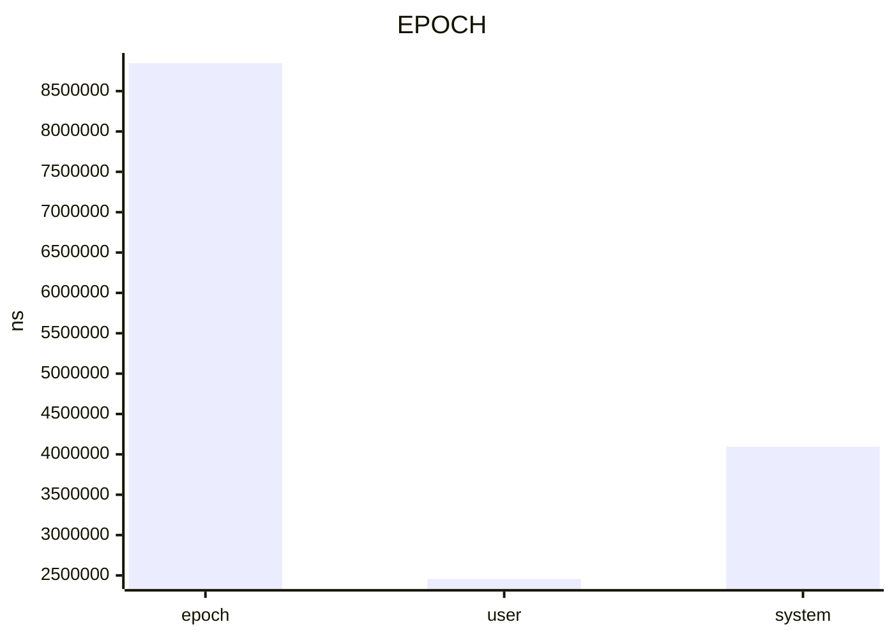

## epoch

+--------+-------+------------+-------------------+------------+---------------------+-------+------+---------------------------------------------------------------------------------------------------+-----------+--------------------+----------------------+
| key    | type  | value      | errorPercent      | min        | max                 | calls | unit | samples                                                                                           | baseline  | change             | probability          |
+========+=======+============+===================+============+=====================+=======+======+===================================================================================================+===========+====================+======================+
| epoch  | float | 8.847375e6 | 4.220649250954843 | 8.270625e6 | 2.131808333333334e7 | 1     | ns   | 2.131808333333334e7, 1.048045833333333e7                                                          | 8.93825e6 | -1.016697899476967 | 0.7676176438012221   |
|        |       |            |                   |            |                     |       |      | , 9.923041666666666e6, 8.931458333333332                                                          |           |                    |                      |
|        |       |            |                   |            |                     |       |      | e6, 8.473958333333334e6, 8.270625e6, 8.6                                                          |           |                    |                      |
|        |       |            |                   |            |                     |       |      | 8e6, 8.8585e6, 8.516e6, 8.847375e6, 8.40                                                          |           |                    |                      |
|        |       |            |                   |            |                     |       |      | 3666666666666e6                                                                                   |           |                    |                      |
+--------+-------+------------+-------------------+------------+---------------------+-------+------+---------------------------------------------------------------------------------------------------+-----------+--------------------+----------------------+
| user   | float | 2.456e6    | 3.053745928338762 | 2.371e6    | 3.843e6             | 1     | ns   | 3.843e6, 3.085e6, 2.846e6, 2.663e6, 2.45                                                          | 2.409e6   | 1.95101701951017   | 0.1890818059645161   |
|        |       |            |                   |            |                     |       |      | e6, 2.371e6, 2.4e6, 2.509e6, 2.381e6, 2.                                                          |           |                    |                      |
|        |       |            |                   |            |                     |       |      | 456e6, 2.409e6                                                                                    |           |                    |                      |
+--------+-------+------------+-------------------+------------+---------------------+-------+------+---------------------------------------------------------------------------------------------------+-----------+--------------------+----------------------+
| system | float | 4.096e6    | 6.3720703125      | 3.713e6    | 7.201e6             | 1     | ns   | 7.201e6, 4.737e6, 4.479e6, 3.942e6, 3.827e6, 3.713e6, 4.096e6, 4.097e6, 3.835e6, 4.105e6, 3.904e6 | 3.785e6   | 8.216644649933951  | 0.005258396703779288 |
+--------+-------+------------+-------------------+------------+---------------------+-------+------+---------------------------------------------------------------------------------------------------+-----------+--------------------+----------------------+

