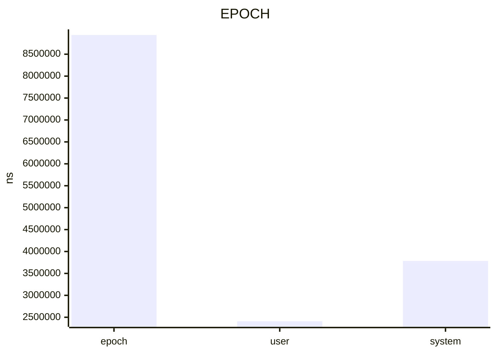

## epoch

+--------+-------+-----------+--------------------+---------------------+---------------------+-------+------+---------------------------------------------------------------------------------------------------+
| key    | type  | value     | errorPercent       | min                 | max                 | calls | unit | samples                                                                                           |
+========+=======+===========+====================+=====================+=====================+=======+======+===================================================================================================+
| epoch  | float | 8.93825e6 | 1.321567420915727  | 8.593291666666668e6 | 2.823237916666667e8 | 1     | ns   | 2.823237916666667e8, 8.594083333333334e6                                                          |
|        |       |           |                    |                     |                     |       |      | , 8.93825e6, 8.593291666666668e6, 8.8892                                                          |
|        |       |           |                    |                     |                     |       |      | 08333333334e6, 9.007875e6, 8.66204166666                                                          |
|        |       |           |                    |                     |                     |       |      | 6666e6, 8.813e6, 8.994416666666666e6, 8.                                                          |
|        |       |           |                    |                     |                     |       |      | 960041666666666e6, 9.056375e6                                                                     |
+--------+-------+-----------+--------------------+---------------------+---------------------+-------+------+---------------------------------------------------------------------------------------------------+
| user   | float | 2.409e6   | 0.8717310087173101 | 2.368e6             | 2.878e6             | 1     | ns   | 2.878e6, 2.439e6, 2.474e6, 2.388e6, 2.418e6, 2.368e6, 2.395e6, 2.409e6, 2.448e6, 2.406e6, 2.406e6 |
+--------+-------+-----------+--------------------+---------------------+---------------------+-------+------+---------------------------------------------------------------------------------------------------+
| system | float | 3.785e6   | 1.056803170409511  | 3.674e6             | 4.864e6             | 1     | ns   | 4.864e6, 3.775e6, 3.83e6, 3.674e6, 3.745                                                          |
|        |       |           |                    |                     |                     |       |      | e6, 3.795e6, 3.68e6, 3.785e6, 3.805e6, 3                                                          |
|        |       |           |                    |                     |                     |       |      | .783e6, 3.833e6                                                                                   |
+--------+-------+-----------+--------------------+---------------------+---------------------+-------+------+---------------------------------------------------------------------------------------------------+

