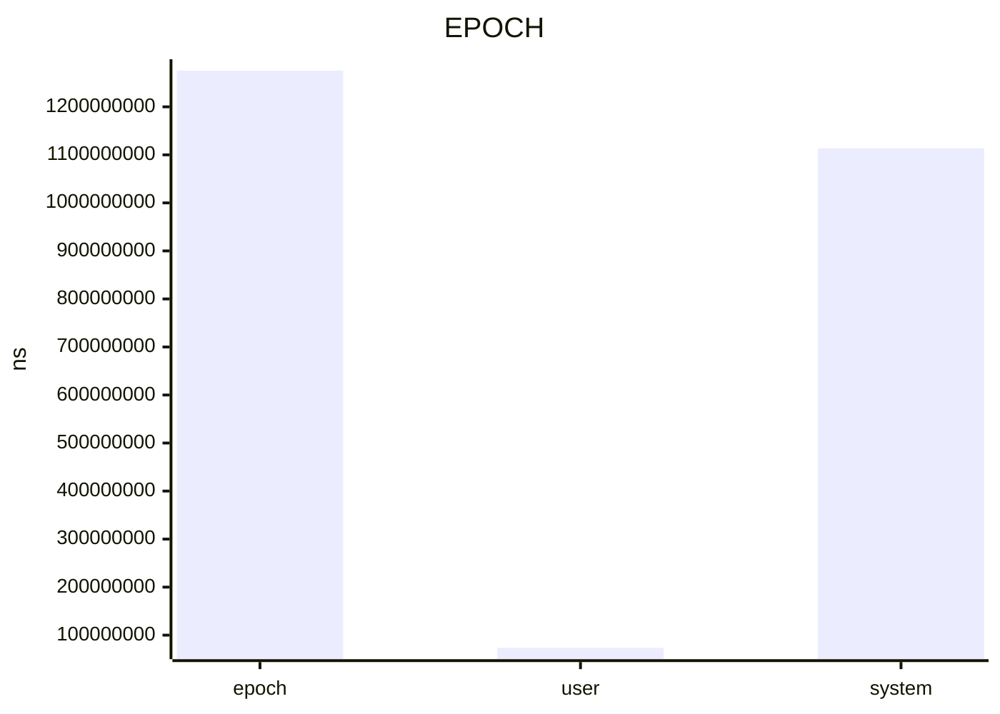

## epoch

+--------+-------+---------------------+--------------------+---------------------+---------------+-------+------+------------------------------------------+---------------------+--------------------+-----------------------+
| key    | type  | value               | errorPercent       | min                 | max           | calls | unit | samples                                  | baseline            | change             | probability           |
+========+=======+=====================+====================+=====================+===============+=======+======+==========================================+=====================+====================+=======================+
| epoch  | float | 1.275449416666667e9 | 1.047029631973527  | 1.233947416666667e9 | 1.334889625e9 | 1     | ns   | 1.334889625e9, 1.280952833333333e9, 1.27 | 1.336718416666667e9 | -4.583538255782027 | 0.3753601950350159    |
|        |       |                     |                    |                     |               |       |      | 5449416666667e9, 1.28880375e9, 1.2489175 |                     |                    |                       |
|        |       |                     |                    |                     |               |       |      | 83333333e9, 1.267825791666667e9, 1.23394 |                     |                    |                       |
|        |       |                     |                    |                     |               |       |      | 7416666667e9, 1.259198583333333e9, 1.262 |                     |                    |                       |
|        |       |                     |                    |                     |               |       |      | 960041666667e9, 1.297986333333333e9, 1.2 |                     |                    |                       |
|        |       |                     |                    |                     |               |       |      | 87946083333333e9                         |                     |                    |                       |
+--------+-------+---------------------+--------------------+---------------------+---------------+-------+------+------------------------------------------+---------------------+--------------------+-----------------------+
| user   | float | 7.3347e7            | 0.7716743697765417 | 7.2466e7            | 7.6309e7      | 1     | ns   | 7.6309e7, 7.4011e7, 7.3347e7, 7.357e7, 7 | 7.6853e7            | -4.561955941863037 | 0.0001595345363348149 |
|        |       |                     |                    |                     |               |       |      | .3176e7, 7.3078e7, 7.2466e7, 7.2781e7, 7 |                     |                    |                       |
|        |       |                     |                    |                     |               |       |      | .2903e7, 7.4566e7, 7.4952e7              |                     |                    |                       |
+--------+-------+---------------------+--------------------+---------------------+---------------+-------+------+------------------------------------------+---------------------+--------------------+-----------------------+
| system | float | 1.113425e9          | 0.9486943440285606 | 1.067383e9          | 1.130063e9    | 1     | ns   | 1.111793e9, 1.11583e9, 1.120008e9, 1.129 | 1.153802e9          | -3.499473913201745 | 0.0005659825222357773 |
|        |       |                     |                    |                     |               |       |      | 191e9, 1.087578e9, 1.078099e9, 1.067383e |                     |                    |                       |
|        |       |                     |                    |                     |               |       |      | 9, 1.110281e9, 1.113425e9, 1.130063e9, 1 |                     |                    |                       |
|        |       |                     |                    |                     |               |       |      | .123988e9                                |                     |                    |                       |
+--------+-------+---------------------+--------------------+---------------------+---------------+-------+------+------------------------------------------+---------------------+--------------------+-----------------------+

