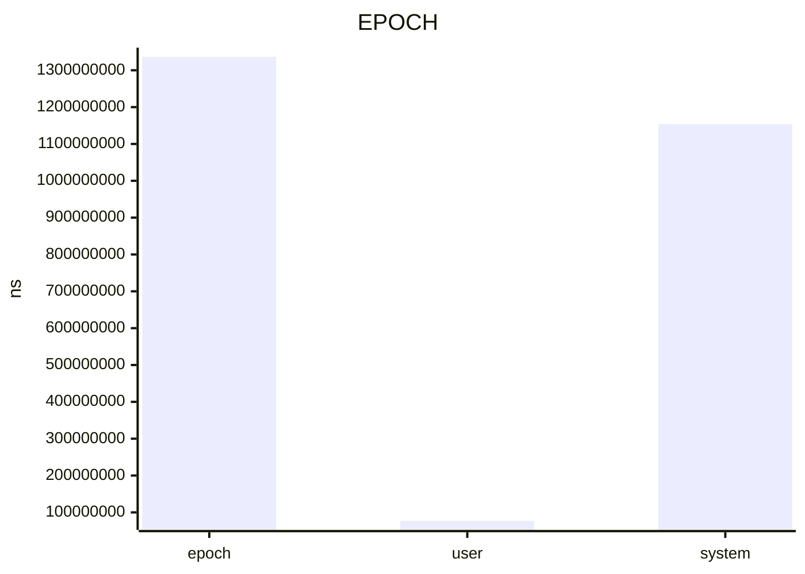

## epoch

+--------+-------+---------------------+-------------------+---------------------+---------------------+-------+------+-----------------------------------------------------------------------------------------------------------------------------------+
| key    | type  | value               | errorPercent      | min                 | max                 | calls | unit | samples                                                                                                                           |
+========+=======+=====================+===================+=====================+=====================+=======+======+===================================================================================================================================+
| epoch  | float | 1.336718416666667e9 | 1.062231318849801 | 1.293611666666667e9 | 1.495353416666667e9 | 1     | ns   | 1.495353416666667e9, 1.29830175e9, 1.322                                                                                          |
|        |       |                     |                   |                     |                     |       |      | 609583333333e9, 1.330479916666667e9, 1.2                                                                                          |
|        |       |                     |                   |                     |                     |       |      | 93611666666667e9, 1.336718416666667e9, 1                                                                                          |
|        |       |                     |                   |                     |                     |       |      | .345342333333333e9, 1.340105e9, 1.351375                                                                                          |
|        |       |                     |                   |                     |                     |       |      | 125e9, 1.351226125e9, 1.322519375e9                                                                                               |
+--------+-------+---------------------+-------------------+---------------------+---------------------+-------+------+-----------------------------------------------------------------------------------------------------------------------------------+
| user   | float | 7.6853e7            | 0.798927823246978 | 7.539e7             | 7.9578e7            | 1     | ns   | 7.9578e7, 7.6327e7, 7.6658e7, 7.8087e7, 7.539e7, 7.6253e7, 7.7467e7, 7.7394e7, 7.6853e7, 7.6129e7, 7.8243e7                       |
+--------+-------+---------------------+-------------------+---------------------+---------------------+-------+------+-----------------------------------------------------------------------------------------------------------------------------------+
| system | float | 1.153802e9          | 1.648809761120192 | 1.108735e9          | 1.196448e9          | 1     | ns   | 1.196448e9, 1.108735e9, 1.134778e9, 1.154771e9, 1.131374e9, 1.130417e9, 1.165921e9, 1.160433e9, 1.153802e9, 1.132547e9, 1.15438e9 |
+--------+-------+---------------------+-------------------+---------------------+---------------------+-------+------+-----------------------------------------------------------------------------------------------------------------------------------+

