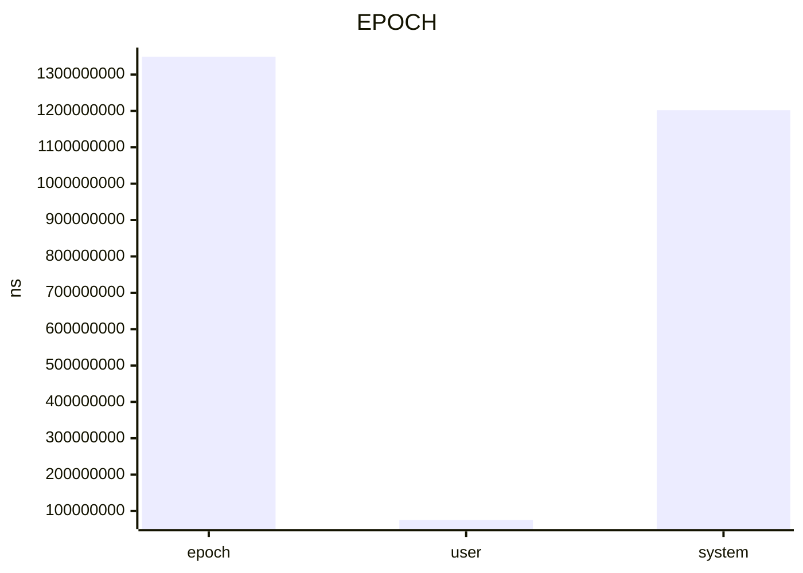

## epoch

+--------+-------+---------------------+--------------------+---------------------+---------------+-------+------+-------------------------------------------------------------------------------------------------------------------------------------------------------------------------------------------------------+---------------------+--------------------+-----------------------+
| key    | type  | value               | errorPercent       | min                 | max           | calls | unit | samples                                                                                                                                                                                               | baseline            | change             | probability           |
+========+=======+=====================+====================+=====================+===============+=======+======+=======================================================================================================================================================================================================+=====================+====================+=======================+
| epoch  | float | 1.349303208333333e9 | 1.277823118395349  | 1.320905958333333e9 | 2.300658375e9 | 1     | ns   | 2.300658375e9, 1.381575333333333e9, 1.3320615e9, 1.360414791666667e9, 1.346504708333333e9, 1.341961875e9, 1.366995375e9, 1.320905958333333e9, 1.360593375e9, 1.322170458333333e9, 1.349303208333333e9 | 1.336718416666667e9 | 0.9414691613248517 | 0.02348551600029814   |
+--------+-------+---------------------+--------------------+---------------------+---------------+-------+------+-------------------------------------------------------------------------------------------------------------------------------------------------------------------------------------------------------+---------------------+--------------------+-----------------------+
| user   | float | 7.528e7             | 0.6535600425079702 | 7.3908e7            | 8.1004e7      | 1     | ns   | 8.1004e7, 7.5772e7, 7.4388e7, 7.5109e7, 7.528e7, 7.4965e7, 7.5385e7, 7.4314e7, 7.6477e7, 7.3908e7, 7.5373e7                                                                                           | 7.6853e7            | -2.046764602552926 | 0.003476877287269923  |
+--------+-------+---------------------+--------------------+---------------------+---------------+-------+------+-------------------------------------------------------------------------------------------------------------------------------------------------------------------------------------------------------+---------------------+--------------------+-----------------------+
| system | float | 1.202167e9          | 1.314792370777105  | 1.160551e9          | 1.225134e9    | 1     | ns   | 1.218514e9, 1.225134e9, 1.182916e9, 1.217973e9, 1.205316e9, 1.206826e9, 1.202167e9, 1.160551e9, 1.190019e9, 1.169878e9, 1.186887e9                                                                    | 1.153802e9          | 4.191793739307091  | 0.0003452506511790301 |
+--------+-------+---------------------+--------------------+---------------------+---------------+-------+------+-------------------------------------------------------------------------------------------------------------------------------------------------------------------------------------------------------+---------------------+--------------------+-----------------------+

