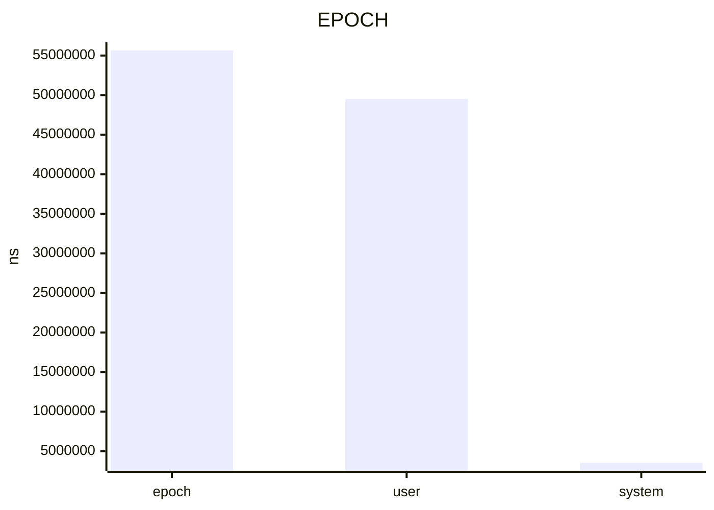

## epoch

+--------+-------+-----------+-------------------+-----------+---------------------+-------+------+------------------------------------------------------------------------------------------------------------+
| key    | type  | value     | errorPercent      | min       | max                 | calls | unit | samples                                                                                                    |
+========+=======+===========+===================+===========+=====================+=======+======+============================================================================================================+
| epoch  | float | 5.56475e7 | 6.8759453105111   | 5.10605e7 | 4.946683333333333e8 | 1     | ns   | 4.946683333333333e8, 5.287870833333334e7                                                                   |
|        |       |           |                   |           |                     |       |      | , 5.182120833333334e7, 5.10605e7, 5.1372                                                                   |
|        |       |           |                   |           |                     |       |      | 875e7, 6.653816666666666e7, 5.5091958333                                                                   |
|        |       |           |                   |           |                     |       |      | 33334e7, 5.829908333333334e7, 6.00002083                                                                   |
|        |       |           |                   |           |                     |       |      | 3333334e7, 5.56475e7, 5.721791666666666e                                                                   |
|        |       |           |                   |           |                     |       |      | 7                                                                                                          |
+--------+-------+-----------+-------------------+-----------+---------------------+-------+------+------------------------------------------------------------------------------------------------------------+
| user   | float | 4.951e7   | 4.904059785901838 | 4.6556e7  | 6.6865e7            | 1     | ns   | 6.6865e7, 4.8064e7, 4.7082e7, 4.6556e7, 4.6787e7, 6.2007e7, 4.951e7, 5.0811e7, 5.2836e7, 4.902e7, 5.0225e7 |
+--------+-------+-----------+-------------------+-----------+---------------------+-------+------+------------------------------------------------------------------------------------------------------------+
| system | float | 3.53e6    | 13.88101983002833 | 3.04e6    | 7.695e6             | 1     | ns   | 7.695e6, 3.347e6, 3.299e6, 3.071e6, 3.05                                                                   |
|        |       |           |                   |           |                     |       |      | 2e6, 3.04e6, 3.53e6, 4.672e6, 4.158e6, 4                                                                   |
|        |       |           |                   |           |                     |       |      | .251e6, 4.332e6                                                                                            |
+--------+-------+-----------+-------------------+-----------+---------------------+-------+------+------------------------------------------------------------------------------------------------------------+

