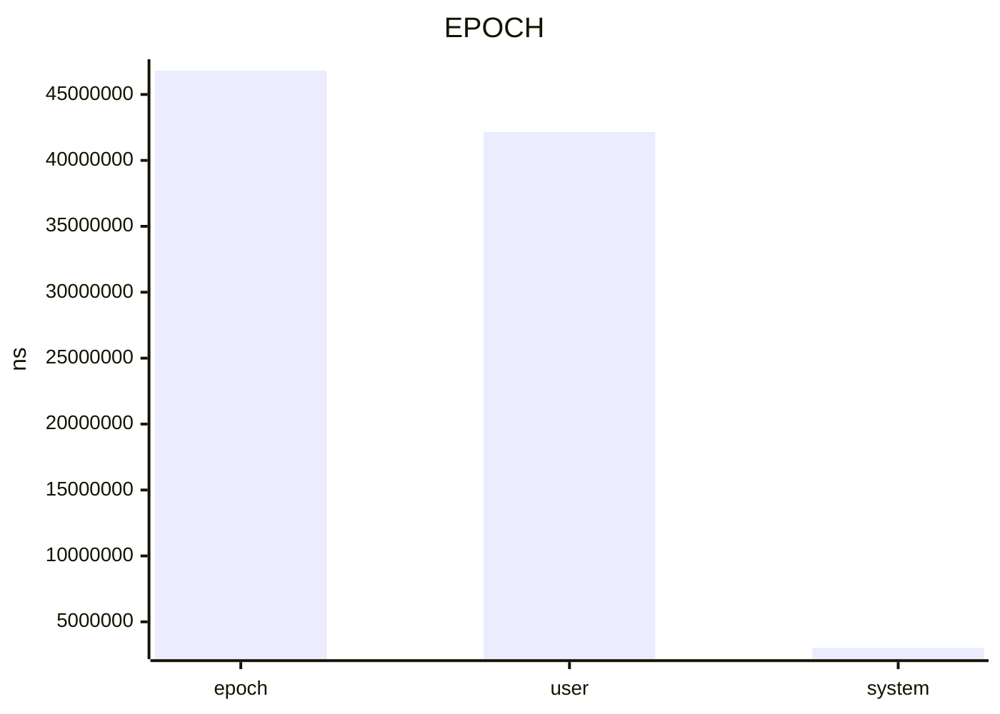

## epoch

+--------+-------+---------------------+-------------------+---------------------+---------------------+-------+------+---------------------------------------------------------------------------------------------------+
| key    | type  | value               | errorPercent      | min                 | max                 | calls | unit | samples                                                                                           |
+========+=======+=====================+===================+=====================+=====================+=======+======+===================================================================================================+
| epoch  | float | 4.681195833333334e7 | 1.50664849704537  | 4.553045833333334e7 | 5.359886666666667e8 | 1     | ns   | 5.359886666666667e8, 5.0810375e7, 4.7466                                                          |
|        |       |                     |                   |                     |                     |       |      | 75e7, 4.667475e7, 4.553045833333334e7, 6                                                          |
|        |       |                     |                   |                     |                     |       |      | .3846375e7, 4.662320833333334e7, 4.61066                                                          |
|        |       |                     |                   |                     |                     |       |      | 6666666666e7, 4.681195833333334e7, 4.670                                                          |
|        |       |                     |                   |                     |                     |       |      | 95e7, 5.476425e7                                                                                  |
+--------+-------+---------------------+-------------------+---------------------+---------------------+-------+------+---------------------------------------------------------------------------------------------------+
| user   | float | 4.2152e7            | 1.238375403302334 | 4.0761e7            | 6.826e7             | 1     | ns   | 6.826e7, 4.4781e7, 4.2152e7, 4.1811e7, 4                                                          |
|        |       |                     |                   |                     |                     |       |      | .0761e7, 5.9202e7, 4.2027e7, 4.163e7, 4.                                                          |
|        |       |                     |                   |                     |                     |       |      | 2228e7, 4.2118e7, 5.0149e7                                                                        |
+--------+-------+---------------------+-------------------+---------------------+---------------------+-------+------+---------------------------------------------------------------------------------------------------+
| system | float | 3.02e6              | 3.940397350993378 | 2.846e6             | 1.1086e7            | 1     | ns   | 1.1086e7, 4.204e6, 3.656e6, 3.261e6, 3.101e6, 3.02e6, 2.998e6, 2.846e6, 3.005e6, 2.901e6, 2.987e6 |
+--------+-------+---------------------+-------------------+---------------------+---------------------+-------+------+---------------------------------------------------------------------------------------------------+

