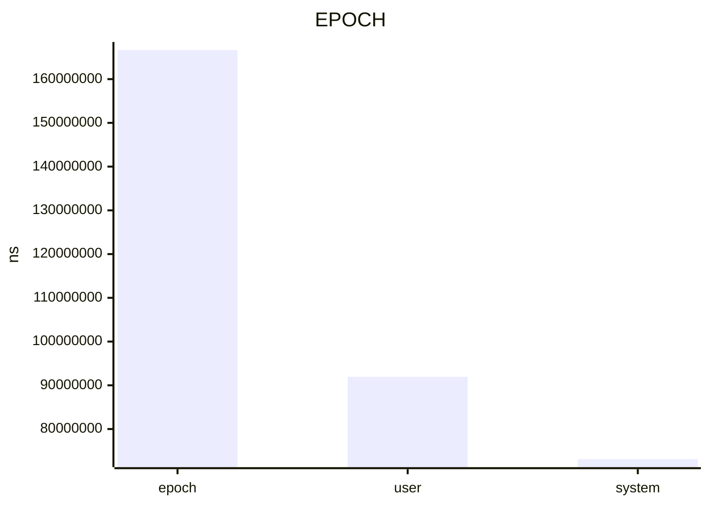

## epoch

+--------+-------+---------------------+--------------------+---------------------+---------------------+-------+------+--------------------------------------------------------------------------------------------------------------+
| key    | type  | value               | errorPercent       | min                 | max                 | calls | unit | samples                                                                                                      |
+========+=======+=====================+====================+=====================+=====================+=======+======+==============================================================================================================+
| epoch  | float | 1.666562916666667e8 | 0.2663915828760221 | 1.632107916666667e8 | 9.572947916666666e8 | 1     | ns   | 9.572947916666666e8, 1.681325416666667e8                                                                     |
|        |       |                     |                    |                     |                     |       |      | , 1.65637875e8, 1.632107916666667e8, 1.6                                                                     |
|        |       |                     |                    |                     |                     |       |      | 62837916666667e8, 1.666562916666667e8, 1                                                                     |
|        |       |                     |                    |                     |                     |       |      | .6639625e8, 1.6710025e8, 1.68667875e8, 1                                                                     |
|        |       |                     |                    |                     |                     |       |      | .662606666666667e8, 1.66702375e8                                                                             |
+--------+-------+---------------------+--------------------+---------------------+---------------------+-------+------+--------------------------------------------------------------------------------------------------------------+
| user   | float | 9.1941e7            | 0.5971220674127973 | 8.8172e7            | 1.07836e8           | 1     | ns   | 1.07836e8, 9.3557e7, 9.1392e7, 8.8172e7, 9.1941e7, 9.1849e7, 9.185e7, 9.1955e7, 9.3505e7, 9.1383e7, 9.1945e7 |
+--------+-------+---------------------+--------------------+---------------------+---------------------+-------+------+--------------------------------------------------------------------------------------------------------------+
| system | float | 7.3106e7            | 0.3118759062183679 | 7.2636e7            | 8.9994e7            | 1     | ns   | 8.9994e7, 7.2878e7, 7.2636e7, 7.3319e7, 7.2646e7, 7.3098e7, 7.2933e7, 7.3521e7, 7.3536e7, 7.3218e7, 7.3106e7 |
+--------+-------+---------------------+--------------------+---------------------+---------------------+-------+------+--------------------------------------------------------------------------------------------------------------+

