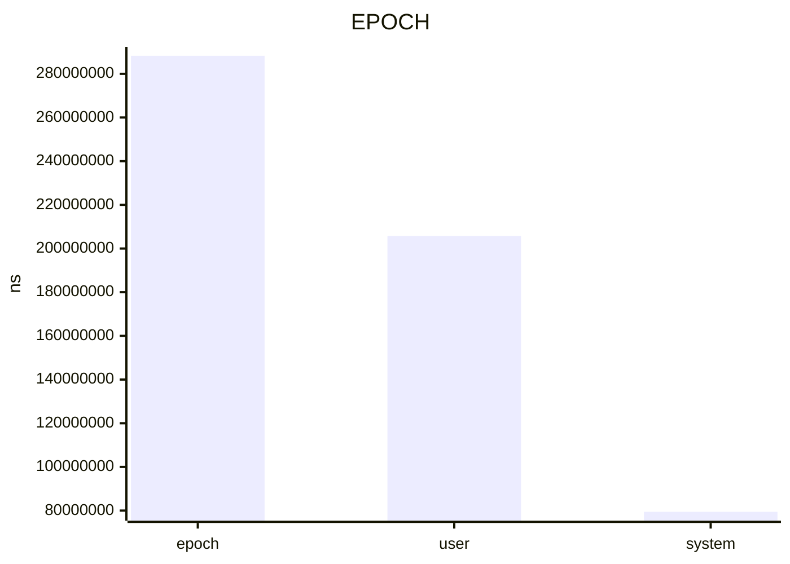

## epoch

+--------+-------+---------------------+-------------------+---------------------+---------------------+-------+------+-------------------------------------------------------------------------------------------------------------+
| key    | type  | value               | errorPercent      | min                 | max                 | calls | unit | samples                                                                                                     |
+========+=======+=====================+===================+=====================+=====================+=======+======+=============================================================================================================+
| epoch  | float | 2.882679583333334e8 | 1.288370152134219 | 2.795619583333334e8 | 3.921737916666667e8 | 1     | ns   | 3.921737916666667e8, 2.795619583333334e8                                                                    |
|        |       |                     |                   |                     |                     |       |      | , 2.850015833333333e8, 2.889368333333333                                                                    |
|        |       |                     |                   |                     |                     |       |      | e8, 2.8462925e8, 2.84554e8, 2.8826795833                                                                    |
|        |       |                     |                   |                     |                     |       |      | 33334e8, 2.884705e8, 2.813224583333334e8                                                                    |
|        |       |                     |                   |                     |                     |       |      | , 2.950902083333333e8, 2.945040416666667                                                                    |
|        |       |                     |                   |                     |                     |       |      | e8                                                                                                          |
+--------+-------+---------------------+-------------------+---------------------+---------------------+-------+------+-------------------------------------------------------------------------------------------------------------+
| user   | float | 2.05792e8           | 1.250291556523091 | 2.01713e8           | 2.2411e8            | 1     | ns   | 2.2411e8, 2.01713e8, 2.03651e8, 2.07316e                                                                    |
|        |       |                     |                   |                     |                     |       |      | 8, 2.03219e8, 2.0568e8, 2.07007e8, 2.057                                                                    |
|        |       |                     |                   |                     |                     |       |      | 92e8, 2.03024e8, 2.10071e8, 2.08889e8                                                                       |
+--------+-------+---------------------+-------------------+---------------------+---------------------+-------+------+-------------------------------------------------------------------------------------------------------------+
| system | float | 7.9432e7            | 2.685315741766543 | 7.6005e7            | 8.6218e7            | 1     | ns   | 8.6218e7, 7.6005e7, 7.9472e7, 7.9643e7, 7.9432e7, 7.711e7, 7.9314e7, 7.8257e7, 7.6452e7, 8.2871e7, 8.1565e7 |
+--------+-------+---------------------+-------------------+---------------------+---------------------+-------+------+-------------------------------------------------------------------------------------------------------------+

