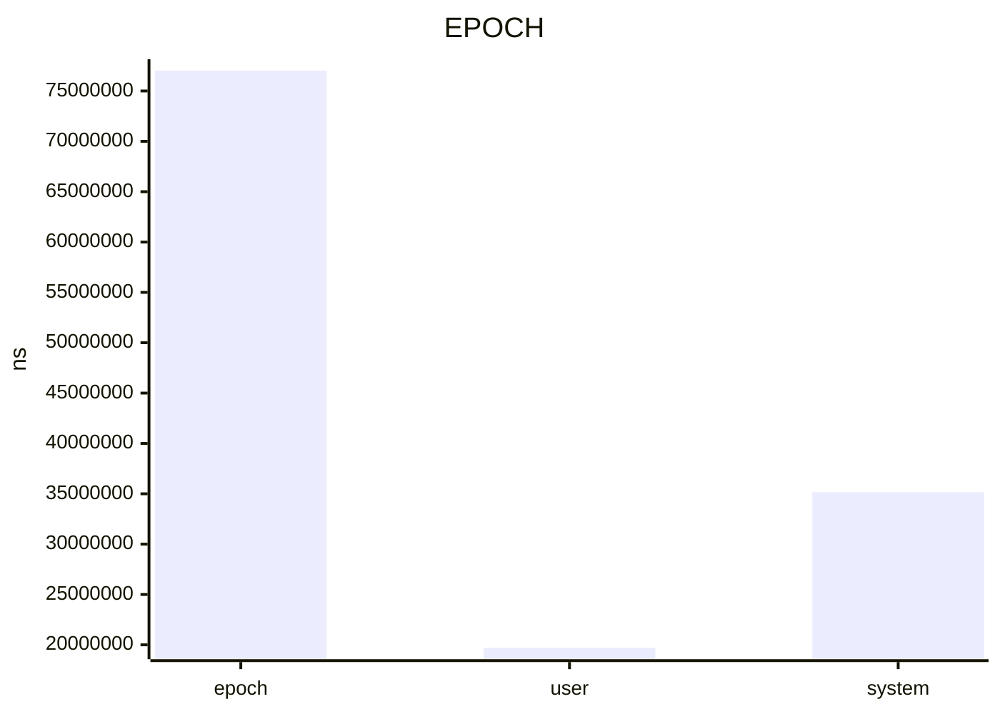

## epoch

+--------+-------+-----------+--------------------+---------------------+--------------+-------+------+-------------------------------------------------------------------------------------------------------------+
| key    | type  | value     | errorPercent       | min                 | max          | calls | unit | samples                                                                                                     |
+========+=======+===========+====================+=====================+==============+=======+======+=============================================================================================================+
| epoch  | float | 7.70255e7 | 0.5830861208301147 | 7.618566666666667e7 | 4.64475875e8 | 1     | ns   | 4.64475875e8, 7.763525e7, 7.6471125e7, 7                                                                    |
|        |       |           |                    |                     |              |       |      | .684016666666667e7, 7.70255e7, 7.7474625                                                                    |
|        |       |           |                    |                     |              |       |      | e7, 7.6708625e7, 7.987691666666667e7, 7.                                                                    |
|        |       |           |                    |                     |              |       |      | 6612375e7, 7.618566666666667e7, 7.703112                                                                    |
|        |       |           |                    |                     |              |       |      | 5e7                                                                                                         |
+--------+-------+-----------+--------------------+---------------------+--------------+-------+------+-------------------------------------------------------------------------------------------------------------+
| user   | float | 1.969e7   | 0.446927374301676  | 1.9561e7            | 3.099e7      | 1     | ns   | 3.099e7, 1.988e7, 1.9887e7, 1.9661e7, 1.                                                                    |
|        |       |           |                    |                     |              |       |      | 9727e7, 1.9674e7, 1.9602e7, 2.015e7, 1.9                                                                    |
|        |       |           |                    |                     |              |       |      | 69e7, 1.962e7, 1.9561e7                                                                                     |
+--------+-------+-----------+--------------------+---------------------+--------------+-------+------+-------------------------------------------------------------------------------------------------------------+
| system | float | 3.5155e7  | 0.2702318304650832 | 3.4753e7            | 5.6379e7     | 1     | ns   | 5.6379e7, 3.5684e7, 3.5206e7, 3.4928e7, 3.5187e7, 3.5155e7, 3.5138e7, 3.6515e7, 3.5132e7, 3.4753e7, 3.506e7 |
+--------+-------+-----------+--------------------+---------------------+--------------+-------+------+-------------------------------------------------------------------------------------------------------------+

