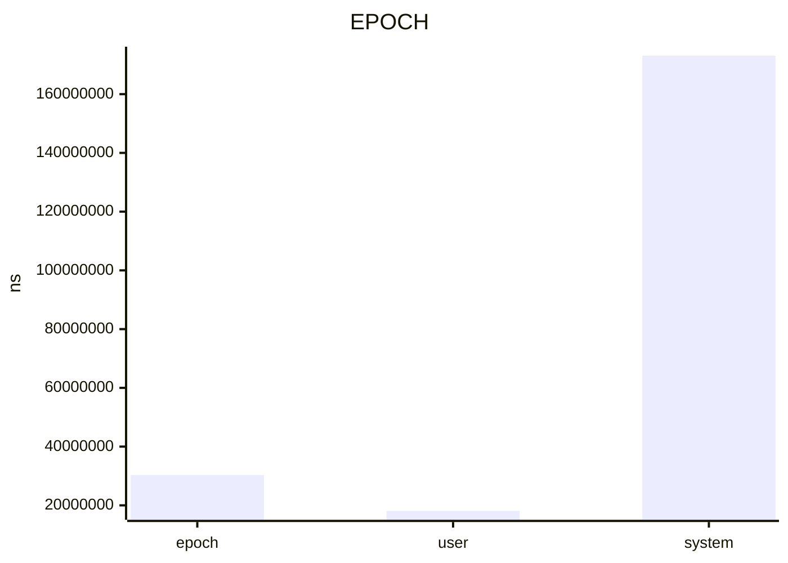

## epoch

+--------+-------+---------------------+--------------------+---------------------+---------------------+-------+------+-------------------------------------------------------------------------------------------------------------+
| key    | type  | value               | errorPercent       | min                 | max                 | calls | unit | samples                                                                                                     |
+========+=======+=====================+====================+=====================+=====================+=======+======+=============================================================================================================+
| epoch  | float | 3.032366666666666e7 | 1.555303338426532  | 2.903791666666667e7 | 3.234416666666667e7 | 1     | ns   | 3.234416666666667e7, 3.062091666666667e7                                                                    |
|        |       |                     |                    |                     |                     |       |      | , 2.923029166666667e7, 3.032366666666666                                                                    |
|        |       |                     |                    |                     |                     |       |      | e7, 3.074404166666667e7, 3.0795291666666                                                                    |
|        |       |                     |                    |                     |                     |       |      | 66e7, 3.057866666666667e7, 2.91025833333                                                                    |
|        |       |                     |                    |                     |                     |       |      | 3334e7, 3.002120833333333e7, 2.915154166                                                                    |
|        |       |                     |                    |                     |                     |       |      | 666666e7, 2.903791666666667e7                                                                               |
+--------+-------+---------------------+--------------------+---------------------+---------------------+-------+------+-------------------------------------------------------------------------------------------------------------+
| user   | float | 1.8101e7            | 0.6795204684824043 | 1.7846e7            | 1.8438e7            | 1     | ns   | 1.8427e7, 1.8438e7, 1.7948e7, 1.7846e7, 1.8171e7, 1.8153e7, 1.8101e7, 1.8048e7, 1.8236e7, 1.808e7, 1.7978e7 |
+--------+-------+---------------------+--------------------+---------------------+---------------------+-------+------+-------------------------------------------------------------------------------------------------------------+
| system | float | 1.73105e8           | 1.015568585540568  | 1.67286e8           | 1.74998e8           | 1     | ns   | 1.73105e8, 1.70887e8, 1.74982e8, 1.68477                                                                    |
|        |       |                     |                    |                     |                     |       |      | e8, 1.73374e8, 1.74863e8, 1.74526e8, 1.7                                                                    |
|        |       |                     |                    |                     |                     |       |      | 4998e8, 1.67286e8, 1.7233e8, 1.72366e8                                                                      |
+--------+-------+---------------------+--------------------+---------------------+---------------------+-------+------+-------------------------------------------------------------------------------------------------------------+

