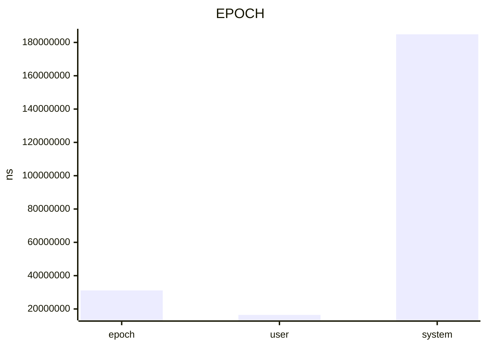

## epoch

+--------+-------+---------------------+--------------------+---------------------+---------------------+-------+------+------------------------------------------------------------------------------------------------------------+
| key    | type  | value               | errorPercent       | min                 | max                 | calls | unit | samples                                                                                                    |
+========+=======+=====================+====================+=====================+=====================+=======+======+============================================================================================================+
| epoch  | float | 3.115091666666667e7 | 1.479758487577955  | 2.968333333333333e7 | 3.512720833333334e7 | 1     | ns   | 3.512720833333334e7, 3.1047875e7, 3.0689                                                                   |
|        |       |                     |                    |                     |                     |       |      | 95833333333e7, 3.1248375e7, 3.1150916666                                                                   |
|        |       |                     |                    |                     |                     |       |      | 66667e7, 3.133470833333334e7, 3.16640833                                                                   |
|        |       |                     |                    |                     |                     |       |      | 3333334e7, 2.968333333333333e7, 3.159704                                                                   |
|        |       |                     |                    |                     |                     |       |      | 166666666e7, 2.971804166666667e7, 3.0674                                                                   |
|        |       |                     |                    |                     |                     |       |      | 58333333334e7                                                                                              |
+--------+-------+---------------------+--------------------+---------------------+---------------------+-------+------+------------------------------------------------------------------------------------------------------------+
| user   | float | 1.6437e7            | 0.669221877471558  | 1.608e7             | 1.8023e7            | 1     | ns   | 1.8023e7, 1.6441e7, 1.6327e7, 1.6445e7, 1.653e7, 1.6437e7, 1.6329e7, 1.608e7, 1.6555e7, 1.6189e7, 1.6207e7 |
+--------+-------+---------------------+--------------------+---------------------+---------------------+-------+------+------------------------------------------------------------------------------------------------------------+
| system | float | 1.84883e8           | 0.3564416414705516 | 1.78539e8           | 1.87774e8           | 1     | ns   | 1.85143e8, 1.84883e8, 1.84384e8, 1.84224                                                                   |
|        |       |                     |                    |                     |                     |       |      | e8, 1.78539e8, 1.85669e8, 1.85071e8, 1.8                                                                   |
|        |       |                     |                    |                     |                     |       |      | 5031e8, 1.87774e8, 1.82324e8, 1.79582e8                                                                    |
+--------+-------+---------------------+--------------------+---------------------+---------------------+-------+------+------------------------------------------------------------------------------------------------------------+

