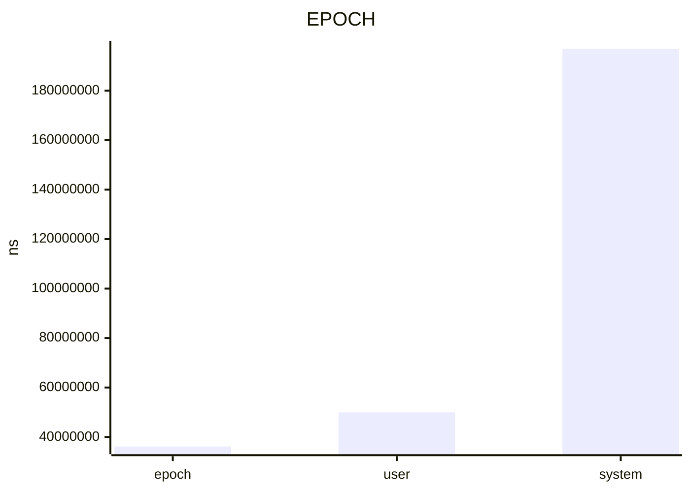

## epoch

+--------+-------+---------------------+--------------------+---------------------+---------------------+-------+------+------------------------------------------+
| key    | type  | value               | errorPercent       | min                 | max                 | calls | unit | samples                                  |
+========+=======+=====================+====================+=====================+=====================+=======+======+==========================================+
| epoch  | float | 3.616329166666666e7 | 1.68448899033204   | 3.471504166666667e7 | 3.950745833333334e7 | 1     | ns   | 3.950745833333334e7, 3.6702625e7, 3.6163 |
|        |       |                     |                    |                     |                     |       |      | 29166666666e7, 3.5554125e7, 3.4715041666 |
|        |       |                     |                    |                     |                     |       |      | 66667e7, 3.5717875e7, 3.510066666666667e |
|        |       |                     |                    |                     |                     |       |      | 7, 3.635304166666667e7, 3.6632625e7, 3.7 |
|        |       |                     |                    |                     |                     |       |      | 49583333333334e7, 3.531729166666666e7    |
+--------+-------+---------------------+--------------------+---------------------+---------------------+-------+------+------------------------------------------+
| user   | float | 4.994e7             | 1.503804565478574  | 4.7794e7            | 5.4177e7            | 1     | ns   | 5.4177e7, 4.994e7, 4.9189e7, 5.1217e7, 4 |
|        |       |                     |                    |                     |                     |       |      | .9955e7, 4.7794e7, 4.9753e7, 5.0851e7, 4 |
|        |       |                     |                    |                     |                     |       |      | .7837e7, 5.01e7, 4.9379e7                |
+--------+-------+---------------------+--------------------+---------------------+---------------------+-------+------+------------------------------------------+
| system | float | 1.97001e8           | 0.7553261150958624 | 1.92873e8           | 2.07196e8           | 1     | ns   | 2.07196e8, 1.94789e8, 1.97059e8, 1.92873 |
|        |       |                     |                    |                     |                     |       |      | e8, 1.9571e8, 1.95243e8, 1.98489e8, 1.97 |
|        |       |                     |                    |                     |                     |       |      | 525e8, 2.01922e8, 1.9669e8, 1.97001e8    |
+--------+-------+---------------------+--------------------+---------------------+---------------------+-------+------+------------------------------------------+

