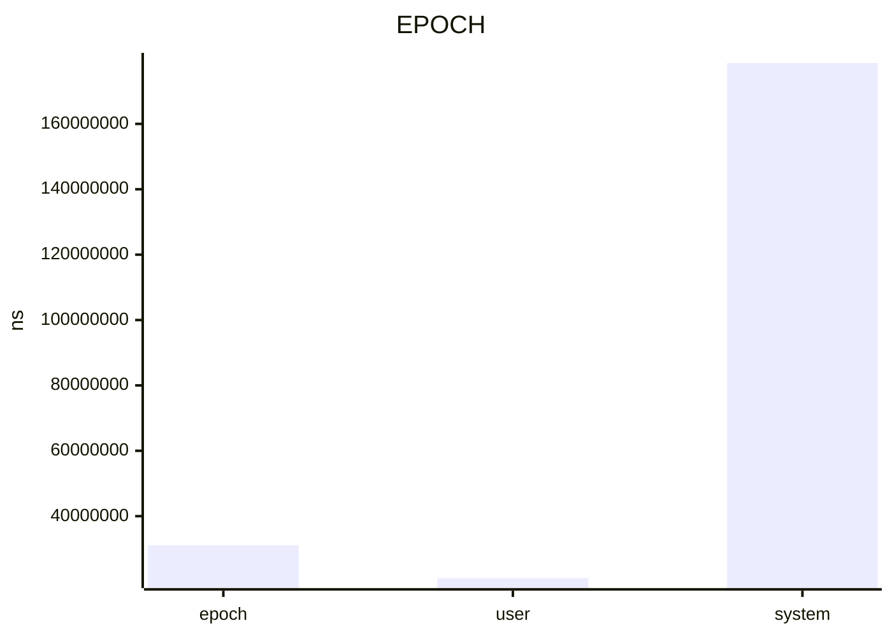

## epoch

+--------+-------+-------------+--------------------+-------------+-------------+-------+------+----------------------------------------------------------------------------------------------------------------------------------------------------------------------------+
| key    | type  | value       | errorPercent       | min         | max         | calls | unit | samples                                                                                                                                                                    |
+========+=======+=============+====================+=============+=============+=======+======+============================================================================================================================================================================+
| epoch  | float | 3.1108875e7 | 2.484419639090131  | 2.9935375e7 | 3.4643125e7 | 1     | ns   | 3.4643125e7, 3.016154166666667e7, 3.1142875e7, 3.139979166666667e7, 3.0208625e7, 3.1108875e7, 3.009979166666667e7, 3.0336e7, 2.9935375e7, 3.1219375e7, 3.140745833333333e7 |
+--------+-------+-------------+--------------------+-------------+-------------+-------+------+----------------------------------------------------------------------------------------------------------------------------------------------------------------------------+
| user   | float | 2.1057e7    | 0.7550933181364867 | 2.0716e7    | 2.1344e7    | 1     | ns   | 2.111e7, 2.0809e7, 2.1344e7, 2.1008e7, 2                                                                                                                                   |
|        |       |             |                    |             |             |       |      | .1097e7, 2.1049e7, 2.1057e7, 2.1276e7, 2                                                                                                                                   |
|        |       |             |                    |             |             |       |      | .0716e7, 2.123e7, 2.0898e7                                                                                                                                                 |
+--------+-------+-------------+--------------------+-------------+-------------+-------+------+----------------------------------------------------------------------------------------------------------------------------------------------------------------------------+
| system | float | 1.78638e8   | 0.3213202118250316 | 1.71298e8   | 1.80712e8   | 1     | ns   | 1.77149e8, 1.78081e8, 1.80423e8, 1.79197                                                                                                                                   |
|        |       |             |                    |             |             |       |      | e8, 1.79137e8, 1.78638e8, 1.80712e8, 1.7                                                                                                                                   |
|        |       |             |                    |             |             |       |      | 1298e8, 1.79578e8, 1.78064e8, 1.78097e8                                                                                                                                    |
+--------+-------+-------------+--------------------+-------------+-------------+-------+------+----------------------------------------------------------------------------------------------------------------------------------------------------------------------------+

