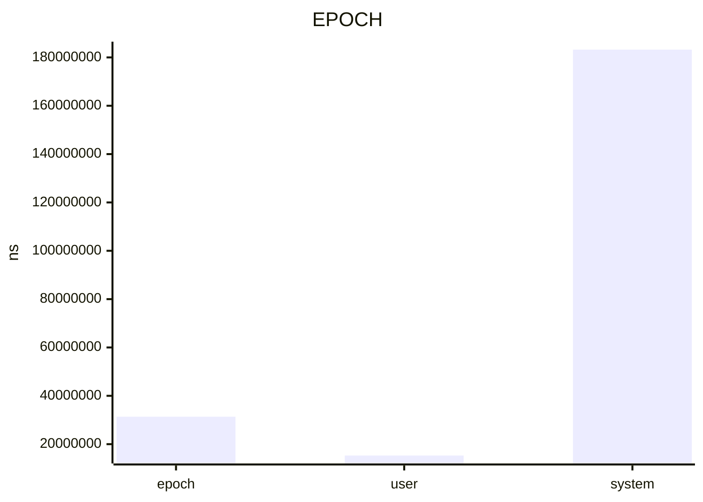

## epoch

+--------+-------+---------------------+--------------------+---------------------+------------+-------+------+------------------------------------------+
| key    | type  | value               | errorPercent       | min                 | max        | calls | unit | samples                                  |
+========+=======+=====================+====================+=====================+============+=======+======+==========================================+
| epoch  | float | 3.135395833333334e7 | 0.9235941767055009 | 3.038733333333333e7 | 3.582025e7 | 1     | ns   | 3.582025e7, 3.135395833333334e7, 3.14134 |
|        |       |                     |                    |                     |            |       |      | 1666666666e7, 3.137766666666666e7, 3.093 |
|        |       |                     |                    |                     |            |       |      | 241666666667e7, 3.093270833333333e7, 3.1 |
|        |       |                     |                    |                     |            |       |      | 15241666666666e7, 3.185991666666667e7, 3 |
|        |       |                     |                    |                     |            |       |      | .038733333333333e7, 3.1064375e7, 3.15470 |
|        |       |                     |                    |                     |            |       |      | 8333333334e7                             |
+--------+-------+---------------------+--------------------+---------------------+------------+-------+------+------------------------------------------+
| user   | float | 1.528e7             | 0.7526178010471204 | 1.4923e7            | 1.6141e7   | 1     | ns   | 1.6141e7, 1.5324e7, 1.4923e7, 1.528e7, 1 |
|        |       |                     |                    |                     |            |       |      | .5317e7, 1.5165e7, 1.5181e7, 1.4974e7, 1 |
|        |       |                     |                    |                     |            |       |      | .5355e7, 1.5049e7, 1.5429e7              |
+--------+-------+---------------------+--------------------+---------------------+------------+-------+------+------------------------------------------+
| system | float | 1.83223e8           | 1.676099616314546  | 1.71818e8           | 1.98548e8  | 1     | ns   | 1.98548e8, 1.81015e8, 1.83223e8, 1.84145 |
|        |       |                     |                    |                     |            |       |      | e8, 1.84946e8, 1.80152e8, 1.71931e8, 1.8 |
|        |       |                     |                    |                     |            |       |      | 5226e8, 1.77878e8, 1.71818e8, 1.87333e8  |
+--------+-------+---------------------+--------------------+---------------------+------------+-------+------+------------------------------------------+

