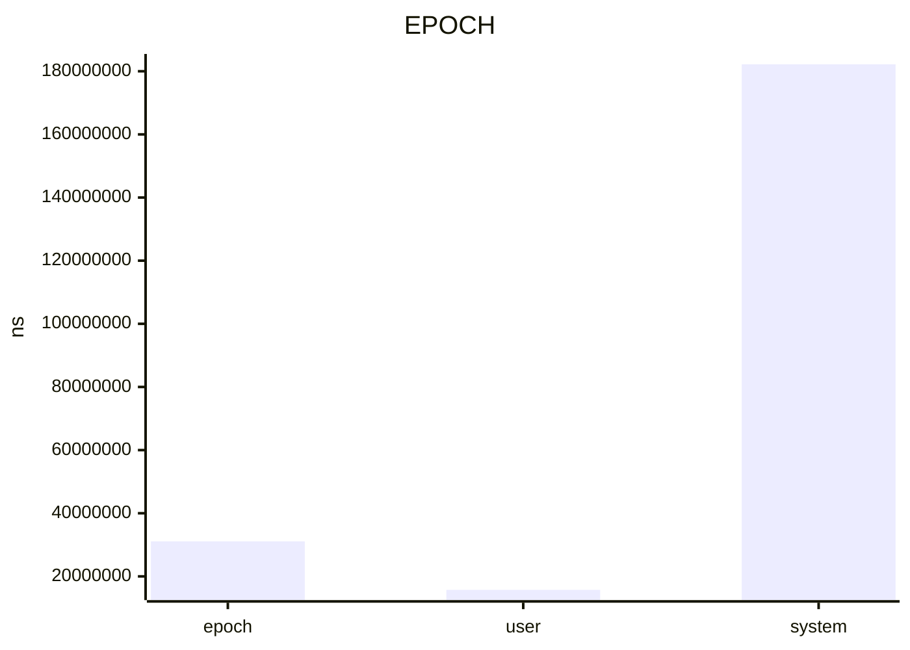

## epoch

+--------+-------+-------------+-------------------+---------------------+---------------------+-------+------+------------------------------------------+
| key    | type  | value       | errorPercent      | min                 | max                 | calls | unit | samples                                  |
+========+=======+=============+===================+=====================+=====================+=======+======+==========================================+
| epoch  | float | 3.1106875e7 | 3.258256146484223 | 2.949608333333333e7 | 3.969716666666666e7 | 1     | ns   | 3.969716666666666e7, 3.212041666666666e7 |
|        |       |             |                   |                     |                     |       |      | , 2.989975e7, 3.1111375e7, 3.1308e7, 3.0 |
|        |       |             |                   |                     |                     |       |      | 20491666666667e7, 2.996541666666667e7, 3 |
|        |       |             |                   |                     |                     |       |      | .120129166666666e7, 2.971075e7, 3.110687 |
|        |       |             |                   |                     |                     |       |      | 5e7, 2.949608333333333e7                 |
+--------+-------+-------------+-------------------+---------------------+---------------------+-------+------+------------------------------------------+
| user   | float | 1.5724e7    | 1.443653014500127 | 1.5245e7            | 1.799e7             | 1     | ns   | 1.799e7, 1.6054e7, 1.5951e7, 1.5724e7, 1 |
|        |       |             |                   |                     |                     |       |      | .574e7, 1.5605e7, 1.5964e7, 1.5482e7, 1. |
|        |       |             |                   |                     |                     |       |      | 5245e7, 1.5711e7, 1.5598e7               |
+--------+-------+-------------+-------------------+---------------------+---------------------+-------+------+------------------------------------------+
| system | float | 1.82215e8   | 2.521197486485745 | 1.751e8             | 1.93971e8           | 1     | ns   | 1.93971e8, 1.86009e8, 1.75419e8, 1.81111 |
|        |       |             |                   |                     |                     |       |      | e8, 1.86323e8, 1.87335e8, 1.86809e8, 1.8 |
|        |       |             |                   |                     |                     |       |      | 2215e8, 1.75726e8, 1.80913e8, 1.751e8    |
+--------+-------+-------------+-------------------+---------------------+---------------------+-------+------+------------------------------------------+

