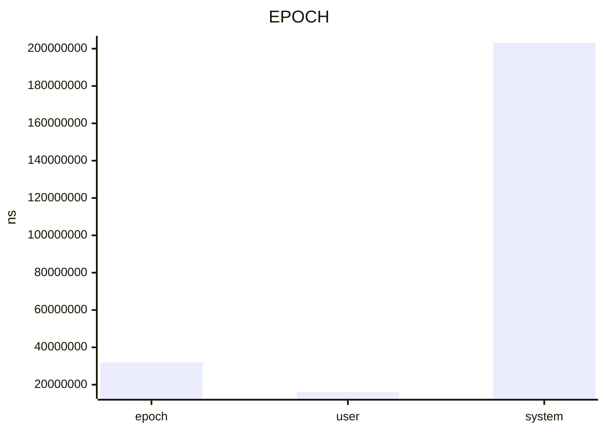

## epoch

+--------+-------+---------------------+--------------------+-------------+---------------------+-------+------+-------------------------------------------------------------------------------------------------------------------------------------------------------------------------------------------+
| key    | type  | value               | errorPercent       | min         | max                 | calls | unit | samples                                                                                                                                                                                   |
+========+=======+=====================+====================+=============+=====================+=======+======+===========================================================================================================================================================================================+
| epoch  | float | 3.187608333333333e7 | 1.604651345183028  | 3.1134375e7 | 5.005773333333333e8 | 1     | ns   | 5.005773333333333e8, 3.3907875e7, 3.1944e7, 3.308608333333334e7, 3.1425625e7, 3.174566666666666e7, 3.263966666666666e7, 3.136458333333334e7, 3.1134375e7, 3.187608333333333e7, 3.183725e7 |
+--------+-------+---------------------+--------------------+-------------+---------------------+-------+------+-------------------------------------------------------------------------------------------------------------------------------------------------------------------------------------------+
| user   | float | 1.6065e7            | 0.6660441954559602 | 1.5758e7    | 2.4392e7            | 1     | ns   | 2.4392e7, 1.7156e7, 1.6158e7, 1.5998e7, 1.6135e7, 1.6065e7, 1.5958e7, 1.5831e7, 1.5958e7, 1.6287e7, 1.5758e7                                                                              |
+--------+-------+---------------------+--------------------+-------------+---------------------+-------+------+-------------------------------------------------------------------------------------------------------------------------------------------------------------------------------------------+
| system | float | 2.03185e8           | 1.333267711691316  | 1.96742e8   | 2.39618e8           | 1     | ns   | 2.39618e8, 2.12112e8, 2.00476e8, 2.00056                                                                                                                                                  |
|        |       |                     |                    |             |                     |       |      | e8, 2.03747e8, 1.99768e8, 2.03185e8, 2.0                                                                                                                                                  |
|        |       |                     |                    |             |                     |       |      | 2527e8, 1.96742e8, 2.03303e8, 2.04719e8                                                                                                                                                   |
+--------+-------+---------------------+--------------------+-------------+---------------------+-------+------+-------------------------------------------------------------------------------------------------------------------------------------------------------------------------------------------+

