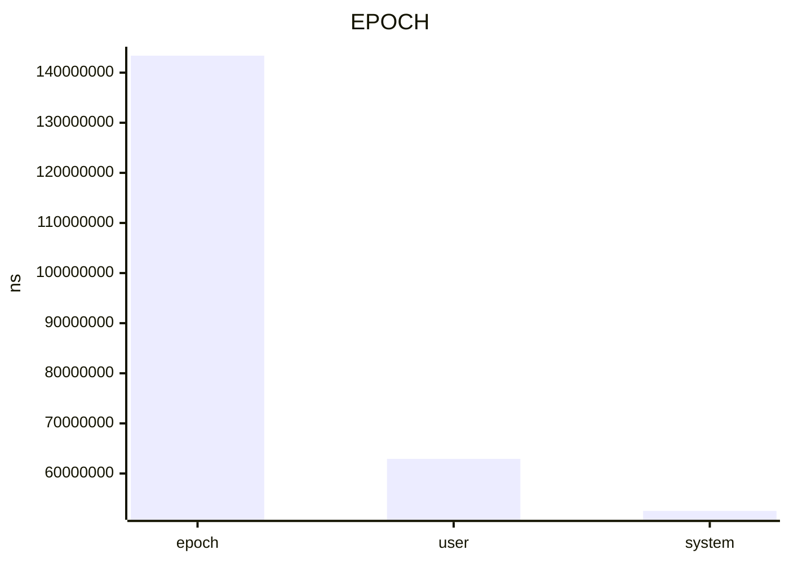

## epoch

+--------+-------+-----------+--------------------+---------------------+---------------------+-------+------+------------------------------------------------------------------------------------------------------------------------------------------------------------------------------------------+
| key    | type  | value     | errorPercent       | min                 | max                 | calls | unit | samples                                                                                                                                                                                  |
+========+=======+===========+====================+=====================+=====================+=======+======+==========================================================================================================================================================================================+
| epoch  | float | 1.43391e8 | 0.5903438849021208 | 1.418472083333333e8 | 5.840749583333334e8 | 1     | ns   | 5.840749583333334e8, 1.43391e8, 1.5604875e8, 1.442375e8, 1.432698333333333e8, 1.454021666666667e8, 1.429596666666667e8, 1.4285075e8, 1.430414166666667e8, 1.45009e8, 1.418472083333333e8 |
+--------+-------+-----------+--------------------+---------------------+---------------------+-------+------+------------------------------------------------------------------------------------------------------------------------------------------------------------------------------------------+
| user   | float | 6.2929e7  | 0.6737752069792941 | 6.2309e7            | 7.9865e7            | 1     | ns   | 7.9865e7, 6.2511e7, 6.7753e7, 6.3074e7, 6.2451e7, 6.3158e7, 6.2887e7, 6.2316e7, 6.2929e7, 6.3353e7, 6.2309e7                                                                             |
+--------+-------+-----------+--------------------+---------------------+---------------------+-------+------+------------------------------------------------------------------------------------------------------------------------------------------------------------------------------------------+
| system | float | 5.2533e7  | 0.7233548436221042 | 5.2153e7            | 6.9842e7            | 1     | ns   | 6.9842e7, 5.2409e7, 5.8647e7, 5.3058e7, 5.2533e7, 5.3509e7, 5.2358e7, 5.2153e7, 5.2457e7, 5.3709e7, 5.2238e7                                                                             |
+--------+-------+-----------+--------------------+---------------------+---------------------+-------+------+------------------------------------------------------------------------------------------------------------------------------------------------------------------------------------------+

