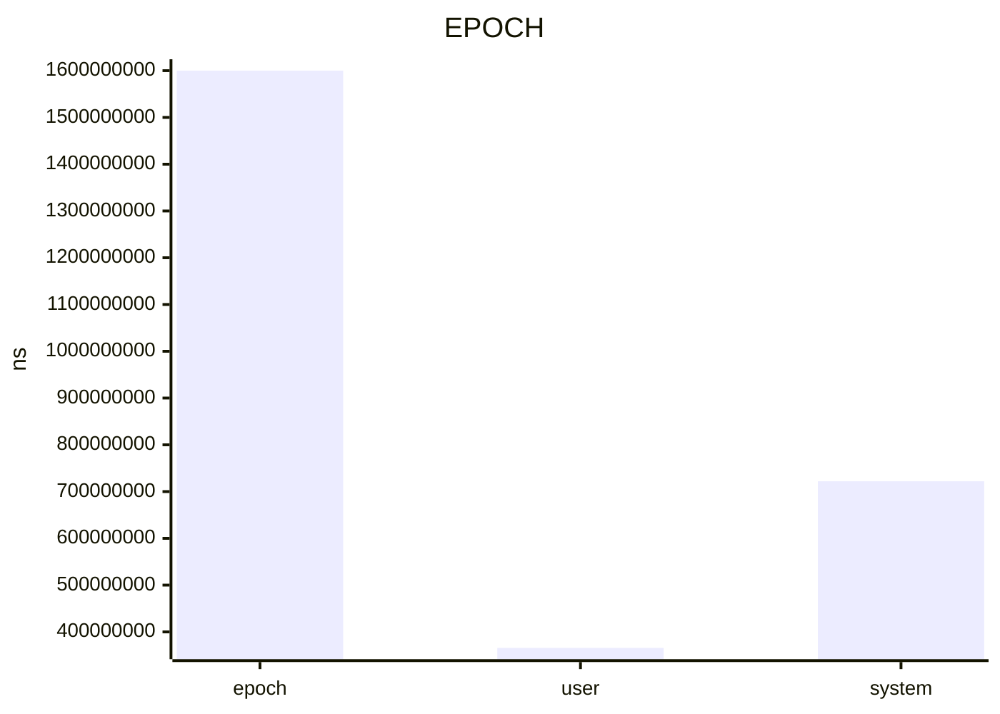

## epoch

+--------+-------+---------------+--------------------+--------------+---------------------+-------+------+-----------------------------------------------------------------------------------------------------------------------------------------------------------------------------------------------------------------+
| key    | type  | value         | errorPercent       | min          | max                 | calls | unit | samples                                                                                                                                                                                                         |
+========+=======+===============+====================+==============+=====================+=======+======+=================================================================================================================================================================================================================+
| epoch  | float | 1.600147625e9 | 0.2886556586719145 | 1.57650225e9 | 1.908806208333333e9 | 1     | ns   | 1.908806208333333e9, 1.604766541666667e9, 1.597542541666667e9, 1.602447083333333e9, 1.600147625e9, 1.606223291666667e9, 1.601956e9, 1.598132166666667e9, 1.583447458333333e9, 1.585113291666667e9, 1.57650225e9 |
+--------+-------+---------------+--------------------+--------------+---------------------+-------+------+-----------------------------------------------------------------------------------------------------------------------------------------------------------------------------------------------------------------+
| user   | float | 3.65648e8     | 0.2127729400953923 | 3.64595e8    | 3.77909e8           | 1     | ns   | 3.77909e8, 3.66637e8, 3.66663e8, 3.6556e                                                                                                                                                                        |
|        |       |               |                    |              |                     |       |      | 8, 3.65466e8, 3.65648e8, 3.66426e8, 3.68                                                                                                                                                                        |
|        |       |               |                    |              |                     |       |      | 047e8, 3.65632e8, 3.6548e8, 3.64595e8                                                                                                                                                                           |
+--------+-------+---------------+--------------------+--------------+---------------------+-------+------+-----------------------------------------------------------------------------------------------------------------------------------------------------------------------------------------------------------------+
| system | float | 7.2199e8      | 0.5130264962118589 | 7.07618e8    | 7.51778e8           | 1     | ns   | 7.51778e8, 7.21384e8, 7.2199e8, 7.23908e                                                                                                                                                                        |
|        |       |               |                    |              |                     |       |      | 8, 7.24638e8, 7.23106e8, 7.27382e8, 7.18                                                                                                                                                                        |
|        |       |               |                    |              |                     |       |      | 286e8, 7.08644e8, 7.11148e8, 7.07618e8                                                                                                                                                                          |
+--------+-------+---------------+--------------------+--------------+---------------------+-------+------+-----------------------------------------------------------------------------------------------------------------------------------------------------------------------------------------------------------------+

