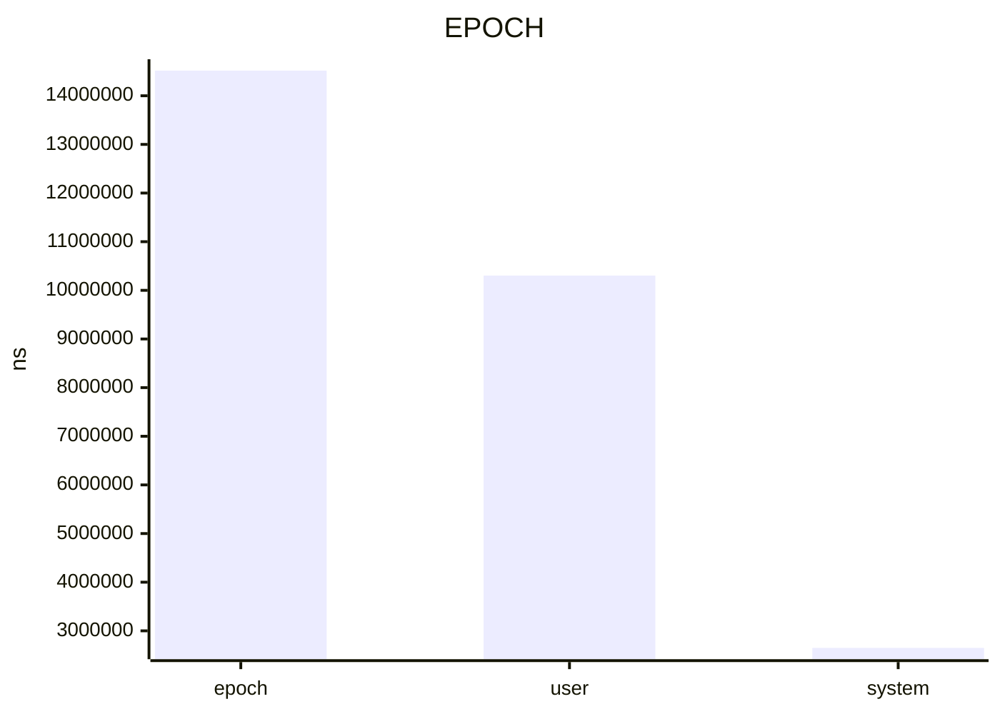

## epoch

+--------+-------+---------------------+-------------------+---------------------+-----------+-------+------+-------------------------------------------------------------------------------------------------+
| key    | type  | value               | errorPercent      | min                 | max       | calls | unit | samples                                                                                         |
+========+=======+=====================+===================+=====================+===========+=======+======+=================================================================================================+
| epoch  | float | 1.451766666666667e7 | 13.57943195646684 | 1.184333333333333e7 | 4.64798e8 | 1     | ns   | 4.64798e8, 1.648908333333333e7, 1.452175                                                        |
|        |       |                     |                   |                     |           |       |      | e7, 2.108e7, 1.184333333333333e7, 1.4517                                                        |
|        |       |                     |                   |                     |           |       |      | 66666666667e7, 1.300558333333333e7, 1.39                                                        |
|        |       |                     |                   |                     |           |       |      | 6933333333333e7, 1.193125e7, 1.185829166                                                        |
|        |       |                     |                   |                     |           |       |      | 666667e7, 1.635508333333333e7                                                                   |
+--------+-------+---------------------+-------------------+---------------------+-----------+-------+------+-------------------------------------------------------------------------------------------------+
| user   | float | 1.0304e7            | 20.86568322981367 | 7.922e6             | 1.7397e7  | 1     | ns   | 1.7397e7, 1.1145e7, 9.877e6, 1.6805e7, 7                                                        |
|        |       |                     |                   |                     |           |       |      | .922e6, 1.0544e7, 9.156e6, 1.0304e7, 8.0                                                        |
|        |       |                     |                   |                     |           |       |      | 62e6, 8.044e6, 1.2454e7                                                                         |
+--------+-------+---------------------+-------------------+---------------------+-----------+-------+------+-------------------------------------------------------------------------------------------------+
| system | float | 2.648e6             | 3.889728096676738 | 2.527e6             | 6.848e6   | 1     | ns   | 6.848e6, 3.506e6, 3.146e6, 2.879e6, 2.648e6, 2.751e6, 2.635e6, 2.527e6, 2.586e6, 2.62e6, 2.63e6 |
+--------+-------+---------------------+-------------------+---------------------+-----------+-------+------+-------------------------------------------------------------------------------------------------+

