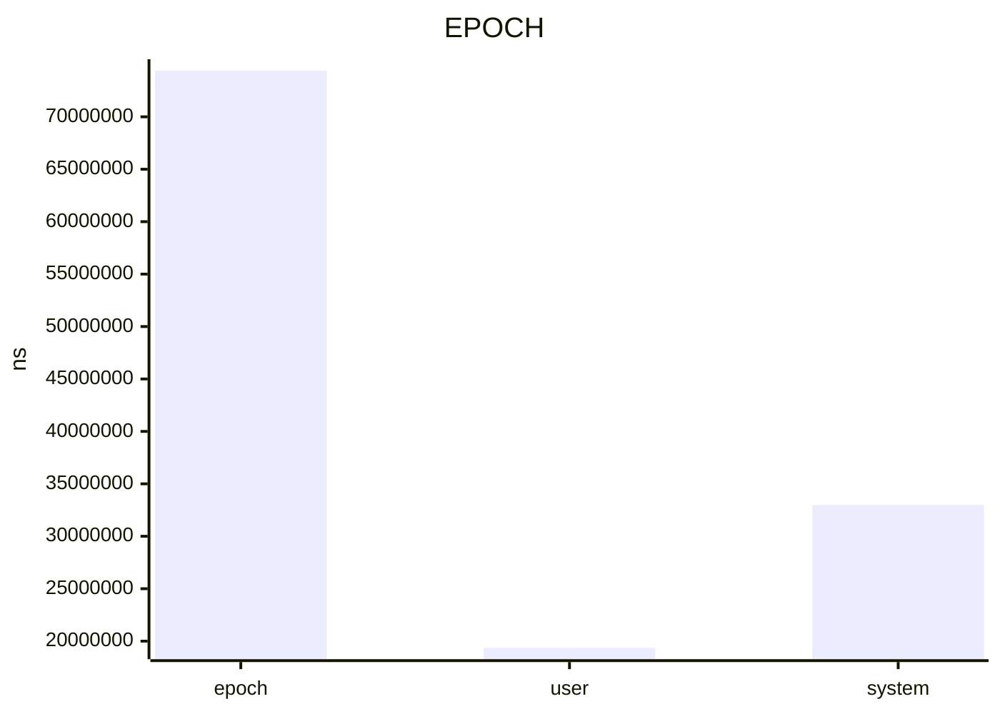

## epoch

+--------+-------+---------------------+--------------------+---------------------+--------------+-------+------+------------------------------------------+
| key    | type  | value               | errorPercent       | min                 | max          | calls | unit | samples                                  |
+========+=======+=====================+====================+=====================+==============+=======+======+==========================================+
| epoch  | float | 7.440766666666666e7 | 0.4838771094376343 | 7.336895833333333e7 | 3.90526125e8 | 1     | ns   | 3.90526125e8, 7.4546625e7, 7.33689583333 |
|        |       |                     |                    |                     |              |       |      | 3333e7, 7.490120833333333e7, 7.4047625e7 |
|        |       |                     |                    |                     |              |       |      | , 7.432595833333333e7, 7.473295833333333 |
|        |       |                     |                    |                     |              |       |      | e7, 7.676695833333333e7, 7.4183791666666 |
|        |       |                     |                    |                     |              |       |      | 67e7, 7.440766666666666e7, 7.37500416666 |
|        |       |                     |                    |                     |              |       |      | 6667e7                                   |
+--------+-------+---------------------+--------------------+---------------------+--------------+-------+------+------------------------------------------+
| user   | float | 1.935e7             | 0.6821705426356589 | 1.918e7             | 3.0587e7     | 1     | ns   | 3.0587e7, 1.935e7, 1.9311e7, 1.9683e7, 1 |
|        |       |                     |                    |                     |              |       |      | .9646e7, 1.9246e7, 1.9218e7, 1.9974e7, 1 |
|        |       |                     |                    |                     |              |       |      | .9238e7, 1.9386e7, 1.918e7               |
+--------+-------+---------------------+--------------------+---------------------+--------------+-------+------+------------------------------------------+
| system | float | 3.2986e7            | 0.6184441884435821 | 3.2653e7            | 5.45e7       | 1     | ns   | 5.45e7, 3.2782e7, 3.2894e7, 3.3847e7, 3. |
|        |       |                     |                    |                     |              |       |      | 3111e7, 3.2901e7, 3.2986e7, 3.4441e7, 3. |
|        |       |                     |                    |                     |              |       |      | 2706e7, 3.3008e7, 3.2653e7               |
+--------+-------+---------------------+--------------------+---------------------+--------------+-------+------+------------------------------------------+

