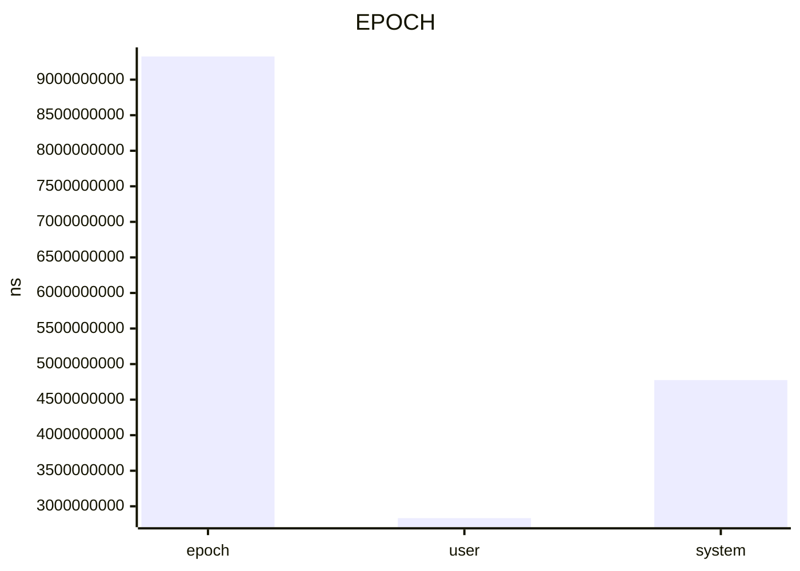

## epoch

+--------+-------+---------------------+--------------------+---------------------+---------------------+-------+------+------------------------------------------------------------------------------------------------------------------------------------+
| key    | type  | value               | errorPercent       | min                 | max                 | calls | unit | samples                                                                                                                            |
+========+=======+=====================+====================+=====================+=====================+=======+======+====================================================================================================================================+
| epoch  | float | 9.326237541666666e9 | 0.4893791999480823 | 9.151520833333332e9 | 9.934642083333334e9 | 1     | ns   | 9.934642083333334e9, 9.318027125e9, 9.15                                                                                           |
|        |       |                     |                    |                     |                     |       |      | 1520833333332e9, 9.335482541666666e9, 9.                                                                                           |
|        |       |                     |                    |                     |                     |       |      | 280596875e9, 9.244375291666668e9, 9.2085                                                                                           |
|        |       |                     |                    |                     |                     |       |      | 75333333334e9, 9.38738375e9, 9.342823833                                                                                           |
|        |       |                     |                    |                     |                     |       |      | 333334e9, 9.326237541666666e9, 9.3525923                                                                                           |
|        |       |                     |                    |                     |                     |       |      | 75e9                                                                                                                               |
+--------+-------+---------------------+--------------------+---------------------+---------------------+-------+------+------------------------------------------------------------------------------------------------------------------------------------+
| user   | float | 2.832804e9          | 0.7266298692037995 | 2.783709e9          | 2.864163e9          | 1     | ns   | 2.84085e9, 2.86266e9, 2.783709e9, 2.828275e9, 2.824487e9, 2.832804e9, 2.81222e9, 2.837468e9, 2.859195e9, 2.864163e9, 2.810016e9    |
+--------+-------+---------------------+--------------------+---------------------+---------------------+-------+------+------------------------------------------------------------------------------------------------------------------------------------+
| system | float | 4.774835e9          | 0.6709551220094516 | 4.715473e9          | 4.920491e9          | 1     | ns   | 4.920491e9, 4.832019e9, 4.715473e9, 4.742798e9, 4.756226e9, 4.771691e9, 4.766543e9, 4.821831e9, 4.805605e9, 4.809293e9, 4.774835e9 |
+--------+-------+---------------------+--------------------+---------------------+---------------------+-------+------+------------------------------------------------------------------------------------------------------------------------------------+

