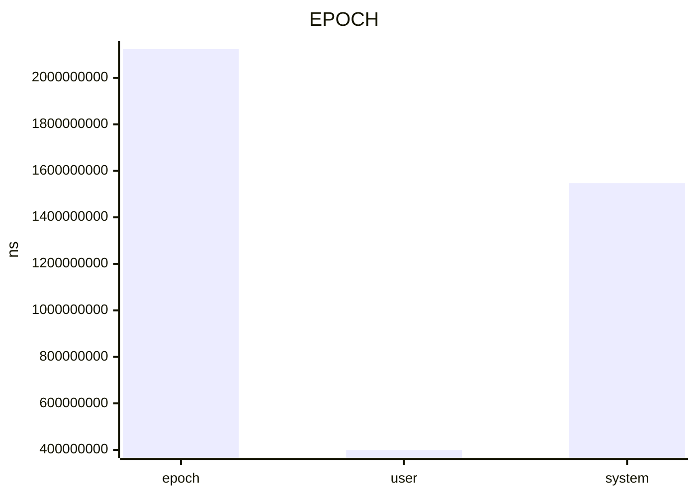

## epoch

+--------+-------+---------------------+--------------------+---------------+------------+-------+------+------------------------------------------+
| key    | type  | value               | errorPercent       | min           | max        | calls | unit | samples                                  |
+========+=======+=====================+====================+===============+============+=======+======+==========================================+
| epoch  | float | 2.123767458333333e9 | 0.9630193544220376 | 2.079027375e9 | 2.485814e9 | 1     | ns   | 2.485814e9, 2.079027375e9, 2.12376745833 |
|        |       |                     |                    |               |            |       |      | 3333e9, 2.119500208333333e9, 2.125098916 |
|        |       |                     |                    |               |            |       |      | 666667e9, 2.087057916666667e9, 2.1384456 |
|        |       |                     |                    |               |            |       |      | 25e9, 2.081861541666667e9, 2.10331516666 |
|        |       |                     |                    |               |            |       |      | 6667e9, 2.125236041666667e9, 2.145085458 |
|        |       |                     |                    |               |            |       |      | 333333e9                                 |
+--------+-------+---------------------+--------------------+---------------+------------+-------+------+------------------------------------------+
| user   | float | 3.98935e8           | 0.30681689999624   | 3.95665e8     | 4.01972e8  | 1     | ns   | 4.01972e8, 3.96561e8, 4.01146e8, 3.95776 |
|        |       |                     |                    |               |            |       |      | e8, 3.99401e8, 3.97711e8, 3.95665e8, 3.9 |
|        |       |                     |                    |               |            |       |      | 8935e8, 3.99077e8, 3.9968e8, 3.9795e8    |
+--------+-------+---------------------+--------------------+---------------+------------+-------+------+------------------------------------------+
| system | float | 1.54711e9           | 0.5566507875975205 | 1.521561e9    | 1.597298e9 | 1     | ns   | 1.54711e9, 1.521561e9, 1.547797e9, 1.541 |
|        |       |                     |                    |               |            |       |      | 912e9, 1.542436e9, 1.534069e9, 1.555722e |
|        |       |                     |                    |               |            |       |      | 9, 1.540814e9, 1.563121e9, 1.580233e9, 1 |
|        |       |                     |                    |               |            |       |      | .597298e9                                |
+--------+-------+---------------------+--------------------+---------------+------------+-------+------+------------------------------------------+

