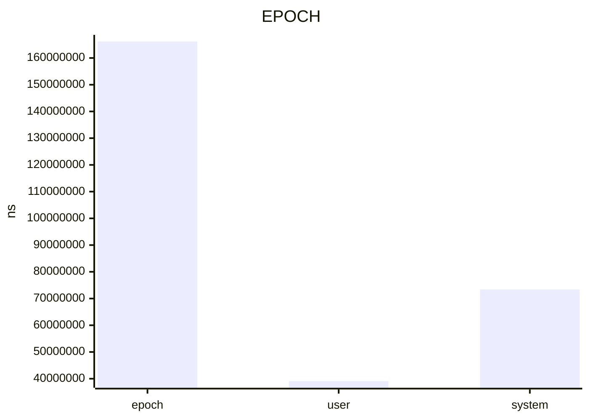

## epoch

+--------+-------+---------------------+--------------------+------------+---------------------+-------+------+------------------------------------------------------------------------------------------------------------------------------------------------------------------------------------+
| key    | type  | value               | errorPercent       | min        | max                 | calls | unit | samples                                                                                                                                                                            |
+========+=======+=====================+====================+============+=====================+=======+======+====================================================================================================================================================================================+
| epoch  | float | 1.661634583333333e8 | 1.046233841526033  | 1.638905e8 | 4.659740833333334e8 | 1     | ns   | 4.659740833333334e8, 1.66202125e8, 1.68089875e8, 1.662050833333333e8, 1.64425e8, 1.646579166666667e8, 1.639565e8, 1.638905e8, 1.673305e8, 1.661634583333333e8, 1.641889583333333e8 |
+--------+-------+---------------------+--------------------+------------+---------------------+-------+------+------------------------------------------------------------------------------------------------------------------------------------------------------------------------------------+
| user   | float | 3.9088e7            | 0.7649406467458044 | 3.8676e7   | 4.9823e7            | 1     | ns   | 4.9823e7, 3.9087e7, 3.9945e7, 3.9284e7, 3.8941e7, 3.9088e7, 3.8722e7, 3.883e7, 3.9891e7, 3.9387e7, 3.8676e7                                                                        |
+--------+-------+---------------------+--------------------+------------+---------------------+-------+------+------------------------------------------------------------------------------------------------------------------------------------------------------------------------------------+
| system | float | 7.3408e7            | 1.028498256320837  | 7.2567e7   | 9.4748e7            | 1     | ns   | 9.4748e7, 7.3184e7, 7.517e7, 7.4232e7, 7                                                                                                                                           |
|        |       |                     |                    |            |                     |       |      | .3227e7, 7.3408e7, 7.2653e7, 7.2567e7, 7                                                                                                                                           |
|        |       |                     |                    |            |                     |       |      | .4794e7, 7.4046e7, 7.2662e7                                                                                                                                                        |
+--------+-------+---------------------+--------------------+------------+---------------------+-------+------+------------------------------------------------------------------------------------------------------------------------------------------------------------------------------------+

