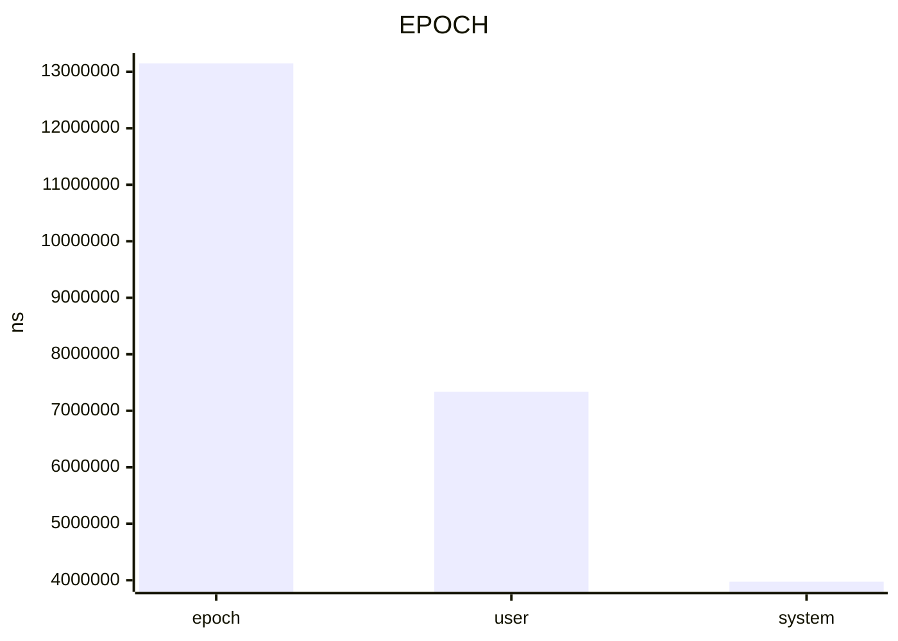

## epoch

+--------+-------+---------------------+-------------------+---------------------+-------------+-------+------+---------------------------------------------------------------------------------------------------+-----------+--------------------+------------------------+
| key    | type  | value               | errorPercent      | min                 | max         | calls | unit | samples                                                                                           | baseline  | change             | probability            |
+========+=======+=====================+===================+=====================+=============+=======+======+===================================================================================================+===========+====================+========================+
| epoch  | float | 1.314908333333333e7 | 1.968451539714419 | 1.279191666666667e7 | 2.1698625e7 | 1     | ns   | 2.1698625e7, 1.68835e7, 1.47460416666666                                                          | 5.56475e7 | -76.37075639816105 | 0.2785986718379627     |
|        |       |                     |                   |                     |             |       |      | 7e7, 1.404170833333333e7, 1.340791666666                                                          |           |                    |                        |
|        |       |                     |                   |                     |             |       |      | 667e7, 1.30845e7, 1.3048125e7, 1.3149083                                                          |           |                    |                        |
|        |       |                     |                   |                     |             |       |      | 33333333e7, 1.296541666666667e7, 1.27919                                                          |           |                    |                        |
|        |       |                     |                   |                     |             |       |      | 1666666667e7, 1.3141375e7                                                                         |           |                    |                        |
+--------+-------+---------------------+-------------------+---------------------+-------------+-------+------+---------------------------------------------------------------------------------------------------+-----------+--------------------+------------------------+
| user   | float | 7.337e6             | 2.003543682704103 | 7.154e6             | 1.2281e7    | 1     | ns   | 1.2281e7, 9.528e6, 8.342e6, 7.881e6, 7.453e6, 7.278e6, 7.19e6, 7.244e6, 7.208e6, 7.154e6, 7.337e6 | 4.951e7   | -85.18077156130074 | 0.00007105263288600171 |
+--------+-------+---------------------+-------------------+---------------------+-------------+-------+------+---------------------------------------------------------------------------------------------------+-----------+--------------------+------------------------+
| system | float | 3.974e6             | 2.264720684448918 | 3.818e6             | 6.454e6     | 1     | ns   | 6.454e6, 4.752e6, 4.216e6, 4.17e6, 3.997                                                          | 3.53e6    | 12.57790368271955  | 0.1076616636574339     |
|        |       |                     |                   |                     |             |       |      | e6, 3.884e6, 3.89e6, 3.974e6, 3.914e6, 3                                                          |           |                    |                        |
|        |       |                     |                   |                     |             |       |      | .818e6, 3.948e6                                                                                   |           |                    |                        |
+--------+-------+---------------------+-------------------+---------------------+-------------+-------+------+---------------------------------------------------------------------------------------------------+-----------+--------------------+------------------------+

