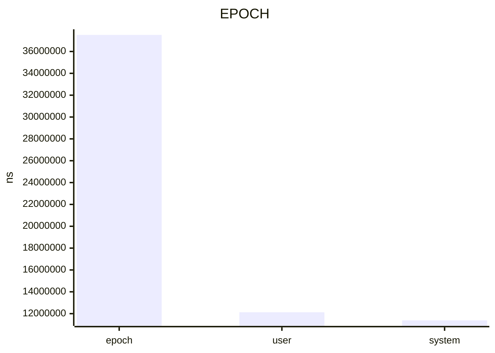

## epoch

+--------+-------+---------------------+-------------------+---------------------+-----------+-------+------+------------------------------------------------------------------------------------------------------------------------------------------------------------------------------------------------------------+-----------+--------------------+------------------------+
| key    | type  | value               | errorPercent      | min                 | max       | calls | unit | samples                                                                                                                                                                                                    | baseline  | change             | probability            |
+========+=======+=====================+===================+=====================+===========+=======+======+============================================================================================================================================================================================================+===========+====================+========================+
| epoch  | float | 3.751891666666666e7 | 3.328432102028526 | 3.038683333333333e7 | 4.62435e7 | 1     | ns   | 3.606716666666666e7, 3.7062125e7, 3.654683333333334e7, 3.420620833333334e7, 3.876770833333333e7, 4.506145833333333e7, 3.790504166666666e7, 3.751891666666666e7, 3.807075e7, 4.62435e7, 3.038683333333333e7 | 5.56475e7 | -32.57753418093056 | 0.2785986718379627     |
+--------+-------+---------------------+-------------------+---------------------+-----------+-------+------+------------------------------------------------------------------------------------------------------------------------------------------------------------------------------------------------------------+-----------+--------------------+------------------------+
| user   | float | 1.2127e7            | 5.442401253401501 | 9.811e6             | 1.2878e7  | 1     | ns   | 1.0102e7, 1.2338e7, 1.2878e7, 1.1213e7, 1.2156e7, 1.2127e7, 1.2379e7, 1.1467e7, 9.811e6, 1.2517e7, 1.0068e7                                                                                                | 4.951e7   | -75.50595839224398 | 0.00007105263288600171 |
+--------+-------+---------------------+-------------------+---------------------+-----------+-------+------+------------------------------------------------------------------------------------------------------------------------------------------------------------------------------------------------------------+-----------+--------------------+------------------------+
| system | float | 1.1387e7            | 7.596381838939141 | 1.017e7             | 1.3789e7  | 1     | ns   | 1.3789e7, 1.3282e7, 1.2124e7, 1.0522e7, 1.1387e7, 1.2015e7, 1.1183e7, 1.0594e7, 1.0302e7, 1.2357e7, 1.017e7                                                                                                | 3.53e6    | 222.5779036827196  | 0.00007105263288600171 |
+--------+-------+---------------------+-------------------+---------------------+-----------+-------+------+------------------------------------------------------------------------------------------------------------------------------------------------------------------------------------------------------------+-----------+--------------------+------------------------+

