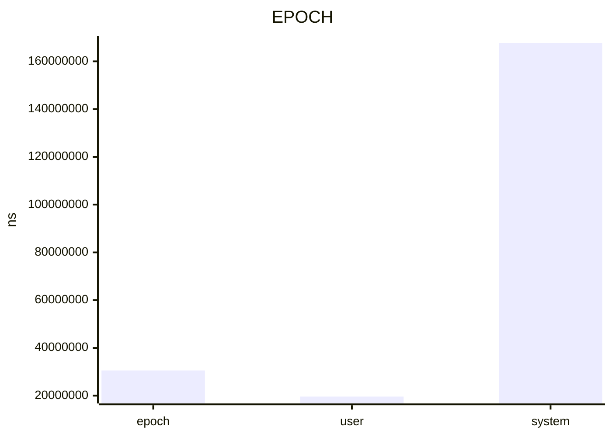

## epoch

+--------+-------+---------------------+--------------------+---------------------+-------------+-------+------+-----------------------------------------------------------------------------------------------------------------------------------------------------------------------------------------------------------------------+---------------------+--------------------+------------------------+
| key    | type  | value               | errorPercent       | min                 | max         | calls | unit | samples                                                                                                                                                                                                               | baseline            | change             | probability            |
+========+=======+=====================+====================+=====================+=============+=======+======+=======================================================================================================================================================================================================================+=====================+====================+========================+
| epoch  | float | 3.055783333333333e7 | 1.46934501246272   | 3.001845833333334e7 | 3.6477375e7 | 1     | ns   | 3.6477375e7, 3.137595833333334e7, 3.030241666666666e7, 3.001845833333334e7, 3.031308333333334e7, 3.036916666666666e7, 3.106441666666667e7, 3.055783333333333e7, 3.100683333333334e7, 3.1072375e7, 3.021516666666667e7 | 3.032366666666666e7 | 0.7722241153774445 | 0.03859793065455368    |
+--------+-------+---------------------+--------------------+---------------------+-------------+-------+------+-----------------------------------------------------------------------------------------------------------------------------------------------------------------------------------------------------------------------+---------------------+--------------------+------------------------+
| user   | float | 1.9617e7            | 0.5607381352908192 | 1.8952e7            | 2.1896e7    | 1     | ns   | 2.1896e7, 1.9623e7, 1.9539e7, 1.8952e7, 1.9727e7, 1.9133e7, 1.9548e7, 1.9789e7, 1.9617e7, 1.9573e7, 1.9759e7                                                                                                          | 1.8101e7            | 8.375227887961991  | 0.00007105263288600171 |
+--------+-------+---------------------+--------------------+---------------------+-------------+-------+------+-----------------------------------------------------------------------------------------------------------------------------------------------------------------------------------------------------------------------+---------------------+--------------------+------------------------+
| system | float | 1.67599e8           | 0.6628917833638626 | 1.63887e8           | 1.71744e8   | 1     | ns   | 1.68475e8, 1.68208e8, 1.67246e8, 1.71655                                                                                                                                                                              | 1.73105e8           | -3.180728459605442 | 0.04520060374758589    |
|        |       |                     |                    |                     |             |       |      | e8, 1.63887e8, 1.66875e8, 1.70143e8, 1.7                                                                                                                                                                              |                     |                    |                        |
|        |       |                     |                    |                     |             |       |      | 1744e8, 1.67599e8, 1.64729e8, 1.66488e8                                                                                                                                                                               |                     |                    |                        |
+--------+-------+---------------------+--------------------+---------------------+-------------+-------+------+-----------------------------------------------------------------------------------------------------------------------------------------------------------------------------------------------------------------------+---------------------+--------------------+------------------------+

