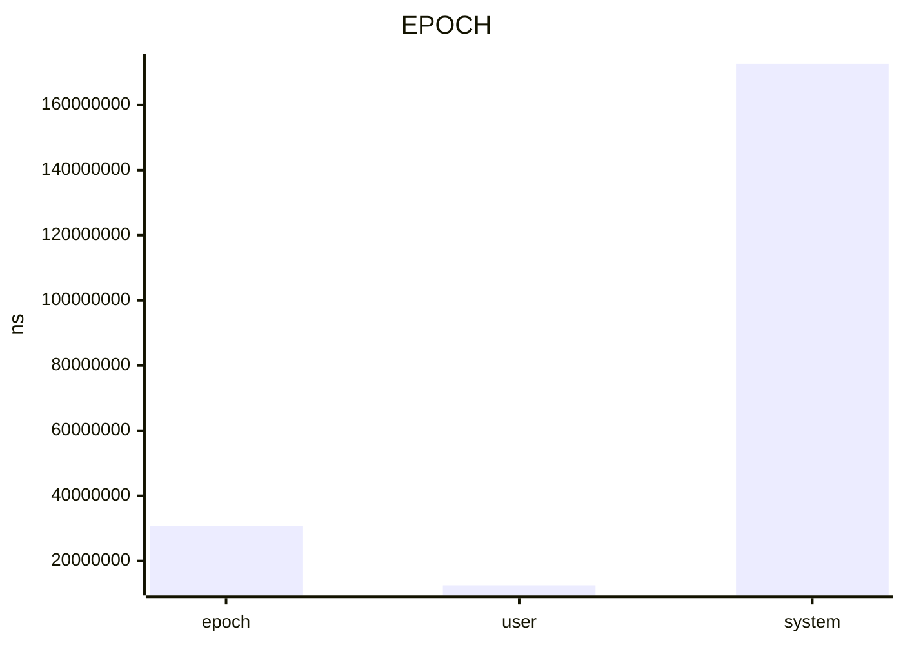

## epoch

+--------+-------+---------------------+--------------------+-------------+------------+-------+------+------------------------------------------+---------------------+--------------------+------------------------+
| key    | type  | value               | errorPercent       | min         | max        | calls | unit | samples                                  | baseline            | change             | probability            |
+========+=======+=====================+====================+=============+============+=======+======+==========================================+=====================+====================+========================+
| epoch  | float | 3.067591666666667e7 | 1.552656671493101  | 2.9755625e7 | 3.502975e7 | 1     | ns   | 3.502975e7, 3.115220833333333e7, 3.06759 | 3.115091666666667e7 | -1.524834742690837 | 0.1782597178058258     |
|        |       |                     |                    |             |            |       |      | 1666666667e7, 3.091629166666667e7, 3.097 |                     |                    |                        |
|        |       |                     |                    |             |            |       |      | 633333333334e7, 3.068633333333333e7, 3.0 |                     |                    |                        |
|        |       |                     |                    |             |            |       |      | 29270833333334e7, 2.995670833333333e7, 3 |                     |                    |                        |
|        |       |                     |                    |             |            |       |      | .01185e7, 2.9755625e7, 2.996929166666667 |                     |                    |                        |
|        |       |                     |                    |             |            |       |      | e7                                       |                     |                    |                        |
+--------+-------+---------------------+--------------------+-------------+------------+-------+------+------------------------------------------+---------------------+--------------------+------------------------+
| user   | float | 1.2502e7            | 0.9998400255959047 | 1.2334e7    | 1.383e7    | 1     | ns   | 1.383e7, 1.2502e7, 1.271e7, 1.2548e7, 1. | 1.6437e7            | -23.93989170773256 | 0.00007105263288600171 |
|        |       |                     |                    |             |            |       |      | 256e7, 1.2377e7, 1.2389e7, 1.2348e7, 1.2 |                     |                    |                        |
|        |       |                     |                    |             |            |       |      | 591e7, 1.2334e7, 1.235e7                 |                     |                    |                        |
+--------+-------+---------------------+--------------------+-------------+------------+-------+------+------------------------------------------+---------------------+--------------------+------------------------+
| system | float | 1.72675e8           | 2.059939192123932  | 1.55969e8   | 1.79863e8  | 1     | ns   | 1.73882e8, 1.75767e8, 1.79863e8, 1.72675 | 1.84883e8           | -6.603094930307275 | 0.01654017185597306    |
|        |       |                     |                    |             |            |       |      | e8, 1.70886e8, 1.69118e8, 1.76323e8, 1.6 |                     |                    |                        |
|        |       |                     |                    |             |            |       |      | 5764e8, 1.73754e8, 1.66357e8, 1.55969e8  |                     |                    |                        |
+--------+-------+---------------------+--------------------+-------------+------------+-------+------+------------------------------------------+---------------------+--------------------+------------------------+

