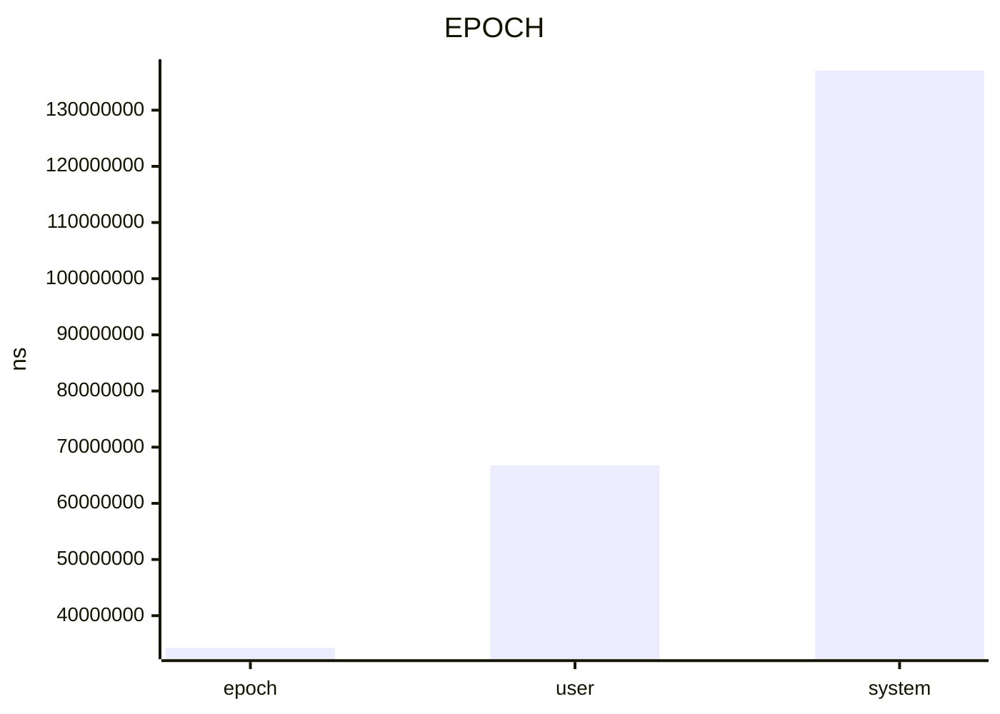

## epoch

+--------+-------+-----------+-------------------+-----------+---------------------+-------+------+----------------------------------------------------------------------------------------------------------------------------------------------------------------------------------------------------------+---------------------+--------------------+------------------------+
| key    | type  | value     | errorPercent      | min       | max                 | calls | unit | samples                                                                                                                                                                                                  | baseline            | change             | probability            |
+========+=======+===========+===================+===========+=====================+=======+======+==========================================================================================================================================================================================================+=====================+====================+========================+
| epoch  | float | 3.42515e7 | 1.672797785011856 | 3.2509e7  | 4.046954166666666e7 | 1     | ns   | 4.046954166666666e7, 3.4371875e7, 3.348091666666666e7, 3.426945833333334e7, 3.2509e7, 3.42515e7, 3.521983333333334e7, 3.482445833333334e7, 3.415533333333334e7, 3.326845833333333e7, 3.401829166666666e7 | 3.616329166666666e7 | -5.286553238262991 | 0.5327473782446905     |
+--------+-------+-----------+-------------------+-----------+---------------------+-------+------+----------------------------------------------------------------------------------------------------------------------------------------------------------------------------------------------------------+---------------------+--------------------+------------------------+
| user   | float | 6.6749e7  | 1.017243704025528 | 6.5134e7  | 7.3354e7            | 1     | ns   | 7.3354e7, 6.6463e7, 6.7428e7, 6.6749e7, 6.5838e7, 6.7384e7, 6.6966e7, 6.7087e7, 6.5134e7, 6.5466e7, 6.5576e7                                                                                             | 4.994e7             | 33.6583900680817   | 0.00007105263288600171 |
+--------+-------+-----------+-------------------+-----------+---------------------+-------+------+----------------------------------------------------------------------------------------------------------------------------------------------------------------------------------------------------------+---------------------+--------------------+------------------------+
| system | float | 1.37049e8 | 1.916102999657057 | 1.30217e8 | 1.4886e8            | 1     | ns   | 1.4886e8, 1.35529e8, 1.30217e8, 1.30757e                                                                                                                                                                 | 1.97001e8           | -30.43233283079782 | 0.01146807302223756    |
|        |       |           |                   |           |                     |       |      | 8, 1.3878e8, 1.32283e8, 1.37049e8, 1.386                                                                                                                                                                 |                     |                    |                        |
|        |       |           |                   |           |                     |       |      | 45e8, 1.39794e8, 1.37736e8, 1.34423e8                                                                                                                                                                    |                     |                    |                        |
+--------+-------+-----------+-------------------+-----------+---------------------+-------+------+----------------------------------------------------------------------------------------------------------------------------------------------------------------------------------------------------------+---------------------+--------------------+------------------------+

