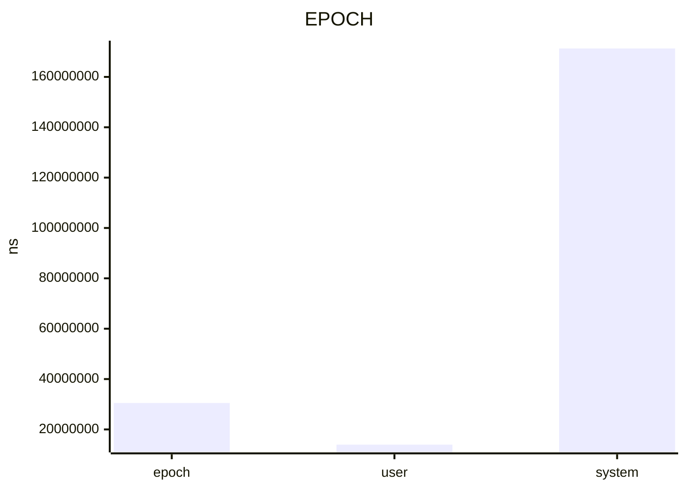

## epoch

+--------+-------+---------------------+--------------------+---------------------+-------------+-------+------+-----------------------------------------------------------------------------------------------------------------------------------------------------------------------------------+-------------+--------------------+---------------------+
| key    | type  | value               | errorPercent       | min                 | max         | calls | unit | samples                                                                                                                                                                           | baseline    | change             | probability         |
+========+=======+=====================+====================+=====================+=============+=======+======+===================================================================================================================================================================================+=============+====================+=====================+
| epoch  | float | 3.050608333333333e7 | 1.12422932038145   | 2.992208333333333e7 | 3.7068375e7 | 1     | ns   | 3.7068375e7, 3.144216666666667e7, 3.118266666666667e7, 3.0389375e7, 2.992208333333333e7, 3.050608333333333e7, 3.0666e7, 3.0163125e7, 2.9987625e7, 3.071775e7, 3.017766666666666e7 | 3.1108875e7 | -1.937683913888458 | 0.7179816667337767  |
+--------+-------+---------------------+--------------------+---------------------+-------------+-------+------+-----------------------------------------------------------------------------------------------------------------------------------------------------------------------------------+-------------+--------------------+---------------------+
| user   | float | 1.3945e7            | 0.9752599498027967 | 1.3663e7            | 1.6549e7    | 1     | ns   | 1.6549e7, 1.4315e7, 1.3845e7, 1.3842e7, 1.3945e7, 1.3924e7, 1.4049e7, 1.3809e7, 1.4084e7, 1.42e7, 1.3663e7                                                                        | 2.1057e7    | -33.77499168922449 | 0.01146807302223756 |
+--------+-------+---------------------+--------------------+---------------------+-------------+-------+------+-----------------------------------------------------------------------------------------------------------------------------------------------------------------------------------+-------------+--------------------+---------------------+
| system | float | 1.71304e8           | 2.509573623499743  | 1.60999e8           | 1.91366e8   | 1     | ns   | 1.91366e8, 1.75066e8, 1.6658e8, 1.67465e                                                                                                                                          | 1.78638e8   | -4.105509466071049 | 0.05273094305698332 |
|        |       |                     |                    |                     |             |       |      | 8, 1.65939e8, 1.75603e8, 1.7586e8, 1.683                                                                                                                                          |             |                    |                     |
|        |       |                     |                    |                     |             |       |      | 63e8, 1.72906e8, 1.71304e8, 1.60999e8                                                                                                                                             |             |                    |                     |
+--------+-------+---------------------+--------------------+---------------------+-------------+-------+------+-----------------------------------------------------------------------------------------------------------------------------------------------------------------------------------+-------------+--------------------+---------------------+

