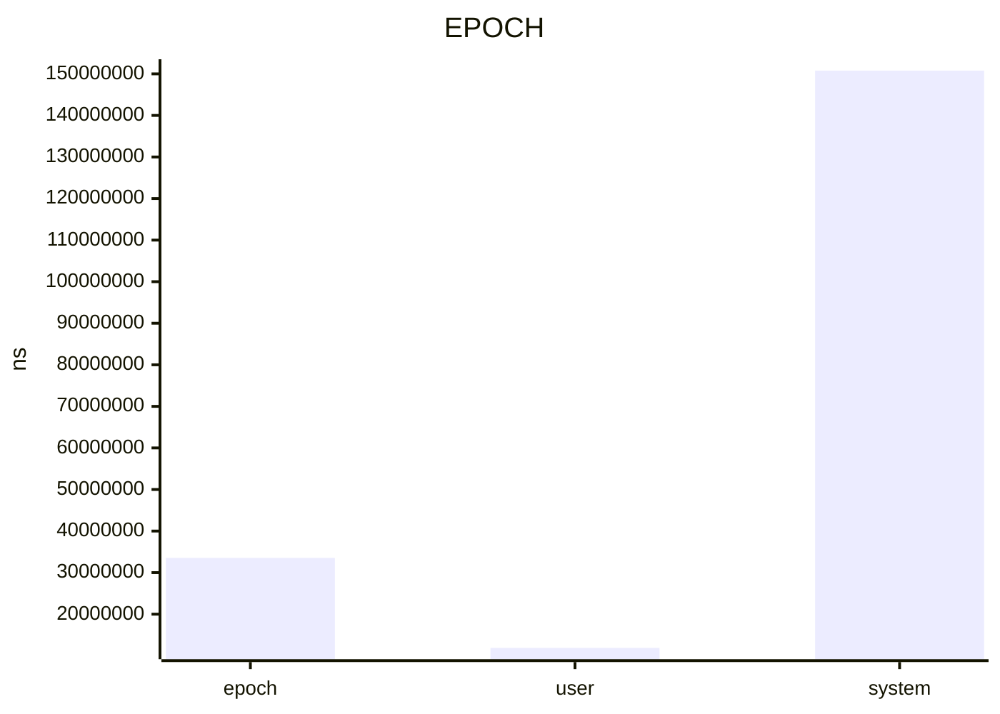

## epoch

+--------+-------+---------------------+-------------------+---------------------+---------------------+-------+------+--------------------------------------------------------------------------------------------------------------------------------------------------------------------------------------------------+---------------------+--------------------+------------------------+
| key    | type  | value               | errorPercent      | min                 | max                 | calls | unit | samples                                                                                                                                                                                          | baseline            | change             | probability            |
+========+=======+=====================+===================+=====================+=====================+=======+======+==================================================================================================================================================================================================+=====================+====================+========================+
| epoch  | float | 3.354345833333333e7 | 2.462974027474301 | 3.218220833333333e7 | 8.183595833333333e7 | 1     | ns   | 8.183595833333333e7, 3.3691875e7, 3.271729166666667e7, 3.218220833333333e7, 3.31515e7, 3.235283333333333e7, 3.3612e7, 3.439529166666666e7, 3.354345833333333e7, 3.439595833333333e7, 3.3365375e7 | 1.666562916666667e8 | -79.8726720738366  | 0.07095149242730564    |
+--------+-------+---------------------+-------------------+---------------------+---------------------+-------+------+--------------------------------------------------------------------------------------------------------------------------------------------------------------------------------------------------+---------------------+--------------------+------------------------+
| user   | float | 1.1873e7            | 1.52446727869957  | 1.1337e7            | 1.5657e7            | 1     | ns   | 1.5657e7, 1.1817e7, 1.1337e7, 1.1669e7, 1.211e7, 1.1839e7, 1.1749e7, 1.2268e7, 1.1873e7, 1.2054e7, 1.2043e7                                                                                      | 9.1941e7            | -87.08628359491412 | 0.00007105263288600171 |
+--------+-------+---------------------+-------------------+---------------------+---------------------+-------+------+--------------------------------------------------------------------------------------------------------------------------------------------------------------------------------------------------+---------------------+--------------------+------------------------+
| system | float | 1.50788e8           | 3.889566809029896 | 1.32294e8           | 4.45965e8           | 1     | ns   | 4.45965e8, 1.44149e8, 1.32294e8, 1.46299                                                                                                                                                         | 7.3106e7            | 106.2594041528739  | 0.00007105263288600171 |
|        |       |                     |                   |                     |                     |       |      | e8, 1.50788e8, 1.44692e8, 1.55229e8, 1.5                                                                                                                                                         |                     |                    |                        |
|        |       |                     |                   |                     |                     |       |      | 6653e8, 1.56321e8, 1.57035e8, 1.47871e8                                                                                                                                                          |                     |                    |                        |
+--------+-------+---------------------+-------------------+---------------------+---------------------+-------+------+--------------------------------------------------------------------------------------------------------------------------------------------------------------------------------------------------+---------------------+--------------------+------------------------+

