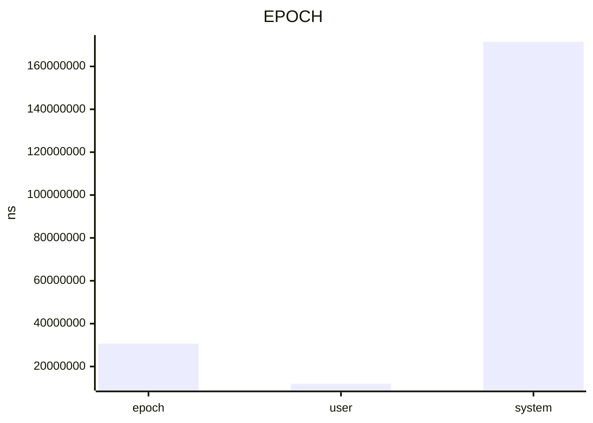

## epoch

+--------+-------+-------------+--------------------+---------------------+---------------------+-------+------+------------------------------------------+---------------------+--------------------+------------------------+
| key    | type  | value       | errorPercent       | min                 | max                 | calls | unit | samples                                  | baseline            | change             | probability            |
+========+=======+=============+====================+=====================+=====================+=======+======+==========================================+=====================+====================+========================+
| epoch  | float | 3.0659875e7 | 0.6228281535177029 | 2.976145833333334e7 | 3.524933333333334e7 | 1     | ns   | 3.524933333333334e7, 3.062420833333333e7 | 1.666562916666667e8 | -81.60292978237895 | 0.07095149242730564    |
|        |       |             |                    |                     |                     |       |      | , 3.062108333333333e7, 3.087825e7, 2.993 |                     |                    |                        |
|        |       |             |                    |                     |                     |       |      | 729166666667e7, 2.976145833333334e7, 3.0 |                     |                    |                        |
|        |       |             |                    |                     |                     |       |      | 659875e7, 3.069579166666667e7, 3.0850833 |                     |                    |                        |
|        |       |             |                    |                     |                     |       |      | 33333334e7, 3.072754166666667e7, 3.0082e |                     |                    |                        |
|        |       |             |                    |                     |                     |       |      | 7                                        |                     |                    |                        |
+--------+-------+-------------+--------------------+---------------------+---------------------+-------+------+------------------------------------------+---------------------+--------------------+------------------------+
| user   | float | 1.1901e7    | 0.8486681791446097 | 1.147e7             | 1.4049e7            | 1     | ns   | 1.4049e7, 1.2095e7, 1.147e7, 1.1921e7, 1 | 9.1941e7            | -87.05582928182204 | 0.00007105263288600171 |
|        |       |             |                    |                     |                     |       |      | .1986e7, 1.18e7, 1.1812e7, 1.1598e7, 1.1 |                     |                    |                        |
|        |       |             |                    |                     |                     |       |      | 827e7, 1.1901e7, 1.2017e7                |                     |                    |                        |
+--------+-------+-------------+--------------------+---------------------+---------------------+-------+------+------------------------------------------+---------------------+--------------------+------------------------+
| system | float | 1.71483e8   | 1.961710490252678  | 1.43422e8           | 1.82477e8           | 1     | ns   | 1.82477e8, 1.66139e8, 1.43422e8, 1.73818 | 7.3106e7            | 134.5676141493174  | 0.00007105263288600171 |
|        |       |             |                    |                     |                     |       |      | e8, 1.71483e8, 1.66421e8, 1.7401e8, 1.69 |                     |                    |                        |
|        |       |             |                    |                     |                     |       |      | 693e8, 1.74847e8, 1.70304e8, 1.81123e8   |                     |                    |                        |
+--------+-------+-------------+--------------------+---------------------+---------------------+-------+------+------------------------------------------+---------------------+--------------------+------------------------+

