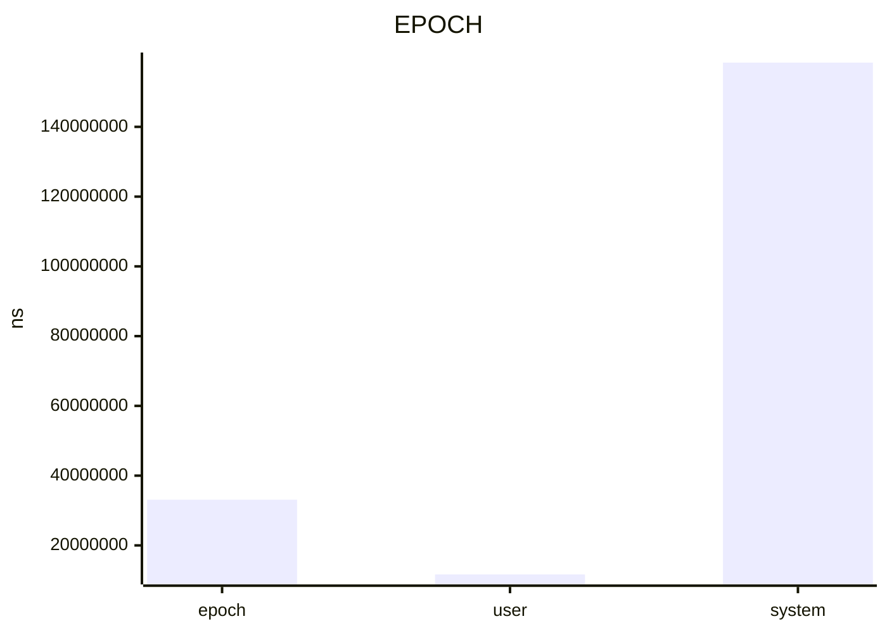

## epoch

+--------+-------+---------------------+-------------------+---------------------+---------------------+-------+------+-------------------------------------------------------------------------------------------------------------+---------------------+--------------------+---------------------+
| key    | type  | value               | errorPercent      | min                 | max                 | calls | unit | samples                                                                                                     | baseline            | change             | probability         |
+========+=======+=====================+===================+=====================+=====================+=======+======+=============================================================================================================+=====================+====================+=====================+
| epoch  | float | 3.310216666666667e7 | 1.404616012043518 | 3.219983333333333e7 | 4.140729166666666e7 | 1     | ns   | 4.140729166666666e7, 3.360795833333334e7                                                                    | 3.231970833333334e7 | 2.420994413883154  | 0.08183746008958785 |
|        |       |                     |                   |                     |                     |       |      | , 3.303708333333334e7, 3.255191666666667                                                                    |                     |                    |                     |
|        |       |                     |                   |                     |                     |       |      | e7, 3.317791666666667e7, 3.3102166666666                                                                    |                     |                    |                     |
|        |       |                     |                   |                     |                     |       |      | 67e7, 3.219983333333333e7, 3.26372083333                                                                    |                     |                    |                     |
|        |       |                     |                   |                     |                     |       |      | 3334e7, 3.384345833333334e7, 3.304391666                                                                    |                     |                    |                     |
|        |       |                     |                   |                     |                     |       |      | 666666e7, 3.346416666666667e7                                                                               |                     |                    |                     |
+--------+-------+---------------------+-------------------+---------------------+---------------------+-------+------+-------------------------------------------------------------------------------------------------------------+---------------------+--------------------+---------------------+
| user   | float | 1.1672e7            | 0.822481151473612 | 1.1442e7            | 1.5776e7            | 1     | ns   | 1.5776e7, 1.2221e7, 1.1576e7, 1.1672e7, 1.1564e7, 1.1632e7, 1.1673e7, 1.1442e7, 1.2036e7, 1.1659e7, 1.172e7 | 1.5373e7            | -24.07467638066741 | 0.03859793065455368 |
+--------+-------+---------------------+-------------------+---------------------+---------------------+-------+------+-------------------------------------------------------------------------------------------------------------+---------------------+--------------------+---------------------+
| system | float | 1.58428e8           | 2.885853510743051 | 1.44096e8           | 1.66402e8           | 1     | ns   | 1.66402e8, 1.51996e8, 1.60926e8, 1.58428                                                                    | 2.0596e8            | -23.07826762478151 | 0.01146807302223756 |
|        |       |                     |                   |                     |                     |       |      | e8, 1.58646e8, 1.58658e8, 1.52271e8, 1.5                                                                    |                     |                    |                     |
|        |       |                     |                   |                     |                     |       |      | 1338e8, 1.44096e8, 1.53856e8, 1.60325e8                                                                     |                     |                    |                     |
+--------+-------+---------------------+-------------------+---------------------+---------------------+-------+------+-------------------------------------------------------------------------------------------------------------+---------------------+--------------------+---------------------+

