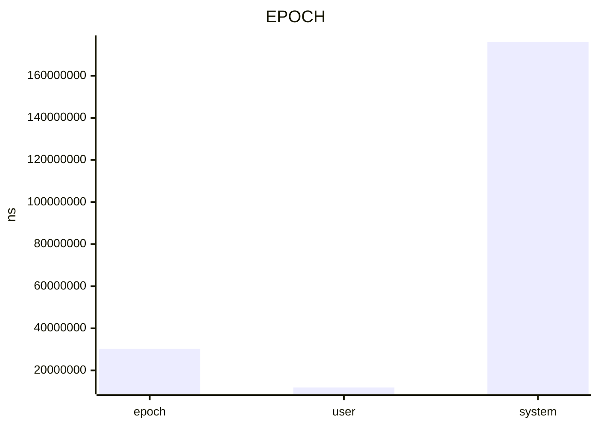

## epoch

+--------+-------+-------------+--------------------+-------------+-----------+-------+------+------------------------------------------------------------------------------------------------------------+---------------------+--------------------+---------------------+
| key    | type  | value       | errorPercent       | min         | max       | calls | unit | samples                                                                                                    | baseline            | change             | probability         |
+========+=======+=============+====================+=============+===========+=======+======+============================================================================================================+=====================+====================+=====================+
| epoch  | float | 3.0275875e7 | 0.9284069686948176 | 2.9839875e7 | 4.71535e7 | 1     | ns   | 4.71535e7, 3.203816666666667e7, 2.999479                                                                   | 3.135395833333334e7 | -3.43842816231339  | 0.490519611041511   |
|        |       |             |                    |             |           |       |      | 166666667e7, 3.031170833333333e7, 3.0204                                                                   |                     |                    |                     |
|        |       |             |                    |             |           |       |      | 25e7, 3.014125e7, 2.9839875e7, 3.4784541                                                                   |                     |                    |                     |
|        |       |             |                    |             |           |       |      | 66666667e7, 3.0275875e7, 3.0196291666666                                                                   |                     |                    |                     |
|        |       |             |                    |             |           |       |      | 67e7, 3.075979166666667e7                                                                                  |                     |                    |                     |
+--------+-------+-------------+--------------------+-------------+-----------+-------+------+------------------------------------------------------------------------------------------------------------+---------------------+--------------------+---------------------+
| user   | float | 1.1874e7    | 1.145359609230251  | 1.1537e7    | 1.4643e7  | 1     | ns   | 1.4643e7, 1.2109e7, 1.1984e7, 1.1874e7, 1.191e7, 1.1879e7, 1.1847e7, 1.1738e7, 1.167e7, 1.1657e7, 1.1537e7 | 1.528e7             | -22.29057591623037 | 0.01146807302223756 |
+--------+-------+-------------+--------------------+-------------+-----------+-------+------+------------------------------------------------------------------------------------------------------------+---------------------+--------------------+---------------------+
| system | float | 1.75967e8   | 2.701074633311928  | 1.62641e8   | 1.89784e8 | 1     | ns   | 1.89784e8, 1.75967e8, 1.79484e8, 1.74948                                                                   | 1.83223e8           | -3.960201503086403 | 0.3087693677144004  |
|        |       |             |                    |             |           |       |      | e8, 1.76959e8, 1.8072e8, 1.76227e8, 1.62                                                                   |                     |                    |                     |
|        |       |             |                    |             |           |       |      | 641e8, 1.65158e8, 1.64689e8, 1.63502e8                                                                     |                     |                    |                     |
+--------+-------+-------------+--------------------+-------------+-----------+-------+------+------------------------------------------------------------------------------------------------------------+---------------------+--------------------+---------------------+

