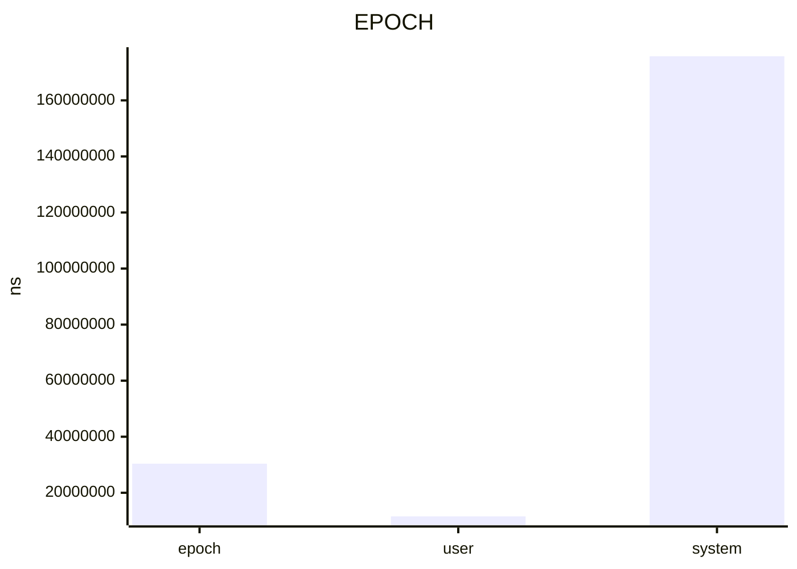

## epoch

+--------+-------+---------------------+--------------------+-------------+---------------------+-------+------+--------------------------------------------------------------------------------------------------------------+---------------------+--------------------+------------------------+
| key    | type  | value               | errorPercent       | min         | max                 | calls | unit | samples                                                                                                      | baseline            | change             | probability            |
+========+=======+=====================+====================+=============+=====================+=======+======+==============================================================================================================+=====================+====================+========================+
| epoch  | float | 3.038520833333333e7 | 1.227570980946047  | 2.9952875e7 | 3.658891666666666e7 | 1     | ns   | 3.658891666666666e7, 3.064579166666667e7                                                                     | 2.882679583333334e8 | -89.45938754032525 | 0.07095149242730564    |
|        |       |                     |                    |             |                     |       |      | , 3.0006875e7, 3.078729166666667e7, 3.01                                                                     |                     |                    |                        |
|        |       |                     |                    |             |                     |       |      | 71625e7, 3.001220833333333e7, 3.0598625e                                                                     |                     |                    |                        |
|        |       |                     |                    |             |                     |       |      | 7, 3.038520833333333e7, 2.9952875e7, 3.0                                                                     |                     |                    |                        |
|        |       |                     |                    |             |                     |       |      | 228625e7, 3.082745833333333e7                                                                                |                     |                    |                        |
+--------+-------+---------------------+--------------------+-------------+---------------------+-------+------+--------------------------------------------------------------------------------------------------------------+---------------------+--------------------+------------------------+
| user   | float | 1.1585e7            | 0.8631851532153647 | 1.1444e7    | 1.3424e7            | 1     | ns   | 1.3424e7, 1.1723e7, 1.1668e7, 1.1576e7, 1.1651e7, 1.1706e7, 1.1444e7, 1.1485e7, 1.1481e7, 1.1585e7, 1.1488e7 | 2.05792e8           | -94.37052946664593 | 0.01146807302223756    |
+--------+-------+---------------------+--------------------+-------------+---------------------+-------+------+--------------------------------------------------------------------------------------------------------------+---------------------+--------------------+------------------------+
| system | float | 1.75741e8           | 1.765097501436774  | 1.6892e8    | 1.84387e8           | 1     | ns   | 1.77782e8, 1.72639e8, 1.73539e8, 1.79048                                                                     | 7.9432e7            | 121.2471044415349  | 0.00007105263288600171 |
|        |       |                     |                    |             |                     |       |      | e8, 1.74015e8, 1.69704e8, 1.6892e8, 1.84                                                                     |                     |                    |                        |
|        |       |                     |                    |             |                     |       |      | 387e8, 1.75741e8, 1.76606e8, 1.79437e8                                                                       |                     |                    |                        |
+--------+-------+---------------------+--------------------+-------------+---------------------+-------+------+--------------------------------------------------------------------------------------------------------------+---------------------+--------------------+------------------------+

