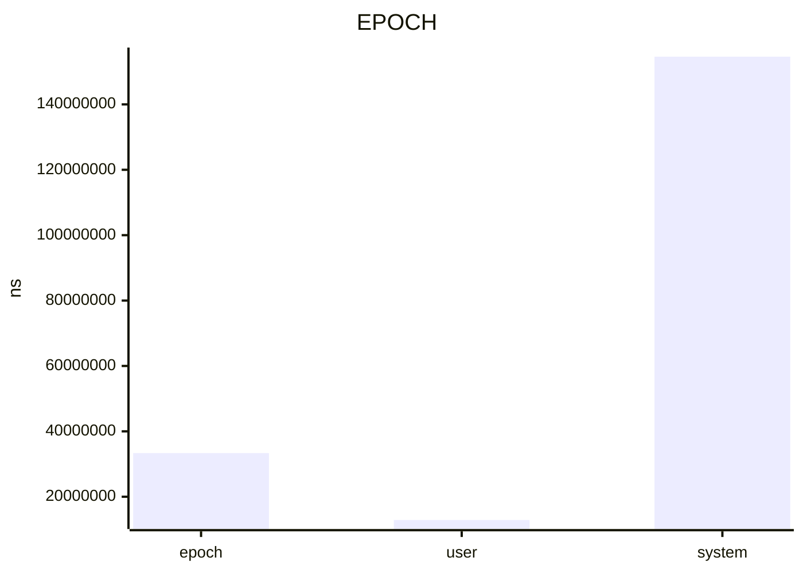

## epoch

+--------+-------+---------------------+-------------------+---------------------+---------------------+-------+------+--------------------------------------------------------------------------------------------------------------+---------------------+--------------------+------------------------+
| key    | type  | value               | errorPercent      | min                 | max                 | calls | unit | samples                                                                                                      | baseline            | change             | probability            |
+========+=======+=====================+===================+=====================+=====================+=======+======+==============================================================================================================+=====================+====================+========================+
| epoch  | float | 3.333616666666667e7 | 1.902088322492596 | 3.230658333333333e7 | 4.157304166666666e7 | 1     | ns   | 4.157304166666666e7, 3.414379166666666e7                                                                     | 2.882679583333334e8 | -88.43570167860314 | 0.07095149242730564    |
|        |       |                     |                   |                     |                     |       |      | , 3.333616666666667e7, 3.230658333333333                                                                     |                     |                    |                        |
|        |       |                     |                   |                     |                     |       |      | e7, 3.230829166666667e7, 3.2702083333333                                                                     |                     |                    |                        |
|        |       |                     |                   |                     |                     |       |      | 33e7, 3.348245833333333e7, 3.29075e7, 3.                                                                     |                     |                    |                        |
|        |       |                     |                   |                     |                     |       |      | 359191666666666e7, 3.3724875e7, 3.270125                                                                     |                     |                    |                        |
|        |       |                     |                   |                     |                     |       |      | e7                                                                                                           |                     |                    |                        |
+--------+-------+---------------------+-------------------+---------------------+---------------------+-------+------+--------------------------------------------------------------------------------------------------------------+---------------------+--------------------+------------------------+
| user   | float | 1.2884e7            | 1.466935734244024 | 1.2631e7            | 1.6711e7            | 1     | ns   | 1.6711e7, 1.3236e7, 1.2631e7, 1.2734e7, 1.2641e7, 1.2895e7, 1.2695e7, 1.2952e7, 1.2884e7, 1.2797e7, 1.3536e7 | 2.05792e8           | -93.73930959415333 | 0.01146807302223756    |
+--------+-------+---------------------+-------------------+---------------------+---------------------+-------+------+--------------------------------------------------------------------------------------------------------------+---------------------+--------------------+------------------------+
| system | float | 1.54604e8           | 1.238648417893457 | 1.43904e8           | 1.71162e8           | 1     | ns   | 1.71162e8, 1.60617e8, 1.53785e8, 1.54604                                                                     | 7.9432e7            | 94.63692214724544  | 0.00007105263288600171 |
|        |       |                     |                   |                     |                     |       |      | e8, 1.5709e8, 1.56519e8, 1.55186e8, 1.54                                                                     |                     |                    |                        |
|        |       |                     |                   |                     |                     |       |      | 59e8, 1.43904e8, 1.54222e8, 1.46871e8                                                                        |                     |                    |                        |
+--------+-------+---------------------+-------------------+---------------------+---------------------+-------+------+--------------------------------------------------------------------------------------------------------------+---------------------+--------------------+------------------------+

