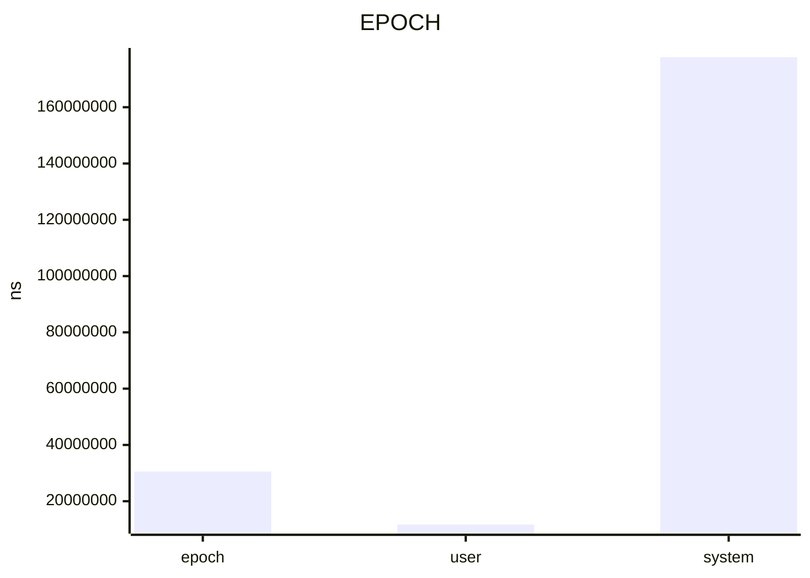

## epoch

+--------+-------+-------------+--------------------+---------------------+-------------+-------+------+-----------------------------------------------------------------------------------------------------------------------------------------------------------------------------------------------------+-------------+--------------------+---------------------+
| key    | type  | value       | errorPercent       | min                 | max         | calls | unit | samples                                                                                                                                                                                             | baseline    | change             | probability         |
+========+=======+=============+====================+=====================+=============+=======+======+=====================================================================================================================================================================================================+=============+====================+=====================+
| epoch  | float | 3.0558375e7 | 1.140167520906017  | 2.988745833333333e7 | 4.4202625e7 | 1     | ns   | 4.4202625e7, 3.082845833333333e7, 3.035620833333333e7, 3.020508333333333e7, 3.090679166666666e7, 2.989345833333334e7, 3.073616666666666e7, 2.988745833333333e7, 3.05175e7, 3.0967375e7, 3.0558375e7 | 3.1106875e7 | -1.763275803178558 | 0.2785986718379627  |
+--------+-------+-------------+--------------------+---------------------+-------------+-------+------+-----------------------------------------------------------------------------------------------------------------------------------------------------------------------------------------------------+-------------+--------------------+---------------------+
| user   | float | 1.1717e7    | 0.7681147051292994 | 1.1464e7            | 1.459e7     | 1     | ns   | 1.459e7, 1.1755e7, 1.1599e7, 1.1464e7, 1                                                                                                                                                            | 1.5724e7    | -25.48333757313661 | 0.01146807302223756 |
|        |       |             |                    |                     |             |       |      | .1627e7, 1.149e7, 1.1777e7, 1.1886e7, 1.                                                                                                                                                            |             |                    |                     |
|        |       |             |                    |                     |             |       |      | 1685e7, 1.1753e7, 1.1717e7                                                                                                                                                                          |             |                    |                     |
+--------+-------+-------------+--------------------+---------------------+-------------+-------+------+-----------------------------------------------------------------------------------------------------------------------------------------------------------------------------------------------------+-------------+--------------------+---------------------+
| system | float | 1.77795e8   | 1.438735622486572  | 1.67517e8           | 1.91392e8   | 1     | ns   | 1.91392e8, 1.74332e8, 1.75237e8, 1.77795                                                                                                                                                            | 1.82215e8   | -2.425705896880059 | 0.490519611041511   |
|        |       |             |                    |                     |             |       |      | e8, 1.7297e8, 1.67517e8, 1.78025e8, 1.76                                                                                                                                                            |             |                    |                     |
|        |       |             |                    |                     |             |       |      | 441e8, 1.81066e8, 1.78501e8, 1.78836e8                                                                                                                                                              |             |                    |                     |
+--------+-------+-------------+--------------------+---------------------+-------------+-------+------+-----------------------------------------------------------------------------------------------------------------------------------------------------------------------------------------------------+-------------+--------------------+---------------------+

