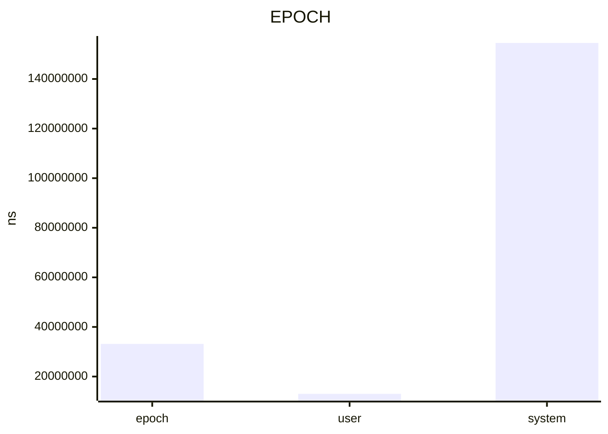

## epoch

+--------+-------+---------------------+-------------------+-------------+---------------------+-------+------+-------------------------------------------------------------------------------------------------------------------------------------------------------------------------------------------------------------------------------+---------------------+--------------------+-----------------------+
| key    | type  | value               | errorPercent      | min         | max                 | calls | unit | samples                                                                                                                                                                                                                       | baseline            | change             | probability           |
+========+=======+=====================+===================+=============+=====================+=======+======+===============================================================================================================================================================================================================================+=====================+====================+=======================+
| epoch  | float | 3.315479166666667e7 | 0.759191419038231 | 3.2322875e7 | 4.092479166666667e7 | 1     | ns   | 4.092479166666667e7, 3.357870833333333e7, 3.2322875e7, 3.320720833333334e7, 3.290308333333333e7, 3.317095833333333e7, 3.311395833333333e7, 3.259054166666667e7, 3.450258333333334e7, 3.315479166666667e7, 3.304541666666667e7 | 3.187608333333333e7 | 4.011497648445955  | 0.02348551600029814   |
+--------+-------+---------------------+-------------------+-------------+---------------------+-------+------+-------------------------------------------------------------------------------------------------------------------------------------------------------------------------------------------------------------------------------+---------------------+--------------------+-----------------------+
| user   | float | 1.3016e7            | 1.997541487400123 | 1.2591e7    | 1.713e7             | 1     | ns   | 1.713e7, 1.3032e7, 1.2673e7, 1.2591e7, 1                                                                                                                                                                                      | 1.6065e7            | -18.97914721444133 | 0.0007202617099102228 |
|        |       |                     |                   |             |                     |       |      | .2756e7, 1.3168e7, 1.2808e7, 1.3016e7, 1                                                                                                                                                                                      |                     |                    |                       |
|        |       |                     |                   |             |                     |       |      | .3745e7, 1.3023e7, 1.2659e7                                                                                                                                                                                                   |                     |                    |                       |
+--------+-------+---------------------+-------------------+-------------+---------------------+-------+------+-------------------------------------------------------------------------------------------------------------------------------------------------------------------------------------------------------------------------------+---------------------+--------------------+-----------------------+
| system | float | 1.54553e8           | 3.273310773650463 | 1.4768e8    | 1.64407e8           | 1     | ns   | 1.64407e8, 1.4768e8, 1.59612e8, 1.49114e                                                                                                                                                                                      | 2.03185e8           | -23.93483770947659 | 0.01146807302223756   |
|        |       |                     |                   |             |                     |       |      | 8, 1.51749e8, 1.62779e8, 1.52278e8, 1.56                                                                                                                                                                                      |                     |                    |                       |
|        |       |                     |                   |             |                     |       |      | 669e8, 1.50887e8, 1.60286e8, 1.54553e8                                                                                                                                                                                        |                     |                    |                       |
+--------+-------+---------------------+-------------------+-------------+---------------------+-------+------+-------------------------------------------------------------------------------------------------------------------------------------------------------------------------------------------------------------------------------+---------------------+--------------------+-----------------------+

