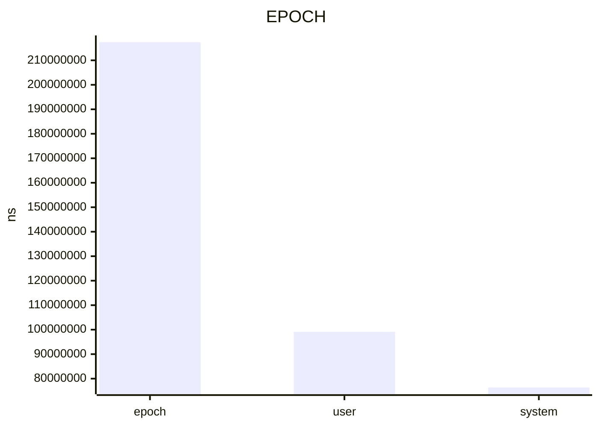

## epoch

+--------+-------+---------------------+--------------------+--------------+---------------------+-------+------+----------------------------------------------------------------------------------------------------------------+-----------+-------------------+------------------------+
| key    | type  | value               | errorPercent       | min          | max                 | calls | unit | samples                                                                                                        | baseline  | change            | probability            |
+========+=======+=====================+====================+==============+=====================+=======+======+================================================================================================================+===========+===================+========================+
| epoch  | float | 2.173990416666667e8 | 0.7299940182962185 | 2.15086125e8 | 6.173279583333334e8 | 1     | ns   | 6.173279583333334e8, 2.158120416666667e8                                                                       | 7.70255e7 | 182.2429476818283 | 0.0009128869759883767  |
|        |       |                     |                    |              |                     |       |      | , 2.183219583333333e8, 2.194677083333333                                                                       |           |                   |                        |
|        |       |                     |                    |              |                     |       |      | e8, 2.161572916666667e8, 2.1739904166666                                                                       |           |                   |                        |
|        |       |                     |                    |              |                     |       |      | 67e8, 2.152324583333333e8, 2.20964708333                                                                       |           |                   |                        |
|        |       |                     |                    |              |                     |       |      | 3333e8, 2.15086125e8, 2.164237083333333e                                                                       |           |                   |                        |
|        |       |                     |                    |              |                     |       |      | 8, 2.175644166666667e8                                                                                         |           |                   |                        |
+--------+-------+---------------------+--------------------+--------------+---------------------+-------+------+----------------------------------------------------------------------------------------------------------------+-----------+-------------------+------------------------+
| user   | float | 9.9137e7            | 0.7847725874295167 | 9.8074e7     | 1.18543e8           | 1     | ns   | 1.18543e8, 9.8359e7, 9.8716e7, 9.9652e7, 9.8721e7, 9.9832e7, 9.8245e7, 1.00232e8, 9.8074e7, 9.9137e7, 9.9985e7 | 1.969e7   | 403.4890807516506 | 0.00007105263288600171 |
+--------+-------+---------------------+--------------------+--------------+---------------------+-------+------+----------------------------------------------------------------------------------------------------------------+-----------+-------------------+------------------------+
| system | float | 7.6379e7            | 0.8379266552324592 | 7.5239e7     | 9.3773e7            | 1     | ns   | 9.3773e7, 7.5787e7, 7.6531e7, 7.7328e7, 7.6241e7, 7.676e7, 7.5448e7, 7.7949e7, 7.5239e7, 7.5739e7, 7.6379e7    | 3.5155e7  | 117.2635471483431 | 0.00007105263288600171 |
+--------+-------+---------------------+--------------------+--------------+---------------------+-------+------+----------------------------------------------------------------------------------------------------------------+-----------+-------------------+------------------------+

