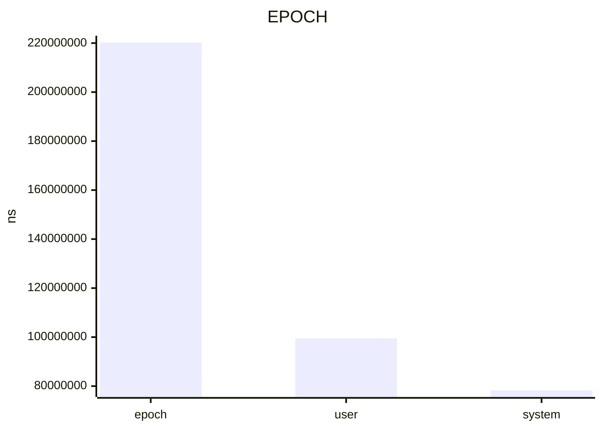

## epoch

+--------+-------+---------------------+-------------------+------------+---------------------+-------+------+-----------------------------------------------------------------------------------------------------------------+-----------+-------------------+------------------------+
| key    | type  | value               | errorPercent      | min        | max                 | calls | unit | samples                                                                                                         | baseline  | change            | probability            |
+========+=======+=====================+===================+============+=====================+=======+======+=================================================================================================================+===========+===================+========================+
| epoch  | float | 2.202395416666667e8 | 1.820763717686944 | 2.162295e8 | 2.408070416666667e8 | 1     | ns   | 2.408070416666667e8, 2.2482475e8, 2.2758                                                                        | 1.43391e8 | 53.59369951159186 | 0.001152354817319397   |
|        |       |                     |                   |            |                     |       |      | 95833333333e8, 2.201588333333333e8, 2.27                                                                        |           |                   |                        |
|        |       |                     |                   |            |                     |       |      | 9010416666667e8, 2.162295e8, 2.195437916                                                                        |           |                   |                        |
|        |       |                     |                   |            |                     |       |      | 666667e8, 2.174034166666667e8, 2.2023954                                                                        |           |                   |                        |
|        |       |                     |                   |            |                     |       |      | 16666667e8, 2.1817e8, 2.250421666666667e                                                                        |           |                   |                        |
|        |       |                     |                   |            |                     |       |      | 8                                                                                                               |           |                   |                        |
+--------+-------+---------------------+-------------------+------------+---------------------+-------+------+-----------------------------------------------------------------------------------------------------------------+-----------+-------------------+------------------------+
| user   | float | 9.9543e7            | 1.225600996554253 | 9.7995e7   | 1.06325e8           | 1     | ns   | 1.06325e8, 9.8362e7, 9.9585e7, 9.9543e7, 1.0114e8, 9.7995e7, 9.9386e7, 9.8301e7, 1.00159e8, 9.8323e7, 1.02163e8 | 6.2929e7  | 58.18303167061292 | 0.00007105263288600171 |
+--------+-------+---------------------+-------------------+------------+---------------------+-------+------+-----------------------------------------------------------------------------------------------------------------+-----------+-------------------+------------------------+
| system | float | 7.8327e7            | 2.400194058243007 | 7.6127e7   | 8.5145e7            | 1     | ns   | 8.5145e7, 8.1484e7, 8.2797e7, 7.8327e7, 7.9457e7, 7.6127e7, 7.6974e7, 7.6388e7, 7.7601e7, 7.6447e7, 7.9335e7    | 5.2533e7  | 49.10056535891725 | 0.00007105263288600171 |
+--------+-------+---------------------+-------------------+------------+---------------------+-------+------+-----------------------------------------------------------------------------------------------------------------+-----------+-------------------+------------------------+

