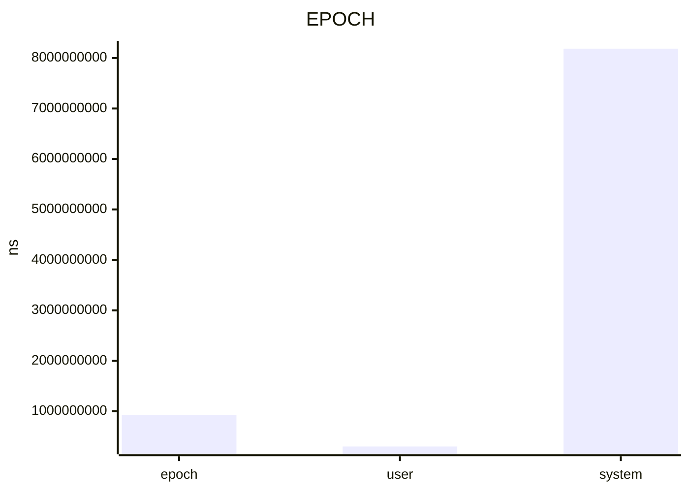
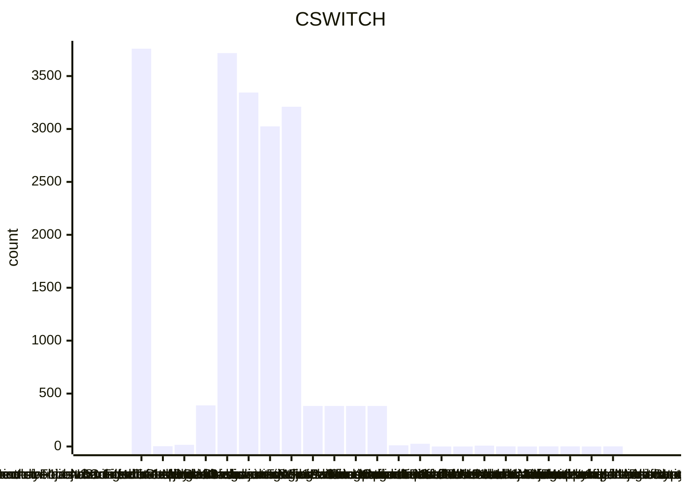

```mermaid
xychart-beta
title "SAMPLE"
x-axis ["-mh-execute-header", "-NSConcreteGlobalBlock", "lsl::sPoolBytes", "-MergedGlobals", "searchFileFast", "std::--1::--function::--func-runFusedDirectoryFind-juce::File-const---std::--1::basic-string-view-char--std::--1::char-traits-char----Pattern-const---Arguments-const---int--int--int--juce::Range-int--::--1--std::--1::allocator-runFusedDirectoryFind-juce::File-const---std::--1::basic-string-view-char--std::--1::char-traits-char----Pattern-const---Arguments-const---int--int--int--juce::Range-int--::--1---void--int--std::--1::basic-string-char--std::--1::char-traits-char---std::--1::allocator-char---const---std::--1::basic-string-view-char--std::--1::char-traits-char----::operator--", "RecursiveJobs-std::--1::tuple-std::--1::basic-string-char--std::--1::char-traits-char---std::--1::allocator-char----std::--1::basic-string-char--std::--1::char-traits-char---std::--1::allocator-char----std::--1::basic-string-char--std::--1::char-traits-char---std::--1::allocator-char----IgnoreRules-const----Paths::applyToDirectory-juce::File-const---std::--1::basic-string-view-char--std::--1::char-traits-char----jam::Strings-const---jam::Strings-const---bool--bool--std::--1::function-void--int---const---std::--1::function-void--int--std::--1::basic-string-char--std::--1::char-traits-char---std::--1::allocator-char---const---std::--1::basic-string-view-char--std::--1::char-traits-char-----const---std::--1::function-void--int--std::--1::basic-string-view-char--std::--1::char-traits-char-----const---std::--1::atomic-bool--const--::--0-::runItems", "Paths::applyToDirectory-juce::File-const---std::--1::basic-string-view-char--std::--1::char-traits-char----jam::Strings-const---jam::Strings-const---bool--bool--std::--1::function-void--int---const---std::--1::function-void--int--std::--1::basic-string-char--std::--1::char-traits-char---std::--1::allocator-char---const---std::--1::basic-string-view-char--std::--1::char-traits-char-----const---std::--1::function-void-", "runWithValidatedOptions", "Find::run", "main", "void--std::--1::--thread-proxy-abi:ne200100--std::--1::tuple-std::--1::unique-ptr-std::--1::--thread-struct--std::--1::default-delete-std::--1::--thread-struct----RecursiveJobs-std::--1::tuple-std::--1::basic-string-char--std::--1::char-traits-char---std::--1::allocator-char----std::--1::basic-string-char--std::--1::char-traits-char---std::--1::allocator-char----std::--1::basic-string-char--std::--1::char-traits-char---std::--1::allocator-char----IgnoreRules-const----Paths::applyToDirectory-juce::File-const---std::--1::basic-string-view-char--std::--1::char-traits-char----jam::Strings-const---jam::Strings-const---bool--bool--std::--1::function-void--int---const---std::--1::function-void--int--std::--1::basic-string-char--std::--1::char-traits-char---std::--1::allocator-char---const---std::--1::basic-string-view-char--std::--1::char-traits-char-----const---std::--1::function-void--int--std::--1::basic-string-view-char--std::--1::char-traits-char-----const---std::--1::atomic-bool--const--::--0-::addItem-std::--1::tuple-std::--1::basic-string-char--std::--1::char-traits-char---std::--1::allocator-char----std::--1::basic-string-char--std::--1::char-traits-char---std::--1::allocator-char----std::--1::basic-string-char--std::--1::char-traits-char---std::--1::allocator-char----IgnoreRules-const---::-lambda-----", "Pattern::Candidates::findNext", "searchBufferFast", "MatchWriter::addMatch", "MatchWriter::appendLinePrefix", "std::--1::--wrap-iter-std::--1::pair-jam::Union-int--int---int----jam::HashMap-jam::Union-int--int---int--jam::Strings::TransparentHash--jam::Strings::TransparentEqual--std::--1::allocator-std::--1::pair-jam::Union-int--int---int----jam::BucketType::Standard--jam::HashMapTraits::DefaultContainer--false-::doFind-std::--1::basic-string-view-char--std::--1::char-traits-char---", "Pattern::hasMatch", "-GLOBAL--sub-I-jam-core-mm", "Pattern::findNext", "std::--1::basic-string-char--std::--1::char-traits-char---std::--1::allocator-char--::--init-copy-ctor-external", "std::--1::pair-std::--1::--wrap-iter-std::--1::pair-juce::String--juce::String-----bool--jam::HashMap-juce::String--juce::String--jam::Hash-juce::String--void---std::--1::equal-to-juce::String---std::--1::allocator-std::--1::pair-juce::String--juce::String----jam::BucketType::Standard--jam::HashMapTraits::DefaultContainer--false-::emplace-std::--1::pair-juce::String--juce::String--const--", "--cxx-global-var-init-430", "jam::Wyhash::hashBytes", "juce::CharPointer-UTF8-juce::StringHolderUtils::createFromCharPointerWhile-juce::CharPointer-UTF8--juce::CharPointer-UTF8-juce::StringHolderUtils::createFromCharPointer-juce::CharPointer-UTF8--juce::CharPointer-UTF8--unsigned-long-::-lambda--juce::CharPointer-UTF8--unsigned-long---juce::CharPointer-UTF8--juce::CharPointer-UTF8-juce::StringHolderUtils::createFromCharPointer-juce::CharPointer-UTF8--juce::CharPointer-UTF8--unsigned-long-::-lambda-", "void-std::--1::allocator-traits-std::--1::allocator-std::--1::thread--::construct-abi:ne200100--std::--1::thread--RecursiveJobs-std::--1::tuple-std::--1::basic-string-char--std::--1::char-traits-char---std::--1::allocator-char----std::--1::basic-string-char--std::--1::char-traits-char---std::--1::allocator-char----std::--1::basic-string-char--std::--1::char-traits-char---std::--1::allocator-char----IgnoreRules-const----Paths::applyToDirectory-juce::File-const---std::--1::basic-string-view-char--std::--1::char-traits-char----jam::Strings-const---jam::Strings-const---bool--bool--std::--1::function-void--int---const---std::--1::function-void--int--std::--1::basic-string-char--std::--1::char-traits-char---std::--1::allocator-char---const---std::--1::basic-string-view-char--std::--1::char-traits-char-----const---std::--1::function-void--int--std::--1::basic-string-view-char--std::--1::char-traits-char-----const---std::--1::atomic-bool--const--::--0-::addItem-std::--1::tuple-std::--1::basic-string-char--std::--1::char-traits-char---std::--1::allocator-char----std::--1::basic-string-char--std::--1::char-traits-char---std::--1::allocator-char----std::--1::basic-string-char--std::--1::char-traits-char---std::--1::allocator-char----IgnoreRules-const---::-lambda-----0--std::--1::allocator-std::--1::thread----std::--1::thread---RecursiveJobs-std::--1::tuple-std::--1::basic-string-char--std::--1::char-traits-char---std::--1::allocator-char----std::--1::basic-string-char--std::--1::char-traits-char---std::--1::allocator-char----std::--1::basic-string-char--std::--1::char-traits-char---std::--1::allocator-char----IgnoreRules-const----Paths::applyToDirectory-juce::File-const---std::--1::basic-string-view-char--std::--1::char-traits-char----jam::Strings-const---jam::Strings-const---bool--bool--std::--1::function-void--int---const---std::--1::function-void--int--std::--1::basic-string-char--std::--1::char-traits-char---std::--1::allocator-char---const---std::--1::basic-string-view-char--std::--1::char-traits-char-----const---std::--1::function-void--int--std::--1::basic-string-view-char--std::--1::char-traits-char-----const---std::--1::atomic-bool--const--::--0-::addItem-std::--1::tuple-std::--1::basic-string-char--std::--1::char-traits-char---std::--1::allocator-char----std::--1::basic-string-char--std::--1::char-traits-char---std::--1::allocator-char----std::--1::basic-string-char--std::--1::char-traits-char---std::--1::allocator-char----IgnoreRules-const---::-lambda-"]
y-axis "count"
bar [7.00000000000000000, 8189.00000000000000000, 2.00000000000000000, 858.00000000000000000, 6861.00000000000000000, 7397.00000000000000000, 8426.00000000000000000, 848.00000000000000000, 848.00000000000000000, 851.00000000000000000, 851.00000000000000000, 7598.00000000000000000, 104.00000000000000000, 179.00000000000000000, 38.00000000000000000, 5.00000000000000000, 12.00000000000000000, 2.00000000000000000, 7.00000000000000000, 1.00000000000000000, 1.00000000000000000, 0.00000000000000000, 1.00000000000000000, 2.00000000000000000, 0.00000000000000000, 0.00000000000000000]
```

## epoch

+--------+-------+-------------+--------------------+---------------------+---------------------+-------+------+------------------------------------------+
| key    | type  | value       | errorPercent       | min                 | max                 | calls | unit | samples                                  |
+========+=======+=============+====================+=====================+=====================+=======+======+==========================================+
| epoch  | float | 9.3029425e8 | 0.5736536226754736 | 9.246282916666667e8 | 1.479990583333333e9 | 1     | ns   | 1.479990583333333e9, 9.3029425e8, 9.2462 |
|        |       |             |                    |                     |                     |       |      | 82916666667e8, 9.322806666666666e8, 9.24 |
|        |       |             |                    |                     |                     |       |      | 9575833333334e8                          |
+--------+-------+-------------+--------------------+---------------------+---------------------+-------+------+------------------------------------------+
| user   | float | 3.03022e8   | 0.6151368547498202 | 2.7084e8            | 3.05522e8           | 1     | ns   | 2.7084e8, 3.04886e8, 3.03022e8, 3.05522e |
|        |       |             |                    |                     |                     |       |      | 8, 3.02312e8                             |
+--------+-------+-------------+--------------------+---------------------+---------------------+-------+------+------------------------------------------+
| system | float | 8.18545e9   | 0.6205523214972909 | 6.006333e9          | 8.236245e9          | 1     | ns   | 6.006333e9, 8.236245e9, 8.18545e9, 8.189 |
|        |       |             |                    |                     |                     |       |      | 463e9, 8.008076e9                        |
+--------+-------+-------------+--------------------+---------------------+---------------------+-------+------+------------------------------------------+

## sample

+-------------------------------------------------------------------------------------------------------------------------------------------------------------------------------------------------------------------------------------------------------------------------------------------------------------------------------------------------------------------------------------------------------------------------------------------------------------------------------------------------------------------------------------------------------------------------------------------------------------------------------------------------------------------------------------------------------------------------------------------------------------------------------------------------------------------------------------------------------------------------------------------------------------------------------------------------------------------------------------------------------------------------------------------------------------------------------------------------------------------------------------------------------------------------------------------------------------------------------------------------------------------------------------------------------------------------------------------------------------------------------------------------------------------------------------------------------------------------------------------------------------------------------------------------------------------------------------------------------------------------------------------------------------------------------------------------------------------------------------------------------------------------------------------------------------------------------------------------------------------------------------------------------------------------------------------------------------------------------------------------------------------------------------------------------------------------------------------------------------------------------------------------------------------------------------------------------------------------------------------------------------------------------------------------------------------------------------------------+-------+--------+--------------------+--------+--------+-------+-------+------------------------------+
| key                                                                                                                                                                                                                                                                                                                                                                                                                                                                                                                                                                                                                                                                                                                                                                                                                                                                                                                                                                                                                                                                                                                                                                                                                                                                                                                                                                                                                                                                                                                                                                                                                                                                                                                                                                                                                                                                                                                                                                                                                                                                                                                                                                                                                                                                                                                                             | type  | value  | errorPercent       | min    | max    | calls | unit  | samples                      |
+=================================================================================================================================================================================================================================================================================================================================================================================================================================================================================================================================================================================================================================================================================================================================================================================================================================================================================================================================================================================================================================================================================================================================================================================================================================================================================================================================================================================================================================================================================================================================================================================================================================================================================================================================================================================================================================================================================================================================================================================================================================================================================================================================================================================================================================================================================================================================================+=======+========+====================+========+========+=======+=======+==============================+
| mh execute header                                                                                                                                                                                                                                                                                                                                                                                                                                                                                                                                                                                                                                                                                                                                                                                                                                                                                                                                                                                                                                                                                                                                                                                                                                                                                                                                                                                                                                                                                                                                                                                                                                                                                                                                                                                                                                                                                                                                                                                                                                                                                                                                                                                                                                                                                                                               | float | 7.0    | 28.57142857142857  | 5.0    | 11.0   | 1     | count | 6, 11, 5, 9, 7               |
+-------------------------------------------------------------------------------------------------------------------------------------------------------------------------------------------------------------------------------------------------------------------------------------------------------------------------------------------------------------------------------------------------------------------------------------------------------------------------------------------------------------------------------------------------------------------------------------------------------------------------------------------------------------------------------------------------------------------------------------------------------------------------------------------------------------------------------------------------------------------------------------------------------------------------------------------------------------------------------------------------------------------------------------------------------------------------------------------------------------------------------------------------------------------------------------------------------------------------------------------------------------------------------------------------------------------------------------------------------------------------------------------------------------------------------------------------------------------------------------------------------------------------------------------------------------------------------------------------------------------------------------------------------------------------------------------------------------------------------------------------------------------------------------------------------------------------------------------------------------------------------------------------------------------------------------------------------------------------------------------------------------------------------------------------------------------------------------------------------------------------------------------------------------------------------------------------------------------------------------------------------------------------------------------------------------------------------------------------+-------+--------+--------------------+--------+--------+-------+-------+------------------------------+
| NS concrete global block                                                                                                                                                                                                                                                                                                                                                                                                                                                                                                                                                                                                                                                                                                                                                                                                                                                                                                                                                                                                                                                                                                                                                                                                                                                                                                                                                                                                                                                                                                                                                                                                                                                                                                                                                                                                                                                                                                                                                                                                                                                                                                                                                                                                                                                                                                                        | float | 8189.0 | 0.3907681035535475 | 6037.0 | 8221.0 | 1     | count | 6037, 8221, 8209, 8189, 8007 |
+-------------------------------------------------------------------------------------------------------------------------------------------------------------------------------------------------------------------------------------------------------------------------------------------------------------------------------------------------------------------------------------------------------------------------------------------------------------------------------------------------------------------------------------------------------------------------------------------------------------------------------------------------------------------------------------------------------------------------------------------------------------------------------------------------------------------------------------------------------------------------------------------------------------------------------------------------------------------------------------------------------------------------------------------------------------------------------------------------------------------------------------------------------------------------------------------------------------------------------------------------------------------------------------------------------------------------------------------------------------------------------------------------------------------------------------------------------------------------------------------------------------------------------------------------------------------------------------------------------------------------------------------------------------------------------------------------------------------------------------------------------------------------------------------------------------------------------------------------------------------------------------------------------------------------------------------------------------------------------------------------------------------------------------------------------------------------------------------------------------------------------------------------------------------------------------------------------------------------------------------------------------------------------------------------------------------------------------------------+-------+--------+--------------------+--------+--------+-------+-------+------------------------------+
| lsl::s pool bytes                                                                                                                                                                                                                                                                                                                                                                                                                                                                                                                                                                                                                                                                                                                                                                                                                                                                                                                                                                                                                                                                                                                                                                                                                                                                                                                                                                                                                                                                                                                                                                                                                                                                                                                                                                                                                                                                                                                                                                                                                                                                                                                                                                                                                                                                                                                               | float | 2.0    | 0.0                | 0.0    | 2.0    | 1     | count | 2, 2, 1, 2, 0                |
+-------------------------------------------------------------------------------------------------------------------------------------------------------------------------------------------------------------------------------------------------------------------------------------------------------------------------------------------------------------------------------------------------------------------------------------------------------------------------------------------------------------------------------------------------------------------------------------------------------------------------------------------------------------------------------------------------------------------------------------------------------------------------------------------------------------------------------------------------------------------------------------------------------------------------------------------------------------------------------------------------------------------------------------------------------------------------------------------------------------------------------------------------------------------------------------------------------------------------------------------------------------------------------------------------------------------------------------------------------------------------------------------------------------------------------------------------------------------------------------------------------------------------------------------------------------------------------------------------------------------------------------------------------------------------------------------------------------------------------------------------------------------------------------------------------------------------------------------------------------------------------------------------------------------------------------------------------------------------------------------------------------------------------------------------------------------------------------------------------------------------------------------------------------------------------------------------------------------------------------------------------------------------------------------------------------------------------------------------+-------+--------+--------------------+--------+--------+-------+-------+------------------------------+
| merged globals                                                                                                                                                                                                                                                                                                                                                                                                                                                                                                                                                                                                                                                                                                                                                                                                                                                                                                                                                                                                                                                                                                                                                                                                                                                                                                                                                                                                                                                                                                                                                                                                                                                                                                                                                                                                                                                                                                                                                                                                                                                                                                                                                                                                                                                                                                                                  | float | 858.0  | 0.5827505827505828 | 627.0  | 863.0  | 1     | count | 627, 863, 858, 862, 830      |
+-------------------------------------------------------------------------------------------------------------------------------------------------------------------------------------------------------------------------------------------------------------------------------------------------------------------------------------------------------------------------------------------------------------------------------------------------------------------------------------------------------------------------------------------------------------------------------------------------------------------------------------------------------------------------------------------------------------------------------------------------------------------------------------------------------------------------------------------------------------------------------------------------------------------------------------------------------------------------------------------------------------------------------------------------------------------------------------------------------------------------------------------------------------------------------------------------------------------------------------------------------------------------------------------------------------------------------------------------------------------------------------------------------------------------------------------------------------------------------------------------------------------------------------------------------------------------------------------------------------------------------------------------------------------------------------------------------------------------------------------------------------------------------------------------------------------------------------------------------------------------------------------------------------------------------------------------------------------------------------------------------------------------------------------------------------------------------------------------------------------------------------------------------------------------------------------------------------------------------------------------------------------------------------------------------------------------------------------------+-------+--------+--------------------+--------+--------+-------+-------+------------------------------+
| search file fast                                                                                                                                                                                                                                                                                                                                                                                                                                                                                                                                                                                                                                                                                                                                                                                                                                                                                                                                                                                                                                                                                                                                                                                                                                                                                                                                                                                                                                                                                                                                                                                                                                                                                                                                                                                                                                                                                                                                                                                                                                                                                                                                                                                                                                                                                                                                | float | 6861.0 | 1.311762133799738  | 4764.0 | 6952.0 | 1     | count | 4764, 6952, 6928, 6861, 6771 |
+-------------------------------------------------------------------------------------------------------------------------------------------------------------------------------------------------------------------------------------------------------------------------------------------------------------------------------------------------------------------------------------------------------------------------------------------------------------------------------------------------------------------------------------------------------------------------------------------------------------------------------------------------------------------------------------------------------------------------------------------------------------------------------------------------------------------------------------------------------------------------------------------------------------------------------------------------------------------------------------------------------------------------------------------------------------------------------------------------------------------------------------------------------------------------------------------------------------------------------------------------------------------------------------------------------------------------------------------------------------------------------------------------------------------------------------------------------------------------------------------------------------------------------------------------------------------------------------------------------------------------------------------------------------------------------------------------------------------------------------------------------------------------------------------------------------------------------------------------------------------------------------------------------------------------------------------------------------------------------------------------------------------------------------------------------------------------------------------------------------------------------------------------------------------------------------------------------------------------------------------------------------------------------------------------------------------------------------------------+-------+--------+--------------------+--------+--------+-------+-------+------------------------------+
| std:: 1:: function:: func run fused directory find juce:: file const std:: 1::basic string view char std:: 1::char traits char pattern const arguments const int int int juce:: range int :: 1 std:: 1::allocator run fused directory find juce:: file const std:: 1::basic string view char std:: 1::char traits char pattern const arguments const int int int juce:: range int :: 1 void int std:: 1::basic string char std:: 1::char traits char std:: 1::allocator char const std:: 1::basic string view char std:: 1::char traits char ::operator                                                                                                                                                                                                                                                                                                                                                                                                                                                                                                                                                                                                                                                                                                                                                                                                                                                                                                                                                                                                                                                                                                                                                                                                                                                                                                                                                                                                                                                                                                                                                                                                                                                                                                                                                                                         | float | 7397.0 | 0.7029876977152899 | 5560.0 | 7449.0 | 1     | count | 5560, 7447, 7449, 7397, 7306 |
+-------------------------------------------------------------------------------------------------------------------------------------------------------------------------------------------------------------------------------------------------------------------------------------------------------------------------------------------------------------------------------------------------------------------------------------------------------------------------------------------------------------------------------------------------------------------------------------------------------------------------------------------------------------------------------------------------------------------------------------------------------------------------------------------------------------------------------------------------------------------------------------------------------------------------------------------------------------------------------------------------------------------------------------------------------------------------------------------------------------------------------------------------------------------------------------------------------------------------------------------------------------------------------------------------------------------------------------------------------------------------------------------------------------------------------------------------------------------------------------------------------------------------------------------------------------------------------------------------------------------------------------------------------------------------------------------------------------------------------------------------------------------------------------------------------------------------------------------------------------------------------------------------------------------------------------------------------------------------------------------------------------------------------------------------------------------------------------------------------------------------------------------------------------------------------------------------------------------------------------------------------------------------------------------------------------------------------------------------+-------+--------+--------------------+--------+--------+-------+-------+------------------------------+
| recursive jobs std:: 1::tuple std:: 1::basic string char std:: 1::char traits char std:: 1::allocator char std:: 1::basic string char std:: 1::char traits char std:: 1::allocator char std:: 1::basic string char std:: 1::char traits char std:: 1::allocator char ignore rules const paths::apply to directory juce:: file const std:: 1::basic string view char std:: 1::char traits char jam:: strings const jam:: strings const bool bool std:: 1::function void int const std:: 1::function void int std:: 1::basic string char std:: 1::char traits char std:: 1::allocator char const std:: 1::basic string view char std:: 1::char traits char const std:: 1::function void int std:: 1::basic string view char std:: 1::char traits char const std:: 1::atomic bool const :: 0 ::run items                                                                                                                                                                                                                                                                                                                                                                                                                                                                                                                                                                                                                                                                                                                                                                                                                                                                                                                                                                                                                                                                                                                                                                                                                                                                                                                                                                                                                                                                                                                                           | float | 8426.0 | 0.3797768810823641 | 6255.0 | 8458.0 | 1     | count | 6255, 8458, 8450, 8426, 8257 |
+-------------------------------------------------------------------------------------------------------------------------------------------------------------------------------------------------------------------------------------------------------------------------------------------------------------------------------------------------------------------------------------------------------------------------------------------------------------------------------------------------------------------------------------------------------------------------------------------------------------------------------------------------------------------------------------------------------------------------------------------------------------------------------------------------------------------------------------------------------------------------------------------------------------------------------------------------------------------------------------------------------------------------------------------------------------------------------------------------------------------------------------------------------------------------------------------------------------------------------------------------------------------------------------------------------------------------------------------------------------------------------------------------------------------------------------------------------------------------------------------------------------------------------------------------------------------------------------------------------------------------------------------------------------------------------------------------------------------------------------------------------------------------------------------------------------------------------------------------------------------------------------------------------------------------------------------------------------------------------------------------------------------------------------------------------------------------------------------------------------------------------------------------------------------------------------------------------------------------------------------------------------------------------------------------------------------------------------------------+-------+--------+--------------------+--------+--------+-------+-------+------------------------------+
| paths::apply to directory juce:: file const std:: 1::basic string view char std:: 1::char traits char jam:: strings const jam:: strings const bool bool std:: 1::function void int const std:: 1::function void int std:: 1::basic string char std:: 1::char traits char std:: 1::allocator char const std:: 1::basic string view char std:: 1::char traits char const std:: 1::function void                                                                                                                                                                                                                                                                                                                                                                                                                                                                                                                                                                                                                                                                                                                                                                                                                                                                                                                                                                                                                                                                                                                                                                                                                                                                                                                                                                                                                                                                                                                                                                                                                                                                                                                                                                                                                                                                                                                                                   | float | 848.0  | 0.3537735849056604 | 618.0  | 851.0  | 1     | count | 618, 851, 848, 849, 820      |
+-------------------------------------------------------------------------------------------------------------------------------------------------------------------------------------------------------------------------------------------------------------------------------------------------------------------------------------------------------------------------------------------------------------------------------------------------------------------------------------------------------------------------------------------------------------------------------------------------------------------------------------------------------------------------------------------------------------------------------------------------------------------------------------------------------------------------------------------------------------------------------------------------------------------------------------------------------------------------------------------------------------------------------------------------------------------------------------------------------------------------------------------------------------------------------------------------------------------------------------------------------------------------------------------------------------------------------------------------------------------------------------------------------------------------------------------------------------------------------------------------------------------------------------------------------------------------------------------------------------------------------------------------------------------------------------------------------------------------------------------------------------------------------------------------------------------------------------------------------------------------------------------------------------------------------------------------------------------------------------------------------------------------------------------------------------------------------------------------------------------------------------------------------------------------------------------------------------------------------------------------------------------------------------------------------------------------------------------------+-------+--------+--------------------+--------+--------+-------+-------+------------------------------+
| run with validated options                                                                                                                                                                                                                                                                                                                                                                                                                                                                                                                                                                                                                                                                                                                                                                                                                                                                                                                                                                                                                                                                                                                                                                                                                                                                                                                                                                                                                                                                                                                                                                                                                                                                                                                                                                                                                                                                                                                                                                                                                                                                                                                                                                                                                                                                                                                      | float | 848.0  | 0.3537735849056604 | 618.0  | 851.0  | 1     | count | 618, 851, 848, 849, 820      |
+-------------------------------------------------------------------------------------------------------------------------------------------------------------------------------------------------------------------------------------------------------------------------------------------------------------------------------------------------------------------------------------------------------------------------------------------------------------------------------------------------------------------------------------------------------------------------------------------------------------------------------------------------------------------------------------------------------------------------------------------------------------------------------------------------------------------------------------------------------------------------------------------------------------------------------------------------------------------------------------------------------------------------------------------------------------------------------------------------------------------------------------------------------------------------------------------------------------------------------------------------------------------------------------------------------------------------------------------------------------------------------------------------------------------------------------------------------------------------------------------------------------------------------------------------------------------------------------------------------------------------------------------------------------------------------------------------------------------------------------------------------------------------------------------------------------------------------------------------------------------------------------------------------------------------------------------------------------------------------------------------------------------------------------------------------------------------------------------------------------------------------------------------------------------------------------------------------------------------------------------------------------------------------------------------------------------------------------------------+-------+--------+--------------------+--------+--------+-------+-------+------------------------------+
| find::run                                                                                                                                                                                                                                                                                                                                                                                                                                                                                                                                                                                                                                                                                                                                                                                                                                                                                                                                                                                                                                                                                                                                                                                                                                                                                                                                                                                                                                                                                                                                                                                                                                                                                                                                                                                                                                                                                                                                                                                                                                                                                                                                                                                                                                                                                                                                       | float | 851.0  | 0.3525264394829613 | 621.0  | 854.0  | 1     | count | 621, 854, 851, 852, 823      |
+-------------------------------------------------------------------------------------------------------------------------------------------------------------------------------------------------------------------------------------------------------------------------------------------------------------------------------------------------------------------------------------------------------------------------------------------------------------------------------------------------------------------------------------------------------------------------------------------------------------------------------------------------------------------------------------------------------------------------------------------------------------------------------------------------------------------------------------------------------------------------------------------------------------------------------------------------------------------------------------------------------------------------------------------------------------------------------------------------------------------------------------------------------------------------------------------------------------------------------------------------------------------------------------------------------------------------------------------------------------------------------------------------------------------------------------------------------------------------------------------------------------------------------------------------------------------------------------------------------------------------------------------------------------------------------------------------------------------------------------------------------------------------------------------------------------------------------------------------------------------------------------------------------------------------------------------------------------------------------------------------------------------------------------------------------------------------------------------------------------------------------------------------------------------------------------------------------------------------------------------------------------------------------------------------------------------------------------------------+-------+--------+--------------------+--------+--------+-------+-------+------------------------------+
| main                                                                                                                                                                                                                                                                                                                                                                                                                                                                                                                                                                                                                                                                                                                                                                                                                                                                                                                                                                                                                                                                                                                                                                                                                                                                                                                                                                                                                                                                                                                                                                                                                                                                                                                                                                                                                                                                                                                                                                                                                                                                                                                                                                                                                                                                                                                                            | float | 851.0  | 0.3525264394829613 | 621.0  | 854.0  | 1     | count | 621, 854, 851, 852, 823      |
+-------------------------------------------------------------------------------------------------------------------------------------------------------------------------------------------------------------------------------------------------------------------------------------------------------------------------------------------------------------------------------------------------------------------------------------------------------------------------------------------------------------------------------------------------------------------------------------------------------------------------------------------------------------------------------------------------------------------------------------------------------------------------------------------------------------------------------------------------------------------------------------------------------------------------------------------------------------------------------------------------------------------------------------------------------------------------------------------------------------------------------------------------------------------------------------------------------------------------------------------------------------------------------------------------------------------------------------------------------------------------------------------------------------------------------------------------------------------------------------------------------------------------------------------------------------------------------------------------------------------------------------------------------------------------------------------------------------------------------------------------------------------------------------------------------------------------------------------------------------------------------------------------------------------------------------------------------------------------------------------------------------------------------------------------------------------------------------------------------------------------------------------------------------------------------------------------------------------------------------------------------------------------------------------------------------------------------------------------+-------+--------+--------------------+--------+--------+-------+-------+------------------------------+
| void std:: 1:: thread proxy abi:ne200100 std:: 1::tuple std:: 1::unique ptr std:: 1:: thread struct std:: 1::default delete std:: 1:: thread struct recursive jobs std:: 1::tuple std:: 1::basic string char std:: 1::char traits char std:: 1::allocator char std:: 1::basic string char std:: 1::char traits char std:: 1::allocator char std:: 1::basic string char std:: 1::char traits char std:: 1::allocator char ignore rules const paths::apply to directory juce:: file const std:: 1::basic string view char std:: 1::char traits char jam:: strings const jam:: strings const bool bool std:: 1::function void int const std:: 1::function void int std:: 1::basic string char std:: 1::char traits char std:: 1::allocator char const std:: 1::basic string view char std:: 1::char traits char const std:: 1::function void int std:: 1::basic string view char std:: 1::char traits char const std:: 1::atomic bool const :: 0 ::add item std:: 1::tuple std:: 1::basic string char std:: 1::char traits char std:: 1::allocator char std:: 1::basic string char std:: 1::char traits char std:: 1::allocator char std:: 1::basic string char std:: 1::char traits char std:: 1::allocator char ignore rules const :: lambda                                                                                                                                                                                                                                                                                                                                                                                                                                                                                                                                                                                                                                                                                                                                                                                                                                                                                                                                                                                                                                                                                                     | float | 7598.0 | 0.4606475388260068 | 5654.0 | 7633.0 | 1     | count | 5654, 7633, 7629, 7598, 7460 |
+-------------------------------------------------------------------------------------------------------------------------------------------------------------------------------------------------------------------------------------------------------------------------------------------------------------------------------------------------------------------------------------------------------------------------------------------------------------------------------------------------------------------------------------------------------------------------------------------------------------------------------------------------------------------------------------------------------------------------------------------------------------------------------------------------------------------------------------------------------------------------------------------------------------------------------------------------------------------------------------------------------------------------------------------------------------------------------------------------------------------------------------------------------------------------------------------------------------------------------------------------------------------------------------------------------------------------------------------------------------------------------------------------------------------------------------------------------------------------------------------------------------------------------------------------------------------------------------------------------------------------------------------------------------------------------------------------------------------------------------------------------------------------------------------------------------------------------------------------------------------------------------------------------------------------------------------------------------------------------------------------------------------------------------------------------------------------------------------------------------------------------------------------------------------------------------------------------------------------------------------------------------------------------------------------------------------------------------------------+-------+--------+--------------------+--------+--------+-------+-------+------------------------------+
| pattern:: candidates::find next                                                                                                                                                                                                                                                                                                                                                                                                                                                                                                                                                                                                                                                                                                                                                                                                                                                                                                                                                                                                                                                                                                                                                                                                                                                                                                                                                                                                                                                                                                                                                                                                                                                                                                                                                                                                                                                                                                                                                                                                                                                                                                                                                                                                                                                                                                                 | float | 104.0  | 3.846153846153846  | 100.0  | 118.0  | 1     | count | 118, 100, 109, 104, 101      |
+-------------------------------------------------------------------------------------------------------------------------------------------------------------------------------------------------------------------------------------------------------------------------------------------------------------------------------------------------------------------------------------------------------------------------------------------------------------------------------------------------------------------------------------------------------------------------------------------------------------------------------------------------------------------------------------------------------------------------------------------------------------------------------------------------------------------------------------------------------------------------------------------------------------------------------------------------------------------------------------------------------------------------------------------------------------------------------------------------------------------------------------------------------------------------------------------------------------------------------------------------------------------------------------------------------------------------------------------------------------------------------------------------------------------------------------------------------------------------------------------------------------------------------------------------------------------------------------------------------------------------------------------------------------------------------------------------------------------------------------------------------------------------------------------------------------------------------------------------------------------------------------------------------------------------------------------------------------------------------------------------------------------------------------------------------------------------------------------------------------------------------------------------------------------------------------------------------------------------------------------------------------------------------------------------------------------------------------------------+-------+--------+--------------------+--------+--------+-------+-------+------------------------------+
| search buffer fast                                                                                                                                                                                                                                                                                                                                                                                                                                                                                                                                                                                                                                                                                                                                                                                                                                                                                                                                                                                                                                                                                                                                                                                                                                                                                                                                                                                                                                                                                                                                                                                                                                                                                                                                                                                                                                                                                                                                                                                                                                                                                                                                                                                                                                                                                                                              | float | 179.0  | 1.675977653631285  | 170.0  | 183.0  | 1     | count | 181, 176, 170, 183, 179      |
+-------------------------------------------------------------------------------------------------------------------------------------------------------------------------------------------------------------------------------------------------------------------------------------------------------------------------------------------------------------------------------------------------------------------------------------------------------------------------------------------------------------------------------------------------------------------------------------------------------------------------------------------------------------------------------------------------------------------------------------------------------------------------------------------------------------------------------------------------------------------------------------------------------------------------------------------------------------------------------------------------------------------------------------------------------------------------------------------------------------------------------------------------------------------------------------------------------------------------------------------------------------------------------------------------------------------------------------------------------------------------------------------------------------------------------------------------------------------------------------------------------------------------------------------------------------------------------------------------------------------------------------------------------------------------------------------------------------------------------------------------------------------------------------------------------------------------------------------------------------------------------------------------------------------------------------------------------------------------------------------------------------------------------------------------------------------------------------------------------------------------------------------------------------------------------------------------------------------------------------------------------------------------------------------------------------------------------------------------+-------+--------+--------------------+--------+--------+-------+-------+------------------------------+
| match writer::add match                                                                                                                                                                                                                                                                                                                                                                                                                                                                                                                                                                                                                                                                                                                                                                                                                                                                                                                                                                                                                                                                                                                                                                                                                                                                                                                                                                                                                                                                                                                                                                                                                                                                                                                                                                                                                                                                                                                                                                                                                                                                                                                                                                                                                                                                                                                         | float | 38.0   | 0.0                | 28.0   | 40.0   | 1     | count | 38, 38, 28, 40, 38           |
+-------------------------------------------------------------------------------------------------------------------------------------------------------------------------------------------------------------------------------------------------------------------------------------------------------------------------------------------------------------------------------------------------------------------------------------------------------------------------------------------------------------------------------------------------------------------------------------------------------------------------------------------------------------------------------------------------------------------------------------------------------------------------------------------------------------------------------------------------------------------------------------------------------------------------------------------------------------------------------------------------------------------------------------------------------------------------------------------------------------------------------------------------------------------------------------------------------------------------------------------------------------------------------------------------------------------------------------------------------------------------------------------------------------------------------------------------------------------------------------------------------------------------------------------------------------------------------------------------------------------------------------------------------------------------------------------------------------------------------------------------------------------------------------------------------------------------------------------------------------------------------------------------------------------------------------------------------------------------------------------------------------------------------------------------------------------------------------------------------------------------------------------------------------------------------------------------------------------------------------------------------------------------------------------------------------------------------------------------+-------+--------+--------------------+--------+--------+-------+-------+------------------------------+
| match writer::append line prefix                                                                                                                                                                                                                                                                                                                                                                                                                                                                                                                                                                                                                                                                                                                                                                                                                                                                                                                                                                                                                                                                                                                                                                                                                                                                                                                                                                                                                                                                                                                                                                                                                                                                                                                                                                                                                                                                                                                                                                                                                                                                                                                                                                                                                                                                                                                | float | 5.0    | 40.0               | 0.0    | 9.0    | 1     | count | 5, 5, 0, 9, 7                |
+-------------------------------------------------------------------------------------------------------------------------------------------------------------------------------------------------------------------------------------------------------------------------------------------------------------------------------------------------------------------------------------------------------------------------------------------------------------------------------------------------------------------------------------------------------------------------------------------------------------------------------------------------------------------------------------------------------------------------------------------------------------------------------------------------------------------------------------------------------------------------------------------------------------------------------------------------------------------------------------------------------------------------------------------------------------------------------------------------------------------------------------------------------------------------------------------------------------------------------------------------------------------------------------------------------------------------------------------------------------------------------------------------------------------------------------------------------------------------------------------------------------------------------------------------------------------------------------------------------------------------------------------------------------------------------------------------------------------------------------------------------------------------------------------------------------------------------------------------------------------------------------------------------------------------------------------------------------------------------------------------------------------------------------------------------------------------------------------------------------------------------------------------------------------------------------------------------------------------------------------------------------------------------------------------------------------------------------------------+-------+--------+--------------------+--------+--------+-------+-------+------------------------------+
| std:: 1:: wrap iter std:: 1::pair jam:: union int int int jam:: hash map jam:: union int int int jam:: strings:: transparent hash jam:: strings:: transparent equal std:: 1::allocator std:: 1::pair jam:: union int int int jam:: bucket type:: standard jam:: hash map traits:: default container false ::do find std:: 1::basic string view char std:: 1::char traits char                                                                                                                                                                                                                                                                                                                                                                                                                                                                                                                                                                                                                                                                                                                                                                                                                                                                                                                                                                                                                                                                                                                                                                                                                                                                                                                                                                                                                                                                                                                                                                                                                                                                                                                                                                                                                                                                                                                                                                   | float | 12.0   | 16.66666666666666  | 7.0    | 15.0   | 1     | count | 12, 15, 7, 11, 14            |
+-------------------------------------------------------------------------------------------------------------------------------------------------------------------------------------------------------------------------------------------------------------------------------------------------------------------------------------------------------------------------------------------------------------------------------------------------------------------------------------------------------------------------------------------------------------------------------------------------------------------------------------------------------------------------------------------------------------------------------------------------------------------------------------------------------------------------------------------------------------------------------------------------------------------------------------------------------------------------------------------------------------------------------------------------------------------------------------------------------------------------------------------------------------------------------------------------------------------------------------------------------------------------------------------------------------------------------------------------------------------------------------------------------------------------------------------------------------------------------------------------------------------------------------------------------------------------------------------------------------------------------------------------------------------------------------------------------------------------------------------------------------------------------------------------------------------------------------------------------------------------------------------------------------------------------------------------------------------------------------------------------------------------------------------------------------------------------------------------------------------------------------------------------------------------------------------------------------------------------------------------------------------------------------------------------------------------------------------------+-------+--------+--------------------+--------+--------+-------+-------+------------------------------+
| pattern::has match                                                                                                                                                                                                                                                                                                                                                                                                                                                                                                                                                                                                                                                                                                                                                                                                                                                                                                                                                                                                                                                                                                                                                                                                                                                                                                                                                                                                                                                                                                                                                                                                                                                                                                                                                                                                                                                                                                                                                                                                                                                                                                                                                                                                                                                                                                                              | float | 2.0    | 50.0               | 1.0    | 5.0    | 1     | count | 2, 1, 1, 3, 5                |
+-------------------------------------------------------------------------------------------------------------------------------------------------------------------------------------------------------------------------------------------------------------------------------------------------------------------------------------------------------------------------------------------------------------------------------------------------------------------------------------------------------------------------------------------------------------------------------------------------------------------------------------------------------------------------------------------------------------------------------------------------------------------------------------------------------------------------------------------------------------------------------------------------------------------------------------------------------------------------------------------------------------------------------------------------------------------------------------------------------------------------------------------------------------------------------------------------------------------------------------------------------------------------------------------------------------------------------------------------------------------------------------------------------------------------------------------------------------------------------------------------------------------------------------------------------------------------------------------------------------------------------------------------------------------------------------------------------------------------------------------------------------------------------------------------------------------------------------------------------------------------------------------------------------------------------------------------------------------------------------------------------------------------------------------------------------------------------------------------------------------------------------------------------------------------------------------------------------------------------------------------------------------------------------------------------------------------------------------------+-------+--------+--------------------+--------+--------+-------+-------+------------------------------+
| GLOBAL sub I jam core mm                                                                                                                                                                                                                                                                                                                                                                                                                                                                                                                                                                                                                                                                                                                                                                                                                                                                                                                                                                                                                                                                                                                                                                                                                                                                                                                                                                                                                                                                                                                                                                                                                                                                                                                                                                                                                                                                                                                                                                                                                                                                                                                                                                                                                                                                                                                        | float | 7.0    | 42.85714285714285  | 3.0    | 16.0   | 1     | count | 3, 10, 16, 6, 7              |
+-------------------------------------------------------------------------------------------------------------------------------------------------------------------------------------------------------------------------------------------------------------------------------------------------------------------------------------------------------------------------------------------------------------------------------------------------------------------------------------------------------------------------------------------------------------------------------------------------------------------------------------------------------------------------------------------------------------------------------------------------------------------------------------------------------------------------------------------------------------------------------------------------------------------------------------------------------------------------------------------------------------------------------------------------------------------------------------------------------------------------------------------------------------------------------------------------------------------------------------------------------------------------------------------------------------------------------------------------------------------------------------------------------------------------------------------------------------------------------------------------------------------------------------------------------------------------------------------------------------------------------------------------------------------------------------------------------------------------------------------------------------------------------------------------------------------------------------------------------------------------------------------------------------------------------------------------------------------------------------------------------------------------------------------------------------------------------------------------------------------------------------------------------------------------------------------------------------------------------------------------------------------------------------------------------------------------------------------------+-------+--------+--------------------+--------+--------+-------+-------+------------------------------+
| pattern::find next                                                                                                                                                                                                                                                                                                                                                                                                                                                                                                                                                                                                                                                                                                                                                                                                                                                                                                                                                                                                                                                                                                                                                                                                                                                                                                                                                                                                                                                                                                                                                                                                                                                                                                                                                                                                                                                                                                                                                                                                                                                                                                                                                                                                                                                                                                                              | float | 1.0    | 0.0                | 1.0    | 2.0    | 1     | count | 2, 1, 1, 2, 1                |
+-------------------------------------------------------------------------------------------------------------------------------------------------------------------------------------------------------------------------------------------------------------------------------------------------------------------------------------------------------------------------------------------------------------------------------------------------------------------------------------------------------------------------------------------------------------------------------------------------------------------------------------------------------------------------------------------------------------------------------------------------------------------------------------------------------------------------------------------------------------------------------------------------------------------------------------------------------------------------------------------------------------------------------------------------------------------------------------------------------------------------------------------------------------------------------------------------------------------------------------------------------------------------------------------------------------------------------------------------------------------------------------------------------------------------------------------------------------------------------------------------------------------------------------------------------------------------------------------------------------------------------------------------------------------------------------------------------------------------------------------------------------------------------------------------------------------------------------------------------------------------------------------------------------------------------------------------------------------------------------------------------------------------------------------------------------------------------------------------------------------------------------------------------------------------------------------------------------------------------------------------------------------------------------------------------------------------------------------------+-------+--------+--------------------+--------+--------+-------+-------+------------------------------+
| std:: 1::basic string char std:: 1::char traits char std:: 1::allocator char :: init copy ctor external                                                                                                                                                                                                                                                                                                                                                                                                                                                                                                                                                                                                                                                                                                                                                                                                                                                                                                                                                                                                                                                                                                                                                                                                                                                                                                                                                                                                                                                                                                                                                                                                                                                                                                                                                                                                                                                                                                                                                                                                                                                                                                                                                                                                                                         | float | 1.0    | 100.0              | 0.0    | 2.0    | 1     | count | 1, 2, 2, 0, 0                |
+-------------------------------------------------------------------------------------------------------------------------------------------------------------------------------------------------------------------------------------------------------------------------------------------------------------------------------------------------------------------------------------------------------------------------------------------------------------------------------------------------------------------------------------------------------------------------------------------------------------------------------------------------------------------------------------------------------------------------------------------------------------------------------------------------------------------------------------------------------------------------------------------------------------------------------------------------------------------------------------------------------------------------------------------------------------------------------------------------------------------------------------------------------------------------------------------------------------------------------------------------------------------------------------------------------------------------------------------------------------------------------------------------------------------------------------------------------------------------------------------------------------------------------------------------------------------------------------------------------------------------------------------------------------------------------------------------------------------------------------------------------------------------------------------------------------------------------------------------------------------------------------------------------------------------------------------------------------------------------------------------------------------------------------------------------------------------------------------------------------------------------------------------------------------------------------------------------------------------------------------------------------------------------------------------------------------------------------------------+-------+--------+--------------------+--------+--------+-------+-------+------------------------------+
| std:: 1::pair std:: 1:: wrap iter std:: 1::pair juce:: string juce:: string bool jam:: hash map juce:: string juce:: string jam:: hash juce:: string void std:: 1::equal to juce:: string std:: 1::allocator std:: 1::pair juce:: string juce:: string jam:: bucket type:: standard jam:: hash map traits:: default container false ::emplace std:: 1::pair juce:: string juce:: string const                                                                                                                                                                                                                                                                                                                                                                                                                                                                                                                                                                                                                                                                                                                                                                                                                                                                                                                                                                                                                                                                                                                                                                                                                                                                                                                                                                                                                                                                                                                                                                                                                                                                                                                                                                                                                                                                                                                                                   | float | 0.0    | 0.0                | 0.0    | 1.0    | 1     | count | 0, 1, 0, 0, 1                |
+-------------------------------------------------------------------------------------------------------------------------------------------------------------------------------------------------------------------------------------------------------------------------------------------------------------------------------------------------------------------------------------------------------------------------------------------------------------------------------------------------------------------------------------------------------------------------------------------------------------------------------------------------------------------------------------------------------------------------------------------------------------------------------------------------------------------------------------------------------------------------------------------------------------------------------------------------------------------------------------------------------------------------------------------------------------------------------------------------------------------------------------------------------------------------------------------------------------------------------------------------------------------------------------------------------------------------------------------------------------------------------------------------------------------------------------------------------------------------------------------------------------------------------------------------------------------------------------------------------------------------------------------------------------------------------------------------------------------------------------------------------------------------------------------------------------------------------------------------------------------------------------------------------------------------------------------------------------------------------------------------------------------------------------------------------------------------------------------------------------------------------------------------------------------------------------------------------------------------------------------------------------------------------------------------------------------------------------------------+-------+--------+--------------------+--------+--------+-------+-------+------------------------------+
| cxx global var init 430                                                                                                                                                                                                                                                                                                                                                                                                                                                                                                                                                                                                                                                                                                                                                                                                                                                                                                                                                                                                                                                                                                                                                                                                                                                                                                                                                                                                                                                                                                                                                                                                                                                                                                                                                                                                                                                                                                                                                                                                                                                                                                                                                                                                                                                                                                                         | float | 1.0    | 0.0                | 0.0    | 1.0    | 1     | count | 0, 1, 1, 1, 1                |
+-------------------------------------------------------------------------------------------------------------------------------------------------------------------------------------------------------------------------------------------------------------------------------------------------------------------------------------------------------------------------------------------------------------------------------------------------------------------------------------------------------------------------------------------------------------------------------------------------------------------------------------------------------------------------------------------------------------------------------------------------------------------------------------------------------------------------------------------------------------------------------------------------------------------------------------------------------------------------------------------------------------------------------------------------------------------------------------------------------------------------------------------------------------------------------------------------------------------------------------------------------------------------------------------------------------------------------------------------------------------------------------------------------------------------------------------------------------------------------------------------------------------------------------------------------------------------------------------------------------------------------------------------------------------------------------------------------------------------------------------------------------------------------------------------------------------------------------------------------------------------------------------------------------------------------------------------------------------------------------------------------------------------------------------------------------------------------------------------------------------------------------------------------------------------------------------------------------------------------------------------------------------------------------------------------------------------------------------------+-------+--------+--------------------+--------+--------+-------+-------+------------------------------+
| jam:: wyhash::hash bytes                                                                                                                                                                                                                                                                                                                                                                                                                                                                                                                                                                                                                                                                                                                                                                                                                                                                                                                                                                                                                                                                                                                                                                                                                                                                                                                                                                                                                                                                                                                                                                                                                                                                                                                                                                                                                                                                                                                                                                                                                                                                                                                                                                                                                                                                                                                        | float | 2.0    | 100.0              | 0.0    | 6.0    | 1     | count | 0, 1, 6, 2, 4                |
+-------------------------------------------------------------------------------------------------------------------------------------------------------------------------------------------------------------------------------------------------------------------------------------------------------------------------------------------------------------------------------------------------------------------------------------------------------------------------------------------------------------------------------------------------------------------------------------------------------------------------------------------------------------------------------------------------------------------------------------------------------------------------------------------------------------------------------------------------------------------------------------------------------------------------------------------------------------------------------------------------------------------------------------------------------------------------------------------------------------------------------------------------------------------------------------------------------------------------------------------------------------------------------------------------------------------------------------------------------------------------------------------------------------------------------------------------------------------------------------------------------------------------------------------------------------------------------------------------------------------------------------------------------------------------------------------------------------------------------------------------------------------------------------------------------------------------------------------------------------------------------------------------------------------------------------------------------------------------------------------------------------------------------------------------------------------------------------------------------------------------------------------------------------------------------------------------------------------------------------------------------------------------------------------------------------------------------------------------+-------+--------+--------------------+--------+--------+-------+-------+------------------------------+
| juce:: char pointer UTF8 juce:: string holder utils::create from char pointer while juce:: char pointer UTF8 juce:: char pointer UTF8 juce:: string holder utils::create from char pointer juce:: char pointer UTF8 juce:: char pointer UTF8 unsigned long :: lambda juce:: char pointer UTF8 unsigned long juce:: char pointer UTF8 juce:: char pointer UTF8 juce:: string holder utils::create from char pointer juce:: char pointer UTF8 juce:: char pointer UTF8 unsigned long :: lambda                                                                                                                                                                                                                                                                                                                                                                                                                                                                                                                                                                                                                                                                                                                                                                                                                                                                                                                                                                                                                                                                                                                                                                                                                                                                                                                                                                                                                                                                                                                                                                                                                                                                                                                                                                                                                                                    | float | 0.0    | 0.0                | 0.0    | 1.0    | 1     | count | 0, 0, 1, 0, 0                |
+-------------------------------------------------------------------------------------------------------------------------------------------------------------------------------------------------------------------------------------------------------------------------------------------------------------------------------------------------------------------------------------------------------------------------------------------------------------------------------------------------------------------------------------------------------------------------------------------------------------------------------------------------------------------------------------------------------------------------------------------------------------------------------------------------------------------------------------------------------------------------------------------------------------------------------------------------------------------------------------------------------------------------------------------------------------------------------------------------------------------------------------------------------------------------------------------------------------------------------------------------------------------------------------------------------------------------------------------------------------------------------------------------------------------------------------------------------------------------------------------------------------------------------------------------------------------------------------------------------------------------------------------------------------------------------------------------------------------------------------------------------------------------------------------------------------------------------------------------------------------------------------------------------------------------------------------------------------------------------------------------------------------------------------------------------------------------------------------------------------------------------------------------------------------------------------------------------------------------------------------------------------------------------------------------------------------------------------------------+-------+--------+--------------------+--------+--------+-------+-------+------------------------------+
| void std:: 1::allocator traits std:: 1::allocator std:: 1::thread ::construct abi:ne200100 std:: 1::thread recursive jobs std:: 1::tuple std:: 1::basic string char std:: 1::char traits char std:: 1::allocator char std:: 1::basic string char std:: 1::char traits char std:: 1::allocator char std:: 1::basic string char std:: 1::char traits char std:: 1::allocator char ignore rules const paths::apply to directory juce:: file const std:: 1::basic string view char std:: 1::char traits char jam:: strings const jam:: strings const bool bool std:: 1::function void int const std:: 1::function void int std:: 1::basic string char std:: 1::char traits char std:: 1::allocator char const std:: 1::basic string view char std:: 1::char traits char const std:: 1::function void int std:: 1::basic string view char std:: 1::char traits char const std:: 1::atomic bool const :: 0 ::add item std:: 1::tuple std:: 1::basic string char std:: 1::char traits char std:: 1::allocator char std:: 1::basic string char std:: 1::char traits char std:: 1::allocator char std:: 1::basic string char std:: 1::char traits char std:: 1::allocator char ignore rules const :: lambda 0 std:: 1::allocator std:: 1::thread std:: 1::thread recursive jobs std:: 1::tuple std:: 1::basic string char std:: 1::char traits char std:: 1::allocator char std:: 1::basic string char std:: 1::char traits char std:: 1::allocator char std:: 1::basic string char std:: 1::char traits char std:: 1::allocator char ignore rules const paths::apply to directory juce:: file const std:: 1::basic string view char std:: 1::char traits char jam:: strings const jam:: strings const bool bool std:: 1::function void int const std:: 1::function void int std:: 1::basic string char std:: 1::char traits char std:: 1::allocator char const std:: 1::basic string view char std:: 1::char traits char const std:: 1::function void int std:: 1::basic string view char std:: 1::char traits char const std:: 1::atomic bool const :: 0 ::add item std:: 1::tuple std:: 1::basic string char std:: 1::char traits char std:: 1::allocator char std:: 1::basic string char std:: 1::char traits char std:: 1::allocator char std:: 1::basic string char std:: 1::char traits char std:: 1::allocator char ignore rules const :: lambda | float | 0.0    | 0.0                | 0.0    | 1.0    | 1     | count | 0, 0, 0, 1, 0                |
+-------------------------------------------------------------------------------------------------------------------------------------------------------------------------------------------------------------------------------------------------------------------------------------------------------------------------------------------------------------------------------------------------------------------------------------------------------------------------------------------------------------------------------------------------------------------------------------------------------------------------------------------------------------------------------------------------------------------------------------------------------------------------------------------------------------------------------------------------------------------------------------------------------------------------------------------------------------------------------------------------------------------------------------------------------------------------------------------------------------------------------------------------------------------------------------------------------------------------------------------------------------------------------------------------------------------------------------------------------------------------------------------------------------------------------------------------------------------------------------------------------------------------------------------------------------------------------------------------------------------------------------------------------------------------------------------------------------------------------------------------------------------------------------------------------------------------------------------------------------------------------------------------------------------------------------------------------------------------------------------------------------------------------------------------------------------------------------------------------------------------------------------------------------------------------------------------------------------------------------------------------------------------------------------------------------------------------------------------+-------+--------+--------------------+--------+--------+-------+-------+------------------------------+

## cswitch

+---------------------------------------------------------------------------------------------------------------------------------------------------------------------------------------------------------------------------------------------------------------------------------------------------------------------------------------------------------------------------------------------------------------------------------------------------------------------------------------------------------------------------------------------------------------------------------------------------------------------------------------------------------------------------------------------------------------------------------------------------------------------------------------------------------------------------------------------------------------------------------------------------------------------------------------------------------------------------------------------------------------------------------------------------------------------------------------------------------------------------------------------------------------------------------------------------------------------------------------------+-------+--------+-------------------+--------+---------+-------+-------+-------------------------------+
| key                                                                                                                                                                                                                                                                                                                                                                                                                                                                                                                                                                                                                                                                                                                                                                                                                                                                                                                                                                                                                                                                                                                                                                                                                                         | type  | value  | errorPercent      | min    | max     | calls | unit  | samples                       |
+=============================================================================================================================================================================================================================================================================================================================================================================================================================================================================================================================================================================================================================================================================================================================================================================================================================================================================================================================================================================================================================================================================================================================================================================================================================================+=======+========+===================+========+=========+=======+=======+===============================+
| NS concrete global block                                                                                                                                                                                                                                                                                                                                                                                                                                                                                                                                                                                                                                                                                                                                                                                                                                                                                                                                                                                                                                                                                                                                                                                                                    | float | 3759.0 | 7.289172652301144 | 3485.0 | 66567.0 | 1     | count | 66567, 3759, 3736, 3485, 4489 |
+---------------------------------------------------------------------------------------------------------------------------------------------------------------------------------------------------------------------------------------------------------------------------------------------------------------------------------------------------------------------------------------------------------------------------------------------------------------------------------------------------------------------------------------------------------------------------------------------------------------------------------------------------------------------------------------------------------------------------------------------------------------------------------------------------------------------------------------------------------------------------------------------------------------------------------------------------------------------------------------------------------------------------------------------------------------------------------------------------------------------------------------------------------------------------------------------------------------------------------------------+-------+--------+-------------------+--------+---------+-------+-------+-------------------------------+
| lsl::s pool bytes                                                                                                                                                                                                                                                                                                                                                                                                                                                                                                                                                                                                                                                                                                                                                                                                                                                                                                                                                                                                                                                                                                                                                                                                                           | float | 3.0    | 33.33333333333333 | 2.0    | 5.0     | 1     | count | 3, 5, 2, 3, 2                 |
+---------------------------------------------------------------------------------------------------------------------------------------------------------------------------------------------------------------------------------------------------------------------------------------------------------------------------------------------------------------------------------------------------------------------------------------------------------------------------------------------------------------------------------------------------------------------------------------------------------------------------------------------------------------------------------------------------------------------------------------------------------------------------------------------------------------------------------------------------------------------------------------------------------------------------------------------------------------------------------------------------------------------------------------------------------------------------------------------------------------------------------------------------------------------------------------------------------------------------------------------+-------+--------+-------------------+--------+---------+-------+-------+-------------------------------+
| mh execute header                                                                                                                                                                                                                                                                                                                                                                                                                                                                                                                                                                                                                                                                                                                                                                                                                                                                                                                                                                                                                                                                                                                                                                                                                           | float | 16.0   | 18.75             | 13.0   | 22.0    | 1     | count | 19, 22, 16, 13, 15            |
+---------------------------------------------------------------------------------------------------------------------------------------------------------------------------------------------------------------------------------------------------------------------------------------------------------------------------------------------------------------------------------------------------------------------------------------------------------------------------------------------------------------------------------------------------------------------------------------------------------------------------------------------------------------------------------------------------------------------------------------------------------------------------------------------------------------------------------------------------------------------------------------------------------------------------------------------------------------------------------------------------------------------------------------------------------------------------------------------------------------------------------------------------------------------------------------------------------------------------------------------+-------+--------+-------------------+--------+---------+-------+-------+-------------------------------+
| merged globals                                                                                                                                                                                                                                                                                                                                                                                                                                                                                                                                                                                                                                                                                                                                                                                                                                                                                                                                                                                                                                                                                                                                                                                                                              | float | 389.0  | 11.82519280205656 | 331.0  | 6654.0  | 1     | count | 6654, 389, 384, 331, 435      |
+---------------------------------------------------------------------------------------------------------------------------------------------------------------------------------------------------------------------------------------------------------------------------------------------------------------------------------------------------------------------------------------------------------------------------------------------------------------------------------------------------------------------------------------------------------------------------------------------------------------------------------------------------------------------------------------------------------------------------------------------------------------------------------------------------------------------------------------------------------------------------------------------------------------------------------------------------------------------------------------------------------------------------------------------------------------------------------------------------------------------------------------------------------------------------------------------------------------------------------------------+-------+--------+-------------------+--------+---------+-------+-------+-------------------------------+
| recursive jobs std:: 1::tuple std:: 1::basic string char std:: 1::char traits char std:: 1::allocator char std:: 1::basic string char std:: 1::char traits char std:: 1::allocator char std:: 1::basic string char std:: 1::char traits char std:: 1::allocator char ignore rules const paths::apply to directory juce:: file const std:: 1::basic string view char std:: 1::char traits char jam:: strings const jam:: strings const bool bool std:: 1::function void int const std:: 1::function void int std:: 1::basic string char std:: 1::char traits char std:: 1::allocator char const std:: 1::basic string view char std:: 1::char traits char const std:: 1::function void int std:: 1::basic string view char std:: 1::char traits char const std:: 1::atomic bool const :: 0 ::run items                                                                                                                                                                                                                                                                                                                                                                                                                                       | float | 3717.0 | 6.96798493408663  | 3458.0 | 66419.0 | 1     | count | 66419, 3717, 3702, 3458, 4453 |
+---------------------------------------------------------------------------------------------------------------------------------------------------------------------------------------------------------------------------------------------------------------------------------------------------------------------------------------------------------------------------------------------------------------------------------------------------------------------------------------------------------------------------------------------------------------------------------------------------------------------------------------------------------------------------------------------------------------------------------------------------------------------------------------------------------------------------------------------------------------------------------------------------------------------------------------------------------------------------------------------------------------------------------------------------------------------------------------------------------------------------------------------------------------------------------------------------------------------------------------------+-------+--------+-------------------+--------+---------+-------+-------+-------------------------------+
| void std:: 1:: thread proxy abi:ne200100 std:: 1::tuple std:: 1::unique ptr std:: 1:: thread struct std:: 1::default delete std:: 1:: thread struct recursive jobs std:: 1::tuple std:: 1::basic string char std:: 1::char traits char std:: 1::allocator char std:: 1::basic string char std:: 1::char traits char std:: 1::allocator char std:: 1::basic string char std:: 1::char traits char std:: 1::allocator char ignore rules const paths::apply to directory juce:: file const std:: 1::basic string view char std:: 1::char traits char jam:: strings const jam:: strings const bool bool std:: 1::function void int const std:: 1::function void int std:: 1::basic string char std:: 1::char traits char std:: 1::allocator char const std:: 1::basic string view char std:: 1::char traits char const std:: 1::function void int std:: 1::basic string view char std:: 1::char traits char const std:: 1::atomic bool const :: 0 ::add item std:: 1::tuple std:: 1::basic string char std:: 1::char traits char std:: 1::allocator char std:: 1::basic string char std:: 1::char traits char std:: 1::allocator char std:: 1::basic string char std:: 1::char traits char std:: 1::allocator char ignore rules const :: lambda | float | 3344.0 | 6.220095693779904 | 3136.0 | 59890.0 | 1     | count | 59890, 3344, 3332, 3136, 4034 |
+---------------------------------------------------------------------------------------------------------------------------------------------------------------------------------------------------------------------------------------------------------------------------------------------------------------------------------------------------------------------------------------------------------------------------------------------------------------------------------------------------------------------------------------------------------------------------------------------------------------------------------------------------------------------------------------------------------------------------------------------------------------------------------------------------------------------------------------------------------------------------------------------------------------------------------------------------------------------------------------------------------------------------------------------------------------------------------------------------------------------------------------------------------------------------------------------------------------------------------------------+-------+--------+-------------------+--------+---------+-------+-------+-------------------------------+
| search file fast                                                                                                                                                                                                                                                                                                                                                                                                                                                                                                                                                                                                                                                                                                                                                                                                                                                                                                                                                                                                                                                                                                                                                                                                                            | float | 3025.0 | 7.008264462809917 | 2813.0 | 11958.0 | 1     | count | 11958, 2949, 3025, 2813, 3505 |
+---------------------------------------------------------------------------------------------------------------------------------------------------------------------------------------------------------------------------------------------------------------------------------------------------------------------------------------------------------------------------------------------------------------------------------------------------------------------------------------------------------------------------------------------------------------------------------------------------------------------------------------------------------------------------------------------------------------------------------------------------------------------------------------------------------------------------------------------------------------------------------------------------------------------------------------------------------------------------------------------------------------------------------------------------------------------------------------------------------------------------------------------------------------------------------------------------------------------------------------------+-------+--------+-------------------+--------+---------+-------+-------+-------------------------------+
| std:: 1:: function:: func run fused directory find juce:: file const std:: 1::basic string view char std:: 1::char traits char pattern const arguments const int int int juce:: range int :: 1 std:: 1::allocator run fused directory find juce:: file const std:: 1::basic string view char std:: 1::char traits char pattern const arguments const int int int juce:: range int :: 1 void int std:: 1::basic string char std:: 1::char traits char std:: 1::allocator char const std:: 1::basic string view char std:: 1::char traits char ::operator                                                                                                                                                                                                                                                                                                                                                                                                                                                                                                                                                                                                                                                                                     | float | 3210.0 | 7.289719626168225 | 2976.0 | 65015.0 | 1     | count | 65015, 3171, 3210, 2976, 3724 |
+---------------------------------------------------------------------------------------------------------------------------------------------------------------------------------------------------------------------------------------------------------------------------------------------------------------------------------------------------------------------------------------------------------------------------------------------------------------------------------------------------------------------------------------------------------------------------------------------------------------------------------------------------------------------------------------------------------------------------------------------------------------------------------------------------------------------------------------------------------------------------------------------------------------------------------------------------------------------------------------------------------------------------------------------------------------------------------------------------------------------------------------------------------------------------------------------------------------------------------------------+-------+--------+-------------------+--------+---------+-------+-------+-------------------------------+
| paths::apply to directory juce:: file const std:: 1::basic string view char std:: 1::char traits char jam:: strings const jam:: strings const bool bool std:: 1::function void int const std:: 1::function void int std:: 1::basic string char std:: 1::char traits char std:: 1::allocator char const std:: 1::basic string view char std:: 1::char traits char const std:: 1::function void                                                                                                                                                                                                                                                                                                                                                                                                                                                                                                                                                                                                                                                                                                                                                                                                                                               | float | 383.0  | 12.53263707571801 | 326.0  | 6650.0  | 1     | count | 6650, 383, 381, 326, 431      |
+---------------------------------------------------------------------------------------------------------------------------------------------------------------------------------------------------------------------------------------------------------------------------------------------------------------------------------------------------------------------------------------------------------------------------------------------------------------------------------------------------------------------------------------------------------------------------------------------------------------------------------------------------------------------------------------------------------------------------------------------------------------------------------------------------------------------------------------------------------------------------------------------------------------------------------------------------------------------------------------------------------------------------------------------------------------------------------------------------------------------------------------------------------------------------------------------------------------------------------------------+-------+--------+-------------------+--------+---------+-------+-------+-------------------------------+
| run with validated options                                                                                                                                                                                                                                                                                                                                                                                                                                                                                                                                                                                                                                                                                                                                                                                                                                                                                                                                                                                                                                                                                                                                                                                                                  | float | 383.0  | 12.53263707571801 | 326.0  | 6650.0  | 1     | count | 6650, 383, 381, 326, 431      |
+---------------------------------------------------------------------------------------------------------------------------------------------------------------------------------------------------------------------------------------------------------------------------------------------------------------------------------------------------------------------------------------------------------------------------------------------------------------------------------------------------------------------------------------------------------------------------------------------------------------------------------------------------------------------------------------------------------------------------------------------------------------------------------------------------------------------------------------------------------------------------------------------------------------------------------------------------------------------------------------------------------------------------------------------------------------------------------------------------------------------------------------------------------------------------------------------------------------------------------------------+-------+--------+-------------------+--------+---------+-------+-------+-------------------------------+
| find::run                                                                                                                                                                                                                                                                                                                                                                                                                                                                                                                                                                                                                                                                                                                                                                                                                                                                                                                                                                                                                                                                                                                                                                                                                                   | float | 383.0  | 12.53263707571801 | 326.0  | 6650.0  | 1     | count | 6650, 383, 381, 326, 431      |
+---------------------------------------------------------------------------------------------------------------------------------------------------------------------------------------------------------------------------------------------------------------------------------------------------------------------------------------------------------------------------------------------------------------------------------------------------------------------------------------------------------------------------------------------------------------------------------------------------------------------------------------------------------------------------------------------------------------------------------------------------------------------------------------------------------------------------------------------------------------------------------------------------------------------------------------------------------------------------------------------------------------------------------------------------------------------------------------------------------------------------------------------------------------------------------------------------------------------------------------------+-------+--------+-------------------+--------+---------+-------+-------+-------------------------------+
| main                                                                                                                                                                                                                                                                                                                                                                                                                                                                                                                                                                                                                                                                                                                                                                                                                                                                                                                                                                                                                                                                                                                                                                                                                                        | float | 383.0  | 12.53263707571801 | 326.0  | 6650.0  | 1     | count | 6650, 383, 381, 326, 431      |
+---------------------------------------------------------------------------------------------------------------------------------------------------------------------------------------------------------------------------------------------------------------------------------------------------------------------------------------------------------------------------------------------------------------------------------------------------------------------------------------------------------------------------------------------------------------------------------------------------------------------------------------------------------------------------------------------------------------------------------------------------------------------------------------------------------------------------------------------------------------------------------------------------------------------------------------------------------------------------------------------------------------------------------------------------------------------------------------------------------------------------------------------------------------------------------------------------------------------------------------------+-------+--------+-------------------+--------+---------+-------+-------+-------------------------------+
| pattern:: candidates::find next                                                                                                                                                                                                                                                                                                                                                                                                                                                                                                                                                                                                                                                                                                                                                                                                                                                                                                                                                                                                                                                                                                                                                                                                             | float | 11.0   | 18.18181818181818 | 9.0    | 5414.0  | 1     | count | 5414, 11, 11, 9, 28           |
+---------------------------------------------------------------------------------------------------------------------------------------------------------------------------------------------------------------------------------------------------------------------------------------------------------------------------------------------------------------------------------------------------------------------------------------------------------------------------------------------------------------------------------------------------------------------------------------------------------------------------------------------------------------------------------------------------------------------------------------------------------------------------------------------------------------------------------------------------------------------------------------------------------------------------------------------------------------------------------------------------------------------------------------------------------------------------------------------------------------------------------------------------------------------------------------------------------------------------------------------+-------+--------+-------------------+--------+---------+-------+-------+-------------------------------+
| search buffer fast                                                                                                                                                                                                                                                                                                                                                                                                                                                                                                                                                                                                                                                                                                                                                                                                                                                                                                                                                                                                                                                                                                                                                                                                                          | float | 26.0   | 38.46153846153847 | 16.0   | 5674.0  | 1     | count | 5674, 26, 20, 16, 38          |
+---------------------------------------------------------------------------------------------------------------------------------------------------------------------------------------------------------------------------------------------------------------------------------------------------------------------------------------------------------------------------------------------------------------------------------------------------------------------------------------------------------------------------------------------------------------------------------------------------------------------------------------------------------------------------------------------------------------------------------------------------------------------------------------------------------------------------------------------------------------------------------------------------------------------------------------------------------------------------------------------------------------------------------------------------------------------------------------------------------------------------------------------------------------------------------------------------------------------------------------------+-------+--------+-------------------+--------+---------+-------+-------+-------------------------------+
| void std:: 1:: split buffer std:: 1::tuple std:: 1::basic string char std:: 1::char traits char std:: 1::allocator char std:: 1::basic string char std:: 1::char traits char std:: 1::allocator char std:: 1::basic string char std:: 1::char traits char std:: 1::allocator char ignore rules const std:: 1::allocator std:: 1::tuple std:: 1::basic string char std:: 1::char traits char std:: 1::allocator char std:: 1::basic string char std:: 1::char traits char std:: 1::allocator char std:: 1::basic string char std:: 1::char traits char std:: 1::allocator char ignore rules const ::emplace back std:: 1::tuple std:: 1::basic string char std:: 1::char traits char std:: 1::allocator char std:: 1::basic string char std:: 1::char traits char std:: 1::allocator char std:: 1::basic string char std:: 1::char traits char std:: 1::allocator char ignore rules const                                                                                                                                                                                                                                                                                                                                                    | float | 0.0    | 0.0               | 0.0    | 1.0     | 1     | count | 1, 0, 0, 0, 0                 |
+---------------------------------------------------------------------------------------------------------------------------------------------------------------------------------------------------------------------------------------------------------------------------------------------------------------------------------------------------------------------------------------------------------------------------------------------------------------------------------------------------------------------------------------------------------------------------------------------------------------------------------------------------------------------------------------------------------------------------------------------------------------------------------------------------------------------------------------------------------------------------------------------------------------------------------------------------------------------------------------------------------------------------------------------------------------------------------------------------------------------------------------------------------------------------------------------------------------------------------------------+-------+--------+-------------------+--------+---------+-------+-------+-------------------------------+
| std:: 1::basic string char std:: 1::char traits char std:: 1::allocator char :: init copy ctor external                                                                                                                                                                                                                                                                                                                                                                                                                                                                                                                                                                                                                                                                                                                                                                                                                                                                                                                                                                                                                                                                                                                                     | float | 0.0    | 0.0               | 0.0    | 5.0     | 1     | count | 5, 0, 0, 0, 0                 |
+---------------------------------------------------------------------------------------------------------------------------------------------------------------------------------------------------------------------------------------------------------------------------------------------------------------------------------------------------------------------------------------------------------------------------------------------------------------------------------------------------------------------------------------------------------------------------------------------------------------------------------------------------------------------------------------------------------------------------------------------------------------------------------------------------------------------------------------------------------------------------------------------------------------------------------------------------------------------------------------------------------------------------------------------------------------------------------------------------------------------------------------------------------------------------------------------------------------------------------------------+-------+--------+-------------------+--------+---------+-------+-------+-------------------------------+
| match writer::add match                                                                                                                                                                                                                                                                                                                                                                                                                                                                                                                                                                                                                                                                                                                                                                                                                                                                                                                                                                                                                                                                                                                                                                                                                     | float | 8.0    | 50.0              | 2.0    | 122.0   | 1     | count | 122, 9, 8, 2, 4               |
+---------------------------------------------------------------------------------------------------------------------------------------------------------------------------------------------------------------------------------------------------------------------------------------------------------------------------------------------------------------------------------------------------------------------------------------------------------------------------------------------------------------------------------------------------------------------------------------------------------------------------------------------------------------------------------------------------------------------------------------------------------------------------------------------------------------------------------------------------------------------------------------------------------------------------------------------------------------------------------------------------------------------------------------------------------------------------------------------------------------------------------------------------------------------------------------------------------------------------------------------+-------+--------+-------------------+--------+---------+-------+-------+-------------------------------+
| GLOBAL sub I jam core mm                                                                                                                                                                                                                                                                                                                                                                                                                                                                                                                                                                                                                                                                                                                                                                                                                                                                                                                                                                                                                                                                                                                                                                                                                    | float | 1.0    | 100.0             | 0.0    | 34.0    | 1     | count | 34, 0, 1, 0, 4                |
+---------------------------------------------------------------------------------------------------------------------------------------------------------------------------------------------------------------------------------------------------------------------------------------------------------------------------------------------------------------------------------------------------------------------------------------------------------------------------------------------------------------------------------------------------------------------------------------------------------------------------------------------------------------------------------------------------------------------------------------------------------------------------------------------------------------------------------------------------------------------------------------------------------------------------------------------------------------------------------------------------------------------------------------------------------------------------------------------------------------------------------------------------------------------------------------------------------------------------------------------+-------+--------+-------------------+--------+---------+-------+-------+-------------------------------+
| pattern::has match                                                                                                                                                                                                                                                                                                                                                                                                                                                                                                                                                                                                                                                                                                                                                                                                                                                                                                                                                                                                                                                                                                                                                                                                                          | float | 0.0    | 0.0               | 0.0    | 6.0     | 1     | count | 6, 2, 0, 0, 0                 |
+---------------------------------------------------------------------------------------------------------------------------------------------------------------------------------------------------------------------------------------------------------------------------------------------------------------------------------------------------------------------------------------------------------------------------------------------------------------------------------------------------------------------------------------------------------------------------------------------------------------------------------------------------------------------------------------------------------------------------------------------------------------------------------------------------------------------------------------------------------------------------------------------------------------------------------------------------------------------------------------------------------------------------------------------------------------------------------------------------------------------------------------------------------------------------------------------------------------------------------------------+-------+--------+-------------------+--------+---------+-------+-------+-------------------------------+
| std:: 1:: wrap iter std:: 1::pair jam:: union int int int jam:: hash map jam:: union int int int jam:: strings:: transparent hash jam:: strings:: transparent equal std:: 1::allocator std:: 1::pair jam:: union int int int jam:: bucket type:: standard jam:: hash map traits:: default container false ::do find std:: 1::basic string view char std:: 1::char traits char                                                                                                                                                                                                                                                                                                                                                                                                                                                                                                                                                                                                                                                                                                                                                                                                                                                               | float | 1.0    | 100.0             | 0.0    | 38.0    | 1     | count | 38, 1, 0, 0, 2                |
+---------------------------------------------------------------------------------------------------------------------------------------------------------------------------------------------------------------------------------------------------------------------------------------------------------------------------------------------------------------------------------------------------------------------------------------------------------------------------------------------------------------------------------------------------------------------------------------------------------------------------------------------------------------------------------------------------------------------------------------------------------------------------------------------------------------------------------------------------------------------------------------------------------------------------------------------------------------------------------------------------------------------------------------------------------------------------------------------------------------------------------------------------------------------------------------------------------------------------------------------+-------+--------+-------------------+--------+---------+-------+-------+-------------------------------+
| match writer::append line prefix                                                                                                                                                                                                                                                                                                                                                                                                                                                                                                                                                                                                                                                                                                                                                                                                                                                                                                                                                                                                                                                                                                                                                                                                            | float | 1.0    | 100.0             | 0.0    | 13.0    | 1     | count | 13, 1, 2, 1, 0                |
+---------------------------------------------------------------------------------------------------------------------------------------------------------------------------------------------------------------------------------------------------------------------------------------------------------------------------------------------------------------------------------------------------------------------------------------------------------------------------------------------------------------------------------------------------------------------------------------------------------------------------------------------------------------------------------------------------------------------------------------------------------------------------------------------------------------------------------------------------------------------------------------------------------------------------------------------------------------------------------------------------------------------------------------------------------------------------------------------------------------------------------------------------------------------------------------------------------------------------------------------+-------+--------+-------------------+--------+---------+-------+-------+-------------------------------+
| pattern::find next                                                                                                                                                                                                                                                                                                                                                                                                                                                                                                                                                                                                                                                                                                                                                                                                                                                                                                                                                                                                                                                                                                                                                                                                                          | float | 0.0    | 0.0               | 0.0    | 1.0     | 1     | count | 1, 1, 0, 0, 0                 |
+---------------------------------------------------------------------------------------------------------------------------------------------------------------------------------------------------------------------------------------------------------------------------------------------------------------------------------------------------------------------------------------------------------------------------------------------------------------------------------------------------------------------------------------------------------------------------------------------------------------------------------------------------------------------------------------------------------------------------------------------------------------------------------------------------------------------------------------------------------------------------------------------------------------------------------------------------------------------------------------------------------------------------------------------------------------------------------------------------------------------------------------------------------------------------------------------------------------------------------------------+-------+--------+-------------------+--------+---------+-------+-------+-------------------------------+
| jam:: wyhash::hash bytes                                                                                                                                                                                                                                                                                                                                                                                                                                                                                                                                                                                                                                                                                                                                                                                                                                                                                                                                                                                                                                                                                                                                                                                                                    | float | 1.0    | 0.0               | 0.0    | 12.0    | 1     | count | 12, 1, 1, 1, 0                |
+---------------------------------------------------------------------------------------------------------------------------------------------------------------------------------------------------------------------------------------------------------------------------------------------------------------------------------------------------------------------------------------------------------------------------------------------------------------------------------------------------------------------------------------------------------------------------------------------------------------------------------------------------------------------------------------------------------------------------------------------------------------------------------------------------------------------------------------------------------------------------------------------------------------------------------------------------------------------------------------------------------------------------------------------------------------------------------------------------------------------------------------------------------------------------------------------------------------------------------------------+-------+--------+-------------------+--------+---------+-------+-------+-------------------------------+

