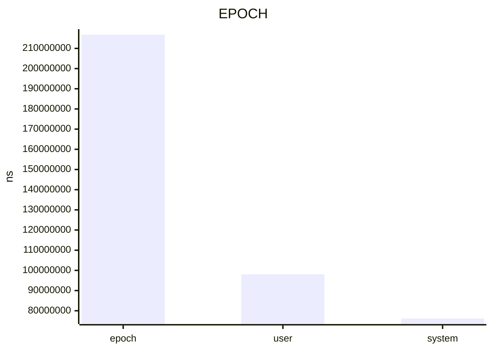

## epoch

+--------+-------+---------------------+--------------------+---------------------+---------------------+-------+------+--------------------------------------------------------------------------------------------------------------------------------------------------------------------------------------------------------------------------------+---------------------+-------------------+------------------------+
| key    | type  | value               | errorPercent       | min                 | max                 | calls | unit | samples                                                                                                                                                                                                                        | baseline            | change            | probability            |
+========+=======+=====================+====================+=====================+=====================+=======+======+================================================================================================================================================================================================================================+=====================+===================+========================+
| epoch  | float | 2.167917083333333e8 | 0.9656350248635308 | 2.136534166666667e8 | 5.301289999999999e8 | 1     | ns   | 5.301289999999999e8, 2.219945416666667e8, 2.14502125e8, 2.159800416666667e8, 2.167917083333333e8, 2.177941666666667e8, 2.146982916666667e8, 2.140344583333333e8, 2.136534166666667e8, 2.176622083333333e8, 2.172040416666667e8 | 7.440766666666666e7 | 191.3566814351568 | 0.0009128869759883767  |
+--------+-------+---------------------+--------------------+---------------------+---------------------+-------+------+--------------------------------------------------------------------------------------------------------------------------------------------------------------------------------------------------------------------------------+---------------------+-------------------+------------------------+
| user   | float | 9.8026e7            | 1.446554995613409  | 9.5927e7            | 1.15298e8           | 1     | ns   | 1.15298e8, 1.00521e8, 9.6438e7, 9.6676e7                                                                                                                                                                                       | 1.935e7             | 406.594315245478  | 0.00007105263288600171 |
|        |       |                     |                    |                     |                     |       |      | , 9.8026e7, 9.8371e7, 9.6608e7, 9.6426e7                                                                                                                                                                                       |                     |                   |                        |
|        |       |                     |                    |                     |                     |       |      | , 9.5927e7, 9.8209e7, 9.893e7                                                                                                                                                                                                  |                     |                   |                        |
+--------+-------+---------------------+--------------------+---------------------+---------------------+-------+------+--------------------------------------------------------------------------------------------------------------------------------------------------------------------------------------------------------------------------------+---------------------+-------------------+------------------------+
| system | float | 7.6143e7            | 1.258158990320844  | 7.4586e7            | 9.1177e7            | 1     | ns   | 9.1177e7, 7.8018e7, 7.5185e7, 7.5243e7, 7.6209e7, 7.6153e7, 7.4983e7, 7.4956e7, 7.4586e7, 7.623e7, 7.6143e7                                                                                                                    | 3.2986e7            | 130.834293336567  | 0.00007105263288600171 |
+--------+-------+---------------------+--------------------+---------------------+---------------------+-------+------+--------------------------------------------------------------------------------------------------------------------------------------------------------------------------------------------------------------------------------+---------------------+-------------------+------------------------+

